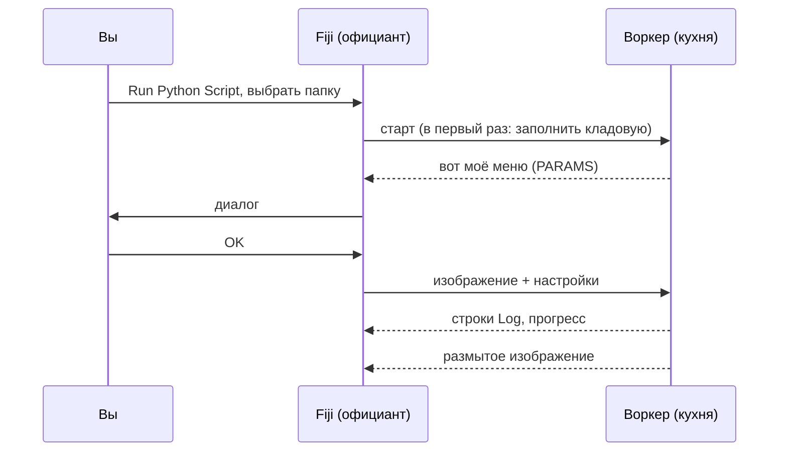

# Первый запуск

## Идея простыми словами

Время первого заказа. Мы возьмём **скрипт-шаблон** — крошечный рецепт,
который размывает изображение (гауссово размытие), — и применим его к
встроенному примеру Fiji *Blobs*. Размытие нарочно скучное: так вы видите
весь путь, от диалога до кухни и обратно, без сюрпризов.



## Шаг 1: получите папку шаблона

Скачайте шаблон как zip и распакуйте туда, где легко его найти, например в
*Документы*:

[Скачать ZIP](https://github.com/Oxford-Zeiss-Centre-of-Excellence/Wavu-Script-Template/archive/refs/heads/main.zip){ .md-button }

Получится папка `Wavu-Script-Template-main`. Внутри лежат `script.py`
(рецепт) и `pixi.toml` (список покупок для кладовой). Это и есть вся
*папка скрипта*.

!!! tip "Лишний уровень папок?"
    *Extract All* в Windows иногда создаёт папку внутри папки с тем же
    именем. Нужна та папка, в которой непосредственно лежит `pixi.toml`.

!!! note "Пока нужен Git"
    Шаблон скачивает Python-часть Wavu с GitHub, а для этого на компьютере
    должен быть установлен [Git](https://git-scm.com). Установите его один
    раз с настройками по умолчанию; *пользоваться* им не придётся.

## Шаг 2: откройте пример Blobs

В Fiji: **File › Open Samples › Blobs (25K)**.

## Шаг 3: запустите скрипт

1. Выберите **Plugins › Wavu › Run Python Script**.
2. Откроется окно выбора папки с заголовком
   *Wavu: choose a script folder (contains pixi.toml)*. Выберите папку
   `Wavu-Script-Template-main` и подтвердите.

!!! info "Первый старт занимает несколько минут, один раз"
    В окне Log написано
    *First start of '…': downloading its Python packages. This happens once
    and can take several minutes…*, а строка состояния отсчитывает секунды.
    Это pixi заполняет кладовую. Дождитесь окончания; в следующий раз скрипт
    стартует за секунды.

3. Появится диалог **Wavu: script**. В первой строке — описание скрипта,
   *Gaussian blur -- the Wavu example script.*, затем поля **Image**,
   **Sigma (pixels)**, **Edges** и **Keep the input's pixel type**, а также
   галочка **Debug in VS Code** (оставьте её выключенной).

4. Оставьте значения по умолчанию, проверьте, что в **Image** указано
   `blobs.gif`, и нажмите **OK**.

## Шаг 4: посмотрите на результат

Откроется новое изображение **blobs-blurred**: те же капли, только мягче.
Log показывает, что произошло:

```text
[Wavu] Running script [sigma:2.0, mode:reflect, keep_dtype:true]
Blurring a (254, 256) uint8 image with sigma=2.0
[Wavu] script finished
```

Попробуйте ещё раз с **Sigma (pixels)** равным `8`. Теперь запуск мгновенный:
кухня всё ещё работает, а кладовая полна.

## Что сейчас произошло?

- Fiji нашёл в папке `pixi.toml` и понял, что это папка скрипта.
- pixi собрал для этой папки собственное окружение (в скрытой папке `.pixi`).
- В этом окружении запустился воркер и сообщил Fiji, что должно быть в
  диалоге.
- Fiji отправил изображение и ваши настройки и открыл вернувшееся
  изображение.

Воркер работает, пока вы не закроете Fiji или не выберете
**Plugins › Wavu › Stop Worker** (остановить воркер).

## Одним предложением

Выберите папку скрипта в **Run Python Script**, один раз дождитесь её
окружения, заполните диалог — и результат откроется в Fiji.

[Далее: пишем свой скрипт :material-arrow-right:](../write/get-the-template.md){ .md-button }
