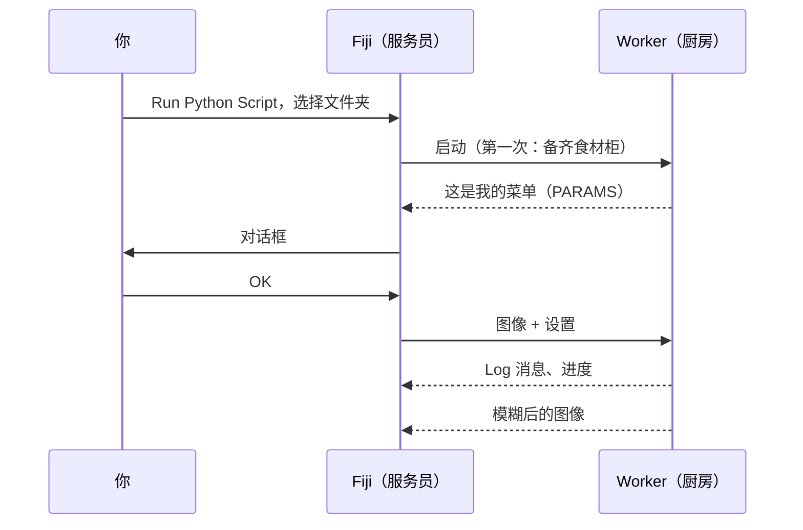

# 第一次运行

## 用大白话说

该点第一道菜了。我们会用**模板脚本**：一道把图像模糊化（高斯模糊）的小
食谱，用在 Fiji 自带的 *Blobs* 示例图像上。模糊本身故意做得很无聊：这样
你就能看清整个流程，从对话框到厨房再回来，不会有任何意外。



## 第 1 步：获取模板文件夹

把模板下载为 zip 文件，解压到一个你之后找得到的地方，例如*文档*文件夹：

[下载 ZIP](https://github.com/Oxford-Zeiss-Centre-of-Excellence/Wavu-Script-Template/archive/refs/heads/main.zip){ .md-button }

你会得到一个名为 `Wavu-Script-Template-main` 的文件夹。里面有
`script.py`（食谱）和 `pixi.toml`（它的食材柜的购物清单）。所谓
*脚本文件夹*，就这么简单。

!!! tip "多套了一层文件夹？"
    Windows 的 *Extract All*（全部解压缩）有时会在文件夹里再建一个同名
    文件夹。正确的是直接包含 `pixi.toml` 的那一层。

!!! note "目前需要 Git"
    模板会从 GitHub 下载 Wavu 自己的 Python 部分，因此电脑上需要安装
    [Git](https://git-scm.com)。用默认选项装一次即可；你完全不需要*使用*它。

## 第 2 步：打开 Blobs 示例

在 Fiji 中：**File › Open Samples › Blobs (25K)**。

## 第 3 步：运行脚本

1. 选择 **Plugins › Wavu › Run Python Script**。
2. 会弹出一个文件夹选择窗口，标题是
   *Wavu: choose a script folder (contains pixi.toml)*。选择
   `Wavu-Script-Template-main` 文件夹并确认。

!!! info "第一次启动要等几分钟，仅此一次"
    Log 窗口会显示
    *First start of '…': downloading its Python packages. This happens once
    and can take several minutes…*，状态栏也会显示已用的秒数。这是 pixi
    在备齐食材柜。让它跑完；下次这个脚本几秒内就能启动。

3. 弹出 **Wavu: script** 对话框。第一行是脚本的说明
   *Gaussian blur -- the Wavu example script.*，接着是
   **Image**、**Sigma (pixels)**、**Edges** 和
   **Keep the input's pixel type** 这几个输入项，还有一个
   **Debug in VS Code** 复选框（保持不勾选）。

4. 保留默认值，确认 **Image** 显示的是 `blobs.gif`，然后按 **OK**。

## 第 4 步：查看结果

一张名为 **blobs-blurred** 的新图像会打开：还是那些斑点，只是更柔和。
Log 会显示刚才发生了什么：

```text
[Wavu] Running script [sigma:2.0, mode:reflect, keep_dtype:true]
Blurring a (254, 256) uint8 image with sigma=2.0
[Wavu] script finished
```

把 **Sigma (pixels)** 改成 `8` 再试一次。这次会立刻开始，因为厨房还开着，
食材柜也是满的。

## 刚才发生了什么？

- Fiji 在文件夹里找到了 `pixi.toml`，因此知道这是一个脚本文件夹。
- pixi 为这个文件夹建立了专属的环境（放在隐藏的 `.pixi` 文件夹里）。
- 一个 worker（厨房）在这个环境中启动，并告诉 Fiji 对话框里该有什么。
- Fiji 发送图像和你的设置，再打开传回来的图像。

worker 会一直运行，直到你退出 Fiji，或选择
**Plugins › Wavu › Stop Worker**。

## 一句话总结

在 **Run Python Script** 中选一个脚本文件夹，等它的环境建好一次，填好
对话框，结果就会在 Fiji 中打开。

[下一步：编写你自己的脚本 :material-arrow-right:](../write/get-the-template.md){ .md-button }
