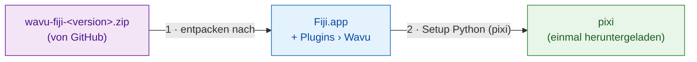
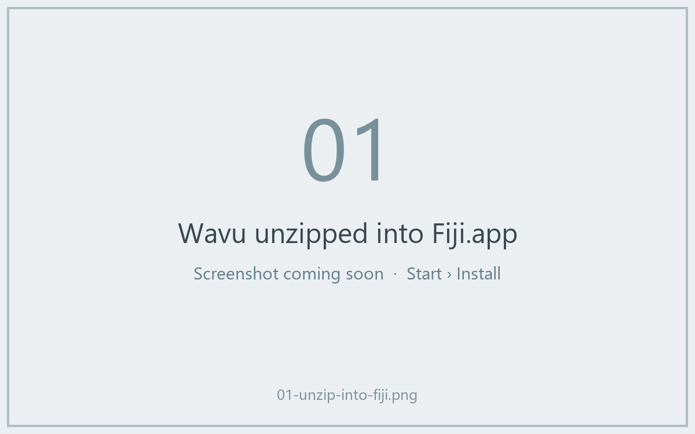
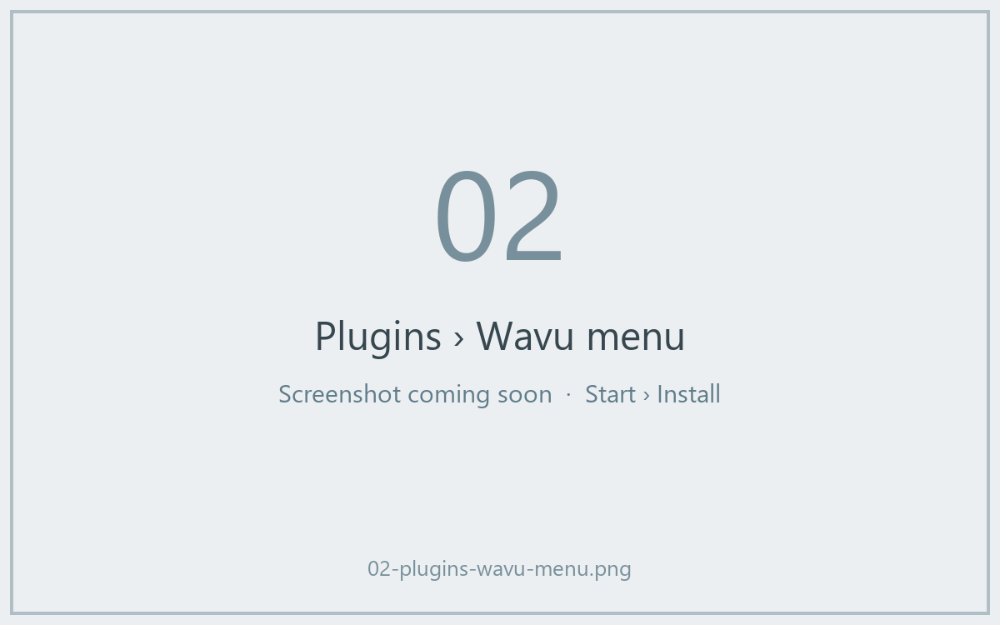
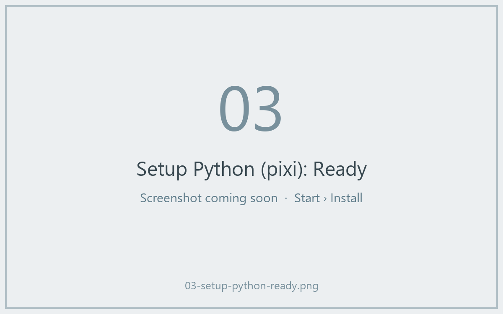

# Wavu in Fiji installieren

## Die Idee in einfachen Worten

Wavu zu installieren ist wie einen Kellner einzustellen. Sie kopieren ein
paar kleine Dateien in Fiji, wodurch ein Menü **Plugins › Wavu** dazukommt.
Dann lassen Sie Wavu **pixi** holen, das Werkzeug, das die Vorratskammer
jedes Skripts füllt (es lädt Python und die Pakete herunter, die ein Skript
braucht). Python, conda oder sonst etwas installieren Sie *nicht* selbst.



!!! note "Eine Fiji-Update-Site kommt bald"
    Bald installieren Sie Wavu, indem Sie in **Help › Update…** ein Häkchen
    setzen. Bis dahin nehmen Sie die ZIP-Datei unten. Das dauert zwei
    Minuten.

## Schritt 1: die ZIP-Datei herunterladen { #step-1-download-the-zip }

Gehen Sie zur
[neuesten Wavu-Version](https://github.com/Oxford-Zeiss-Centre-of-Excellence/Wavu/releases/latest)
und laden Sie **`wavu-fiji-<version>.zip`** herunter (unter *Assets*).

## Schritt 2: in den Fiji-Ordner entpacken { #step-2-unzip-it-into-your-fiji-folder }

Die ZIP-Datei enthält einen Ordner `scripts`. Er muss **in** Ihrem
Fiji-Ordner (`Fiji.app`) landen, neben Fijis eigenen Ordnern `scripts` und
`plugins`, sodass die Dateien in `Fiji.app/scripts/Plugins/Wavu/` liegen.

=== "Windows"

    1. Rechtsklick auf die ZIP-Datei › **Extract All…** (Alle extrahieren).
    2. Klicken Sie auf **Browse…** (Durchsuchen) und wählen Sie Ihren Ordner
       `Fiji.app`.
    3. Klicken Sie auf **Extract** (Extrahieren). Wenn Windows nach
       vorhandenen Ordnern fragt, erlauben Sie das Zusammenführen.

=== "macOS"

    `Fiji.app` ist ein besonderer Ordner (ein „Paket“), und wenn Sie im
    Finder Ordner hineinziehen, kann das Fijis Ordner `scripts` *ersetzen*,
    statt ihn zusammenzuführen. Am sichersten ist ein einziger Befehl im
    Terminal (Programme › Dienstprogramme › Terminal). Passen Sie den Pfad
    an, wenn Fiji nicht unter Programme liegt:

    ```sh
    unzip -o ~/Downloads/wavu-fiji-*.zip -d /Applications/Fiji.app
    ```

    Sie sollten ein paar Zeilen sehen wie
    `inflating: /Applications/Fiji.app/scripts/Plugins/Wavu/Run_Python_Script.groovy`.

=== "Linux"

    Nutzen Sie *Entpacken nach…* in Ihrem Dateimanager und wählen Sie
    `Fiji.app`, oder:

    ```sh
    unzip -o ~/Downloads/wavu-fiji-*.zip -d ~/Fiji.app
    ```

    Sie sollten Zeilen sehen wie
    `inflating: …/Fiji.app/scripts/Plugins/Wavu/Run_Python_Script.groovy`.



## Schritt 3: Fiji neu starten und das Menü suchen { #step-3-restart-fiji-and-look-for-the-menu }

Beenden Sie Fiji und starten Sie es neu. Öffnen Sie das Menü **Plugins**.
Weiter unten sollten Sie jetzt **Wavu** mit vier Einträgen sehen:

- **Connect to Running Worker** (mit laufendem Worker verbinden)
- **Run Python Script** (Python-Skript ausführen)
- **Setup Python (pixi)** (Python einrichten)
- **Stop Worker** (Worker stoppen)



## Schritt 4: Setup Python (pixi), einmalig { #step-4-setup-python-pixi-once }

Wählen Sie **Plugins › Wavu › Setup Python (pixi)**. Wavu lädt das
offizielle pixi-Programm herunter (etwa 20 MB), prüft, ob der Download echt
ist, und legt es in `Fiji.app/wavu/` ab (oder in `~/.wavu/bin`, falls Fijis
Ordner schreibgeschützt ist). Das Log-Fenster zeigt `Downloading pixi…` und
`Checksum OK`.

Wenn alles fertig ist, zeigt ein kleines Fenster **Ready:** und dahinter die
pixi-Version.



!!! tip "Sie haben pixi schon?"
    Wenn pixi bereits auf Ihrem Computer installiert ist, meldet Wavu
    *"pixi is already available"* und fragt, ob es trotzdem heruntergeladen
    werden soll. Klicken Sie auf **Cancel**; Wavu nimmt dann Ihr vorhandenes.

Sie können diesen Schritt sogar weglassen: Wenn ein Skript zum ersten Mal
pixi braucht, bietet Wavu an, es für Sie herunterzuladen.

## In einem Satz

Eine Datei in `Fiji.app` entpacken, Fiji neu starten und einmal auf
**Plugins › Wavu › Setup Python (pixi)** klicken: Das ist die ganze
Installation.

[Weiter: Ihr erster Durchlauf :material-arrow-right:](first-run.md){ .md-button }
