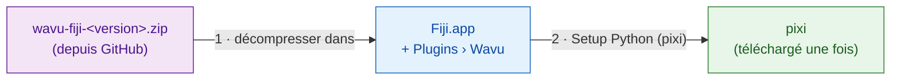

# Installer Wavu dans Fiji

## L'idée en mots simples

Installer Wavu, c'est comme embaucher le serveur. Vous copiez quelques petits
fichiers dans Fiji, ce qui ajoute un menu **Plugins › Wavu**. Ensuite, vous
demandez à Wavu d'aller chercher **pixi**, l'outil qui remplit le
garde-manger de chaque script (il télécharge Python et les paquets dont un
script a besoin). Vous n'installez *pas* vous-même Python, conda ni quoi que
ce soit d'autre.



!!! note "Un site de mise à jour Fiji arrive bientôt"
    Bientôt, vous installerez Wavu en cochant une case dans
    **Help › Update…**. En attendant, utilisez le zip ci-dessous. Cela prend
    deux minutes.

## Étape 1 : télécharger le zip { #step-1-download-the-zip }

Allez sur la
[dernière version de Wavu](https://github.com/Oxford-Zeiss-Centre-of-Excellence/Wavu/releases/latest)
et téléchargez **`wavu-fiji-<version>.zip`** (sous *Assets*).

## Étape 2 : le décompresser dans votre dossier Fiji { #step-2-unzip-it-into-your-fiji-folder }

Le zip contient un dossier `scripts`. Il doit arriver **à l'intérieur** de
votre dossier Fiji (`Fiji.app`), à côté des dossiers `scripts` et `plugins`
de Fiji, pour que les fichiers se retrouvent dans
`Fiji.app/scripts/Plugins/Wavu/`.

=== "Windows"

    1. Clic droit sur le zip › **Extract All…** (Extraire tout).
    2. Cliquez sur **Browse…** (Parcourir) et choisissez votre dossier
       `Fiji.app`.
    3. Cliquez sur **Extract** (Extraire). Si Windows pose une question sur
       des dossiers existants, autorisez la fusion.

=== "macOS"

    `Fiji.app` est un dossier spécial (un « paquet »), et y glisser des
    dossiers dans le Finder peut *remplacer* le dossier `scripts` de Fiji au
    lieu de le fusionner. Le plus sûr est une seule commande dans le Terminal
    (Applications › Utilitaires › Terminal). Changez le chemin si Fiji n'est
    pas dans Applications :

    ```sh
    unzip -o ~/Downloads/wavu-fiji-*.zip -d /Applications/Fiji.app
    ```

    Vous devriez voir quelques lignes comme
    `inflating: /Applications/Fiji.app/scripts/Plugins/Wavu/Run_Python_Script.groovy`.

=== "Linux"

    Utilisez *Extraire vers…* dans votre gestionnaire de fichiers et
    choisissez `Fiji.app`, ou :

    ```sh
    unzip -o ~/Downloads/wavu-fiji-*.zip -d ~/Fiji.app
    ```

    Vous devriez voir des lignes comme
    `inflating: …/Fiji.app/scripts/Plugins/Wavu/Run_Python_Script.groovy`.

## Étape 3 : redémarrer Fiji et chercher le menu { #step-3-restart-fiji-and-look-for-the-menu }

Quittez Fiji et relancez-le. Ouvrez le menu **Plugins**. Vers le bas, vous
devriez maintenant voir **Wavu** avec quatre entrées :

- **Connect to Running Worker** (se connecter à un worker déjà lancé)
- **Run Python Script** (lancer un script Python)
- **Setup Python (pixi)** (installer Python)
- **Stop Worker** (arrêter le worker)

## Étape 4 : Setup Python (pixi), une seule fois { #step-4-setup-python-pixi-once }

Choisissez **Plugins › Wavu › Setup Python (pixi)**. Wavu télécharge le
programme pixi officiel (environ 20 Mo), vérifie que le téléchargement est
authentique et le garde dans `Fiji.app/wavu/` (ou dans `~/.wavu/bin` si le
dossier de Fiji est en lecture seule). La fenêtre Log affiche
`Downloading pixi…` puis `Checksum OK`.

Quand c'est fini, une petite fenêtre affiche **Ready:** suivi de la version
de pixi.

!!! tip "Vous avez déjà pixi ?"
    Si pixi est déjà installé sur votre ordinateur, Wavu affiche
    *"pixi is already available"* et demande s'il faut quand même le
    télécharger. Cliquez sur **Cancel** ; Wavu utilisera celui que vous avez.

Vous pouvez même sauter cette étape : la première fois qu'un script a besoin
de pixi, Wavu propose de le télécharger pour vous.

## En une phrase

Décompressez un fichier dans `Fiji.app`, redémarrez Fiji et cliquez une fois
sur **Plugins › Wavu › Setup Python (pixi)** : c'est toute l'installation.

[Suite : votre première exécution :material-arrow-right:](first-run.md){ .md-button }
