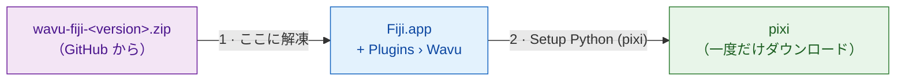

# Fiji に Wavu をインストールする

## やさしく言うと

Wavu のインストールは、ウェイターを雇うようなものです。いくつかの小さな
ファイルを Fiji にコピーすると、**Plugins › Wavu** メニューが加わります。
次に Wavu に **pixi** を取ってきてもらいます。pixi は各スクリプトの食材庫に
材料をそろえるツールです（Python とスクリプトに必要なパッケージを
ダウンロードします）。Python や conda などを自分でインストールする必要は
*ありません*。



!!! note "Fiji のアップデートサイトは近日公開"
    近いうちに、**Help › Update…** でチェックを 1 つ入れるだけで Wavu を
    インストールできるようになります。それまでは下の zip を使ってください。
    2 分で終わります。

## ステップ 1：zip をダウンロードする

[Wavu の最新リリース](https://github.com/Oxford-Zeiss-Centre-of-Excellence/Wavu/releases/latest)
を開き、**`wavu-fiji-<version>.zip`**（*Assets* の下）をダウンロードします。

## ステップ 2：Fiji フォルダーに解凍する { #step-2-unzip-it-into-your-fiji-folder }

zip には `scripts` フォルダーが入っています。これを Fiji フォルダー
（`Fiji.app`）の **中**、Fiji 自身の `scripts` フォルダーや `plugins`
フォルダーの隣に置き、ファイルが `Fiji.app/scripts/Plugins/Wavu/` に
入るようにします。

=== "Windows"

    1. zip を右クリック › **Extract All…**（すべて展開）
    2. **Browse…**（参照）をクリックし、`Fiji.app` フォルダーを選びます。
    3. **Extract**（展開）をクリックします。既存のフォルダーについて
       聞かれたら、統合を許可してください。

=== "macOS"

    `Fiji.app` は特別な「パッケージ」フォルダーで、Finder でフォルダーを
    ドラッグすると、Fiji の `scripts` フォルダーが統合されずに *置き換え*
    られてしまうことがあります。一番安全なのは、ターミナル
    （Applications › Utilities › Terminal）でコマンドを 1 つ実行する方法です。
    Fiji が Applications にない場合はパスを変えてください。

    ```sh
    unzip -o ~/Downloads/wavu-fiji-*.zip -d /Applications/Fiji.app
    ```

    `inflating: /Applications/Fiji.app/scripts/Plugins/Wavu/Run_Python_Script.groovy`
    のような行がいくつか表示されるはずです。

=== "Linux"

    ファイルマネージャーの *Extract to…* で `Fiji.app` を選ぶか、次を
    実行します。

    ```sh
    unzip -o ~/Downloads/wavu-fiji-*.zip -d ~/Fiji.app
    ```

    `inflating: …/Fiji.app/scripts/Plugins/Wavu/Run_Python_Script.groovy`
    のような行が表示されるはずです。

## ステップ 3：Fiji を再起動してメニューを探す

Fiji を終了して、もう一度起動します。**Plugins** メニューを開くと、
下のほうに 4 つの項目を持つ **Wavu** があるはずです。

- **Connect to Running Worker**（動いているワーカーに接続）
- **Run Python Script**（Python スクリプトを実行）
- **Setup Python (pixi)**（Python をセットアップ）
- **Stop Worker**（ワーカーを停止）

## ステップ 4：Setup Python (pixi) を一度だけ

**Plugins › Wavu › Setup Python (pixi)** を選びます。Wavu は公式の pixi
プログラム（約 20 MB）をダウンロードし、本物かどうかを確認してから
`Fiji.app/wavu/` に保存します（Fiji のフォルダーが読み取り専用なら
`~/.wavu/bin`）。Log ウィンドウには `Downloading pixi…` と
`Checksum OK` が表示されます。

終わると、小さなウィンドウに **Ready:** と pixi のバージョンが表示されます。

!!! tip "すでに pixi を持っている場合"
    pixi がすでにコンピューターにインストールされていると、Wavu は
    *"pixi is already available"* と表示し、それでもダウンロードするか
    聞いてきます。**Cancel** をクリックすれば、今ある pixi が使われます。

このステップは飛ばしてもかまいません。スクリプトが初めて pixi を必要とした
ときに、Wavu がダウンロードを申し出てくれます。

## ひとことで言うと

ファイルを 1 つ `Fiji.app` に解凍し、Fiji を再起動して、
**Plugins › Wavu › Setup Python (pixi)** を一度クリックする。インストールは
これで全部です。

[次へ：最初の実行 :material-arrow-right:](first-run.md){ .md-button }
