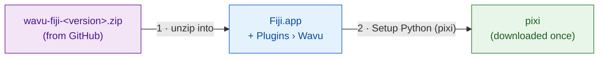
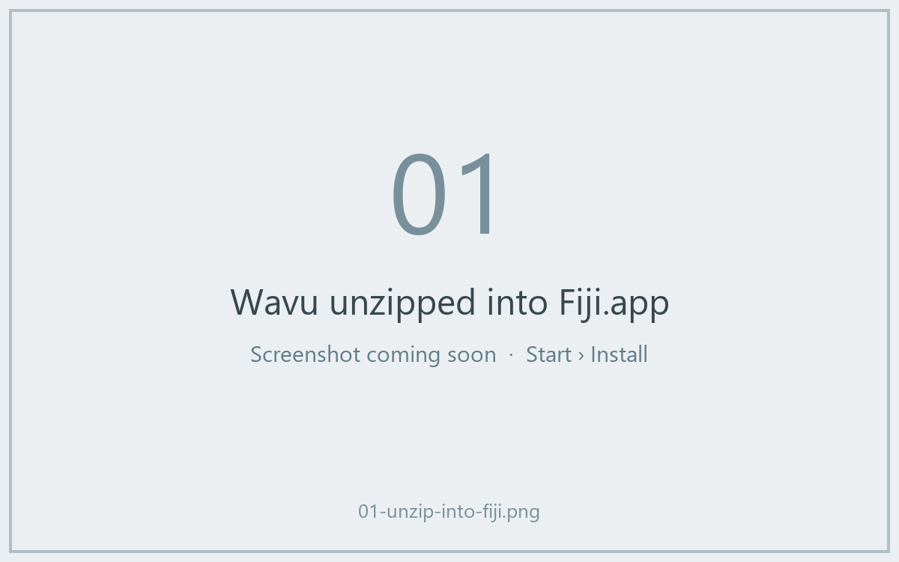
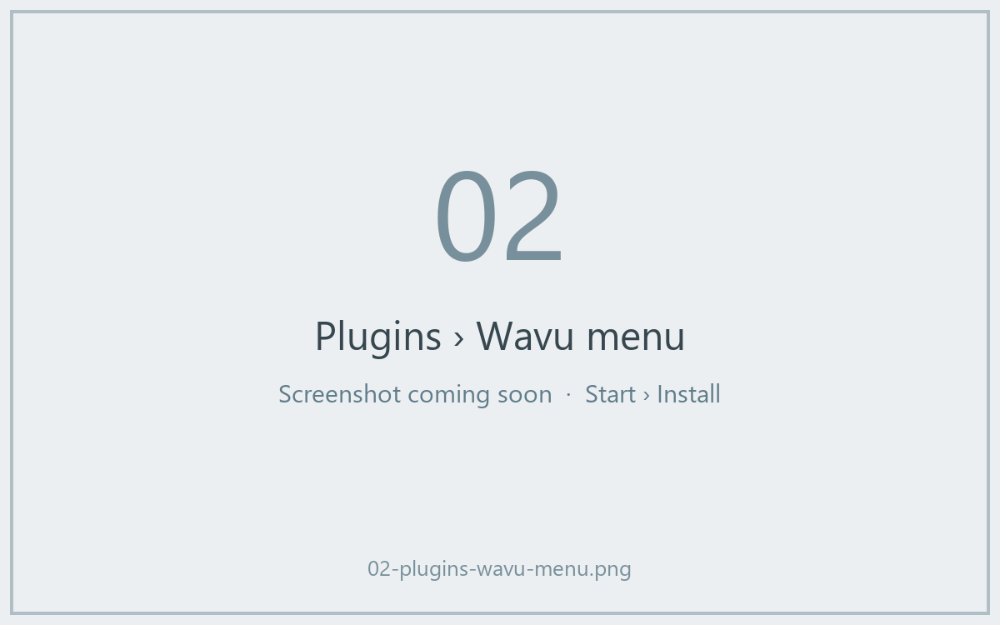
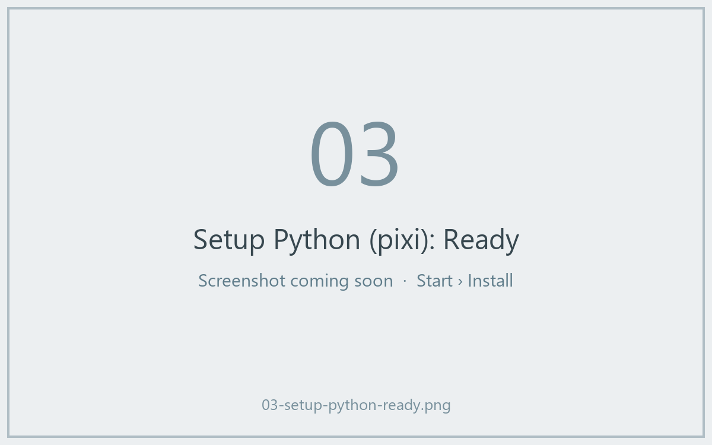

# Install Wavu in Fiji

## The idea in plain words

Installing Wavu is like hiring the waiter. You copy a few small files into
Fiji, which adds a **Plugins › Wavu** menu. Then you ask Wavu to fetch
**pixi**, the tool that stocks each script's pantry (it downloads Python and
the packages a script needs). You do *not* install Python, conda or anything
else yourself.



!!! note "A Fiji update site is coming soon"
    Soon you will install Wavu by ticking a box in **Help › Update…**. Until
    then, use the zip below. It takes two minutes.

## Step 1: download the zip

Go to the
[latest Wavu release](https://github.com/Oxford-Zeiss-Centre-of-Excellence/Wavu/releases/latest)
and download **`wavu-fiji-<version>.zip`** (under *Assets*).

## Step 2: unzip it into your Fiji folder

The zip contains a `scripts` folder. It must land **inside** your Fiji
folder (`Fiji.app`), next to Fiji's own `scripts` and `plugins` folders, so
that the files end up in `Fiji.app/scripts/Plugins/Wavu/`.

=== "Windows"

    1. Right-click the zip › **Extract All…**
    2. Click **Browse…** and choose your `Fiji.app` folder.
    3. Click **Extract**. If Windows asks about existing folders, allow it to
       merge them.

=== "macOS"

    `Fiji.app` is a special "package" folder, and dragging folders onto it in
    Finder can *replace* Fiji's `scripts` folder instead of merging it. The
    safest way is one Terminal command (Applications › Utilities ›
    Terminal). Change the path if Fiji is not in Applications:

    ```sh
    unzip -o ~/Downloads/wavu-fiji-*.zip -d /Applications/Fiji.app
    ```

    You should see a few lines such as
    `inflating: /Applications/Fiji.app/scripts/Plugins/Wavu/Run_Python_Script.groovy`.

=== "Linux"

    Use your file manager's *Extract to…* and pick `Fiji.app`, or:

    ```sh
    unzip -o ~/Downloads/wavu-fiji-*.zip -d ~/Fiji.app
    ```

    You should see lines such as
    `inflating: …/Fiji.app/scripts/Plugins/Wavu/Run_Python_Script.groovy`.



## Step 3: restart Fiji and look for the menu

Quit Fiji and start it again. Open the **Plugins** menu. Near the bottom you
should now see **Wavu** with four items:

- **Connect to Running Worker**
- **Run Python Script**
- **Setup Python (pixi)**
- **Stop Worker**



## Step 4: Setup Python (pixi), once

Choose **Plugins › Wavu › Setup Python (pixi)**. Wavu downloads the official
pixi program (about 20 MB), checks that the download is genuine, and keeps it
inside `Fiji.app/wavu/` (or in `~/.wavu/bin` if Fiji's folder is
read-only). The Log window shows `Downloading pixi…` and `Checksum OK`.

When it is done, a small window says **Ready:** followed by the pixi version.



!!! tip "Already have pixi?"
    If pixi is already installed on your computer, Wavu says
    *"pixi is already available"* and asks whether to download it anyway.
    Click **Cancel**; Wavu will use the one you have.

You can even skip this step: the first time a script needs pixi, Wavu offers
to download it for you.

## In one sentence

Unzip one file into `Fiji.app`, restart Fiji, and click
**Plugins › Wavu › Setup Python (pixi)** once: that is the whole installation.

[Next: your first run :material-arrow-right:](first-run.md){ .md-button }
