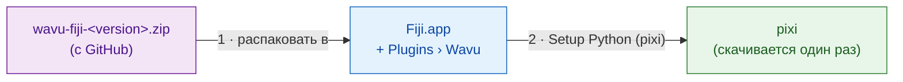
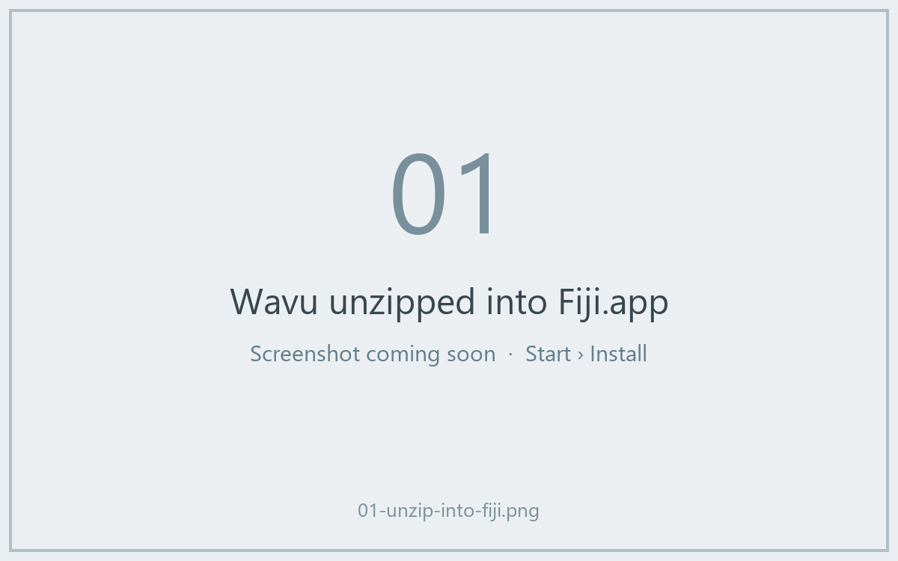
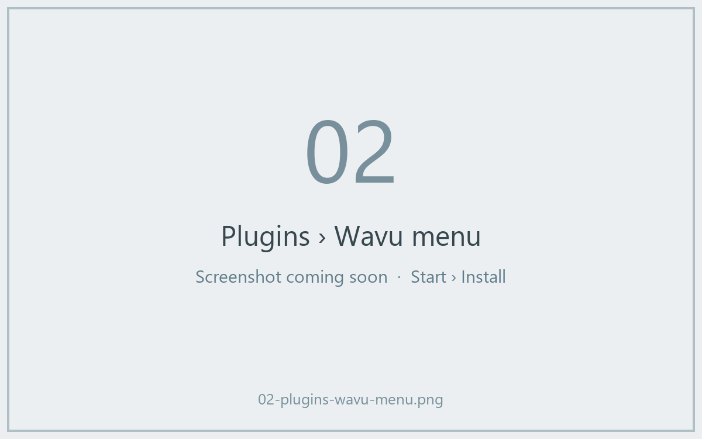
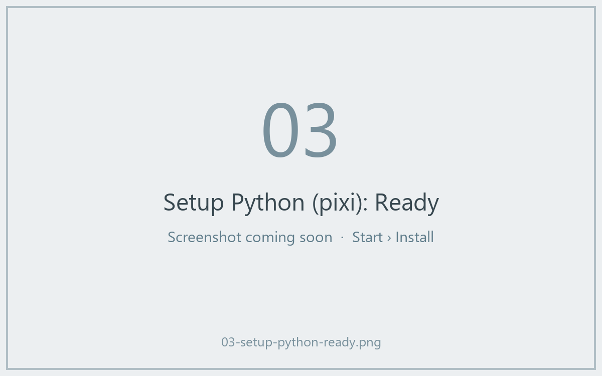

# Установка Wavu в Fiji

## Идея простыми словами

Установить Wavu — это как нанять официанта. Вы копируете несколько небольших
файлов в Fiji, и появляется меню **Plugins › Wavu**. Затем вы просите Wavu
скачать **pixi** — инструмент, который заполняет кладовую каждого скрипта (он
скачивает Python и нужные скрипту пакеты). Сами вы *не* устанавливаете ни
Python, ни conda, ни что-либо ещё.



!!! note "Скоро появится сайт обновлений Fiji"
    Скоро Wavu можно будет установить, отметив галочку в **Help › Update…**.
    А пока используйте zip-архив ниже. Это займёт две минуты.

## Шаг 1: скачайте zip

Откройте
[последний релиз Wavu](https://github.com/Oxford-Zeiss-Centre-of-Excellence/Wavu/releases/latest)
и скачайте **`wavu-fiji-<version>.zip`** (в разделе *Assets*).

## Шаг 2: распакуйте его в папку Fiji { #step-2-unzip-it-into-your-fiji-folder }

В архиве лежит папка `scripts`. Она должна оказаться **внутри** папки Fiji
(`Fiji.app`), рядом с собственными папками `scripts` и `plugins` Fiji, чтобы
файлы попали в `Fiji.app/scripts/Plugins/Wavu/`.

=== "Windows"

    1. Щёлкните по архиву правой кнопкой › **Extract All…** (извлечь все).
    2. Нажмите **Browse…** и выберите папку `Fiji.app`.
    3. Нажмите **Extract**. Если Windows спросит про существующие папки,
       разрешите их объединить.

=== "macOS"

    `Fiji.app` — особая папка-«пакет», и перетаскивание папок на неё в
    Finder может *заменить* папку `scripts` Fiji вместо объединения.
    Надёжнее всего одна команда в Терминале (Applications › Utilities ›
    Terminal). Измените путь, если Fiji лежит не в Applications:

    ```sh
    unzip -o ~/Downloads/wavu-fiji-*.zip -d /Applications/Fiji.app
    ```

    Вы увидите несколько строк вроде
    `inflating: /Applications/Fiji.app/scripts/Plugins/Wavu/Run_Python_Script.groovy`.

=== "Linux"

    Используйте *Extract to…* в файловом менеджере и выберите `Fiji.app`,
    или:

    ```sh
    unzip -o ~/Downloads/wavu-fiji-*.zip -d ~/Fiji.app
    ```

    Вы увидите строки вроде
    `inflating: …/Fiji.app/scripts/Plugins/Wavu/Run_Python_Script.groovy`.



## Шаг 3: перезапустите Fiji и найдите меню

Закройте Fiji и запустите снова. Откройте меню **Plugins**. Ближе к низу
теперь должен быть пункт **Wavu** с четырьмя командами:

- **Connect to Running Worker**
- **Run Python Script**
- **Setup Python (pixi)**
- **Stop Worker**



## Шаг 4: Setup Python (pixi), один раз

Выберите **Plugins › Wavu › Setup Python (pixi)**. Wavu скачает официальную
программу pixi (около 20 МБ), проверит подлинность загрузки и сохранит её в
`Fiji.app/wavu/` (или в `~/.wavu/bin`, если папка Fiji доступна только для
чтения). В окне Log появятся `Downloading pixi…` и `Checksum OK`.

Когда всё готово, маленькое окно покажет **Ready:** и версию pixi.



!!! tip "pixi уже установлен?"
    Если pixi уже есть на компьютере, Wavu скажет
    *"pixi is already available"* и спросит, скачать ли его всё равно.
    Нажмите **Cancel**: Wavu будет использовать ваш.

Этот шаг можно даже пропустить: когда скрипту впервые понадобится pixi, Wavu
сам предложит его скачать.

## Одним предложением

Распакуйте один файл в `Fiji.app`, перезапустите Fiji и один раз нажмите
**Plugins › Wavu › Setup Python (pixi)** — вот и вся установка.

[Далее: первый запуск :material-arrow-right:](first-run.md){ .md-button }
