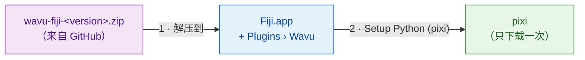
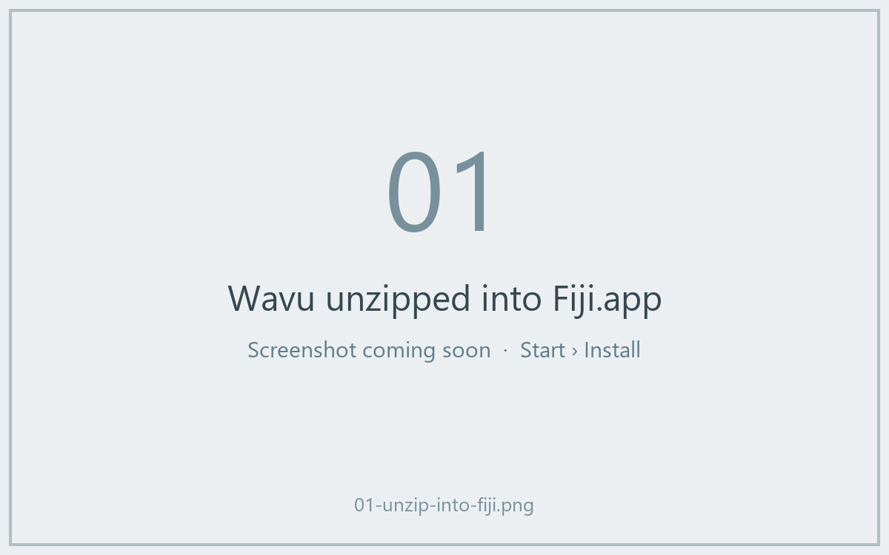
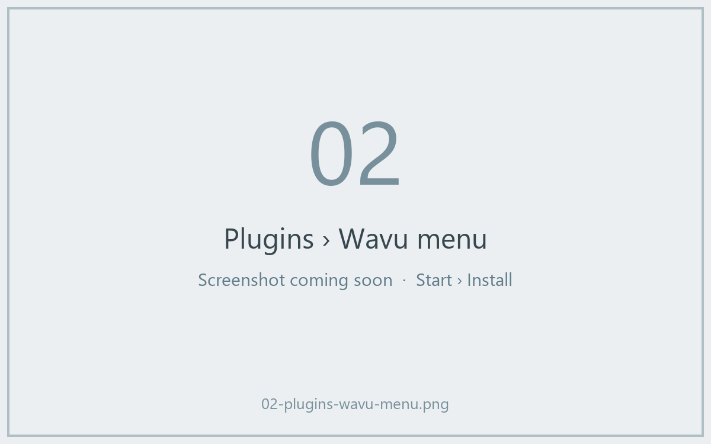
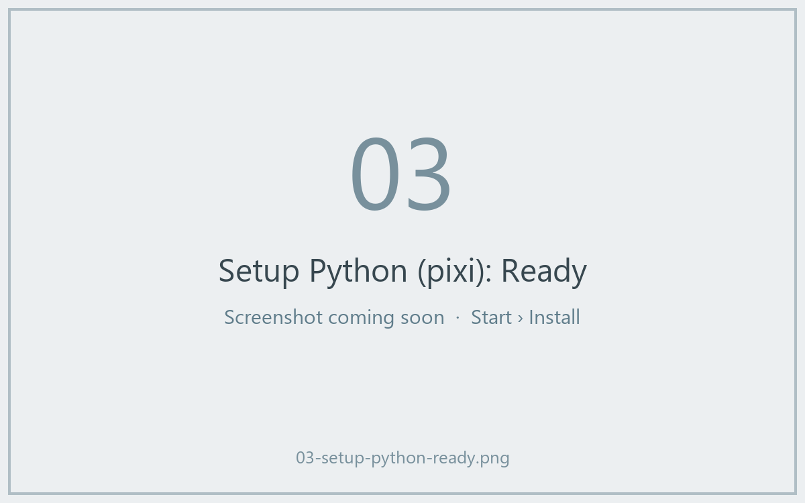

# 在 Fiji 中安装 Wavu

## 用大白话说

安装 Wavu 就像雇一位服务员。你把几个小文件复制到 Fiji 里，Fiji 就会多出
**Plugins › Wavu** 菜单。然后让 Wavu 去获取 **pixi**，也就是负责给每个
脚本备齐食材柜的工具（它会下载 Python 和脚本需要的包）。你*不用*自己安装
Python、conda 或其他任何东西。



!!! note "Fiji 更新站点即将上线"
    很快你就能在 **Help › Update…** 里勾选一个复选框来安装 Wavu。在此之前，
    请使用下面的 zip 文件，只需两分钟。

## 第 1 步：下载 zip 文件

打开
[最新的 Wavu 发布版本](https://github.com/Oxford-Zeiss-Centre-of-Excellence/Wavu/releases/latest)，
下载 **`wavu-fiji-<version>.zip`**（在 *Assets* 下面）。

## 第 2 步：解压到你的 Fiji 文件夹 { #step-2-unzip-it-into-your-fiji-folder }

zip 文件里有一个 `scripts` 文件夹。它必须放在你的 Fiji 文件夹（`Fiji.app`）
**里面**，与 Fiji 自带的 `scripts`、`plugins` 文件夹并列，这样文件才会落到
`Fiji.app/scripts/Plugins/Wavu/`。

=== "Windows"

    1. 右键单击 zip 文件 › **Extract All…**（全部解压缩）
    2. 点击 **Browse…**（浏览），选择你的 `Fiji.app` 文件夹。
    3. 点击 **Extract**（提取）。如果 Windows 询问如何处理已有文件夹，
       请允许合并。

=== "macOS"

    `Fiji.app` 是一种特殊的“包”文件夹，在访达（Finder）里把文件夹拖进去，
    可能会*替换掉* Fiji 的 `scripts` 文件夹，而不是合并。最稳妥的办法是在
    终端（Applications › Utilities › Terminal）里运行一条命令。如果 Fiji
    不在“应用程序”里，请修改路径：

    ```sh
    unzip -o ~/Downloads/wavu-fiji-*.zip -d /Applications/Fiji.app
    ```

    你应该会看到几行类似
    `inflating: /Applications/Fiji.app/scripts/Plugins/Wavu/Run_Python_Script.groovy`
    的输出。

=== "Linux"

    用文件管理器的“解压到…”并选择 `Fiji.app`，或者：

    ```sh
    unzip -o ~/Downloads/wavu-fiji-*.zip -d ~/Fiji.app
    ```

    你应该会看到类似
    `inflating: …/Fiji.app/scripts/Plugins/Wavu/Run_Python_Script.groovy`
    的输出。



## 第 3 步：重启 Fiji，找到菜单

退出 Fiji 再重新打开。打开 **Plugins** 菜单，在靠近底部的位置应该能看到
**Wavu**，下面有四个菜单项：

- **Connect to Running Worker**（连接到正在运行的 worker）
- **Run Python Script**（运行 Python 脚本）
- **Setup Python (pixi)**（配置 Python）
- **Stop Worker**（停止 worker）



## 第 4 步：运行一次 Setup Python (pixi)

选择 **Plugins › Wavu › Setup Python (pixi)**。Wavu 会下载官方的 pixi 程序
（约 20 MB），校验下载内容是否真实可靠，然后把它保存在 `Fiji.app/wavu/` 里
（如果 Fiji 的文件夹是只读的，则放在 `~/.wavu/bin`）。Log 窗口会显示
`Downloading pixi…` 和 `Checksum OK`。

完成后，一个小窗口会显示 **Ready:**，后面跟着 pixi 的版本号。



!!! tip "已经装了 pixi？"
    如果你的电脑上已经装有 pixi，Wavu 会提示
    *"pixi is already available"*，并询问是否仍要下载。点击 **Cancel**，
    Wavu 就会使用你已有的那个。

你甚至可以跳过这一步：第一次有脚本需要 pixi 时，Wavu 会主动提出帮你下载。

## 一句话总结

把一个文件解压到 `Fiji.app`、重启 Fiji，再点一次
**Plugins › Wavu › Setup Python (pixi)**：安装就全部完成了。

[下一步：第一次运行 :material-arrow-right:](first-run.md){ .md-button }
