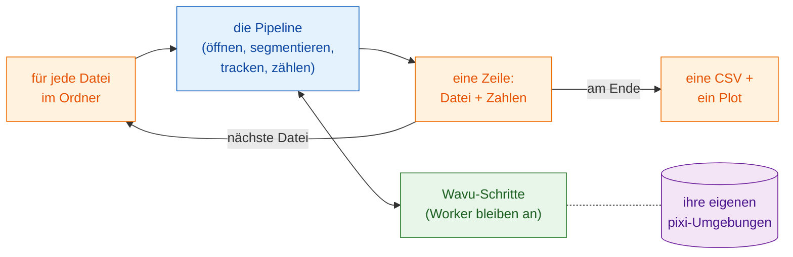

# Batch-Verarbeitung

## Die Idee in einfachen Worten { #the-idea-in-plain-words }

Die Pipeline-Seite hat ein einziges Abendessen serviert: Die Analyseschritte
waren die Gänge, ein Zeitraffer die Zutaten. Jetzt bestellt ein ganzer Tisch
voller Gäste dasselbe Menü, jeder mit eigenen Zutaten (je eine Datei). Das Rezept ändert sich nicht. Was sich ändert: Die Küchen
**heizen ihre Öfen einmal an** und halten sie heiß, der Kellner bringt die
Teller einen nach dem anderen, und am Ende schreibt er **eine Rechnung** für
den ganzen Tisch.

In Bildbegriffen: Lassen Sie **dieselbe Pipeline** über jeden Zeitraffer in
einem Ordner laufen, starten Sie die Worker einmal und verwenden Sie sie
wieder, sammeln Sie **eine Zeile pro Datei** (Dateiname und ein paar Zahlen),
schreiben Sie **eine CSV** für den Ordner und zeichnen Sie einen
Übersichtsplot.



## Bevor Sie anfangen { #before-you-start }

- Bringen Sie die Pipeline zuerst mit **einer** Datei zum Laufen:
  [Pipeline in Fiji](pipeline-fiji.md) oder
  [Pipeline in Python](pipeline-python.md). Diese Seite benutzt dieselben
  Beispielordner (`examples/segment_frames`, `examples/track_trackpy`) und
  dieselben Einstellungen; sie sind im Wavu-Repository enthalten
  ([öffnen Sie es in VS Code](vscode://vscode.git/clone?url=https%3A%2F%2Fgithub.com%2FOxford-Zeiss-Centre-of-Excellence%2FWavu.git)).
- **Ein Ordner mit Zeitraffern** (`.tif`). Zum Ausprobieren legen Sie einen
  Ordner an und kopieren `examples/data/demo_timelapse.tif` zwei- oder
  dreimal unter verschiedenen Namen hinein. Jede Kopie liefert dieselben
  Zahlen, was eine einfache Kontrolle ist.
- Ein **Ausgabeordner**, verschieden vom Eingabeordner.

## Der Code { #the-code }

In allen drei Versionen ist die Pipeline pro Datei **der Code der
Pipeline-Seite, unverändert**: dieselben Schritte, dieselben Parameter. Neu
sind nur die Schleife über die Dateien, die Übersichtszeile und das
Schließen der Fenster jeder Datei, damit der Speicher nicht vollläuft. Jede
Datei bekommt weiterhin ihre eigene `-counts.csv` und ihre Plots; der Ordner
bekommt `batch-summary.csv` und `batch-summary.png`.

=== "Groovy"

    Öffnen Sie **File › New › Script…** (neues Skript), wählen Sie
    **Language › Groovy**, fügen Sie den Code ein und drücken Sie **Run**.
    Die Schritte 1 bis 5 sind die der Groovy-Pipeline, in einer Closure
    (`analyse`), die eine Zeile zurückgibt; die einzige Änderung darin ist,
    dass Plot und Film gespeichert und geschlossen statt angezeigt werden.

    ```groovy
    #@ File (label = "Folder of time-lapses (.tif)", style = "directory") inDir
    #@ File (label = "segment_frames folder", style = "directory") segmentDir
    #@ File (label = "Output folder", style = "directory") outDir
    // Batch: die Pipeline aus „Pipeline in Fiji“ für jede .tif in einem Ordner,
    // eine Zeile pro Datei, eine CSV und ein Plot für den Ordner.
    import fiji.plugin.trackmate.Logger
    import fiji.plugin.trackmate.Model
    import fiji.plugin.trackmate.Settings
    import fiji.plugin.trackmate.TrackMate
    import fiji.plugin.trackmate.detection.LabelImageDetectorFactory
    import fiji.plugin.trackmate.tracking.jaqaman.SparseLAPTrackerFactory
    import ij.IJ
    import ij.ImagePlus
    import ij.gui.Line
    import ij.gui.OvalRoi
    import ij.gui.Overlay
    import ij.gui.Plot
    import ij.measure.ResultsTable
    import java.awt.Color

    def wavu = new GroovyShell(this.class.classLoader).evaluate(
            new File(IJ.getDirectory("imagej"), "scripts/Plugins/Wavu/lib/wavu_lib.groovy.txt"))

    // Die Pipeline für eine Datei (Schritte 1-5 der Pipeline-Seite). Gibt eine Zeile zurück.
    def analyse = { File file ->
        // 1. Den Zeitraffer öffnen (natives Fiji).
        def imp = IJ.openImage(file.path)
        if (imp == null) throw new IOException("cannot open " + file.name)
        def cal = imp.getCalibration()
        double dt = cal.frameInterval > 0 ? cal.frameInterval : 1
        int nFrames = imp.getNFrames()

        // 2. Jedes Einzelbild segmentieren (Wavu). Der für die erste Datei gestartete Worker wird wiederverwendet.
        Map seg = wavu.run(segmentDir, "script", [sigma: 2, threshold: "otsu", min_area: 30], [image: imp])
        def labels = seg.images.labels
        labels.setCalibration(cal.copy())

        // 3. Tracken (natives Fiji: TrackMate).
        def model = new Model()
        model.setLogger(Logger.VOID_LOGGER)
        def settings = new Settings(labels)
        settings.detectorFactory = new LabelImageDetectorFactory()
        settings.detectorSettings = settings.detectorFactory.getDefaultSettings()
        settings.detectorSettings["TARGET_CHANNEL"] = 1
        settings.detectorSettings["SIMPLIFY_CONTOURS"] = false
        settings.trackerFactory = new SparseLAPTrackerFactory()
        settings.trackerSettings = settings.trackerFactory.getDefaultSettings()
        settings.trackerSettings["LINKING_MAX_DISTANCE"] = 10d
        settings.trackerSettings["ALLOW_GAP_CLOSING"] = true
        settings.trackerSettings["GAP_CLOSING_MAX_DISTANCE"] = 10d
        settings.trackerSettings["MAX_FRAME_GAP"] = 2
        settings.trackerSettings["ALLOW_TRACK_SPLITTING"] = true
        settings.trackerSettings["SPLITTING_MAX_DISTANCE"] = 10d
        def trackmate = new TrackMate(model, settings)
        if (!trackmate.checkInput() || !trackmate.process())
            throw new RuntimeException("TrackMate: " + trackmate.getErrorMessage())
        def tm = model.getTrackModel()
        def trackIds = tm.trackIDs(true)

        // 4. Tabellieren: Zellen pro Bild und eine Zeile pro Track.
        def counts = new ResultsTable()
        List<Integer> perFrame = []
        for (int t = 0; t < nFrames; t++) {
            int n = model.getSpots().getNSpots(t, true)
            perFrame << n
            counts.addRow()
            counts.addValue("frame", t)
            counts.addValue("time_min", t * dt)
            counts.addValue("cells", n)
        }
        def tracks = new ResultsTable()
        int divisions = 0
        trackIds.each { id ->
            def spots = tm.trackSpots(id)
            int splits = spots.count { s -> tm.edgesOf(s).count { e -> tm.getEdgeSource(e) == s } > 1 }
            divisions += splits
            def frames = spots.collect { it.getFeature("FRAME") as int }
            tracks.addRow()
            tracks.addValue("track", id)
            tracks.addValue("spots", spots.size())
            tracks.addValue("first_frame", frames.min())
            tracks.addValue("last_frame", frames.max())
            tracks.addValue("divisions", splits)
        }
        counts.save(new File(outDir, imp.getShortTitle() + "-counts.csv").path)
        tracks.save(new File(outDir, imp.getShortTitle() + "-tracks.csv").path)

        // 5a. Plot der Zellen pro Bild (gespeichert, nicht angezeigt).
        def plot = new Plot("Cells per frame", "time (" + (cal.getTimeUnit() ?: "frame") + ")", "cells")
        plot.setColor(new Color(0x1565c0))
        plot.setLineWidth(2)
        double[] times = (0..<nFrames).collect { it * dt } as double[]
        plot.add("line", times, perFrame as double[])
        plot.add("circle", times, perFrame as double[])
        plot.setLimits(0, (nFrames - 1) * dt, 0, perFrame.max() + 5)
        IJ.saveAs(plot.getImagePlus(), "PNG", new File(outDir, imp.getShortTitle() + "-counts.png").path)

        // 5b. Tracks auf dem letzten Bild (gespeichert, nicht angezeigt).
        double px = cal.pixelWidth
        def overlay = new Overlay()
        trackIds.each { id ->
            def colour = Color.getHSBColor((float) ((id * 0.618034) % 1), 0.9f, 1f)
            tm.trackEdges(id).each { e ->
                def a = tm.getEdgeSource(e), b = tm.getEdgeTarget(e)
                def line = new Line(a.getDoublePosition(0) / px, a.getDoublePosition(1) / px,
                                    b.getDoublePosition(0) / px, b.getDoublePosition(1) / px)
                line.setStrokeColor(colour)
                overlay.add(line)
            }
            tm.trackSpots(id).each { s ->
                double r = s.getFeature("RADIUS") / px
                def ring = new OvalRoi(s.getDoublePosition(0) / px - r, s.getDoublePosition(1) / px - r, 2 * r, 2 * r)
                ring.setStrokeColor(colour)
                ring.setPosition(1, 1, (s.getFeature("FRAME") as int) + 1)
                overlay.add(ring)
            }
        }
        imp.setOverlay(overlay)
        IJ.run(imp, "Grays", "")
        imp.setT(nFrames)
        def last = new ImagePlus("last frame", imp.getProcessor().duplicate())
        last.setOverlay(new Overlay())
        overlay.each { roi -> if (roi.getTPosition() in [0, nFrames]) last.getOverlay().add(roi) }
        IJ.saveAs(last.flatten(), "PNG", new File(outDir, imp.getShortTitle() + "-tracks.png").path)
        imp.close()                                          // Speicher vor der nächsten Datei freigeben
        labels.close()

        return [frames: nFrames, times: times, perFrame: perFrame,
                tracks: trackIds.size(), divisions: divisions]
    }

    // Der Batch: Schleife, eine Zeile pro Datei, eine CSV und ein Plot für den Ordner.
    def files = inDir.listFiles().findAll { it.name.toLowerCase().endsWith(".tif") }.sort { it.name }
    def summary = new ResultsTable()
    def all = new Plot("Cells per frame, all files", "time (min)", "cells")
    try {
        files.eachWithIndex { File file, int i ->
            IJ.log("[${i + 1}/${files.size()}] ${file.name}")
            summary.addRow()
            summary.addValue("file", file.name)
            try {
                Map row = analyse(file)
                summary.addValue("frames", row.frames)
                summary.addValue("first_count", row.perFrame[0])
                summary.addValue("last_count", row.perFrame[-1])
                summary.addValue("mean_cells", (row.perFrame.sum() / row.frames) as double)
                summary.addValue("tracks", row.tracks)
                summary.addValue("divisions", row.divisions)
                summary.addValue("error", "")
                all.setColor(Color.getHSBColor((float) ((i * 0.618034) % 1), 0.8f, 0.8f))
                all.add("line", row.times, row.perFrame as double[])
            } catch (InterruptedException e) {
                throw e                                      // Esc: den ganzen Batch stoppen
            } catch (Throwable e) {                          // auch Lesefehler (Bio-Formats)
                IJ.log("  skipped ${file.name}: ${e}")          // eine fehlerhafte Datei: protokollieren, weitermachen
                summary.addValue("error", (e.message ?: e.toString()).readLines()[0])
            }
        }
    } finally {
        wavu.stopAll()                                       // den Worker einmal stoppen, am Ende
    }
    summary.show("Batch summary")
    summary.save(new File(outDir, "batch-summary.csv").path)
    all.setLimitsToFit(false)
    all.show()
    IJ.saveAs(all.getImagePlus(), "PNG", new File(outDir, "batch-summary.png").path)
    ```

=== "ImageJ macro"

    Öffnen Sie **File › New › Script…**, wählen Sie **Language › IJ1 Macro**,
    fügen Sie den Code ein und drücken Sie **Run**. Die Schritte 1 bis 5 sind
    die der Makro-Pipeline, unverändert, in einer `for`-Schleife.

    ```javascript
    // Batch: die Pipeline aus „Pipeline in Fiji“ (Makro) für jede .tif in einem Ordner.
    // Von der Kommandozeile:
    //   ImageJ-win64.exe --console -batch batch_counting.ijm "<input folder>|<segment_frames>|<track_trackpy>|<output folder>"
    arg = getArgument();
    if (arg == "") {
        inDir = getDirectory("Choose the folder of time-lapses");
        segmentDir = getDirectory("Choose the segment_frames folder");
        trackDir = getDirectory("Choose the track_trackpy folder");
        outDir = getDirectory("Choose the output folder");
    } else {
        a = split(arg, "|");
        inDir = a[0] + "/"; segmentDir = a[1]; trackDir = a[2]; outDir = a[3] + "/";
    }
    setBatchMode(true);
    list = getFileList(inDir);
    Table.create("Batch summary");

    for (f = 0; f < list.length; f++) {
        if (!endsWith(toLowerCase(list[f]), ".tif")) continue;
        print("[" + (f + 1) + "/" + list.length + "] " + list[f]);
        timelapse = inDir + list[f];

        // 1. Den Zeitraffer öffnen (natives Fiji).
        open(timelapse);
        movie = getImageID();
        name = File.nameWithoutExtension;
        dt = Stack.getFrameInterval();
        if (dt == 0) dt = 1;
        Stack.getUnits(xu, yu, zu, timeUnit, vu);
        Stack.getDimensions(w, h, channels, slices, frames);

        // 2. Jedes Einzelbild segmentieren (Wavu). Der für die erste Datei gestartete Worker wird wiederverwendet.
        run("Run Script (Macro)", "folder=[" + segmentDir + "] script=script params=[sigma=2 threshold=otsu min_area=30]");

        // 3. Tracken (Wavu: trackpy) mit der Detektionstabelle. Öffnet „tracks“.
        run("Run Script (Macro)", "folder=[" + trackDir + "] script=script params=[search_range=15 memory=2] tables=[detections=" + name + "-detections]");

        // 4. Tabellieren: Zellen pro Bild und Anzahl der Tracks.
        n = Table.size("tracks");
        cells = newArray(frames);
        times = newArray(frames);
        nTracks = 0;
        for (i = 0; i < n; i++) {
            t = Table.get("frame", i, "tracks");
            cells[t] = cells[t] + 1;
            if (i == 0 || Table.get("particle", i, "tracks") != Table.get("particle", i - 1, "tracks"))
                nTracks++;
        }
        Table.create("Cells per frame");
        for (t = 0; t < frames; t++) {
            times[t] = t * dt;
            Table.set("frame", t, t);
            Table.set("time_" + timeUnit, t, times[t]);
            Table.set("cells", t, cells[t]);
        }
        Table.update;
        Table.save(outDir + name + "-counts.csv");

        // 5a. Zellen pro Bild gegen die Zeit plotten.
        Plot.create("Cells per frame", "time (" + timeUnit + ")", "cells");
        Plot.setColor("#1565c0");
        Plot.setLineWidth(2);
        Plot.add("line", times, cells);
        Plot.add("circle", times, cells);
        Array.getStatistics(cells, cmin, cmax, cmean);
        Plot.setLimits(0, (frames - 1) * dt, 0, cmax + 5);
        Plot.show();
        saveAs("PNG", outDir + name + "-counts.png");

        // 5b. Den Weg jedes Tracks auf das Original zeichnen, eine Farbe pro Track.
        selectImage(movie);
        run("Grays");
        palette = newArray("#e6194b", "#3cb44b", "#ffe119", "#4363d8", "#f58231", "#911eb4",
                           "#46f0f0", "#f032e6", "#bcf60c", "#fabebe", "#008080", "#e6beff");
        Overlay.remove;
        for (i = 1; i < n; i++) {
            p = Table.get("particle", i, "tracks");
            if (Table.get("particle", i - 1, "tracks") != p) continue;
            setColor(palette[p % palette.length]);
            Overlay.drawLine(Table.get("x", i - 1, "tracks"), Table.get("y", i - 1, "tracks"),
                             Table.get("x", i, "tracks"), Table.get("y", i, "tracks"));
        }
        Overlay.show;
        Stack.setFrame(frames);
        run("Flatten", "slice");
        saveAs("PNG", outDir + name + "-tracks.png");

        // Batch: eine Zeile für diese Datei, dann alles schließen, was sie geöffnet hat.
        r = Table.size("Batch summary");
        Table.set("file", r, list[f], "Batch summary");
        Table.set("frames", r, frames, "Batch summary");
        Table.set("first_count", r, cells[0], "Batch summary");
        Table.set("last_count", r, cells[frames - 1], "Batch summary");
        Table.set("mean_cells", r, cmean, "Batch summary");
        Table.set("tracks", r, nTracks, "Batch summary");
        close("*");                                    // alle Bilder: Film, Labels, Plot, Schnappschuss
        close(name + "-detections");
        close(name + "-count_per_frame");
        close("tracks");
        close("Cells per frame");
    }

    // Der Ordner: eine CSV und ein Übersichtsplot.
    Table.save(outDir + "batch-summary.csv", "Batch summary");
    last = Table.getColumn("last_count", "Batch summary");
    mean = Table.getColumn("mean_cells", "Batch summary");
    x = Array.getSequence(last.length);
    Plot.create("Batch summary", "file (0 = first)", "cells");
    Plot.setColor("#1565c0");
    Plot.add("circle", x, last);
    Plot.setColor("#ef6c00");
    Plot.add("circle", x, mean);
    Plot.setLegend("final count\tmean per frame");
    Plot.show();
    saveAs("PNG", outDir + "batch-summary.png");
    setBatchMode("exit and display");
    run("Stop Worker");                                // beide Worker stoppen, einmal
    ```

=== "Python"

    Speichern Sie dies als `batch_counting.py` **neben**
    `examples/pipelines/dag_counting.py`, damit es die Ordner und
    Einstellungen dieser Datei importieren kann. `analyse_one` ist der Rumpf
    von `analyse()` mit einer Änderung: Es bekommt die beiden laufenden Worker
    übergeben, statt sie zu starten, sodass sie für den ganzen Ordner nur
    einmal starten.

    ```python
    """Batch: the dag_counting pipeline for every time-lapse in a folder.

        pixi run -e napari python examples/pipelines/batch_counting.py <folder> [<output folder>]
    """
    import sys
    from pathlib import Path

    import pandas as pd
    import tifffile
    from matplotlib.figure import Figure

    from dag_counting import FRAME_MIN, PIXEL_UM, SEGMENT, TRACK
    from wavu.client import JobCancelled, Worker


    def analyse_one(movie_path, seg, trk):
        """Steps 1-4 of dag_counting.analyse(), with workers that are already running."""
        movie = tifffile.imread(movie_path)
        res = seg.run("script", {"sigma": 2.0, "threshold": "otsu", "min_area": 30},
                      {"image": movie}, meta={"image": {"pixel_um": PIXEL_UM}})
        detections = res.outputs["detections"].value
        res = trk.run("script", {"search_range": 10.0, "memory": 2},
                      {"detections": detections})
        tracks = res.outputs["tracks"].value
        counts = (detections.groupby("frame").size()
                  .reindex(range(len(movie)), fill_value=0).rename("cells").reset_index())
        counts["minutes"] = counts["frame"] * FRAME_MIN
        per_track = tracks.groupby("particle")["frame"].agg(start="min", end="max", length="size")
        row = {
            "frames": len(movie),
            "first_count": int(counts["cells"].iloc[0]),
            "last_count": int(counts["cells"].iloc[-1]),
            "mean_cells": float(counts["cells"].mean()),
            "tracks": int(tracks["particle"].nunique()),
            "new_tracks": int((per_track["start"] > 0).sum()),
        }
        return counts, row


    def main(folder: Path, out: Path):
        out.mkdir(parents=True, exist_ok=True)
        files = sorted(folder.glob("*.tif"))
        rows, curves = [], {}
        with Worker.start(SEGMENT, on_log=print) as seg, Worker.start(TRACK, on_log=print) as trk:
            for i, path in enumerate(files, 1):
                print(f"[{i}/{len(files)}] {path.name}")
                try:
                    counts, row = analyse_one(path, seg, trk)
                except JobCancelled:
                    raise                                   # abgebrochen: den ganzen Batch stoppen
                except Exception as e:                      # eine fehlerhafte Datei: protokollieren, weitermachen
                    print(f"  skipped {path.name}: {e}")
                    rows.append({"file": path.name, "error": str(e).split("\n")[0]})
                    continue
                counts.to_csv(out / f"{path.stem}-counts.csv", index=False)
                rows.append({"file": path.name, **row})
                curves[path.stem] = counts

        summary = pd.DataFrame(rows)
        summary.to_csv(out / "batch-summary.csv", index=False)
        print(summary.to_string(index=False))

        fig = Figure(figsize=(6, 3.5), layout="constrained")
        ax = fig.add_subplot()
        for name, counts in curves.items():
            ax.plot(counts["minutes"], counts["cells"], label=name)
        ax.set_xlabel("time (min)")
        ax.set_ylabel("cells")
        ax.set_title("Cells per frame, all files")
        ax.legend(fontsize="small")
        fig.savefig(out / "batch-summary.png", dpi=120)


    if __name__ == "__main__":
        main(Path(sys.argv[1]), Path(sys.argv[2]) if len(sys.argv) > 2 else Path("batch_out"))
    ```

## Was Sie bekommen { #what-you-get }

Im Ausgabeordner:

- für **jede Datei** dieselben Dateien wie auf der Pipeline-Seite:
  `<name>-counts.csv`, `<name>-counts.png` und `<name>-tracks.png` (Fiji)
  oder `<name>-counts.csv` (Python);
- für den **Ordner** `batch-summary.csv` mit einer Zeile pro Datei und
  `batch-summary.png`.

| Spalte | Bedeutung |
|---|---|
| `file` | der Dateiname |
| `frames` | Anzahl der Einzelbilder |
| `first_count`, `last_count` | Zellen im ersten und letzten Bild |
| `mean_cells` | mittlere Zellzahl pro Bild |
| `tracks` | Anzahl der Tracks |
| `divisions` | nur Groovy: die Track-Verzweigungen von TrackMate |
| `new_tracks` | nur Python: Tracks, die nach Bild 0 beginnen |
| `error` | Groovy und Python: warum eine Datei übersprungen wurde |

Der Übersichtsplot zeigt die Zellen-pro-Bild-Kurve jeder Datei auf einer
gemeinsamen Achse (Groovy, Python) oder die End- und Mittelwerte pro Datei
(Makro). Mit Kopien des Demo-Films sind jede Zeile und jede Kurve gleich:
25 Zellen am Anfang, 29 am Ende.

## Tipps { #tips }

- **Nur die erste Datei ist langsam.** Der erste Wavu-Aufruf startet den
  Worker (und richtet beim allerersten Mal seine Küchengeräte ein). Jeder
  spätere Aufruf verwendet ihn wieder. Deshalb werden die Worker **nach** der
  Schleife gestoppt, nicht darin.
- **Eine fehlerhafte Datei soll den Batch nicht stoppen.** Die Groovy- und
  die Python-Version fangen den Fehler ab, protokollieren den Dateinamen,
  fügen eine Zeile mit einer Spalte `error` hinzu und machen weiter. Ein
  ImageJ-Makro kann keine Fehler abfangen: Ein fehlgeschlagener Wavu-Schritt
  stoppt das ganze Makro. Das Log zeigt die zuletzt begonnene Datei;
  verschieben Sie diese Datei aus dem Ordner oder reparieren Sie sie, und
  starten Sie erneut.
- **Anhalten.** Drücken Sie **Esc** in Fiji (oder **Ctrl+C** in einem
  Terminal für Python). Der laufende Wavu-Schritt wird abgebrochen, und der
  Batch stoppt, statt mit der nächsten Datei weiterzumachen. Wird ein Makro
  mittendrin angehalten, beenden Sie die Worker mit
  **Plugins › Wavu › Stop Worker**.
- **Speicher.** Schließen Sie jedes Bild und jede Tabelle, die eine Datei
  geöffnet hat, bevor die nächste kommt (`imp.close()`, `close("*")`). In
  Python werden die Arrays freigegeben, wenn die nächste Datei sie ersetzt.
  Sonst wächst der Speicherverbrauch mit jeder Datei.
- **Erst prüfen, dann vertrauen.** Sehen Sie sich ein oder zwei Plots pro
  Datei und Track-Schnappschüsse mit eigenen Augen an. Eine
  Übersichtstabelle versteckt eine schlechte Segmentierung sehr gut.
- **Wann Sie zu großen Daten wechseln.** Batch-Verarbeitung ist für **viele
  Dateien, die jeweils in den Arbeitsspeicher passen** (etwa 1–2 GB pro
  Datei). Ist eine einzelne Datei größer, nehmen Sie die
  [Streaming-Analyse](large-data.md). Für Tausende von Dateien oder viele
  Stunden Arbeit lassen Sie die Python-Version in einem Terminal ohne
  Betrachter laufen, oder auf einem Cluster.

## In einem Satz { #in-one-sentence }

Schreiben Sie die Pipeline für eine Datei, packen Sie sie in eine Schleife,
lassen Sie die Worker einmal starten und jede Datei bedienen, machen Sie an
fehlerhaften Dateien vorbei weiter und sammeln Sie eine Zeile pro Datei in
einer CSV und einem Plot für den Ordner.

[Weiter: Große Daten :material-arrow-right:](large-data.md){ .md-button }
