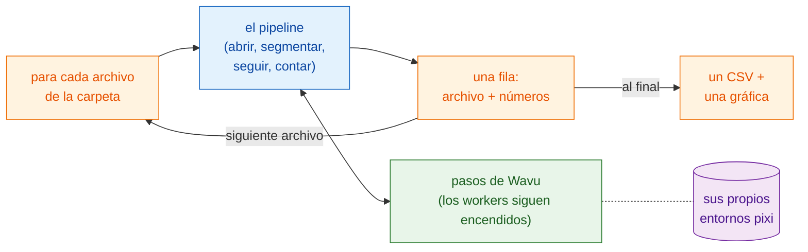

# Procesamiento por lotes

## La idea en palabras sencillas

La página del pipeline sirvió una cena: los pasos del análisis eran los
platos y una serie temporal, los ingredientes. Ahora una mesa entera de
invitados pide el mismo menú, cada uno con sus propios ingredientes (un
archivo cada uno). La
receta no cambia. Lo que cambia es que las cocinas **encienden los hornos
una sola vez** y los mantienen calientes, el camarero trae los platos uno
detrás de otro y, al final, escribe **una sola cuenta** para toda la mesa.

En términos de imágenes: ejecuta el **mismo pipeline** sobre cada serie
temporal de una carpeta, arranca los workers una vez y reutilízalos, reúne
**una fila por archivo** (el nombre del archivo y unos pocos números),
escribe **un CSV** para la carpeta y dibuja una gráfica de resumen.



## Antes de empezar

- Haz que el pipeline funcione primero con **un** archivo:
  [Pipeline en Fiji](pipeline-fiji.md) o
  [Pipeline en Python](pipeline-python.md). Esta página usa las mismas
  carpetas de ejemplo (`examples/segment_frames`, `examples/track_trackpy`)
  y los mismos ajustes; vienen con el repositorio de Wavu
  ([ábrelo en VS Code](vscode://vscode.git/clone?url=https%3A%2F%2Fgithub.com%2FOxford-Zeiss-Centre-of-Excellence%2FWavu.git)).
- **Una carpeta de series temporales** (`.tif`). Para probarlo, crea una
  carpeta y copia en ella `examples/data/demo_timelapse.tif` dos o tres
  veces con nombres distintos. Todas las copias dan los mismos números, lo
  que es una comprobación fácil.
- Una **carpeta de salida**, distinta de la carpeta de entrada.

## El código

En las tres versiones, el pipeline de cada archivo es **el código de la
página del pipeline, sin cambios**: los mismos pasos, los mismos
parámetros. Lo único que se añade es el bucle sobre los archivos, la fila
de resumen y el cierre de las ventanas de cada archivo para que la memoria
no se llene. Cada archivo sigue teniendo su propio `-counts.csv` y sus
gráficas; la carpeta recibe `batch-summary.csv` y `batch-summary.png`.

=== "Groovy"

    Abre **File › New › Script…**, elige **Language › Groovy**, pega el
    código y pulsa **Run**. Los pasos 1 a 5 son los del pipeline en Groovy,
    dentro de un closure (`analyse`) que devuelve una fila; el único cambio
    en ellos es que la gráfica y la película se guardan y se cierran en
    lugar de mostrarse.

    ```groovy
    #@ File (label = "Folder of time-lapses (.tif)", style = "directory") inDir
    #@ File (label = "segment_frames folder", style = "directory") segmentDir
    #@ File (label = "Output folder", style = "directory") outDir
    // Por lotes: el pipeline de "Pipeline en Fiji" para cada .tif de una carpeta,
    // una fila por archivo, un CSV y una gráfica para la carpeta.
    import fiji.plugin.trackmate.Logger
    import fiji.plugin.trackmate.Model
    import fiji.plugin.trackmate.Settings
    import fiji.plugin.trackmate.TrackMate
    import fiji.plugin.trackmate.detection.LabelImageDetectorFactory
    import fiji.plugin.trackmate.tracking.jaqaman.SparseLAPTrackerFactory
    import ij.IJ
    import ij.ImagePlus
    import ij.gui.Line
    import ij.gui.OvalRoi
    import ij.gui.Overlay
    import ij.gui.Plot
    import ij.measure.ResultsTable
    import java.awt.Color

    def wavu = new GroovyShell(this.class.classLoader).evaluate(
            new File(IJ.getDirectory("imagej"), "scripts/Plugins/Wavu/lib/wavu_lib.groovy.txt"))

    // El pipeline para un archivo (pasos 1-5 de la página del pipeline). Devuelve una fila.
    def analyse = { File file ->
        // 1. Abrir la serie temporal (Fiji nativo).
        def imp = IJ.openImage(file.path)
        if (imp == null) throw new IOException("cannot open " + file.name)
        def cal = imp.getCalibration()
        double dt = cal.frameInterval > 0 ? cal.frameInterval : 1
        int nFrames = imp.getNFrames()

        // 2. Segmentar cada fotograma (Wavu). Se reutiliza el worker arrancado para el primer archivo.
        Map seg = wavu.run(segmentDir, "script", [sigma: 2, threshold: "otsu", min_area: 30], [image: imp])
        def labels = seg.images.labels
        labels.setCalibration(cal.copy())

        // 3. Seguir (Fiji nativo: TrackMate).
        def model = new Model()
        model.setLogger(Logger.VOID_LOGGER)
        def settings = new Settings(labels)
        settings.detectorFactory = new LabelImageDetectorFactory()
        settings.detectorSettings = settings.detectorFactory.getDefaultSettings()
        settings.detectorSettings["TARGET_CHANNEL"] = 1
        settings.detectorSettings["SIMPLIFY_CONTOURS"] = false
        settings.trackerFactory = new SparseLAPTrackerFactory()
        settings.trackerSettings = settings.trackerFactory.getDefaultSettings()
        settings.trackerSettings["LINKING_MAX_DISTANCE"] = 10d
        settings.trackerSettings["ALLOW_GAP_CLOSING"] = true
        settings.trackerSettings["GAP_CLOSING_MAX_DISTANCE"] = 10d
        settings.trackerSettings["MAX_FRAME_GAP"] = 2
        settings.trackerSettings["ALLOW_TRACK_SPLITTING"] = true
        settings.trackerSettings["SPLITTING_MAX_DISTANCE"] = 10d
        def trackmate = new TrackMate(model, settings)
        if (!trackmate.checkInput() || !trackmate.process())
            throw new RuntimeException("TrackMate: " + trackmate.getErrorMessage())
        def tm = model.getTrackModel()
        def trackIds = tm.trackIDs(true)

        // 4. Tabular: células por fotograma, y una fila por trayectoria.
        def counts = new ResultsTable()
        List<Integer> perFrame = []
        for (int t = 0; t < nFrames; t++) {
            int n = model.getSpots().getNSpots(t, true)
            perFrame << n
            counts.addRow()
            counts.addValue("frame", t)
            counts.addValue("time_min", t * dt)
            counts.addValue("cells", n)
        }
        def tracks = new ResultsTable()
        int divisions = 0
        trackIds.each { id ->
            def spots = tm.trackSpots(id)
            int splits = spots.count { s -> tm.edgesOf(s).count { e -> tm.getEdgeSource(e) == s } > 1 }
            divisions += splits
            def frames = spots.collect { it.getFeature("FRAME") as int }
            tracks.addRow()
            tracks.addValue("track", id)
            tracks.addValue("spots", spots.size())
            tracks.addValue("first_frame", frames.min())
            tracks.addValue("last_frame", frames.max())
            tracks.addValue("divisions", splits)
        }
        counts.save(new File(outDir, imp.getShortTitle() + "-counts.csv").path)
        tracks.save(new File(outDir, imp.getShortTitle() + "-tracks.csv").path)

        // 5a. Gráfica de células por fotograma (se guarda, no se muestra).
        def plot = new Plot("Cells per frame", "time (" + (cal.getTimeUnit() ?: "frame") + ")", "cells")
        plot.setColor(new Color(0x1565c0))
        plot.setLineWidth(2)
        double[] times = (0..<nFrames).collect { it * dt } as double[]
        plot.add("line", times, perFrame as double[])
        plot.add("circle", times, perFrame as double[])
        plot.setLimits(0, (nFrames - 1) * dt, 0, perFrame.max() + 5)
        IJ.saveAs(plot.getImagePlus(), "PNG", new File(outDir, imp.getShortTitle() + "-counts.png").path)

        // 5b. Trayectorias sobre el último fotograma (se guarda, no se muestra).
        double px = cal.pixelWidth
        def overlay = new Overlay()
        trackIds.each { id ->
            def colour = Color.getHSBColor((float) ((id * 0.618034) % 1), 0.9f, 1f)
            tm.trackEdges(id).each { e ->
                def a = tm.getEdgeSource(e), b = tm.getEdgeTarget(e)
                def line = new Line(a.getDoublePosition(0) / px, a.getDoublePosition(1) / px,
                                    b.getDoublePosition(0) / px, b.getDoublePosition(1) / px)
                line.setStrokeColor(colour)
                overlay.add(line)
            }
            tm.trackSpots(id).each { s ->
                double r = s.getFeature("RADIUS") / px
                def ring = new OvalRoi(s.getDoublePosition(0) / px - r, s.getDoublePosition(1) / px - r, 2 * r, 2 * r)
                ring.setStrokeColor(colour)
                ring.setPosition(1, 1, (s.getFeature("FRAME") as int) + 1)
                overlay.add(ring)
            }
        }
        imp.setOverlay(overlay)
        IJ.run(imp, "Grays", "")
        imp.setT(nFrames)
        def last = new ImagePlus("last frame", imp.getProcessor().duplicate())
        last.setOverlay(new Overlay())
        overlay.each { roi -> if (roi.getTPosition() in [0, nFrames]) last.getOverlay().add(roi) }
        IJ.saveAs(last.flatten(), "PNG", new File(outDir, imp.getShortTitle() + "-tracks.png").path)
        imp.close()                                          // liberar la memoria antes del siguiente archivo
        labels.close()

        return [frames: nFrames, times: times, perFrame: perFrame,
                tracks: trackIds.size(), divisions: divisions]
    }

    // El lote: bucle, una fila por archivo, un CSV y una gráfica para la carpeta.
    def files = inDir.listFiles().findAll { it.name.toLowerCase().endsWith(".tif") }.sort { it.name }
    def summary = new ResultsTable()
    def all = new Plot("Cells per frame, all files", "time (min)", "cells")
    try {
        files.eachWithIndex { File file, int i ->
            IJ.log("[${i + 1}/${files.size()}] ${file.name}")
            summary.addRow()
            summary.addValue("file", file.name)
            try {
                Map row = analyse(file)
                summary.addValue("frames", row.frames)
                summary.addValue("first_count", row.perFrame[0])
                summary.addValue("last_count", row.perFrame[-1])
                summary.addValue("mean_cells", (row.perFrame.sum() / row.frames) as double)
                summary.addValue("tracks", row.tracks)
                summary.addValue("divisions", row.divisions)
                summary.addValue("error", "")
                all.setColor(Color.getHSBColor((float) ((i * 0.618034) % 1), 0.8f, 0.8f))
                all.add("line", row.times, row.perFrame as double[])
            } catch (InterruptedException e) {
                throw e                                      // Esc: detener todo el lote
            } catch (Throwable e) {                          // también errores del lector (Bio-Formats)
                IJ.log("  skipped ${file.name}: ${e}")          // un archivo malo: anotarlo y seguir
                summary.addValue("error", (e.message ?: e.toString()).readLines()[0])
            }
        }
    } finally {
        wavu.stopAll()                                       // detener el worker una vez, al final
    }
    summary.show("Batch summary")
    summary.save(new File(outDir, "batch-summary.csv").path)
    all.setLimitsToFit(false)
    all.show()
    IJ.saveAs(all.getImagePlus(), "PNG", new File(outDir, "batch-summary.png").path)
    ```

=== "ImageJ macro"

    Abre **File › New › Script…**, elige **Language › IJ1 Macro**, pega el
    código y pulsa **Run**. Los pasos 1 a 5 son los del pipeline en macro,
    sin cambios, dentro de un bucle `for`.

    ```javascript
    // Por lotes: el pipeline de "Pipeline en Fiji" (macro) para cada .tif de una carpeta.
    // Desde la línea de comandos:
    //   ImageJ-win64.exe --console -batch batch_counting.ijm "<input folder>|<segment_frames>|<track_trackpy>|<output folder>"
    arg = getArgument();
    if (arg == "") {
        inDir = getDirectory("Choose the folder of time-lapses");
        segmentDir = getDirectory("Choose the segment_frames folder");
        trackDir = getDirectory("Choose the track_trackpy folder");
        outDir = getDirectory("Choose the output folder");
    } else {
        a = split(arg, "|");
        inDir = a[0] + "/"; segmentDir = a[1]; trackDir = a[2]; outDir = a[3] + "/";
    }
    setBatchMode(true);
    list = getFileList(inDir);
    Table.create("Batch summary");

    for (f = 0; f < list.length; f++) {
        if (!endsWith(toLowerCase(list[f]), ".tif")) continue;
        print("[" + (f + 1) + "/" + list.length + "] " + list[f]);
        timelapse = inDir + list[f];

        // 1. Abrir la serie temporal (Fiji nativo).
        open(timelapse);
        movie = getImageID();
        name = File.nameWithoutExtension;
        dt = Stack.getFrameInterval();
        if (dt == 0) dt = 1;
        Stack.getUnits(xu, yu, zu, timeUnit, vu);
        Stack.getDimensions(w, h, channels, slices, frames);

        // 2. Segmentar cada fotograma (Wavu). Se reutiliza el worker arrancado para el primer archivo.
        run("Run Script (Macro)", "folder=[" + segmentDir + "] script=script params=[sigma=2 threshold=otsu min_area=30]");

        // 3. Seguir (Wavu: trackpy), dada la tabla de detecciones. Abre "tracks".
        run("Run Script (Macro)", "folder=[" + trackDir + "] script=script params=[search_range=15 memory=2] tables=[detections=" + name + "-detections]");

        // 4. Tabular: células por fotograma y número de trayectorias.
        n = Table.size("tracks");
        cells = newArray(frames);
        times = newArray(frames);
        nTracks = 0;
        for (i = 0; i < n; i++) {
            t = Table.get("frame", i, "tracks");
            cells[t] = cells[t] + 1;
            if (i == 0 || Table.get("particle", i, "tracks") != Table.get("particle", i - 1, "tracks"))
                nTracks++;
        }
        Table.create("Cells per frame");
        for (t = 0; t < frames; t++) {
            times[t] = t * dt;
            Table.set("frame", t, t);
            Table.set("time_" + timeUnit, t, times[t]);
            Table.set("cells", t, cells[t]);
        }
        Table.update;
        Table.save(outDir + name + "-counts.csv");

        // 5a. Gráfica de células por fotograma frente al tiempo.
        Plot.create("Cells per frame", "time (" + timeUnit + ")", "cells");
        Plot.setColor("#1565c0");
        Plot.setLineWidth(2);
        Plot.add("line", times, cells);
        Plot.add("circle", times, cells);
        Array.getStatistics(cells, cmin, cmax, cmean);
        Plot.setLimits(0, (frames - 1) * dt, 0, cmax + 5);
        Plot.show();
        saveAs("PNG", outDir + name + "-counts.png");

        // 5b. Dibujar el camino de cada trayectoria sobre el original, un color por trayectoria.
        selectImage(movie);
        run("Grays");
        palette = newArray("#e6194b", "#3cb44b", "#ffe119", "#4363d8", "#f58231", "#911eb4",
                           "#46f0f0", "#f032e6", "#bcf60c", "#fabebe", "#008080", "#e6beff");
        Overlay.remove;
        for (i = 1; i < n; i++) {
            p = Table.get("particle", i, "tracks");
            if (Table.get("particle", i - 1, "tracks") != p) continue;
            setColor(palette[p % palette.length]);
            Overlay.drawLine(Table.get("x", i - 1, "tracks"), Table.get("y", i - 1, "tracks"),
                             Table.get("x", i, "tracks"), Table.get("y", i, "tracks"));
        }
        Overlay.show;
        Stack.setFrame(frames);
        run("Flatten", "slice");
        saveAs("PNG", outDir + name + "-tracks.png");

        // Lote: una fila para este archivo, luego cerrar todo lo que abrió.
        r = Table.size("Batch summary");
        Table.set("file", r, list[f], "Batch summary");
        Table.set("frames", r, frames, "Batch summary");
        Table.set("first_count", r, cells[0], "Batch summary");
        Table.set("last_count", r, cells[frames - 1], "Batch summary");
        Table.set("mean_cells", r, cmean, "Batch summary");
        Table.set("tracks", r, nTracks, "Batch summary");
        close("*");                                    // todas las imágenes: película, etiquetas, gráfica, captura
        close(name + "-detections");
        close(name + "-count_per_frame");
        close("tracks");
        close("Cells per frame");
    }

    // La carpeta: un CSV y una gráfica de resumen.
    Table.save(outDir + "batch-summary.csv", "Batch summary");
    last = Table.getColumn("last_count", "Batch summary");
    mean = Table.getColumn("mean_cells", "Batch summary");
    x = Array.getSequence(last.length);
    Plot.create("Batch summary", "file (0 = first)", "cells");
    Plot.setColor("#1565c0");
    Plot.add("circle", x, last);
    Plot.setColor("#ef6c00");
    Plot.add("circle", x, mean);
    Plot.setLegend("final count\tmean per frame");
    Plot.show();
    saveAs("PNG", outDir + "batch-summary.png");
    setBatchMode("exit and display");
    run("Stop Worker");                                // detener los dos workers, una vez
    ```

=== "Python"

    Guarda esto como `batch_counting.py` **junto a**
    `examples/pipelines/dag_counting.py`, para que pueda importar las
    carpetas y los ajustes de ese archivo. `analyse_one` es el cuerpo de
    `analyse()` con un cambio: recibe los dos workers ya en marcha en lugar
    de arrancarlos, así que arrancan una sola vez para toda la carpeta.

    ```python
    """Batch: the dag_counting pipeline for every time-lapse in a folder.

        pixi run -e napari python examples/pipelines/batch_counting.py <folder> [<output folder>]
    """
    import sys
    from pathlib import Path

    import pandas as pd
    import tifffile
    from matplotlib.figure import Figure

    from dag_counting import FRAME_MIN, PIXEL_UM, SEGMENT, TRACK
    from wavu.client import JobCancelled, Worker


    def analyse_one(movie_path, seg, trk):
        """Steps 1-4 of dag_counting.analyse(), with workers that are already running."""
        movie = tifffile.imread(movie_path)
        res = seg.run("script", {"sigma": 2.0, "threshold": "otsu", "min_area": 30},
                      {"image": movie}, meta={"image": {"pixel_um": PIXEL_UM}})
        detections = res.outputs["detections"].value
        res = trk.run("script", {"search_range": 10.0, "memory": 2},
                      {"detections": detections})
        tracks = res.outputs["tracks"].value
        counts = (detections.groupby("frame").size()
                  .reindex(range(len(movie)), fill_value=0).rename("cells").reset_index())
        counts["minutes"] = counts["frame"] * FRAME_MIN
        per_track = tracks.groupby("particle")["frame"].agg(start="min", end="max", length="size")
        row = {
            "frames": len(movie),
            "first_count": int(counts["cells"].iloc[0]),
            "last_count": int(counts["cells"].iloc[-1]),
            "mean_cells": float(counts["cells"].mean()),
            "tracks": int(tracks["particle"].nunique()),
            "new_tracks": int((per_track["start"] > 0).sum()),
        }
        return counts, row


    def main(folder: Path, out: Path):
        out.mkdir(parents=True, exist_ok=True)
        files = sorted(folder.glob("*.tif"))
        rows, curves = [], {}
        with Worker.start(SEGMENT, on_log=print) as seg, Worker.start(TRACK, on_log=print) as trk:
            for i, path in enumerate(files, 1):
                print(f"[{i}/{len(files)}] {path.name}")
                try:
                    counts, row = analyse_one(path, seg, trk)
                except JobCancelled:
                    raise                                   # cancelado: detener todo el lote
                except Exception as e:                      # un archivo malo: anotarlo y seguir
                    print(f"  skipped {path.name}: {e}")
                    rows.append({"file": path.name, "error": str(e).split("\n")[0]})
                    continue
                counts.to_csv(out / f"{path.stem}-counts.csv", index=False)
                rows.append({"file": path.name, **row})
                curves[path.stem] = counts

        summary = pd.DataFrame(rows)
        summary.to_csv(out / "batch-summary.csv", index=False)
        print(summary.to_string(index=False))

        fig = Figure(figsize=(6, 3.5), layout="constrained")
        ax = fig.add_subplot()
        for name, counts in curves.items():
            ax.plot(counts["minutes"], counts["cells"], label=name)
        ax.set_xlabel("time (min)")
        ax.set_ylabel("cells")
        ax.set_title("Cells per frame, all files")
        ax.legend(fontsize="small")
        fig.savefig(out / "batch-summary.png", dpi=120)


    if __name__ == "__main__":
        main(Path(sys.argv[1]), Path(sys.argv[2]) if len(sys.argv) > 2 else Path("batch_out"))
    ```

## Lo que obtienes

En la carpeta de salida:

- para **cada archivo**, los mismos archivos que en la página del pipeline:
  `<name>-counts.csv`, `<name>-counts.png` y `<name>-tracks.png` (Fiji), o
  `<name>-counts.csv` (Python);
- para la **carpeta**, `batch-summary.csv` con una fila por archivo, y
  `batch-summary.png`.

| columna | significado |
|---|---|
| `file` | el nombre del archivo |
| `frames` | número de fotogramas |
| `first_count`, `last_count` | células en el primer y el último fotograma |
| `mean_cells` | media de células por fotograma |
| `tracks` | número de trayectorias |
| `divisions` | solo Groovy: las ramificaciones de trayectoria de TrackMate |
| `new_tracks` | solo Python: trayectorias que empiezan después del fotograma 0 |
| `error` | Groovy y Python: por qué se saltó un archivo |

La gráfica de resumen muestra la curva de células por fotograma de cada
archivo en unos mismos ejes (Groovy, Python), o los recuentos final y medio
de cada archivo (macro). Con copias de la película de demostración, todas
las filas y todas las curvas son iguales: 25 células al principio, 29 al
final.

## Consejos

- **Solo el primer archivo es lento.** La primera llamada a Wavu arranca el
  worker (y, la primerísima vez, instala sus utensilios de cocina). Todas
  las llamadas siguientes lo reutilizan. Por eso los workers se detienen
  **después** del bucle, no dentro de él.
- **Un archivo malo no debe detener el lote.** Las versiones en Groovy y en
  Python capturan el error, anotan el nombre del archivo, añaden una fila
  con una columna `error` y siguen. Una macro de ImageJ no puede capturar
  errores: un paso de Wavu que falla detiene toda la macro. El Log muestra
  el último archivo que empezó; saca ese archivo de la carpeta, o arréglalo,
  y vuelve a ejecutar.
- **Detener.** Pulsa **Esc** en Fiji (o **Ctrl+C** en una terminal para
  Python). El paso de Wavu en curso se cancela y el lote se detiene en vez
  de pasar al siguiente archivo. Si una macro se detiene a medias, termina
  los workers con **Plugins › Wavu › Stop Worker** (detener el worker).
- **Memoria.** Cierra todas las imágenes y tablas que abrió un archivo antes
  de pasar al siguiente (`imp.close()`, `close("*")`). En Python, los arrays
  se liberan cuando el siguiente archivo los sustituye. Si no, la memoria
  crece con cada archivo.
- **Comprueba antes de fiarte.** Abre una o dos gráficas por archivo y
  capturas de trayectorias y míralas. Una tabla de resumen esconde muy bien
  una mala segmentación.
- **Cuándo pasar a datos grandes.** El procesamiento por lotes es para
  **muchos archivos que caben cada uno en la memoria** (de 1–2 GB cada uno,
  más o menos). Si un solo archivo es más grande, usa el
  [análisis en flujo](large-data.md). Para miles de archivos o muchas horas
  de trabajo, ejecuta la versión en Python en una terminal sin visor, o en
  un clúster.

## En una frase

Escribe el pipeline para un archivo, envuélvelo en un bucle, deja que los
workers arranquen una vez y sirvan todos los archivos, sigue adelante
aunque haya archivos malos y reúne una fila por archivo en un CSV y una
gráfica para la carpeta.

[Siguiente: Datos grandes :material-arrow-right:](large-data.md){ .md-button }
