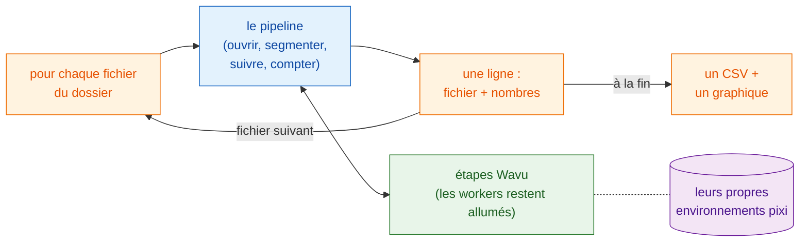

# Traitement par lots

## L'idée en mots simples { #the-idea-in-plain-words }

La page pipeline a servi un seul dîner : les étapes de l'analyse étaient les
plats, et un time-lapse les ingrédients. Maintenant, toute une tablée commande
le même menu, chacun avec ses propres ingrédients (un fichier chacun). La recette ne
change pas. Ce qui change, c'est que les cuisines **allument leurs fours une
seule fois** et les gardent chauds, que le serveur apporte les assiettes
l'une après l'autre et qu'à la fin il rédige **une seule addition** pour
toute la table.

En termes d'images : lancez le **même pipeline** sur chaque time-lapse d'un
dossier, démarrez les workers une fois et réutilisez-les, rassemblez **une
ligne par fichier** (nom du fichier et quelques nombres), écrivez **un seul
CSV** pour le dossier et dessinez un graphique récapitulatif.



## Avant de commencer { #before-you-start }

- Faites d'abord marcher le pipeline sur **un seul** fichier :
  [Pipeline dans Fiji](pipeline-fiji.md) ou
  [Pipeline en Python](pipeline-python.md). Cette page utilise les mêmes
  dossiers d'exemple (`examples/segment_frames`, `examples/track_trackpy`) et
  les mêmes réglages.
- **Un dossier de time-lapses** (`.tif`). Pour essayer, créez un dossier et
  copiez-y `examples/data/demo_timelapse.tif` deux ou trois fois sous des
  noms différents. Chaque copie donne les mêmes nombres, ce qui fait une
  vérification facile.
- Un **dossier de sortie**, différent du dossier d'entrée.

## Le code { #the-code }

Dans les trois versions, le pipeline par fichier est **le code de la page
pipeline, inchangé** : mêmes étapes, mêmes paramètres. Les seuls ajouts sont
la boucle sur les fichiers, la ligne récapitulative, et la fermeture des
fenêtres de chaque fichier pour que la mémoire ne se remplisse pas. Chaque
fichier garde son propre `-counts.csv` et ses graphiques ; le dossier
obtient `batch-summary.csv` et `batch-summary.png`.

=== "Groovy"

    Ouvrez **File › New › Script…** (nouveau script), choisissez
    **Language › Groovy**, collez le code et appuyez sur **Run**. Les étapes
    1 à 5 sont celles du pipeline Groovy, placées dans une closure
    (`analyse`) qui renvoie une ligne ; leur seul changement est que le
    graphique et le film sont enregistrés et fermés au lieu d'être affichés.

    ```groovy
    #@ File (label = "Folder of time-lapses (.tif)", style = "directory") inDir
    #@ File (label = "segment_frames folder", style = "directory") segmentDir
    #@ File (label = "Output folder", style = "directory") outDir
    // Lots : le pipeline de « Pipeline dans Fiji » pour chaque .tif d'un dossier,
    // une ligne par fichier, un CSV et un graphique pour le dossier.
    import fiji.plugin.trackmate.Logger
    import fiji.plugin.trackmate.Model
    import fiji.plugin.trackmate.Settings
    import fiji.plugin.trackmate.TrackMate
    import fiji.plugin.trackmate.detection.LabelImageDetectorFactory
    import fiji.plugin.trackmate.tracking.jaqaman.SparseLAPTrackerFactory
    import ij.IJ
    import ij.ImagePlus
    import ij.gui.Line
    import ij.gui.OvalRoi
    import ij.gui.Overlay
    import ij.gui.Plot
    import ij.measure.ResultsTable
    import java.awt.Color

    def wavu = new GroovyShell(this.class.classLoader).evaluate(
            new File(IJ.getDirectory("imagej"), "scripts/Plugins/Wavu/lib/wavu_lib.groovy.txt"))

    // Le pipeline pour un fichier (étapes 1-5 de la page pipeline). Renvoie une ligne.
    def analyse = { File file ->
        // 1. Ouvrir le time-lapse (Fiji natif).
        def imp = IJ.openImage(file.path)
        if (imp == null) throw new IOException("cannot open " + file.name)
        def cal = imp.getCalibration()
        double dt = cal.frameInterval > 0 ? cal.frameInterval : 1
        int nFrames = imp.getNFrames()

        // 2. Segmenter chaque image (Wavu). Le worker démarré pour le premier fichier est réutilisé.
        Map seg = wavu.run(segmentDir, "script", [sigma: 2, threshold: "otsu", min_area: 30], [image: imp])
        def labels = seg.images.labels
        labels.setCalibration(cal.copy())

        // 3. Suivre (Fiji natif : TrackMate).
        def model = new Model()
        model.setLogger(Logger.VOID_LOGGER)
        def settings = new Settings(labels)
        settings.detectorFactory = new LabelImageDetectorFactory()
        settings.detectorSettings = settings.detectorFactory.getDefaultSettings()
        settings.detectorSettings["TARGET_CHANNEL"] = 1
        settings.detectorSettings["SIMPLIFY_CONTOURS"] = false
        settings.trackerFactory = new SparseLAPTrackerFactory()
        settings.trackerSettings = settings.trackerFactory.getDefaultSettings()
        settings.trackerSettings["LINKING_MAX_DISTANCE"] = 10d
        settings.trackerSettings["ALLOW_GAP_CLOSING"] = true
        settings.trackerSettings["GAP_CLOSING_MAX_DISTANCE"] = 10d
        settings.trackerSettings["MAX_FRAME_GAP"] = 2
        settings.trackerSettings["ALLOW_TRACK_SPLITTING"] = true
        settings.trackerSettings["SPLITTING_MAX_DISTANCE"] = 10d
        def trackmate = new TrackMate(model, settings)
        if (!trackmate.checkInput() || !trackmate.process())
            throw new RuntimeException("TrackMate: " + trackmate.getErrorMessage())
        def tm = model.getTrackModel()
        def trackIds = tm.trackIDs(true)

        // 4. Tabuler : cellules par image, et une ligne par trajectoire.
        def counts = new ResultsTable()
        List<Integer> perFrame = []
        for (int t = 0; t < nFrames; t++) {
            int n = model.getSpots().getNSpots(t, true)
            perFrame << n
            counts.addRow()
            counts.addValue("frame", t)
            counts.addValue("time_min", t * dt)
            counts.addValue("cells", n)
        }
        def tracks = new ResultsTable()
        int divisions = 0
        trackIds.each { id ->
            def spots = tm.trackSpots(id)
            int splits = spots.count { s -> tm.edgesOf(s).count { e -> tm.getEdgeSource(e) == s } > 1 }
            divisions += splits
            def frames = spots.collect { it.getFeature("FRAME") as int }
            tracks.addRow()
            tracks.addValue("track", id)
            tracks.addValue("spots", spots.size())
            tracks.addValue("first_frame", frames.min())
            tracks.addValue("last_frame", frames.max())
            tracks.addValue("divisions", splits)
        }
        counts.save(new File(outDir, imp.getShortTitle() + "-counts.csv").path)
        tracks.save(new File(outDir, imp.getShortTitle() + "-tracks.csv").path)

        // 5a. Graphique des cellules par image (enregistré, pas affiché).
        def plot = new Plot("Cells per frame", "time (" + (cal.getTimeUnit() ?: "frame") + ")", "cells")
        plot.setColor(new Color(0x1565c0))
        plot.setLineWidth(2)
        double[] times = (0..<nFrames).collect { it * dt } as double[]
        plot.add("line", times, perFrame as double[])
        plot.add("circle", times, perFrame as double[])
        plot.setLimits(0, (nFrames - 1) * dt, 0, perFrame.max() + 5)
        IJ.saveAs(plot.getImagePlus(), "PNG", new File(outDir, imp.getShortTitle() + "-counts.png").path)

        // 5b. Trajectoires sur la dernière image (enregistrées, pas affichées).
        double px = cal.pixelWidth
        def overlay = new Overlay()
        trackIds.each { id ->
            def colour = Color.getHSBColor((float) ((id * 0.618034) % 1), 0.9f, 1f)
            tm.trackEdges(id).each { e ->
                def a = tm.getEdgeSource(e), b = tm.getEdgeTarget(e)
                def line = new Line(a.getDoublePosition(0) / px, a.getDoublePosition(1) / px,
                                    b.getDoublePosition(0) / px, b.getDoublePosition(1) / px)
                line.setStrokeColor(colour)
                overlay.add(line)
            }
            tm.trackSpots(id).each { s ->
                double r = s.getFeature("RADIUS") / px
                def ring = new OvalRoi(s.getDoublePosition(0) / px - r, s.getDoublePosition(1) / px - r, 2 * r, 2 * r)
                ring.setStrokeColor(colour)
                ring.setPosition(1, 1, (s.getFeature("FRAME") as int) + 1)
                overlay.add(ring)
            }
        }
        imp.setOverlay(overlay)
        IJ.run(imp, "Grays", "")
        imp.setT(nFrames)
        def last = new ImagePlus("last frame", imp.getProcessor().duplicate())
        last.setOverlay(new Overlay())
        overlay.each { roi -> if (roi.getTPosition() in [0, nFrames]) last.getOverlay().add(roi) }
        IJ.saveAs(last.flatten(), "PNG", new File(outDir, imp.getShortTitle() + "-tracks.png").path)
        imp.close()                                          // libérer la mémoire avant le fichier suivant
        labels.close()

        return [frames: nFrames, times: times, perFrame: perFrame,
                tracks: trackIds.size(), divisions: divisions]
    }

    // Le lot : boucle, une ligne par fichier, un CSV et un graphique pour le dossier.
    def files = inDir.listFiles().findAll { it.name.toLowerCase().endsWith(".tif") }.sort { it.name }
    def summary = new ResultsTable()
    def all = new Plot("Cells per frame, all files", "time (min)", "cells")
    try {
        files.eachWithIndex { File file, int i ->
            IJ.log("[${i + 1}/${files.size()}] ${file.name}")
            summary.addRow()
            summary.addValue("file", file.name)
            try {
                Map row = analyse(file)
                summary.addValue("frames", row.frames)
                summary.addValue("first_count", row.perFrame[0])
                summary.addValue("last_count", row.perFrame[-1])
                summary.addValue("mean_cells", (row.perFrame.sum() / row.frames) as double)
                summary.addValue("tracks", row.tracks)
                summary.addValue("divisions", row.divisions)
                summary.addValue("error", "")
                all.setColor(Color.getHSBColor((float) ((i * 0.618034) % 1), 0.8f, 0.8f))
                all.add("line", row.times, row.perFrame as double[])
            } catch (InterruptedException e) {
                throw e                                      // Échap : arrêter tout le lot
            } catch (Throwable e) {                          // aussi les erreurs de lecture (Bio-Formats)
                IJ.log("  skipped ${file.name}: ${e}")          // un mauvais fichier : le noter, continuer
                summary.addValue("error", (e.message ?: e.toString()).readLines()[0])
            }
        }
    } finally {
        wavu.stopAll()                                       // arrêter le worker une fois, à la fin
    }
    summary.show("Batch summary")
    summary.save(new File(outDir, "batch-summary.csv").path)
    all.setLimitsToFit(false)
    all.show()
    IJ.saveAs(all.getImagePlus(), "PNG", new File(outDir, "batch-summary.png").path)
    ```

=== "ImageJ macro"

    Ouvrez **File › New › Script…**, choisissez **Language › IJ1 Macro**,
    collez le code et appuyez sur **Run**. Les étapes 1 à 5 sont celles du
    pipeline en macro, inchangées, dans une boucle `for`.

    ```javascript
    // Lots : le pipeline de « Pipeline dans Fiji » (macro) pour chaque .tif d'un dossier.
    // Depuis la ligne de commande :
    //   ImageJ-win64.exe --console -batch batch_counting.ijm "<input folder>|<segment_frames>|<track_trackpy>|<output folder>"
    arg = getArgument();
    if (arg == "") {
        inDir = getDirectory("Choose the folder of time-lapses");
        segmentDir = getDirectory("Choose the segment_frames folder");
        trackDir = getDirectory("Choose the track_trackpy folder");
        outDir = getDirectory("Choose the output folder");
    } else {
        a = split(arg, "|");
        inDir = a[0] + "/"; segmentDir = a[1]; trackDir = a[2]; outDir = a[3] + "/";
    }
    setBatchMode(true);
    list = getFileList(inDir);
    Table.create("Batch summary");

    for (f = 0; f < list.length; f++) {
        if (!endsWith(toLowerCase(list[f]), ".tif")) continue;
        print("[" + (f + 1) + "/" + list.length + "] " + list[f]);
        timelapse = inDir + list[f];

        // 1. Ouvrir le time-lapse (Fiji natif).
        open(timelapse);
        movie = getImageID();
        name = File.nameWithoutExtension;
        dt = Stack.getFrameInterval();
        if (dt == 0) dt = 1;
        Stack.getUnits(xu, yu, zu, timeUnit, vu);
        Stack.getDimensions(w, h, channels, slices, frames);

        // 2. Segmenter chaque image (Wavu). Le worker démarré pour le premier fichier est réutilisé.
        run("Run Script (Macro)", "folder=[" + segmentDir + "] script=script params=[sigma=2 threshold=otsu min_area=30]");

        // 3. Suivre (Wavu : trackpy), à partir du tableau des détections. Ouvre « tracks ».
        run("Run Script (Macro)", "folder=[" + trackDir + "] script=script params=[search_range=15 memory=2] tables=[detections=" + name + "-detections]");

        // 4. Tabuler : cellules par image et nombre de trajectoires.
        n = Table.size("tracks");
        cells = newArray(frames);
        times = newArray(frames);
        nTracks = 0;
        for (i = 0; i < n; i++) {
            t = Table.get("frame", i, "tracks");
            cells[t] = cells[t] + 1;
            if (i == 0 || Table.get("particle", i, "tracks") != Table.get("particle", i - 1, "tracks"))
                nTracks++;
        }
        Table.create("Cells per frame");
        for (t = 0; t < frames; t++) {
            times[t] = t * dt;
            Table.set("frame", t, t);
            Table.set("time_" + timeUnit, t, times[t]);
            Table.set("cells", t, cells[t]);
        }
        Table.update;
        Table.save(outDir + name + "-counts.csv");

        // 5a. Graphique des cellules par image en fonction du temps.
        Plot.create("Cells per frame", "time (" + timeUnit + ")", "cells");
        Plot.setColor("#1565c0");
        Plot.setLineWidth(2);
        Plot.add("line", times, cells);
        Plot.add("circle", times, cells);
        Array.getStatistics(cells, cmin, cmax, cmean);
        Plot.setLimits(0, (frames - 1) * dt, 0, cmax + 5);
        Plot.show();
        saveAs("PNG", outDir + name + "-counts.png");

        // 5b. Dessiner le chemin de chaque trajectoire sur l'original, une couleur par trajectoire.
        selectImage(movie);
        run("Grays");
        palette = newArray("#e6194b", "#3cb44b", "#ffe119", "#4363d8", "#f58231", "#911eb4",
                           "#46f0f0", "#f032e6", "#bcf60c", "#fabebe", "#008080", "#e6beff");
        Overlay.remove;
        for (i = 1; i < n; i++) {
            p = Table.get("particle", i, "tracks");
            if (Table.get("particle", i - 1, "tracks") != p) continue;
            setColor(palette[p % palette.length]);
            Overlay.drawLine(Table.get("x", i - 1, "tracks"), Table.get("y", i - 1, "tracks"),
                             Table.get("x", i, "tracks"), Table.get("y", i, "tracks"));
        }
        Overlay.show;
        Stack.setFrame(frames);
        run("Flatten", "slice");
        saveAs("PNG", outDir + name + "-tracks.png");

        // Lot : une ligne pour ce fichier, puis fermer tout ce qu'il a ouvert.
        r = Table.size("Batch summary");
        Table.set("file", r, list[f], "Batch summary");
        Table.set("frames", r, frames, "Batch summary");
        Table.set("first_count", r, cells[0], "Batch summary");
        Table.set("last_count", r, cells[frames - 1], "Batch summary");
        Table.set("mean_cells", r, cmean, "Batch summary");
        Table.set("tracks", r, nTracks, "Batch summary");
        close("*");                                    // toutes les images : film, labels, graphique, capture
        close(name + "-detections");
        close(name + "-count_per_frame");
        close("tracks");
        close("Cells per frame");
    }

    // Le dossier : un CSV et un graphique récapitulatif.
    Table.save(outDir + "batch-summary.csv", "Batch summary");
    last = Table.getColumn("last_count", "Batch summary");
    mean = Table.getColumn("mean_cells", "Batch summary");
    x = Array.getSequence(last.length);
    Plot.create("Batch summary", "file (0 = first)", "cells");
    Plot.setColor("#1565c0");
    Plot.add("circle", x, last);
    Plot.setColor("#ef6c00");
    Plot.add("circle", x, mean);
    Plot.setLegend("final count\tmean per frame");
    Plot.show();
    saveAs("PNG", outDir + "batch-summary.png");
    setBatchMode("exit and display");
    run("Stop Worker");                                // arrêter les deux workers, une fois
    ```

=== "Python"

    Enregistrez ceci sous `batch_counting.py` **à côté de**
    `examples/pipelines/dag_counting.py`, pour qu'il puisse importer les
    dossiers et les réglages de ce fichier. `analyse_one` est le corps
    d'`analyse()` avec un seul changement : on lui passe les deux workers déjà
    en marche au lieu de les démarrer, pour qu'ils ne démarrent qu'une fois
    pour tout le dossier.

    ```python
    """Batch: the dag_counting pipeline for every time-lapse in a folder.

        pixi run -e napari python examples/pipelines/batch_counting.py <folder> [<output folder>]
    """
    import sys
    from pathlib import Path

    import pandas as pd
    import tifffile
    from matplotlib.figure import Figure

    from dag_counting import FRAME_MIN, PIXEL_UM, SEGMENT, TRACK
    from wavu.client import JobCancelled, Worker


    def analyse_one(movie_path, seg, trk):
        """Steps 1-4 of dag_counting.analyse(), with workers that are already running."""
        movie = tifffile.imread(movie_path)
        res = seg.run("script", {"sigma": 2.0, "threshold": "otsu", "min_area": 30},
                      {"image": movie}, meta={"image": {"pixel_um": PIXEL_UM}})
        detections = res.outputs["detections"].value
        res = trk.run("script", {"search_range": 10.0, "memory": 2},
                      {"detections": detections})
        tracks = res.outputs["tracks"].value
        counts = (detections.groupby("frame").size()
                  .reindex(range(len(movie)), fill_value=0).rename("cells").reset_index())
        counts["minutes"] = counts["frame"] * FRAME_MIN
        per_track = tracks.groupby("particle")["frame"].agg(start="min", end="max", length="size")
        row = {
            "frames": len(movie),
            "first_count": int(counts["cells"].iloc[0]),
            "last_count": int(counts["cells"].iloc[-1]),
            "mean_cells": float(counts["cells"].mean()),
            "tracks": int(tracks["particle"].nunique()),
            "new_tracks": int((per_track["start"] > 0).sum()),
        }
        return counts, row


    def main(folder: Path, out: Path):
        out.mkdir(parents=True, exist_ok=True)
        files = sorted(folder.glob("*.tif"))
        rows, curves = [], {}
        with Worker.start(SEGMENT, on_log=print) as seg, Worker.start(TRACK, on_log=print) as trk:
            for i, path in enumerate(files, 1):
                print(f"[{i}/{len(files)}] {path.name}")
                try:
                    counts, row = analyse_one(path, seg, trk)
                except JobCancelled:
                    raise                                   # annulé : arrêter tout le lot
                except Exception as e:                      # un mauvais fichier : le noter, continuer
                    print(f"  skipped {path.name}: {e}")
                    rows.append({"file": path.name, "error": str(e).split("\n")[0]})
                    continue
                counts.to_csv(out / f"{path.stem}-counts.csv", index=False)
                rows.append({"file": path.name, **row})
                curves[path.stem] = counts

        summary = pd.DataFrame(rows)
        summary.to_csv(out / "batch-summary.csv", index=False)
        print(summary.to_string(index=False))

        fig = Figure(figsize=(6, 3.5), layout="constrained")
        ax = fig.add_subplot()
        for name, counts in curves.items():
            ax.plot(counts["minutes"], counts["cells"], label=name)
        ax.set_xlabel("time (min)")
        ax.set_ylabel("cells")
        ax.set_title("Cells per frame, all files")
        ax.legend(fontsize="small")
        fig.savefig(out / "batch-summary.png", dpi=120)


    if __name__ == "__main__":
        main(Path(sys.argv[1]), Path(sys.argv[2]) if len(sys.argv) > 2 else Path("batch_out"))
    ```

## Ce que vous obtenez { #what-you-get }

Dans le dossier de sortie :

- pour **chaque fichier**, les mêmes fichiers que sur la page pipeline :
  `<name>-counts.csv`, `<name>-counts.png` et `<name>-tracks.png` (Fiji),
  ou `<name>-counts.csv` (Python) ;
- pour le **dossier**, `batch-summary.csv` avec une ligne par fichier, et
  `batch-summary.png`.

| colonne | signification |
|---|---|
| `file` | le nom du fichier |
| `frames` | nombre d'images |
| `first_count`, `last_count` | cellules dans la première et la dernière image |
| `mean_cells` | nombre moyen de cellules par image |
| `tracks` | nombre de trajectoires |
| `divisions` | Groovy seulement : les ramifications de trajectoire de TrackMate |
| `new_tracks` | Python seulement : trajectoires qui commencent après l'image 0 |
| `error` | Groovy et Python : pourquoi un fichier a été sauté |

Le graphique récapitulatif montre la courbe des cellules par image de chaque
fichier sur un même axe (Groovy, Python), ou le compte final et le compte
moyen par fichier (macro). Avec des copies du film de démo, chaque ligne et
chaque courbe est identique : 25 cellules au début, 29 à la fin.

## Astuces { #tips }

- **Seul le premier fichier est lent.** Le premier appel Wavu démarre le
  worker (et, la toute première fois, installe sa batterie de cuisine).
  Chaque appel suivant le réutilise. C'est pourquoi les workers sont arrêtés
  **après** la boucle, pas à l'intérieur.
- **Un mauvais fichier ne doit pas arrêter le lot.** Les versions Groovy et
  Python attrapent l'erreur, notent le nom du fichier, ajoutent une ligne
  avec une colonne `error`, et continuent. Une macro ImageJ ne peut pas
  attraper les erreurs : une étape Wavu qui échoue arrête toute la macro. Le
  Log montre le dernier fichier commencé ; sortez ce fichier du dossier, ou
  corrigez-le, et relancez.
- **Arrêter.** Appuyez sur **Esc** dans Fiji (ou **Ctrl+C** dans un terminal
  pour Python). L'étape Wavu en cours est annulée et le lot s'arrête au lieu
  de passer au fichier suivant. Si une macro est arrêtée en cours de route,
  arrêtez les workers avec **Plugins › Wavu › Stop Worker**.
- **Mémoire.** Fermez chaque image et chaque tableau qu'un fichier a ouverts
  avant de passer au suivant (`imp.close()`, `close("*")`). En Python, les
  tableaux sont libérés quand le fichier suivant les remplace. Sinon, la
  mémoire grossit à chaque fichier.
- **Vérifiez avant de faire confiance.** Ouvrez à l'œil un ou deux
  graphiques par fichier et des captures des trajectoires. Un tableau
  récapitulatif cache très bien une mauvaise segmentation.
- **Quand passer aux données volumineuses.** Le traitement par lots est fait
  pour **beaucoup de fichiers qui tiennent chacun en mémoire** (environ
  1–2 Go chacun). Si un seul fichier est plus gros, utilisez
  [l'analyse en flux](large-data.md). Pour des milliers de fichiers ou de
  nombreuses heures de travail, lancez la version Python dans un terminal
  sans visualiseur, ou sur un cluster.

## En une phrase { #in-one-sentence }

Écrivez le pipeline pour un fichier, enveloppez-le dans une boucle, laissez
les workers démarrer une fois et servir chaque fichier, passez outre les
mauvais fichiers, et rassemblez une ligne par fichier dans un CSV et un
graphique pour le dossier.

[Suivant : Données volumineuses :material-arrow-right:](large-data.md){ .md-button }
