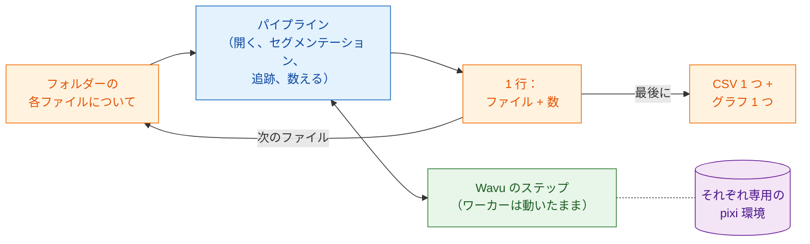

# バッチ処理

## やさしく言うと

パイプラインのページでは、ディナーを 1 回出しました。解析の各ステップが
コースの一皿で、1 本のタイムラプスが食材でした。今度はテーブルいっぱいの
お客さんが同じコース料理を注文し、それぞれが自分の食材（ファイル 1 つずつ）を
持ってきます。レシピは変わりません。変わるのは、厨房が
**一度だけ火を入れて** ずっと熱いままにしておくこと、ウェイターがお皿を
次々に運ぶこと、そして最後にテーブル全体で **伝票を 1 枚** 書くことです。

画像の言葉で言うと、フォルダーのすべてのタイムラプスに **同じパイプライン**
をかけ、ワーカーは一度だけ起動して使い回し、**ファイルごとに 1 行**
（ファイル名といくつかの数）を集め、フォルダーに **CSV を 1 つ** 書き出し、
まとめのグラフを描きます。



## 始める前に

- まず **1 つ** のファイルでパイプラインを動かしてください：
  [Fiji でパイプライン](pipeline-fiji.md) または
  [Python でパイプライン](pipeline-python.md)。このページも同じサンプル
  フォルダー（`examples/segment_frames`、`examples/track_trackpy`）と同じ
  設定を使います。これらは Wavu リポジトリに入っています
  （[VS Code で開く](vscode://vscode.git/clone?url=https%3A%2F%2Fgithub.com%2FOxford-Zeiss-Centre-of-Excellence%2FWavu.git)）。
- **タイムラプスのフォルダー**（`.tif`）。試すには、フォルダーを作り、
  `examples/data/demo_timelapse.tif` を別々の名前で 2、3 回コピーします。
  どのコピーも同じ数を出すので、確認が簡単です。
- 入力フォルダーとは別の **出力フォルダー**。

## コード

3 つの版のどれでも、ファイルごとのパイプラインは **パイプラインのページの
コードそのまま** です。同じステップ、同じパラメーターです。加えたのは、
ファイルのループ、まとめの行、そしてメモリーがいっぱいにならないように
ファイルごとにウィンドウを閉じる処理だけです。各ファイルにはこれまでどおり
専用の `-counts.csv` とグラフができ、フォルダーには `batch-summary.csv` と
`batch-summary.png` ができます。

=== "Groovy"

    **File › New › Script…** を開き、**Language › Groovy** を選んで貼り付け、
    **Run** を押します。ステップ 1〜5 は Groovy のパイプラインのものを、
    1 行を返すクロージャー（`analyse`）の中に入れたものです。中身の変更は、
    グラフと動画を表示する代わりに保存して閉じることだけです。

    ```groovy
    #@ File (label = "Folder of time-lapses (.tif)", style = "directory") inDir
    #@ File (label = "segment_frames folder", style = "directory") segmentDir
    #@ File (label = "Output folder", style = "directory") outDir
    // バッチ：「Fiji でパイプライン」のパイプラインをフォルダーのすべての .tif に。
    // ファイルごとに 1 行、フォルダーに CSV 1 つとグラフ 1 つ。
    import fiji.plugin.trackmate.Logger
    import fiji.plugin.trackmate.Model
    import fiji.plugin.trackmate.Settings
    import fiji.plugin.trackmate.TrackMate
    import fiji.plugin.trackmate.detection.LabelImageDetectorFactory
    import fiji.plugin.trackmate.tracking.jaqaman.SparseLAPTrackerFactory
    import ij.IJ
    import ij.ImagePlus
    import ij.gui.Line
    import ij.gui.OvalRoi
    import ij.gui.Overlay
    import ij.gui.Plot
    import ij.measure.ResultsTable
    import java.awt.Color

    def wavu = new GroovyShell(this.class.classLoader).evaluate(
            new File(IJ.getDirectory("imagej"), "scripts/Plugins/Wavu/lib/wavu_lib.groovy.txt"))

    // 1 つのファイル用のパイプライン（パイプラインのページのステップ 1-5）。1 行を返す。
    def analyse = { File file ->
        // 1. タイムラプスを開く（Fiji 標準）。
        def imp = IJ.openImage(file.path)
        if (imp == null) throw new IOException("cannot open " + file.name)
        def cal = imp.getCalibration()
        double dt = cal.frameInterval > 0 ? cal.frameInterval : 1
        int nFrames = imp.getNFrames()

        // 2. 全フレームをセグメンテーション（Wavu）。最初のファイルで起動したワーカーを使い回す。
        Map seg = wavu.run(segmentDir, "script", [sigma: 2, threshold: "otsu", min_area: 30], [image: imp])
        def labels = seg.images.labels
        labels.setCalibration(cal.copy())

        // 3. 追跡（Fiji 標準：TrackMate）。
        def model = new Model()
        model.setLogger(Logger.VOID_LOGGER)
        def settings = new Settings(labels)
        settings.detectorFactory = new LabelImageDetectorFactory()
        settings.detectorSettings = settings.detectorFactory.getDefaultSettings()
        settings.detectorSettings["TARGET_CHANNEL"] = 1
        settings.detectorSettings["SIMPLIFY_CONTOURS"] = false
        settings.trackerFactory = new SparseLAPTrackerFactory()
        settings.trackerSettings = settings.trackerFactory.getDefaultSettings()
        settings.trackerSettings["LINKING_MAX_DISTANCE"] = 10d
        settings.trackerSettings["ALLOW_GAP_CLOSING"] = true
        settings.trackerSettings["GAP_CLOSING_MAX_DISTANCE"] = 10d
        settings.trackerSettings["MAX_FRAME_GAP"] = 2
        settings.trackerSettings["ALLOW_TRACK_SPLITTING"] = true
        settings.trackerSettings["SPLITTING_MAX_DISTANCE"] = 10d
        def trackmate = new TrackMate(model, settings)
        if (!trackmate.checkInput() || !trackmate.process())
            throw new RuntimeException("TrackMate: " + trackmate.getErrorMessage())
        def tm = model.getTrackModel()
        def trackIds = tm.trackIDs(true)

        // 4. 表にする：フレームごとの細胞数と、トラックごとに 1 行。
        def counts = new ResultsTable()
        List<Integer> perFrame = []
        for (int t = 0; t < nFrames; t++) {
            int n = model.getSpots().getNSpots(t, true)
            perFrame << n
            counts.addRow()
            counts.addValue("frame", t)
            counts.addValue("time_min", t * dt)
            counts.addValue("cells", n)
        }
        def tracks = new ResultsTable()
        int divisions = 0
        trackIds.each { id ->
            def spots = tm.trackSpots(id)
            int splits = spots.count { s -> tm.edgesOf(s).count { e -> tm.getEdgeSource(e) == s } > 1 }
            divisions += splits
            def frames = spots.collect { it.getFeature("FRAME") as int }
            tracks.addRow()
            tracks.addValue("track", id)
            tracks.addValue("spots", spots.size())
            tracks.addValue("first_frame", frames.min())
            tracks.addValue("last_frame", frames.max())
            tracks.addValue("divisions", splits)
        }
        counts.save(new File(outDir, imp.getShortTitle() + "-counts.csv").path)
        tracks.save(new File(outDir, imp.getShortTitle() + "-tracks.csv").path)

        // 5a. フレームごとの細胞数をプロット（表示せずに保存）。
        def plot = new Plot("Cells per frame", "time (" + (cal.getTimeUnit() ?: "frame") + ")", "cells")
        plot.setColor(new Color(0x1565c0))
        plot.setLineWidth(2)
        double[] times = (0..<nFrames).collect { it * dt } as double[]
        plot.add("line", times, perFrame as double[])
        plot.add("circle", times, perFrame as double[])
        plot.setLimits(0, (nFrames - 1) * dt, 0, perFrame.max() + 5)
        IJ.saveAs(plot.getImagePlus(), "PNG", new File(outDir, imp.getShortTitle() + "-counts.png").path)

        // 5b. 最後のフレームにトラックを描く（表示せずに保存）。
        double px = cal.pixelWidth
        def overlay = new Overlay()
        trackIds.each { id ->
            def colour = Color.getHSBColor((float) ((id * 0.618034) % 1), 0.9f, 1f)
            tm.trackEdges(id).each { e ->
                def a = tm.getEdgeSource(e), b = tm.getEdgeTarget(e)
                def line = new Line(a.getDoublePosition(0) / px, a.getDoublePosition(1) / px,
                                    b.getDoublePosition(0) / px, b.getDoublePosition(1) / px)
                line.setStrokeColor(colour)
                overlay.add(line)
            }
            tm.trackSpots(id).each { s ->
                double r = s.getFeature("RADIUS") / px
                def ring = new OvalRoi(s.getDoublePosition(0) / px - r, s.getDoublePosition(1) / px - r, 2 * r, 2 * r)
                ring.setStrokeColor(colour)
                ring.setPosition(1, 1, (s.getFeature("FRAME") as int) + 1)
                overlay.add(ring)
            }
        }
        imp.setOverlay(overlay)
        IJ.run(imp, "Grays", "")
        imp.setT(nFrames)
        def last = new ImagePlus("last frame", imp.getProcessor().duplicate())
        last.setOverlay(new Overlay())
        overlay.each { roi -> if (roi.getTPosition() in [0, nFrames]) last.getOverlay().add(roi) }
        IJ.saveAs(last.flatten(), "PNG", new File(outDir, imp.getShortTitle() + "-tracks.png").path)
        imp.close()                                          // 次のファイルの前にメモリーを空ける
        labels.close()

        return [frames: nFrames, times: times, perFrame: perFrame,
                tracks: trackIds.size(), divisions: divisions]
    }

    // バッチ：ループ、ファイルごとに 1 行、フォルダーに CSV 1 つとグラフ 1 つ。
    def files = inDir.listFiles().findAll { it.name.toLowerCase().endsWith(".tif") }.sort { it.name }
    def summary = new ResultsTable()
    def all = new Plot("Cells per frame, all files", "time (min)", "cells")
    try {
        files.eachWithIndex { File file, int i ->
            IJ.log("[${i + 1}/${files.size()}] ${file.name}")
            summary.addRow()
            summary.addValue("file", file.name)
            try {
                Map row = analyse(file)
                summary.addValue("frames", row.frames)
                summary.addValue("first_count", row.perFrame[0])
                summary.addValue("last_count", row.perFrame[-1])
                summary.addValue("mean_cells", (row.perFrame.sum() / row.frames) as double)
                summary.addValue("tracks", row.tracks)
                summary.addValue("divisions", row.divisions)
                summary.addValue("error", "")
                all.setColor(Color.getHSBColor((float) ((i * 0.618034) % 1), 0.8f, 0.8f))
                all.add("line", row.times, row.perFrame as double[])
            } catch (InterruptedException e) {
                throw e                                      // Esc：バッチ全体を止める
            } catch (Throwable e) {                          // 読み込みのエラー（Bio-Formats）も
                IJ.log("  skipped ${file.name}: ${e}")          // 不良ファイル 1 つ：記録して続ける
                summary.addValue("error", (e.message ?: e.toString()).readLines()[0])
            }
        }
    } finally {
        wavu.stopAll()                                       // ワーカーは最後に一度だけ止める
    }
    summary.show("Batch summary")
    summary.save(new File(outDir, "batch-summary.csv").path)
    all.setLimitsToFit(false)
    all.show()
    IJ.saveAs(all.getImagePlus(), "PNG", new File(outDir, "batch-summary.png").path)
    ```

=== "ImageJ macro"

    **File › New › Script…** を開き、**Language › IJ1 Macro** を選んで
    貼り付け、**Run** を押します。ステップ 1〜5 はマクロのパイプラインの
    ものをそのまま、`for` ループの中に入れたものです。

    ```javascript
    // バッチ：「Fiji でパイプライン」のパイプライン（マクロ）をフォルダーのすべての .tif に。
    // コマンドラインからは：
    //   ImageJ-win64.exe --console -batch batch_counting.ijm "<input folder>|<segment_frames>|<track_trackpy>|<output folder>"
    arg = getArgument();
    if (arg == "") {
        inDir = getDirectory("Choose the folder of time-lapses");
        segmentDir = getDirectory("Choose the segment_frames folder");
        trackDir = getDirectory("Choose the track_trackpy folder");
        outDir = getDirectory("Choose the output folder");
    } else {
        a = split(arg, "|");
        inDir = a[0] + "/"; segmentDir = a[1]; trackDir = a[2]; outDir = a[3] + "/";
    }
    setBatchMode(true);
    list = getFileList(inDir);
    Table.create("Batch summary");

    for (f = 0; f < list.length; f++) {
        if (!endsWith(toLowerCase(list[f]), ".tif")) continue;
        print("[" + (f + 1) + "/" + list.length + "] " + list[f]);
        timelapse = inDir + list[f];

        // 1. タイムラプスを開く（Fiji 標準）。
        open(timelapse);
        movie = getImageID();
        name = File.nameWithoutExtension;
        dt = Stack.getFrameInterval();
        if (dt == 0) dt = 1;
        Stack.getUnits(xu, yu, zu, timeUnit, vu);
        Stack.getDimensions(w, h, channels, slices, frames);

        // 2. 全フレームをセグメンテーション（Wavu）。最初のファイルで起動したワーカーを使い回す。
        run("Run Script (Macro)", "folder=[" + segmentDir + "] script=script params=[sigma=2 threshold=otsu min_area=30]");

        // 3. detections の表を渡して追跡（Wavu：trackpy）。"tracks" が開く。
        run("Run Script (Macro)", "folder=[" + trackDir + "] script=script params=[search_range=15 memory=2] tables=[detections=" + name + "-detections]");

        // 4. 表にする：フレームごとの細胞数とトラック数。
        n = Table.size("tracks");
        cells = newArray(frames);
        times = newArray(frames);
        nTracks = 0;
        for (i = 0; i < n; i++) {
            t = Table.get("frame", i, "tracks");
            cells[t] = cells[t] + 1;
            if (i == 0 || Table.get("particle", i, "tracks") != Table.get("particle", i - 1, "tracks"))
                nTracks++;
        }
        Table.create("Cells per frame");
        for (t = 0; t < frames; t++) {
            times[t] = t * dt;
            Table.set("frame", t, t);
            Table.set("time_" + timeUnit, t, times[t]);
            Table.set("cells", t, cells[t]);
        }
        Table.update;
        Table.save(outDir + name + "-counts.csv");

        // 5a. フレームごとの細胞数を時間に対してプロット。
        Plot.create("Cells per frame", "time (" + timeUnit + ")", "cells");
        Plot.setColor("#1565c0");
        Plot.setLineWidth(2);
        Plot.add("line", times, cells);
        Plot.add("circle", times, cells);
        Array.getStatistics(cells, cmin, cmax, cmean);
        Plot.setLimits(0, (frames - 1) * dt, 0, cmax + 5);
        Plot.show();
        saveAs("PNG", outDir + name + "-counts.png");

        // 5b. 元の画像に各トラックの経路を描く（トラックごとに 1 色）。
        selectImage(movie);
        run("Grays");
        palette = newArray("#e6194b", "#3cb44b", "#ffe119", "#4363d8", "#f58231", "#911eb4",
                           "#46f0f0", "#f032e6", "#bcf60c", "#fabebe", "#008080", "#e6beff");
        Overlay.remove;
        for (i = 1; i < n; i++) {
            p = Table.get("particle", i, "tracks");
            if (Table.get("particle", i - 1, "tracks") != p) continue;
            setColor(palette[p % palette.length]);
            Overlay.drawLine(Table.get("x", i - 1, "tracks"), Table.get("y", i - 1, "tracks"),
                             Table.get("x", i, "tracks"), Table.get("y", i, "tracks"));
        }
        Overlay.show;
        Stack.setFrame(frames);
        run("Flatten", "slice");
        saveAs("PNG", outDir + name + "-tracks.png");

        // バッチ：このファイルの 1 行を書き、このファイルが開いたものをすべて閉じる。
        r = Table.size("Batch summary");
        Table.set("file", r, list[f], "Batch summary");
        Table.set("frames", r, frames, "Batch summary");
        Table.set("first_count", r, cells[0], "Batch summary");
        Table.set("last_count", r, cells[frames - 1], "Batch summary");
        Table.set("mean_cells", r, cmean, "Batch summary");
        Table.set("tracks", r, nTracks, "Batch summary");
        close("*");                                    // すべての画像：動画、ラベル、グラフ、スナップショット
        close(name + "-detections");
        close(name + "-count_per_frame");
        close("tracks");
        close("Cells per frame");
    }

    // フォルダー：CSV 1 つとまとめのグラフ 1 つ。
    Table.save(outDir + "batch-summary.csv", "Batch summary");
    last = Table.getColumn("last_count", "Batch summary");
    mean = Table.getColumn("mean_cells", "Batch summary");
    x = Array.getSequence(last.length);
    Plot.create("Batch summary", "file (0 = first)", "cells");
    Plot.setColor("#1565c0");
    Plot.add("circle", x, last);
    Plot.setColor("#ef6c00");
    Plot.add("circle", x, mean);
    Plot.setLegend("final count\tmean per frame");
    Plot.show();
    saveAs("PNG", outDir + "batch-summary.png");
    setBatchMode("exit and display");
    run("Stop Worker");                                // 両方のワーカーを一度だけ止める
    ```

=== "Python"

    これを `batch_counting.py` として `examples/pipelines/dag_counting.py` の
    **隣に** 保存します。そうすると、そのファイルのフォルダーと設定を import
    できます。`analyse_one` は `analyse()` の本体に 1 つだけ変更を加えたもの
    です。2 つのワーカーを自分で起動するのではなく、動いているワーカーを
    受け取るので、ワーカーはフォルダー全体で一度だけ起動します。

    ```python
    """Batch: the dag_counting pipeline for every time-lapse in a folder.

        pixi run -e napari python examples/pipelines/batch_counting.py <folder> [<output folder>]
    """
    import sys
    from pathlib import Path

    import pandas as pd
    import tifffile
    from matplotlib.figure import Figure

    from dag_counting import FRAME_MIN, PIXEL_UM, SEGMENT, TRACK
    from wavu.client import JobCancelled, Worker


    def analyse_one(movie_path, seg, trk):
        """Steps 1-4 of dag_counting.analyse(), with workers that are already running."""
        movie = tifffile.imread(movie_path)
        res = seg.run("script", {"sigma": 2.0, "threshold": "otsu", "min_area": 30},
                      {"image": movie}, meta={"image": {"pixel_um": PIXEL_UM}})
        detections = res.outputs["detections"].value
        res = trk.run("script", {"search_range": 10.0, "memory": 2},
                      {"detections": detections})
        tracks = res.outputs["tracks"].value
        counts = (detections.groupby("frame").size()
                  .reindex(range(len(movie)), fill_value=0).rename("cells").reset_index())
        counts["minutes"] = counts["frame"] * FRAME_MIN
        per_track = tracks.groupby("particle")["frame"].agg(start="min", end="max", length="size")
        row = {
            "frames": len(movie),
            "first_count": int(counts["cells"].iloc[0]),
            "last_count": int(counts["cells"].iloc[-1]),
            "mean_cells": float(counts["cells"].mean()),
            "tracks": int(tracks["particle"].nunique()),
            "new_tracks": int((per_track["start"] > 0).sum()),
        }
        return counts, row


    def main(folder: Path, out: Path):
        out.mkdir(parents=True, exist_ok=True)
        files = sorted(folder.glob("*.tif"))
        rows, curves = [], {}
        with Worker.start(SEGMENT, on_log=print) as seg, Worker.start(TRACK, on_log=print) as trk:
            for i, path in enumerate(files, 1):
                print(f"[{i}/{len(files)}] {path.name}")
                try:
                    counts, row = analyse_one(path, seg, trk)
                except JobCancelled:
                    raise                                   # キャンセル：バッチ全体を止める
                except Exception as e:                      # 不良ファイル 1 つ：記録して続ける
                    print(f"  skipped {path.name}: {e}")
                    rows.append({"file": path.name, "error": str(e).split("\n")[0]})
                    continue
                counts.to_csv(out / f"{path.stem}-counts.csv", index=False)
                rows.append({"file": path.name, **row})
                curves[path.stem] = counts

        summary = pd.DataFrame(rows)
        summary.to_csv(out / "batch-summary.csv", index=False)
        print(summary.to_string(index=False))

        fig = Figure(figsize=(6, 3.5), layout="constrained")
        ax = fig.add_subplot()
        for name, counts in curves.items():
            ax.plot(counts["minutes"], counts["cells"], label=name)
        ax.set_xlabel("time (min)")
        ax.set_ylabel("cells")
        ax.set_title("Cells per frame, all files")
        ax.legend(fontsize="small")
        fig.savefig(out / "batch-summary.png", dpi=120)


    if __name__ == "__main__":
        main(Path(sys.argv[1]), Path(sys.argv[2]) if len(sys.argv) > 2 else Path("batch_out"))
    ```

## 得られるもの

出力フォルダーには次のものができます。

- **各ファイル** について、パイプラインのページと同じファイル：
  `<name>-counts.csv`、`<name>-counts.png`、`<name>-tracks.png`（Fiji）、
  または `<name>-counts.csv`（Python）
- **フォルダー** について、ファイルごとに 1 行の `batch-summary.csv` と、
  `batch-summary.png`

| 列 | 意味 |
|---|---|
| `file` | ファイル名 |
| `frames` | フレーム数 |
| `first_count`、`last_count` | 最初と最後のフレームの細胞数 |
| `mean_cells` | フレームあたりの平均細胞数 |
| `tracks` | トラック数 |
| `divisions` | Groovy のみ：TrackMate のトラックの分岐 |
| `new_tracks` | Python のみ：フレーム 0 より後に始まるトラック |
| `error` | Groovy と Python：ファイルを飛ばした理由 |

まとめのグラフは、各ファイルのフレームごとの細胞数の曲線を 1 つの軸に重ねて
示すか（Groovy、Python）、ファイルごとの最終の数と平均の数を示します（マクロ）。
デモ動画のコピーなら、どの行もどの曲線も同じで、最初が 25 個、最後が 29 個です。

## ヒント

- **遅いのは最初のファイルだけ。** 最初の Wavu の呼び出しがワーカーを起動します
  （そしていちばん最初には、調理器具をそろえます）。それ以降の呼び出しは
  そのワーカーを使い回します。だからワーカーはループの中ではなく、ループの
  **後で** 止めます。
- **不良ファイル 1 つでバッチを止めない。** Groovy 版と Python 版は
  エラーを捕まえ、ファイル名を Log に書き、`error` 列のある行を加えて
  先へ進みます。ImageJ マクロはエラーを捕まえられないので、Wavu のステップが
  失敗するとマクロ全体が止まります。Log には最後に始めたファイルが出ているので、
  そのファイルをフォルダーから出すか直して、もう一度実行してください。
- **止める。** Fiji では **Esc** を押します（Python ならターミナルで
  **Ctrl+C**）。実行中の Wavu のステップがキャンセルされ、次のファイルへ
  進まずにバッチが止まります。マクロが途中で止まったら、
  **Plugins › Wavu › Stop Worker** でワーカーを終わらせてください。
- **メモリー。** 次のファイルに移る前に、そのファイルが開いた画像と表を
  すべて閉じます（`imp.close()`、`close("*")`）。Python では、次のファイルが
  配列を置き換えるときに解放されます。そうしないと、ファイルごとにメモリーが
  増えていきます。
- **信じる前に確かめる。** ファイルごとのグラフとトラックのスナップショットを
  1 つか 2 つ開いて、目で見てください。まとめの表は、悪いセグメンテーションを
  とても上手に隠してしまいます。
- **大きなデータに切り替えるとき。** バッチ処理は、**それぞれはメモリーに
  収まるファイルがたくさん**（1 つあたりおよそ 1〜2 GB）ある場合のものです。
  1 つのファイルがそれより大きければ、[ストリーム解析](large-data.md) を
  使ってください。ファイルが数千ある場合や何時間もかかる作業なら、Python 版を
  ビューアーなしでターミナルから、またはクラスターで動かしてください。

## ひとことで言うと

1 つのファイル用にパイプラインを書いてループで包み、ワーカーは一度だけ
起動してすべてのファイルを調理させ、不良ファイルは飛ばして先へ進み、
ファイルごとに 1 行を集めて、フォルダーに CSV 1 つとグラフ 1 つにまとめます。

[次へ：大きなデータ :material-arrow-right:](large-data.md){ .md-button }
