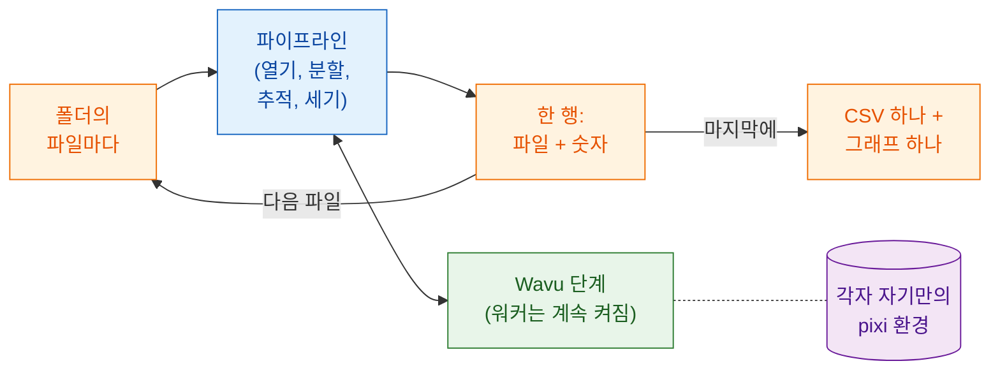

# 배치 처리

## 쉬운 말로 설명하면

파이프라인 페이지에서는 저녁 식사를 한 번 차렸어요. 분석의 각 단계가 코스였고,
타임랩스 하나가 재료였어요. 이번에는 한 테이블 가득한 손님이 같은 코스 요리를
주문하고, 각자 자기 재료(파일 하나씩)를 가져와요.
레시피는 바뀌지 않아요. 바뀌는 건 주방이 **불을 한 번만 켜고** 계속 뜨겁게
두는 것, 웨이터가 접시를 하나씩 차례로 가져오는 것, 그리고 마지막에 테이블
전체에 대해 **계산서를 한 장** 쓰는 것이에요.

이미지로 말하면, 폴더의 모든 타임랩스에 **같은 파이프라인**을 돌리고, 워커는
한 번만 시작해서 다시 쓰고, **파일마다 한 행**(파일 이름과 숫자 몇 개)을
모으고, 폴더에 대해 **CSV 하나**를 쓰고, 요약 그래프를 그려요.



## 시작하기 전에

- 먼저 **파일 하나**에서 파이프라인이 작동하게 하세요:
  [Fiji에서 파이프라인](pipeline-fiji.md) 또는
  [Python에서 파이프라인](pipeline-python.md). 이 페이지도 같은 예제
  폴더(`examples/segment_frames`, `examples/track_trackpy`)와 같은 설정을
  써요.
- **타임랩스 폴더**(`.tif`). 시험해 보려면 폴더를 하나 만들고
  `examples/data/demo_timelapse.tif`를 서로 다른 이름으로 두세 번 복사해
  넣으세요. 복사본마다 같은 숫자가 나오니 확인하기 쉬워요.
- 입력 폴더와 다른 **출력 폴더**.

## 코드

세 버전 모두 파일마다 도는 파이프라인은 **파이프라인 페이지의 코드
그대로**예요. 같은 단계, 같은 매개변수예요. 더한 건 파일을 도는 루프, 요약
행, 그리고 메모리가 차지 않도록 파일마다 창을 닫는 것뿐이에요. 파일마다
여전히 자기 `-counts.csv`와 그래프가 생기고, 폴더에는 `batch-summary.csv`와
`batch-summary.png`가 생겨요.

=== "Groovy"

    **File › New › Script…**를 열고 **Language › Groovy**를 고른 다음
    붙여 넣고 **Run**을 누르세요. 1–5단계는 Groovy 파이프라인의 것을 한 행을
    돌려주는 클로저(`analyse`) 안에 넣은 거예요. 그 안에서 바뀐 건 그래프와
    동영상을 보여 주는 대신 저장하고 닫는다는 것뿐이에요.

    ```groovy
    #@ File (label = "Folder of time-lapses (.tif)", style = "directory") inDir
    #@ File (label = "segment_frames folder", style = "directory") segmentDir
    #@ File (label = "Output folder", style = "directory") outDir
    // 배치: "Fiji에서 파이프라인"의 파이프라인을 폴더의 모든 .tif에.
    // 파일마다 한 행, 폴더에 CSV 하나와 그래프 하나.
    import fiji.plugin.trackmate.Logger
    import fiji.plugin.trackmate.Model
    import fiji.plugin.trackmate.Settings
    import fiji.plugin.trackmate.TrackMate
    import fiji.plugin.trackmate.detection.LabelImageDetectorFactory
    import fiji.plugin.trackmate.tracking.jaqaman.SparseLAPTrackerFactory
    import ij.IJ
    import ij.ImagePlus
    import ij.gui.Line
    import ij.gui.OvalRoi
    import ij.gui.Overlay
    import ij.gui.Plot
    import ij.measure.ResultsTable
    import java.awt.Color

    def wavu = new GroovyShell(this.class.classLoader).evaluate(
            new File(IJ.getDirectory("imagej"), "scripts/Plugins/Wavu/lib/wavu_lib.groovy.txt"))

    // 파일 하나에 대한 파이프라인(파이프라인 페이지의 1-5단계). 한 행을 돌려줘요.
    def analyse = { File file ->
        // 1. 타임랩스 열기(Fiji 기본 기능).
        def imp = IJ.openImage(file.path)
        if (imp == null) throw new IOException("cannot open " + file.name)
        def cal = imp.getCalibration()
        double dt = cal.frameInterval > 0 ? cal.frameInterval : 1
        int nFrames = imp.getNFrames()

        // 2. 모든 프레임 분할(Wavu). 첫 파일 때 시작한 워커를 다시 써요.
        Map seg = wavu.run(segmentDir, "script", [sigma: 2, threshold: "otsu", min_area: 30], [image: imp])
        def labels = seg.images.labels
        labels.setCalibration(cal.copy())

        // 3. 추적(Fiji 기본 기능: TrackMate).
        def model = new Model()
        model.setLogger(Logger.VOID_LOGGER)
        def settings = new Settings(labels)
        settings.detectorFactory = new LabelImageDetectorFactory()
        settings.detectorSettings = settings.detectorFactory.getDefaultSettings()
        settings.detectorSettings["TARGET_CHANNEL"] = 1
        settings.detectorSettings["SIMPLIFY_CONTOURS"] = false
        settings.trackerFactory = new SparseLAPTrackerFactory()
        settings.trackerSettings = settings.trackerFactory.getDefaultSettings()
        settings.trackerSettings["LINKING_MAX_DISTANCE"] = 10d
        settings.trackerSettings["ALLOW_GAP_CLOSING"] = true
        settings.trackerSettings["GAP_CLOSING_MAX_DISTANCE"] = 10d
        settings.trackerSettings["MAX_FRAME_GAP"] = 2
        settings.trackerSettings["ALLOW_TRACK_SPLITTING"] = true
        settings.trackerSettings["SPLITTING_MAX_DISTANCE"] = 10d
        def trackmate = new TrackMate(model, settings)
        if (!trackmate.checkInput() || !trackmate.process())
            throw new RuntimeException("TrackMate: " + trackmate.getErrorMessage())
        def tm = model.getTrackModel()
        def trackIds = tm.trackIDs(true)

        // 4. 표 만들기: 프레임별 세포 수, 그리고 트랙마다 한 행.
        def counts = new ResultsTable()
        List<Integer> perFrame = []
        for (int t = 0; t < nFrames; t++) {
            int n = model.getSpots().getNSpots(t, true)
            perFrame << n
            counts.addRow()
            counts.addValue("frame", t)
            counts.addValue("time_min", t * dt)
            counts.addValue("cells", n)
        }
        def tracks = new ResultsTable()
        int divisions = 0
        trackIds.each { id ->
            def spots = tm.trackSpots(id)
            int splits = spots.count { s -> tm.edgesOf(s).count { e -> tm.getEdgeSource(e) == s } > 1 }
            divisions += splits
            def frames = spots.collect { it.getFeature("FRAME") as int }
            tracks.addRow()
            tracks.addValue("track", id)
            tracks.addValue("spots", spots.size())
            tracks.addValue("first_frame", frames.min())
            tracks.addValue("last_frame", frames.max())
            tracks.addValue("divisions", splits)
        }
        counts.save(new File(outDir, imp.getShortTitle() + "-counts.csv").path)
        tracks.save(new File(outDir, imp.getShortTitle() + "-tracks.csv").path)

        // 5a. 프레임별 세포 수 그래프(보여 주지 않고 저장).
        def plot = new Plot("Cells per frame", "time (" + (cal.getTimeUnit() ?: "frame") + ")", "cells")
        plot.setColor(new Color(0x1565c0))
        plot.setLineWidth(2)
        double[] times = (0..<nFrames).collect { it * dt } as double[]
        plot.add("line", times, perFrame as double[])
        plot.add("circle", times, perFrame as double[])
        plot.setLimits(0, (nFrames - 1) * dt, 0, perFrame.max() + 5)
        IJ.saveAs(plot.getImagePlus(), "PNG", new File(outDir, imp.getShortTitle() + "-counts.png").path)

        // 5b. 마지막 프레임 위의 트랙(보여 주지 않고 저장).
        double px = cal.pixelWidth
        def overlay = new Overlay()
        trackIds.each { id ->
            def colour = Color.getHSBColor((float) ((id * 0.618034) % 1), 0.9f, 1f)
            tm.trackEdges(id).each { e ->
                def a = tm.getEdgeSource(e), b = tm.getEdgeTarget(e)
                def line = new Line(a.getDoublePosition(0) / px, a.getDoublePosition(1) / px,
                                    b.getDoublePosition(0) / px, b.getDoublePosition(1) / px)
                line.setStrokeColor(colour)
                overlay.add(line)
            }
            tm.trackSpots(id).each { s ->
                double r = s.getFeature("RADIUS") / px
                def ring = new OvalRoi(s.getDoublePosition(0) / px - r, s.getDoublePosition(1) / px - r, 2 * r, 2 * r)
                ring.setStrokeColor(colour)
                ring.setPosition(1, 1, (s.getFeature("FRAME") as int) + 1)
                overlay.add(ring)
            }
        }
        imp.setOverlay(overlay)
        IJ.run(imp, "Grays", "")
        imp.setT(nFrames)
        def last = new ImagePlus("last frame", imp.getProcessor().duplicate())
        last.setOverlay(new Overlay())
        overlay.each { roi -> if (roi.getTPosition() in [0, nFrames]) last.getOverlay().add(roi) }
        IJ.saveAs(last.flatten(), "PNG", new File(outDir, imp.getShortTitle() + "-tracks.png").path)
        imp.close()                                          // 다음 파일 전에 메모리 비우기
        labels.close()

        return [frames: nFrames, times: times, perFrame: perFrame,
                tracks: trackIds.size(), divisions: divisions]
    }

    // 배치: 루프, 파일마다 한 행, 폴더에 CSV 하나와 그래프 하나.
    def files = inDir.listFiles().findAll { it.name.toLowerCase().endsWith(".tif") }.sort { it.name }
    def summary = new ResultsTable()
    def all = new Plot("Cells per frame, all files", "time (min)", "cells")
    try {
        files.eachWithIndex { File file, int i ->
            IJ.log("[${i + 1}/${files.size()}] ${file.name}")
            summary.addRow()
            summary.addValue("file", file.name)
            try {
                Map row = analyse(file)
                summary.addValue("frames", row.frames)
                summary.addValue("first_count", row.perFrame[0])
                summary.addValue("last_count", row.perFrame[-1])
                summary.addValue("mean_cells", (row.perFrame.sum() / row.frames) as double)
                summary.addValue("tracks", row.tracks)
                summary.addValue("divisions", row.divisions)
                summary.addValue("error", "")
                all.setColor(Color.getHSBColor((float) ((i * 0.618034) % 1), 0.8f, 0.8f))
                all.add("line", row.times, row.perFrame as double[])
            } catch (InterruptedException e) {
                throw e                                      // Esc: 배치 전체 멈추기
            } catch (Throwable e) {                          // 읽기 오류(Bio-Formats)도
                IJ.log("  skipped ${file.name}: ${e}")          // 나쁜 파일 하나: 기록하고 계속
                summary.addValue("error", (e.message ?: e.toString()).readLines()[0])
            }
        }
    } finally {
        wavu.stopAll()                                       // 워커는 마지막에 한 번만 멈추기
    }
    summary.show("Batch summary")
    summary.save(new File(outDir, "batch-summary.csv").path)
    all.setLimitsToFit(false)
    all.show()
    IJ.saveAs(all.getImagePlus(), "PNG", new File(outDir, "batch-summary.png").path)
    ```

=== "ImageJ macro"

    **File › New › Script…**를 열고 **Language › IJ1 Macro**를 고른 다음
    붙여 넣고 **Run**을 누르세요. 1–5단계는 매크로 파이프라인의 것을 그대로
    `for` 루프 안에 넣은 거예요.

    ```javascript
    // 배치: "Fiji에서 파이프라인"의 파이프라인(매크로)을 폴더의 모든 .tif에.
    // 명령줄에서는:
    //   ImageJ-win64.exe --console -batch batch_counting.ijm "<input folder>|<segment_frames>|<track_trackpy>|<output folder>"
    arg = getArgument();
    if (arg == "") {
        inDir = getDirectory("Choose the folder of time-lapses");
        segmentDir = getDirectory("Choose the segment_frames folder");
        trackDir = getDirectory("Choose the track_trackpy folder");
        outDir = getDirectory("Choose the output folder");
    } else {
        a = split(arg, "|");
        inDir = a[0] + "/"; segmentDir = a[1]; trackDir = a[2]; outDir = a[3] + "/";
    }
    setBatchMode(true);
    list = getFileList(inDir);
    Table.create("Batch summary");

    for (f = 0; f < list.length; f++) {
        if (!endsWith(toLowerCase(list[f]), ".tif")) continue;
        print("[" + (f + 1) + "/" + list.length + "] " + list[f]);
        timelapse = inDir + list[f];

        // 1. 타임랩스 열기(Fiji 기본 기능).
        open(timelapse);
        movie = getImageID();
        name = File.nameWithoutExtension;
        dt = Stack.getFrameInterval();
        if (dt == 0) dt = 1;
        Stack.getUnits(xu, yu, zu, timeUnit, vu);
        Stack.getDimensions(w, h, channels, slices, frames);

        // 2. 모든 프레임 분할(Wavu). 첫 파일 때 시작한 워커를 다시 써요.
        run("Run Script (Macro)", "folder=[" + segmentDir + "] script=script params=[sigma=2 threshold=otsu min_area=30]");

        // 3. detections 표를 주고 추적(Wavu: trackpy). "tracks"가 열려요.
        run("Run Script (Macro)", "folder=[" + trackDir + "] script=script params=[search_range=15 memory=2] tables=[detections=" + name + "-detections]");

        // 4. 표 만들기: 프레임별 세포 수와 트랙 수.
        n = Table.size("tracks");
        cells = newArray(frames);
        times = newArray(frames);
        nTracks = 0;
        for (i = 0; i < n; i++) {
            t = Table.get("frame", i, "tracks");
            cells[t] = cells[t] + 1;
            if (i == 0 || Table.get("particle", i, "tracks") != Table.get("particle", i - 1, "tracks"))
                nTracks++;
        }
        Table.create("Cells per frame");
        for (t = 0; t < frames; t++) {
            times[t] = t * dt;
            Table.set("frame", t, t);
            Table.set("time_" + timeUnit, t, times[t]);
            Table.set("cells", t, cells[t]);
        }
        Table.update;
        Table.save(outDir + name + "-counts.csv");

        // 5a. 프레임별 세포 수를 시간에 대해 그리기.
        Plot.create("Cells per frame", "time (" + timeUnit + ")", "cells");
        Plot.setColor("#1565c0");
        Plot.setLineWidth(2);
        Plot.add("line", times, cells);
        Plot.add("circle", times, cells);
        Array.getStatistics(cells, cmin, cmax, cmean);
        Plot.setLimits(0, (frames - 1) * dt, 0, cmax + 5);
        Plot.show();
        saveAs("PNG", outDir + name + "-counts.png");

        // 5b. 원본 위에 트랙마다 한 색으로 경로 그리기.
        selectImage(movie);
        run("Grays");
        palette = newArray("#e6194b", "#3cb44b", "#ffe119", "#4363d8", "#f58231", "#911eb4",
                           "#46f0f0", "#f032e6", "#bcf60c", "#fabebe", "#008080", "#e6beff");
        Overlay.remove;
        for (i = 1; i < n; i++) {
            p = Table.get("particle", i, "tracks");
            if (Table.get("particle", i - 1, "tracks") != p) continue;
            setColor(palette[p % palette.length]);
            Overlay.drawLine(Table.get("x", i - 1, "tracks"), Table.get("y", i - 1, "tracks"),
                             Table.get("x", i, "tracks"), Table.get("y", i, "tracks"));
        }
        Overlay.show;
        Stack.setFrame(frames);
        run("Flatten", "slice");
        saveAs("PNG", outDir + name + "-tracks.png");

        // 배치: 이 파일의 한 행을 쓰고, 이 파일이 연 것을 모두 닫기.
        r = Table.size("Batch summary");
        Table.set("file", r, list[f], "Batch summary");
        Table.set("frames", r, frames, "Batch summary");
        Table.set("first_count", r, cells[0], "Batch summary");
        Table.set("last_count", r, cells[frames - 1], "Batch summary");
        Table.set("mean_cells", r, cmean, "Batch summary");
        Table.set("tracks", r, nTracks, "Batch summary");
        close("*");                                    // 모든 이미지: 동영상, 라벨, 그래프, 스냅숏
        close(name + "-detections");
        close(name + "-count_per_frame");
        close("tracks");
        close("Cells per frame");
    }

    // 폴더: CSV 하나와 요약 그래프 하나.
    Table.save(outDir + "batch-summary.csv", "Batch summary");
    last = Table.getColumn("last_count", "Batch summary");
    mean = Table.getColumn("mean_cells", "Batch summary");
    x = Array.getSequence(last.length);
    Plot.create("Batch summary", "file (0 = first)", "cells");
    Plot.setColor("#1565c0");
    Plot.add("circle", x, last);
    Plot.setColor("#ef6c00");
    Plot.add("circle", x, mean);
    Plot.setLegend("final count\tmean per frame");
    Plot.show();
    saveAs("PNG", outDir + "batch-summary.png");
    setBatchMode("exit and display");
    run("Stop Worker");                                // 워커 둘 다 한 번만 멈추기
    ```

=== "Python"

    이것을 `batch_counting.py`로 `examples/pipelines/dag_counting.py`
    **옆에** 저장하세요. 그래야 그 파일의 폴더와 설정을 import할 수 있어요.
    `analyse_one`은 `analyse()`의 본문에서 한 가지만 바꾼 거예요. 워커 두
    개를 직접 시작하는 대신 이미 실행 중인 워커를 넘겨받으니, 워커는 폴더
    전체에 대해 한 번만 시작해요.

    ```python
    """Batch: the dag_counting pipeline for every time-lapse in a folder.

        pixi run -e napari python examples/pipelines/batch_counting.py <folder> [<output folder>]
    """
    import sys
    from pathlib import Path

    import pandas as pd
    import tifffile
    from matplotlib.figure import Figure

    from dag_counting import FRAME_MIN, PIXEL_UM, SEGMENT, TRACK
    from wavu.client import JobCancelled, Worker


    def analyse_one(movie_path, seg, trk):
        """Steps 1-4 of dag_counting.analyse(), with workers that are already running."""
        movie = tifffile.imread(movie_path)
        res = seg.run("script", {"sigma": 2.0, "threshold": "otsu", "min_area": 30},
                      {"image": movie}, meta={"image": {"pixel_um": PIXEL_UM}})
        detections = res.outputs["detections"].value
        res = trk.run("script", {"search_range": 10.0, "memory": 2},
                      {"detections": detections})
        tracks = res.outputs["tracks"].value
        counts = (detections.groupby("frame").size()
                  .reindex(range(len(movie)), fill_value=0).rename("cells").reset_index())
        counts["minutes"] = counts["frame"] * FRAME_MIN
        per_track = tracks.groupby("particle")["frame"].agg(start="min", end="max", length="size")
        row = {
            "frames": len(movie),
            "first_count": int(counts["cells"].iloc[0]),
            "last_count": int(counts["cells"].iloc[-1]),
            "mean_cells": float(counts["cells"].mean()),
            "tracks": int(tracks["particle"].nunique()),
            "new_tracks": int((per_track["start"] > 0).sum()),
        }
        return counts, row


    def main(folder: Path, out: Path):
        out.mkdir(parents=True, exist_ok=True)
        files = sorted(folder.glob("*.tif"))
        rows, curves = [], {}
        with Worker.start(SEGMENT, on_log=print) as seg, Worker.start(TRACK, on_log=print) as trk:
            for i, path in enumerate(files, 1):
                print(f"[{i}/{len(files)}] {path.name}")
                try:
                    counts, row = analyse_one(path, seg, trk)
                except JobCancelled:
                    raise                                   # 취소됨: 배치 전체 멈추기
                except Exception as e:                      # 나쁜 파일 하나: 기록하고 계속
                    print(f"  skipped {path.name}: {e}")
                    rows.append({"file": path.name, "error": str(e).split("\n")[0]})
                    continue
                counts.to_csv(out / f"{path.stem}-counts.csv", index=False)
                rows.append({"file": path.name, **row})
                curves[path.stem] = counts

        summary = pd.DataFrame(rows)
        summary.to_csv(out / "batch-summary.csv", index=False)
        print(summary.to_string(index=False))

        fig = Figure(figsize=(6, 3.5), layout="constrained")
        ax = fig.add_subplot()
        for name, counts in curves.items():
            ax.plot(counts["minutes"], counts["cells"], label=name)
        ax.set_xlabel("time (min)")
        ax.set_ylabel("cells")
        ax.set_title("Cells per frame, all files")
        ax.legend(fontsize="small")
        fig.savefig(out / "batch-summary.png", dpi=120)


    if __name__ == "__main__":
        main(Path(sys.argv[1]), Path(sys.argv[2]) if len(sys.argv) > 2 else Path("batch_out"))
    ```

## 얻는 것

출력 폴더에는:

- **파일마다** 파이프라인 페이지와 같은 파일:
  `<name>-counts.csv`, `<name>-counts.png`, `<name>-tracks.png`(Fiji),
  또는 `<name>-counts.csv`(Python)
- **폴더**에 대해서는 파일마다 한 행인 `batch-summary.csv`와
  `batch-summary.png`

| 열 | 뜻 |
|---|---|
| `file` | 파일 이름 |
| `frames` | 프레임 수 |
| `first_count`, `last_count` | 첫 프레임과 마지막 프레임의 세포 수 |
| `mean_cells` | 프레임당 평균 세포 수 |
| `tracks` | 트랙 수 |
| `divisions` | Groovy만: TrackMate의 트랙 분기 |
| `new_tracks` | Python만: 프레임 0 뒤에 시작하는 트랙 |
| `error` | Groovy와 Python: 파일을 건너뛴 이유 |

요약 그래프는 파일마다의 프레임별 세포 수 곡선을 한 축에 모두 보여 주거나
(Groovy, Python), 파일마다 최종 개수와 평균 개수를 보여 줘요(매크로). 데모
동영상의 복사본이라면 모든 행과 모든 곡선이 같아요. 처음에 세포 25개, 끝에
29개예요.

## 팁

- **느린 건 첫 파일뿐이에요.** 첫 Wavu 호출이 워커를 시작해요(맨 처음에는
  주방 도구도 갖춰요). 그 뒤의 호출은 모두 그 워커를 다시 써요. 그래서
  워커는 루프 안이 아니라 루프 **뒤에서** 멈춰요.
- **나쁜 파일 하나가 배치를 멈추면 안 돼요.** Groovy와 Python 버전은 오류를
  잡아서 파일 이름을 Log에 남기고, `error` 열이 있는 행을 더한 뒤 계속해요.
  ImageJ 매크로는 오류를 잡을 수 없어서, Wavu 단계가 실패하면 매크로 전체가
  멈춰요. Log에 마지막으로 시작한 파일이 나오니, 그 파일을 폴더에서 빼거나
  고친 다음 다시 실행하세요.
- **멈추기.** Fiji에서 **Esc**를 누르세요(Python이면 터미널에서
  **Ctrl+C**). 실행 중인 Wavu 단계가 취소되고, 배치는 다음 파일로 넘어가지
  않고 멈춰요. 매크로가 중간에 멈췄다면 **Plugins › Wavu › Stop Worker**로
  워커를 끝내세요.
- **메모리.** 다음 파일로 가기 전에 그 파일이 연 이미지와 표를 모두
  닫으세요(`imp.close()`, `close("*")`). Python에서는 다음 파일이 배열을
  대신하면서 메모리가 풀려요. 그러지 않으면 파일마다 메모리가 늘어나요.
- **믿기 전에 확인하세요.** 파일별 그래프와 트랙 스냅숏을 한두 개 열어 눈으로
  보세요. 요약 표는 잘못된 분할을 아주 잘 숨겨요.
- **큰 데이터로 넘어갈 때.** 배치 처리는 **각각은 메모리에 들어가는 파일이
  많을 때**(파일당 대략 1–2 GB) 쓰는 거예요. 파일 하나가 그보다 크면
  [스트림 분석](large-data.md)을 쓰세요. 파일이 수천 개이거나 몇 시간씩
  걸리는 일이라면, Python 버전을 뷰어 없이 터미널에서 돌리거나 클러스터에서
  돌리세요.

## 한 문장으로

파일 하나에 대한 파이프라인을 쓰고, 루프로 감싸고, 워커는 한 번만 시작해
모든 파일을 요리하게 하고, 나쁜 파일은 지나쳐 계속 가고, 파일마다 한 행을 모아
폴더에 대한 CSV 하나와 그래프 하나로 만들어요.

[다음: 큰 데이터 :material-arrow-right:](large-data.md){ .md-button }
