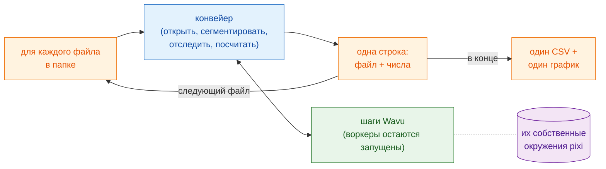

# Пакетная обработка

## Идея простыми словами

На странице про конвейер мы подали один ужин: шаги анализа были блюдами, а
один временной ряд — ингредиентами. Теперь целый стол гостей заказывает одно
и то же комплексное меню, и каждый приносит свои ингредиенты (по одному
файлу). Рецепт не меняется. Меняется вот что: кухни **разжигают
печи один раз** и держат их горячими, официант приносит тарелки одну за
другой, а в конце выписывает **один счёт** на весь стол.

В терминах изображений: запустите **тот же конвейер** для каждого
временного ряда в папке, запустите воркеры один раз и используйте их
повторно, соберите **одну строку на файл** (имя файла и несколько чисел),
запишите **один CSV** на папку и нарисуйте итоговый график.



## Перед началом

- Сначала добейтесь, чтобы конвейер работал на **одном** файле:
  [Конвейер в Fiji](pipeline-fiji.md) или
  [Конвейер на Python](pipeline-python.md). Эта страница использует те же
  папки с примерами (`examples/segment_frames`, `examples/track_trackpy`) и
  те же настройки.
- **Папка с временными рядами** (`.tif`). Чтобы попробовать, создайте
  папку и скопируйте в неё `examples/data/demo_timelapse.tif` два-три раза
  под разными именами. Каждая копия даёт те же числа — простая проверка.
- **Папка результатов**, отличная от входной папки.

## Код

Во всех трёх версиях конвейер для одного файла — это **код со страницы про
конвейер без изменений**: те же шаги, те же параметры. Добавлены только
цикл по файлам, итоговая строка и закрытие окон каждого файла, чтобы не
переполнялась память. Каждый файл по-прежнему получает свой `-counts.csv`
и графики; папка получает `batch-summary.csv` и `batch-summary.png`.

=== "Groovy"

    Откройте **File › New › Script…**, выберите **Language › Groovy**,
    вставьте код и нажмите **Run**. Шаги 1–5 взяты из конвейера на Groovy и
    помещены в замыкание (`analyse`), которое возвращает одну строку;
    единственное изменение в них — график и фильм сохраняются и
    закрываются, а не показываются.

    ```groovy
    #@ File (label = "Folder of time-lapses (.tif)", style = "directory") inDir
    #@ File (label = "segment_frames folder", style = "directory") segmentDir
    #@ File (label = "Output folder", style = "directory") outDir
    // Пакетная обработка: конвейер из «Конвейер в Fiji» для каждого .tif в папке,
    // одна строка на файл, один CSV и один график на папку.
    import fiji.plugin.trackmate.Logger
    import fiji.plugin.trackmate.Model
    import fiji.plugin.trackmate.Settings
    import fiji.plugin.trackmate.TrackMate
    import fiji.plugin.trackmate.detection.LabelImageDetectorFactory
    import fiji.plugin.trackmate.tracking.jaqaman.SparseLAPTrackerFactory
    import ij.IJ
    import ij.ImagePlus
    import ij.gui.Line
    import ij.gui.OvalRoi
    import ij.gui.Overlay
    import ij.gui.Plot
    import ij.measure.ResultsTable
    import java.awt.Color

    def wavu = new GroovyShell(this.class.classLoader).evaluate(
            new File(IJ.getDirectory("imagej"), "scripts/Plugins/Wavu/lib/wavu_lib.groovy.txt"))

    // Конвейер для одного файла (шаги 1-5 со страницы про конвейер). Возвращает одну строку.
    def analyse = { File file ->
        // 1. Открыть временной ряд (нативно в Fiji).
        def imp = IJ.openImage(file.path)
        if (imp == null) throw new IOException("cannot open " + file.name)
        def cal = imp.getCalibration()
        double dt = cal.frameInterval > 0 ? cal.frameInterval : 1
        int nFrames = imp.getNFrames()

        // 2. Сегментировать каждый кадр (Wavu). Воркер, запущенный для первого файла, используется повторно.
        Map seg = wavu.run(segmentDir, "script", [sigma: 2, threshold: "otsu", min_area: 30], [image: imp])
        def labels = seg.images.labels
        labels.setCalibration(cal.copy())

        // 3. Трекинг (нативно в Fiji: TrackMate).
        def model = new Model()
        model.setLogger(Logger.VOID_LOGGER)
        def settings = new Settings(labels)
        settings.detectorFactory = new LabelImageDetectorFactory()
        settings.detectorSettings = settings.detectorFactory.getDefaultSettings()
        settings.detectorSettings["TARGET_CHANNEL"] = 1
        settings.detectorSettings["SIMPLIFY_CONTOURS"] = false
        settings.trackerFactory = new SparseLAPTrackerFactory()
        settings.trackerSettings = settings.trackerFactory.getDefaultSettings()
        settings.trackerSettings["LINKING_MAX_DISTANCE"] = 10d
        settings.trackerSettings["ALLOW_GAP_CLOSING"] = true
        settings.trackerSettings["GAP_CLOSING_MAX_DISTANCE"] = 10d
        settings.trackerSettings["MAX_FRAME_GAP"] = 2
        settings.trackerSettings["ALLOW_TRACK_SPLITTING"] = true
        settings.trackerSettings["SPLITTING_MAX_DISTANCE"] = 10d
        def trackmate = new TrackMate(model, settings)
        if (!trackmate.checkInput() || !trackmate.process())
            throw new RuntimeException("TrackMate: " + trackmate.getErrorMessage())
        def tm = model.getTrackModel()
        def trackIds = tm.trackIDs(true)

        // 4. Таблицы: клетки на кадр и одна строка на трек.
        def counts = new ResultsTable()
        List<Integer> perFrame = []
        for (int t = 0; t < nFrames; t++) {
            int n = model.getSpots().getNSpots(t, true)
            perFrame << n
            counts.addRow()
            counts.addValue("frame", t)
            counts.addValue("time_min", t * dt)
            counts.addValue("cells", n)
        }
        def tracks = new ResultsTable()
        int divisions = 0
        trackIds.each { id ->
            def spots = tm.trackSpots(id)
            int splits = spots.count { s -> tm.edgesOf(s).count { e -> tm.getEdgeSource(e) == s } > 1 }
            divisions += splits
            def frames = spots.collect { it.getFeature("FRAME") as int }
            tracks.addRow()
            tracks.addValue("track", id)
            tracks.addValue("spots", spots.size())
            tracks.addValue("first_frame", frames.min())
            tracks.addValue("last_frame", frames.max())
            tracks.addValue("divisions", splits)
        }
        counts.save(new File(outDir, imp.getShortTitle() + "-counts.csv").path)
        tracks.save(new File(outDir, imp.getShortTitle() + "-tracks.csv").path)

        // 5a. График клеток на кадр (сохраняется, не показывается).
        def plot = new Plot("Cells per frame", "time (" + (cal.getTimeUnit() ?: "frame") + ")", "cells")
        plot.setColor(new Color(0x1565c0))
        plot.setLineWidth(2)
        double[] times = (0..<nFrames).collect { it * dt } as double[]
        plot.add("line", times, perFrame as double[])
        plot.add("circle", times, perFrame as double[])
        plot.setLimits(0, (nFrames - 1) * dt, 0, perFrame.max() + 5)
        IJ.saveAs(plot.getImagePlus(), "PNG", new File(outDir, imp.getShortTitle() + "-counts.png").path)

        // 5b. Треки на последнем кадре (сохраняется, не показывается).
        double px = cal.pixelWidth
        def overlay = new Overlay()
        trackIds.each { id ->
            def colour = Color.getHSBColor((float) ((id * 0.618034) % 1), 0.9f, 1f)
            tm.trackEdges(id).each { e ->
                def a = tm.getEdgeSource(e), b = tm.getEdgeTarget(e)
                def line = new Line(a.getDoublePosition(0) / px, a.getDoublePosition(1) / px,
                                    b.getDoublePosition(0) / px, b.getDoublePosition(1) / px)
                line.setStrokeColor(colour)
                overlay.add(line)
            }
            tm.trackSpots(id).each { s ->
                double r = s.getFeature("RADIUS") / px
                def ring = new OvalRoi(s.getDoublePosition(0) / px - r, s.getDoublePosition(1) / px - r, 2 * r, 2 * r)
                ring.setStrokeColor(colour)
                ring.setPosition(1, 1, (s.getFeature("FRAME") as int) + 1)
                overlay.add(ring)
            }
        }
        imp.setOverlay(overlay)
        IJ.run(imp, "Grays", "")
        imp.setT(nFrames)
        def last = new ImagePlus("last frame", imp.getProcessor().duplicate())
        last.setOverlay(new Overlay())
        overlay.each { roi -> if (roi.getTPosition() in [0, nFrames]) last.getOverlay().add(roi) }
        IJ.saveAs(last.flatten(), "PNG", new File(outDir, imp.getShortTitle() + "-tracks.png").path)
        imp.close()                                          // освободить память перед следующим файлом
        labels.close()

        return [frames: nFrames, times: times, perFrame: perFrame,
                tracks: trackIds.size(), divisions: divisions]
    }

    // Пакет: цикл, одна строка на файл, один CSV и один график на папку.
    def files = inDir.listFiles().findAll { it.name.toLowerCase().endsWith(".tif") }.sort { it.name }
    def summary = new ResultsTable()
    def all = new Plot("Cells per frame, all files", "time (min)", "cells")
    try {
        files.eachWithIndex { File file, int i ->
            IJ.log("[${i + 1}/${files.size()}] ${file.name}")
            summary.addRow()
            summary.addValue("file", file.name)
            try {
                Map row = analyse(file)
                summary.addValue("frames", row.frames)
                summary.addValue("first_count", row.perFrame[0])
                summary.addValue("last_count", row.perFrame[-1])
                summary.addValue("mean_cells", (row.perFrame.sum() / row.frames) as double)
                summary.addValue("tracks", row.tracks)
                summary.addValue("divisions", row.divisions)
                summary.addValue("error", "")
                all.setColor(Color.getHSBColor((float) ((i * 0.618034) % 1), 0.8f, 0.8f))
                all.add("line", row.times, row.perFrame as double[])
            } catch (InterruptedException e) {
                throw e                                      // Esc: остановить весь пакет
            } catch (Throwable e) {                          // в том числе ошибки чтения (Bio-Formats)
                IJ.log("  skipped ${file.name}: ${e}")          // один плохой файл: записать в лог и идти дальше
                summary.addValue("error", (e.message ?: e.toString()).readLines()[0])
            }
        }
    } finally {
        wavu.stopAll()                                       // остановить воркер один раз, в конце
    }
    summary.show("Batch summary")
    summary.save(new File(outDir, "batch-summary.csv").path)
    all.setLimitsToFit(false)
    all.show()
    IJ.saveAs(all.getImagePlus(), "PNG", new File(outDir, "batch-summary.png").path)
    ```

=== "ImageJ macro"

    Откройте **File › New › Script…**, выберите **Language › IJ1 Macro**,
    вставьте код и нажмите **Run**. Шаги 1–5 взяты из конвейера на макросе
    без изменений и помещены в цикл `for`.

    ```javascript
    // Пакетная обработка: конвейер из «Конвейер в Fiji» (макрос) для каждого .tif в папке.
    // Из командной строки:
    //   ImageJ-win64.exe --console -batch batch_counting.ijm "<input folder>|<segment_frames>|<track_trackpy>|<output folder>"
    arg = getArgument();
    if (arg == "") {
        inDir = getDirectory("Choose the folder of time-lapses");
        segmentDir = getDirectory("Choose the segment_frames folder");
        trackDir = getDirectory("Choose the track_trackpy folder");
        outDir = getDirectory("Choose the output folder");
    } else {
        a = split(arg, "|");
        inDir = a[0] + "/"; segmentDir = a[1]; trackDir = a[2]; outDir = a[3] + "/";
    }
    setBatchMode(true);
    list = getFileList(inDir);
    Table.create("Batch summary");

    for (f = 0; f < list.length; f++) {
        if (!endsWith(toLowerCase(list[f]), ".tif")) continue;
        print("[" + (f + 1) + "/" + list.length + "] " + list[f]);
        timelapse = inDir + list[f];

        // 1. Открыть временной ряд (нативно в Fiji).
        open(timelapse);
        movie = getImageID();
        name = File.nameWithoutExtension;
        dt = Stack.getFrameInterval();
        if (dt == 0) dt = 1;
        Stack.getUnits(xu, yu, zu, timeUnit, vu);
        Stack.getDimensions(w, h, channels, slices, frames);

        // 2. Сегментировать каждый кадр (Wavu). Воркер, запущенный для первого файла, используется повторно.
        run("Run Script (Macro)", "folder=[" + segmentDir + "] script=script params=[sigma=2 threshold=otsu min_area=30]");

        // 3. Трекинг (Wavu: trackpy) по таблице детекций. Открывает "tracks".
        run("Run Script (Macro)", "folder=[" + trackDir + "] script=script params=[search_range=15 memory=2] tables=[detections=" + name + "-detections]");

        // 4. Таблицы: клетки на кадр и число треков.
        n = Table.size("tracks");
        cells = newArray(frames);
        times = newArray(frames);
        nTracks = 0;
        for (i = 0; i < n; i++) {
            t = Table.get("frame", i, "tracks");
            cells[t] = cells[t] + 1;
            if (i == 0 || Table.get("particle", i, "tracks") != Table.get("particle", i - 1, "tracks"))
                nTracks++;
        }
        Table.create("Cells per frame");
        for (t = 0; t < frames; t++) {
            times[t] = t * dt;
            Table.set("frame", t, t);
            Table.set("time_" + timeUnit, t, times[t]);
            Table.set("cells", t, cells[t]);
        }
        Table.update;
        Table.save(outDir + name + "-counts.csv");

        // 5a. График числа клеток на кадр в зависимости от времени.
        Plot.create("Cells per frame", "time (" + timeUnit + ")", "cells");
        Plot.setColor("#1565c0");
        Plot.setLineWidth(2);
        Plot.add("line", times, cells);
        Plot.add("circle", times, cells);
        Array.getStatistics(cells, cmin, cmax, cmean);
        Plot.setLimits(0, (frames - 1) * dt, 0, cmax + 5);
        Plot.show();
        saveAs("PNG", outDir + name + "-counts.png");

        // 5b. Нарисовать путь каждого трека на оригинале, свой цвет для каждого трека.
        selectImage(movie);
        run("Grays");
        palette = newArray("#e6194b", "#3cb44b", "#ffe119", "#4363d8", "#f58231", "#911eb4",
                           "#46f0f0", "#f032e6", "#bcf60c", "#fabebe", "#008080", "#e6beff");
        Overlay.remove;
        for (i = 1; i < n; i++) {
            p = Table.get("particle", i, "tracks");
            if (Table.get("particle", i - 1, "tracks") != p) continue;
            setColor(palette[p % palette.length]);
            Overlay.drawLine(Table.get("x", i - 1, "tracks"), Table.get("y", i - 1, "tracks"),
                             Table.get("x", i, "tracks"), Table.get("y", i, "tracks"));
        }
        Overlay.show;
        Stack.setFrame(frames);
        run("Flatten", "slice");
        saveAs("PNG", outDir + name + "-tracks.png");

        // Пакет: одна строка для этого файла, затем закрыть всё, что он открыл.
        r = Table.size("Batch summary");
        Table.set("file", r, list[f], "Batch summary");
        Table.set("frames", r, frames, "Batch summary");
        Table.set("first_count", r, cells[0], "Batch summary");
        Table.set("last_count", r, cells[frames - 1], "Batch summary");
        Table.set("mean_cells", r, cmean, "Batch summary");
        Table.set("tracks", r, nTracks, "Batch summary");
        close("*");                                    // все изображения: фильм, метки, график, снимок
        close(name + "-detections");
        close(name + "-count_per_frame");
        close("tracks");
        close("Cells per frame");
    }

    // Папка: один CSV и один итоговый график.
    Table.save(outDir + "batch-summary.csv", "Batch summary");
    last = Table.getColumn("last_count", "Batch summary");
    mean = Table.getColumn("mean_cells", "Batch summary");
    x = Array.getSequence(last.length);
    Plot.create("Batch summary", "file (0 = first)", "cells");
    Plot.setColor("#1565c0");
    Plot.add("circle", x, last);
    Plot.setColor("#ef6c00");
    Plot.add("circle", x, mean);
    Plot.setLegend("final count\tmean per frame");
    Plot.show();
    saveAs("PNG", outDir + "batch-summary.png");
    setBatchMode("exit and display");
    run("Stop Worker");                                // остановить оба воркера, один раз
    ```

=== "Python"

    Сохраните это как `batch_counting.py` **рядом с**
    `examples/pipelines/dag_counting.py`, чтобы он мог импортировать папки
    и настройки из того файла. `analyse_one` — это тело `analyse()` с одним
    изменением: ему передают два уже работающих воркера, а не запускают их,
    поэтому они запускаются один раз на всю папку.

    ```python
    """Batch: the dag_counting pipeline for every time-lapse in a folder.

        pixi run -e napari python examples/pipelines/batch_counting.py <folder> [<output folder>]
    """
    import sys
    from pathlib import Path

    import pandas as pd
    import tifffile
    from matplotlib.figure import Figure

    from dag_counting import FRAME_MIN, PIXEL_UM, SEGMENT, TRACK
    from wavu.client import JobCancelled, Worker


    def analyse_one(movie_path, seg, trk):
        """Steps 1-4 of dag_counting.analyse(), with workers that are already running."""
        movie = tifffile.imread(movie_path)
        res = seg.run("script", {"sigma": 2.0, "threshold": "otsu", "min_area": 30},
                      {"image": movie}, meta={"image": {"pixel_um": PIXEL_UM}})
        detections = res.outputs["detections"].value
        res = trk.run("script", {"search_range": 10.0, "memory": 2},
                      {"detections": detections})
        tracks = res.outputs["tracks"].value
        counts = (detections.groupby("frame").size()
                  .reindex(range(len(movie)), fill_value=0).rename("cells").reset_index())
        counts["minutes"] = counts["frame"] * FRAME_MIN
        per_track = tracks.groupby("particle")["frame"].agg(start="min", end="max", length="size")
        row = {
            "frames": len(movie),
            "first_count": int(counts["cells"].iloc[0]),
            "last_count": int(counts["cells"].iloc[-1]),
            "mean_cells": float(counts["cells"].mean()),
            "tracks": int(tracks["particle"].nunique()),
            "new_tracks": int((per_track["start"] > 0).sum()),
        }
        return counts, row


    def main(folder: Path, out: Path):
        out.mkdir(parents=True, exist_ok=True)
        files = sorted(folder.glob("*.tif"))
        rows, curves = [], {}
        with Worker.start(SEGMENT, on_log=print) as seg, Worker.start(TRACK, on_log=print) as trk:
            for i, path in enumerate(files, 1):
                print(f"[{i}/{len(files)}] {path.name}")
                try:
                    counts, row = analyse_one(path, seg, trk)
                except JobCancelled:
                    raise                                   # отменено: остановить весь пакет
                except Exception as e:                      # один плохой файл: записать в лог и идти дальше
                    print(f"  skipped {path.name}: {e}")
                    rows.append({"file": path.name, "error": str(e).split("\n")[0]})
                    continue
                counts.to_csv(out / f"{path.stem}-counts.csv", index=False)
                rows.append({"file": path.name, **row})
                curves[path.stem] = counts

        summary = pd.DataFrame(rows)
        summary.to_csv(out / "batch-summary.csv", index=False)
        print(summary.to_string(index=False))

        fig = Figure(figsize=(6, 3.5), layout="constrained")
        ax = fig.add_subplot()
        for name, counts in curves.items():
            ax.plot(counts["minutes"], counts["cells"], label=name)
        ax.set_xlabel("time (min)")
        ax.set_ylabel("cells")
        ax.set_title("Cells per frame, all files")
        ax.legend(fontsize="small")
        fig.savefig(out / "batch-summary.png", dpi=120)


    if __name__ == "__main__":
        main(Path(sys.argv[1]), Path(sys.argv[2]) if len(sys.argv) > 2 else Path("batch_out"))
    ```

## Что вы получите

В папке результатов:

- для **каждого файла** — те же файлы, что и на странице про конвейер:
  `<name>-counts.csv`, `<name>-counts.png` и `<name>-tracks.png` (Fiji)
  или `<name>-counts.csv` (Python);
- для **папки** — `batch-summary.csv` с одной строкой на файл и
  `batch-summary.png`.

| столбец | значение |
|---|---|
| `file` | имя файла |
| `frames` | число кадров |
| `first_count`, `last_count` | клетки в первом и последнем кадре |
| `mean_cells` | среднее число клеток на кадр |
| `tracks` | число треков |
| `divisions` | только Groovy: разветвления треков в TrackMate |
| `new_tracks` | только Python: треки, которые начинаются после кадра 0 |
| `error` | Groovy и Python: почему файл был пропущен |

Итоговый график показывает кривую «клетки на кадр» каждого файла на одних
осях (Groovy, Python) или итоговое и среднее число клеток для каждого
файла (макрос). С копиями демо-фильма все строки и все кривые одинаковы:
25 клеток в начале, 29 в конце.

## Советы

- **Медленный только первый файл.** Первый вызов Wavu запускает воркер (а
  в самый первый раз ещё и устанавливает его кухонную утварь). Все
  следующие вызовы используют его повторно. Поэтому воркеры
  останавливаются **после** цикла, а не внутри него.
- **Один плохой файл не должен останавливать пакет.** Версии на Groovy и
  Python перехватывают ошибку, записывают имя файла в лог, добавляют строку
  со столбцом `error` и идут дальше. Макрос ImageJ не умеет перехватывать
  ошибки: неудачный шаг Wavu останавливает весь макрос. В окне Log виден
  последний начатый файл; уберите его из папки или исправьте и запустите
  снова.
- **Остановка.** Нажмите **Esc** в Fiji (или **Ctrl+C** в терминале для
  Python). Текущий шаг Wavu отменяется, и пакет останавливается, а не
  переходит к следующему файлу. Если макрос остановлен на полпути,
  завершите воркеры через **Plugins › Wavu › Stop Worker** (остановить
  воркер).
- **Память.** Закрывайте все изображения и таблицы, открытые для файла,
  перед следующим (`imp.close()`, `close("*")`). В Python массивы
  освобождаются, когда следующий файл их заменяет. Иначе память растёт с
  каждым файлом.
- **Проверяйте, прежде чем доверять.** Откройте и посмотрите на глаз один-два
  графика и снимка треков для отдельных файлов. Итоговая таблица отлично
  прячет плохую сегментацию.
- **Когда переходить к большим данным.** Пакетная обработка — для **многих
  файлов, каждый из которых помещается в память** (примерно 1–2 ГБ
  каждый). Если один файл больше, используйте
  [потоковый анализ](large-data.md). Для тысяч файлов или многих часов
  работы запускайте версию на Python в терминале без просмотрщика или на
  кластере.

## Одним предложением

Напишите конвейер для одного файла, оберните его в цикл, пусть воркеры
запустятся один раз и обслужат все файлы, не останавливайтесь на плохих
файлах и соберите по одной строке на файл в один CSV и один график на
папку.

[Далее: Большие данные :material-arrow-right:](large-data.md){ .md-button }
