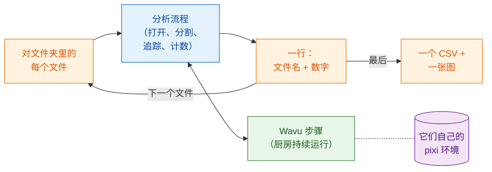

# 批处理

## 用白话说

在分析流程那一页，厨房为一段延时视频从打开一路做到绘图，每个步骤就是一道
菜。现在一整桌客人点了同一套套餐，每位客人都带来自己的一份食材（一个
文件）。食谱不变。改变的是：厨房**只生一次火**，让灶台一直热着，服务员
一盘接一盘地端菜，最后为整桌开**一张账单**。

换成图像的说法：对文件夹里的每段延时视频运行**同一个分析流程**，厨房只
启动一次并重复使用，**每个文件收集一行**（文件名和几个数字），为整个文件夹
写出**一个 CSV**，再画一张汇总图。



## 开始之前

- 先让分析流程在**一个**文件上跑通：
  [Fiji 中的分析流程](pipeline-fiji.md)或
  [Python 中的分析流程](pipeline-python.md)。本页使用同样的示例文件夹
  （`examples/segment_frames`、`examples/track_trackpy`）和同样的设置。
- **一个装着延时视频的文件夹**（`.tif`）。想试试的话，建一个文件夹，
  把 `examples/data/demo_timelapse.tif` 用不同的文件名复制进去两三次。每份
  副本得到的数字都一样，这是一个很容易的检查。
- 一个**输出文件夹**，和输入文件夹不同。

## 代码

三个版本里，每个文件的分析流程都是**分析流程页的代码，原封不动**：同样
的步骤，同样的参数。唯一新增的是对文件的循环、汇总的那一行，以及关闭每个
文件打开的窗口，免得内存被占满。每个文件仍然有自己的 `-counts.csv` 和
图表；整个文件夹则得到 `batch-summary.csv` 和 `batch-summary.png`。

=== "Groovy"

    打开 **File › New › Script…**，选择 **Language › Groovy**，粘贴代码，
    再按 **Run**。步骤 1 到 5 就是 Groovy 分析流程的步骤，放在一个返回一行
    的闭包（`analyse`）里；其中唯一的改变是图表和视频会保存并关闭，
    而不是显示出来。

    ```groovy
    #@ File (label = "Folder of time-lapses (.tif)", style = "directory") inDir
    #@ File (label = "segment_frames folder", style = "directory") segmentDir
    #@ File (label = "Output folder", style = "directory") outDir
    // 批处理：对文件夹里的每个 .tif 运行“Fiji 中的分析流程”，
    // 每个文件一行，整个文件夹一个 CSV 和一张图。
    import fiji.plugin.trackmate.Logger
    import fiji.plugin.trackmate.Model
    import fiji.plugin.trackmate.Settings
    import fiji.plugin.trackmate.TrackMate
    import fiji.plugin.trackmate.detection.LabelImageDetectorFactory
    import fiji.plugin.trackmate.tracking.jaqaman.SparseLAPTrackerFactory
    import ij.IJ
    import ij.ImagePlus
    import ij.gui.Line
    import ij.gui.OvalRoi
    import ij.gui.Overlay
    import ij.gui.Plot
    import ij.measure.ResultsTable
    import java.awt.Color

    def wavu = new GroovyShell(this.class.classLoader).evaluate(
            new File(IJ.getDirectory("imagej"), "scripts/Plugins/Wavu/lib/wavu_lib.groovy.txt"))

    // 一个文件的分析流程（分析流程页的步骤 1-5）。返回一行。
    def analyse = { File file ->
        // 1. 打开延时视频（Fiji 原生）。
        def imp = IJ.openImage(file.path)
        if (imp == null) throw new IOException("cannot open " + file.name)
        def cal = imp.getCalibration()
        double dt = cal.frameInterval > 0 ? cal.frameInterval : 1
        int nFrames = imp.getNFrames()

        // 2. 分割每一帧（Wavu）。为第一个文件启动的厨房会被复用。
        Map seg = wavu.run(segmentDir, "script", [sigma: 2, threshold: "otsu", min_area: 30], [image: imp])
        def labels = seg.images.labels
        labels.setCalibration(cal.copy())

        // 3. 追踪（Fiji 原生：TrackMate）。
        def model = new Model()
        model.setLogger(Logger.VOID_LOGGER)
        def settings = new Settings(labels)
        settings.detectorFactory = new LabelImageDetectorFactory()
        settings.detectorSettings = settings.detectorFactory.getDefaultSettings()
        settings.detectorSettings["TARGET_CHANNEL"] = 1
        settings.detectorSettings["SIMPLIFY_CONTOURS"] = false
        settings.trackerFactory = new SparseLAPTrackerFactory()
        settings.trackerSettings = settings.trackerFactory.getDefaultSettings()
        settings.trackerSettings["LINKING_MAX_DISTANCE"] = 10d
        settings.trackerSettings["ALLOW_GAP_CLOSING"] = true
        settings.trackerSettings["GAP_CLOSING_MAX_DISTANCE"] = 10d
        settings.trackerSettings["MAX_FRAME_GAP"] = 2
        settings.trackerSettings["ALLOW_TRACK_SPLITTING"] = true
        settings.trackerSettings["SPLITTING_MAX_DISTANCE"] = 10d
        def trackmate = new TrackMate(model, settings)
        if (!trackmate.checkInput() || !trackmate.process())
            throw new RuntimeException("TrackMate: " + trackmate.getErrorMessage())
        def tm = model.getTrackModel()
        def trackIds = tm.trackIDs(true)

        // 4. 制表：每帧细胞数，以及每条轨迹一行。
        def counts = new ResultsTable()
        List<Integer> perFrame = []
        for (int t = 0; t < nFrames; t++) {
            int n = model.getSpots().getNSpots(t, true)
            perFrame << n
            counts.addRow()
            counts.addValue("frame", t)
            counts.addValue("time_min", t * dt)
            counts.addValue("cells", n)
        }
        def tracks = new ResultsTable()
        int divisions = 0
        trackIds.each { id ->
            def spots = tm.trackSpots(id)
            int splits = spots.count { s -> tm.edgesOf(s).count { e -> tm.getEdgeSource(e) == s } > 1 }
            divisions += splits
            def frames = spots.collect { it.getFeature("FRAME") as int }
            tracks.addRow()
            tracks.addValue("track", id)
            tracks.addValue("spots", spots.size())
            tracks.addValue("first_frame", frames.min())
            tracks.addValue("last_frame", frames.max())
            tracks.addValue("divisions", splits)
        }
        counts.save(new File(outDir, imp.getShortTitle() + "-counts.csv").path)
        tracks.save(new File(outDir, imp.getShortTitle() + "-tracks.csv").path)

        // 5a. 画出每帧细胞数（保存，不显示）。
        def plot = new Plot("Cells per frame", "time (" + (cal.getTimeUnit() ?: "frame") + ")", "cells")
        plot.setColor(new Color(0x1565c0))
        plot.setLineWidth(2)
        double[] times = (0..<nFrames).collect { it * dt } as double[]
        plot.add("line", times, perFrame as double[])
        plot.add("circle", times, perFrame as double[])
        plot.setLimits(0, (nFrames - 1) * dt, 0, perFrame.max() + 5)
        IJ.saveAs(plot.getImagePlus(), "PNG", new File(outDir, imp.getShortTitle() + "-counts.png").path)

        // 5b. 最后一帧上的轨迹（保存，不显示）。
        double px = cal.pixelWidth
        def overlay = new Overlay()
        trackIds.each { id ->
            def colour = Color.getHSBColor((float) ((id * 0.618034) % 1), 0.9f, 1f)
            tm.trackEdges(id).each { e ->
                def a = tm.getEdgeSource(e), b = tm.getEdgeTarget(e)
                def line = new Line(a.getDoublePosition(0) / px, a.getDoublePosition(1) / px,
                                    b.getDoublePosition(0) / px, b.getDoublePosition(1) / px)
                line.setStrokeColor(colour)
                overlay.add(line)
            }
            tm.trackSpots(id).each { s ->
                double r = s.getFeature("RADIUS") / px
                def ring = new OvalRoi(s.getDoublePosition(0) / px - r, s.getDoublePosition(1) / px - r, 2 * r, 2 * r)
                ring.setStrokeColor(colour)
                ring.setPosition(1, 1, (s.getFeature("FRAME") as int) + 1)
                overlay.add(ring)
            }
        }
        imp.setOverlay(overlay)
        IJ.run(imp, "Grays", "")
        imp.setT(nFrames)
        def last = new ImagePlus("last frame", imp.getProcessor().duplicate())
        last.setOverlay(new Overlay())
        overlay.each { roi -> if (roi.getTPosition() in [0, nFrames]) last.getOverlay().add(roi) }
        IJ.saveAs(last.flatten(), "PNG", new File(outDir, imp.getShortTitle() + "-tracks.png").path)
        imp.close()                                          // 处理下一个文件前先释放内存
        labels.close()

        return [frames: nFrames, times: times, perFrame: perFrame,
                tracks: trackIds.size(), divisions: divisions]
    }

    // 批处理：循环，每个文件一行，整个文件夹一个 CSV 和一张图。
    def files = inDir.listFiles().findAll { it.name.toLowerCase().endsWith(".tif") }.sort { it.name }
    def summary = new ResultsTable()
    def all = new Plot("Cells per frame, all files", "time (min)", "cells")
    try {
        files.eachWithIndex { File file, int i ->
            IJ.log("[${i + 1}/${files.size()}] ${file.name}")
            summary.addRow()
            summary.addValue("file", file.name)
            try {
                Map row = analyse(file)
                summary.addValue("frames", row.frames)
                summary.addValue("first_count", row.perFrame[0])
                summary.addValue("last_count", row.perFrame[-1])
                summary.addValue("mean_cells", (row.perFrame.sum() / row.frames) as double)
                summary.addValue("tracks", row.tracks)
                summary.addValue("divisions", row.divisions)
                summary.addValue("error", "")
                all.setColor(Color.getHSBColor((float) ((i * 0.618034) % 1), 0.8f, 0.8f))
                all.add("line", row.times, row.perFrame as double[])
            } catch (InterruptedException e) {
                throw e                                      // Esc：停止整个批处理
            } catch (Throwable e) {                          // 也包括读取器的错误（Bio-Formats）
                IJ.log("  skipped ${file.name}: ${e}")          // 一个坏文件：记下来，继续
                summary.addValue("error", (e.message ?: e.toString()).readLines()[0])
            }
        }
    } finally {
        wavu.stopAll()                                       // 最后只停止厨房一次
    }
    summary.show("Batch summary")
    summary.save(new File(outDir, "batch-summary.csv").path)
    all.setLimitsToFit(false)
    all.show()
    IJ.saveAs(all.getImagePlus(), "PNG", new File(outDir, "batch-summary.png").path)
    ```

=== "ImageJ macro"

    打开 **File › New › Script…**，选择 **Language › IJ1 Macro**，粘贴
    代码，再按 **Run**。步骤 1 到 5 就是宏分析流程的步骤，原封不动，
    放在一个 `for` 循环里。

    ```javascript
    // 批处理：对文件夹里的每个 .tif 运行“Fiji 中的分析流程”（宏）。
    // 从命令行运行：
    //   ImageJ-win64.exe --console -batch batch_counting.ijm "<input folder>|<segment_frames>|<track_trackpy>|<output folder>"
    arg = getArgument();
    if (arg == "") {
        inDir = getDirectory("Choose the folder of time-lapses");
        segmentDir = getDirectory("Choose the segment_frames folder");
        trackDir = getDirectory("Choose the track_trackpy folder");
        outDir = getDirectory("Choose the output folder");
    } else {
        a = split(arg, "|");
        inDir = a[0] + "/"; segmentDir = a[1]; trackDir = a[2]; outDir = a[3] + "/";
    }
    setBatchMode(true);
    list = getFileList(inDir);
    Table.create("Batch summary");

    for (f = 0; f < list.length; f++) {
        if (!endsWith(toLowerCase(list[f]), ".tif")) continue;
        print("[" + (f + 1) + "/" + list.length + "] " + list[f]);
        timelapse = inDir + list[f];

        // 1. 打开延时视频（Fiji 原生）。
        open(timelapse);
        movie = getImageID();
        name = File.nameWithoutExtension;
        dt = Stack.getFrameInterval();
        if (dt == 0) dt = 1;
        Stack.getUnits(xu, yu, zu, timeUnit, vu);
        Stack.getDimensions(w, h, channels, slices, frames);

        // 2. 分割每一帧（Wavu）。为第一个文件启动的厨房会被复用。
        run("Run Script (Macro)", "folder=[" + segmentDir + "] script=script params=[sigma=2 threshold=otsu min_area=30]");

        // 3. 追踪（Wavu：trackpy），输入检测结果表格。会打开 "tracks"。
        run("Run Script (Macro)", "folder=[" + trackDir + "] script=script params=[search_range=15 memory=2] tables=[detections=" + name + "-detections]");

        // 4. 制表：每帧细胞数和轨迹数。
        n = Table.size("tracks");
        cells = newArray(frames);
        times = newArray(frames);
        nTracks = 0;
        for (i = 0; i < n; i++) {
            t = Table.get("frame", i, "tracks");
            cells[t] = cells[t] + 1;
            if (i == 0 || Table.get("particle", i, "tracks") != Table.get("particle", i - 1, "tracks"))
                nTracks++;
        }
        Table.create("Cells per frame");
        for (t = 0; t < frames; t++) {
            times[t] = t * dt;
            Table.set("frame", t, t);
            Table.set("time_" + timeUnit, t, times[t]);
            Table.set("cells", t, cells[t]);
        }
        Table.update;
        Table.save(outDir + name + "-counts.csv");

        // 5a. 画出每帧细胞数对时间的图。
        Plot.create("Cells per frame", "time (" + timeUnit + ")", "cells");
        Plot.setColor("#1565c0");
        Plot.setLineWidth(2);
        Plot.add("line", times, cells);
        Plot.add("circle", times, cells);
        Array.getStatistics(cells, cmin, cmax, cmean);
        Plot.setLimits(0, (frames - 1) * dt, 0, cmax + 5);
        Plot.show();
        saveAs("PNG", outDir + name + "-counts.png");

        // 5b. 在原始图像上画出每条轨迹的路径，每条轨迹一种颜色。
        selectImage(movie);
        run("Grays");
        palette = newArray("#e6194b", "#3cb44b", "#ffe119", "#4363d8", "#f58231", "#911eb4",
                           "#46f0f0", "#f032e6", "#bcf60c", "#fabebe", "#008080", "#e6beff");
        Overlay.remove;
        for (i = 1; i < n; i++) {
            p = Table.get("particle", i, "tracks");
            if (Table.get("particle", i - 1, "tracks") != p) continue;
            setColor(palette[p % palette.length]);
            Overlay.drawLine(Table.get("x", i - 1, "tracks"), Table.get("y", i - 1, "tracks"),
                             Table.get("x", i, "tracks"), Table.get("y", i, "tracks"));
        }
        Overlay.show;
        Stack.setFrame(frames);
        run("Flatten", "slice");
        saveAs("PNG", outDir + name + "-tracks.png");

        // 批处理：这个文件一行，然后关闭它打开的所有东西。
        r = Table.size("Batch summary");
        Table.set("file", r, list[f], "Batch summary");
        Table.set("frames", r, frames, "Batch summary");
        Table.set("first_count", r, cells[0], "Batch summary");
        Table.set("last_count", r, cells[frames - 1], "Batch summary");
        Table.set("mean_cells", r, cmean, "Batch summary");
        Table.set("tracks", r, nTracks, "Batch summary");
        close("*");                                    // 所有图像：视频、标签、图表、快照
        close(name + "-detections");
        close(name + "-count_per_frame");
        close("tracks");
        close("Cells per frame");
    }

    // 整个文件夹：一个 CSV 和一张汇总图。
    Table.save(outDir + "batch-summary.csv", "Batch summary");
    last = Table.getColumn("last_count", "Batch summary");
    mean = Table.getColumn("mean_cells", "Batch summary");
    x = Array.getSequence(last.length);
    Plot.create("Batch summary", "file (0 = first)", "cells");
    Plot.setColor("#1565c0");
    Plot.add("circle", x, last);
    Plot.setColor("#ef6c00");
    Plot.add("circle", x, mean);
    Plot.setLegend("final count\tmean per frame");
    Plot.show();
    saveAs("PNG", outDir + "batch-summary.png");
    setBatchMode("exit and display");
    run("Stop Worker");                                // 停止两个厨房，只停一次
    ```

=== "Python"

    把这段保存为 `batch_counting.py`，放在
    `examples/pipelines/dag_counting.py` **旁边**，这样它才能导入那个文件的
    文件夹和设置。`analyse_one` 就是 `analyse()` 的主体，只改了一处：它拿到
    的是两个已经在运行的厨房，而不是自己启动它们，所以整个文件夹只需要启动
    一次。

    ```python
    """Batch: the dag_counting pipeline for every time-lapse in a folder.

        pixi run -e napari python examples/pipelines/batch_counting.py <folder> [<output folder>]
    """
    import sys
    from pathlib import Path

    import pandas as pd
    import tifffile
    from matplotlib.figure import Figure

    from dag_counting import FRAME_MIN, PIXEL_UM, SEGMENT, TRACK
    from wavu.client import JobCancelled, Worker


    def analyse_one(movie_path, seg, trk):
        """Steps 1-4 of dag_counting.analyse(), with workers that are already running."""
        movie = tifffile.imread(movie_path)
        res = seg.run("script", {"sigma": 2.0, "threshold": "otsu", "min_area": 30},
                      {"image": movie}, meta={"image": {"pixel_um": PIXEL_UM}})
        detections = res.outputs["detections"].value
        res = trk.run("script", {"search_range": 10.0, "memory": 2},
                      {"detections": detections})
        tracks = res.outputs["tracks"].value
        counts = (detections.groupby("frame").size()
                  .reindex(range(len(movie)), fill_value=0).rename("cells").reset_index())
        counts["minutes"] = counts["frame"] * FRAME_MIN
        per_track = tracks.groupby("particle")["frame"].agg(start="min", end="max", length="size")
        row = {
            "frames": len(movie),
            "first_count": int(counts["cells"].iloc[0]),
            "last_count": int(counts["cells"].iloc[-1]),
            "mean_cells": float(counts["cells"].mean()),
            "tracks": int(tracks["particle"].nunique()),
            "new_tracks": int((per_track["start"] > 0).sum()),
        }
        return counts, row


    def main(folder: Path, out: Path):
        out.mkdir(parents=True, exist_ok=True)
        files = sorted(folder.glob("*.tif"))
        rows, curves = [], {}
        with Worker.start(SEGMENT, on_log=print) as seg, Worker.start(TRACK, on_log=print) as trk:
            for i, path in enumerate(files, 1):
                print(f"[{i}/{len(files)}] {path.name}")
                try:
                    counts, row = analyse_one(path, seg, trk)
                except JobCancelled:
                    raise                                   # 已取消：停止整个批处理
                except Exception as e:                      # 一个坏文件：记下来，继续
                    print(f"  skipped {path.name}: {e}")
                    rows.append({"file": path.name, "error": str(e).split("\n")[0]})
                    continue
                counts.to_csv(out / f"{path.stem}-counts.csv", index=False)
                rows.append({"file": path.name, **row})
                curves[path.stem] = counts

        summary = pd.DataFrame(rows)
        summary.to_csv(out / "batch-summary.csv", index=False)
        print(summary.to_string(index=False))

        fig = Figure(figsize=(6, 3.5), layout="constrained")
        ax = fig.add_subplot()
        for name, counts in curves.items():
            ax.plot(counts["minutes"], counts["cells"], label=name)
        ax.set_xlabel("time (min)")
        ax.set_ylabel("cells")
        ax.set_title("Cells per frame, all files")
        ax.legend(fontsize="small")
        fig.savefig(out / "batch-summary.png", dpi=120)


    if __name__ == "__main__":
        main(Path(sys.argv[1]), Path(sys.argv[2]) if len(sys.argv) > 2 else Path("batch_out"))
    ```

## 你会得到什么

在输出文件夹里：

- **每个文件**都有和分析流程页一样的文件：
  `<name>-counts.csv`、`<name>-counts.png` 和 `<name>-tracks.png`（Fiji），
  或 `<name>-counts.csv`（Python）；
- **整个文件夹**有 `batch-summary.csv`（每个文件一行）和
  `batch-summary.png`。

| 列 | 含义 |
|---|---|
| `file` | 文件名 |
| `frames` | 帧数 |
| `first_count`、`last_count` | 第一帧和最后一帧的细胞数 |
| `mean_cells` | 每帧的平均细胞数 |
| `tracks` | 轨迹数 |
| `divisions` | 仅 Groovy：TrackMate 的轨迹分叉数 |
| `new_tracks` | 仅 Python：在第 0 帧之后才开始的轨迹 |
| `error` | Groovy 和 Python：某个文件被跳过的原因 |

汇总图把每个文件的“每帧细胞数”曲线画在同一组坐标轴上（Groovy、Python），
或画出每个文件的最终数量和平均数量（宏）。用示例视频的副本时，每一行、
每一条曲线都一样：开始时 25 个细胞，最后 29 个。

## 小技巧

- **只有第一个文件会慢**。第一次 Wavu 调用会启动厨房（而且在最初那一次还
  会安装它的厨具）。之后的每次调用都复用它。这就是为什么厨房是在循环
  **之后**才停止，而不是在循环里面。
- **一个坏文件不该让整个批处理停下来**。Groovy 和 Python 版本会捕获错误，
  记下文件名，加上一行带有 `error` 列的数据，然后继续。ImageJ 宏无法
  捕获错误：一个 Wavu 步骤失败，整个宏就会停止。Log 会显示它最后开始
  处理的文件；把那个文件移出文件夹，或修好它，再运行一次。
- **停止**。在 Fiji 里按 **Esc**（Python 则是在终端里按 **Ctrl+C**）。
  正在运行的 Wavu 步骤会被取消，批处理会停下来，而不是继续处理下一个文件。
  如果宏在中途被停止，请用 **Plugins › Wavu › Stop Worker** 结束厨房。
- **内存**。在处理下一个文件之前，关闭这个文件打开的每张图像和每个表格
  （`imp.close()`、`close("*")`）。在 Python 里，下一个文件替换数组时，
  它们就会被释放。否则内存会随着每个文件增长。
- **相信之前先检查**。用眼睛看一两张每个文件的图表和轨迹快照。汇总表格
  非常善于把糟糕的分割藏起来。
- **什么时候该改用大型数据的做法**。批处理适用于**很多个、每个都放得进
  内存的文件**（每个大约 1–2 GB）。如果单个文件更大，请用
  [流式分析](large-data.md)。如果有成千上万个文件或要跑好几个小时，请在
  终端里运行 Python 版本，不开 Fiji/napari，或在集群上运行。

## 一句话总结

为一个文件写好分析流程，把它包进循环，让厨房只启动一次就服务每个文件，
遇到坏文件就跳过继续，并把每个文件的一行收集成整个文件夹的一个 CSV 和
一张图。

[下一页：大型数据 :material-arrow-right:](large-data.md){ .md-button }
