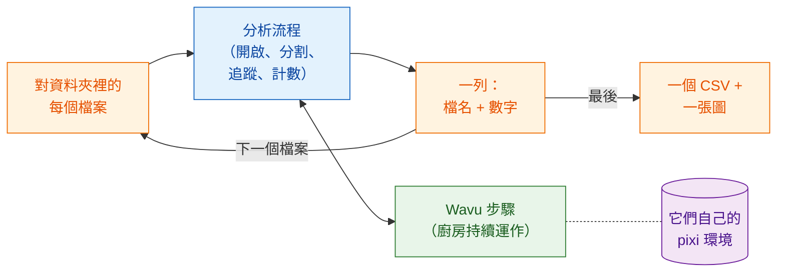

# 批次處理

## 用白話說

在分析流程那一頁，廚房為一段縮時影片從開啟一路做到繪圖，每個步驟就是一道
菜。現在一整桌客人點了同一套套餐，每位客人都帶來自己的一份食材（一個
檔案）。食譜不變。改變的是：廚房**只生一次火**，讓爐子一直熱著，服務生
一盤接一盤地端菜，最後為整桌開**一張帳單**。

換成影像的說法：對資料夾裡的每段縮時影片執行**同一個分析流程**，廚房只
啟動一次並重複使用，**每個檔案收集一列**（檔名和幾個數字），為整個資料夾
寫出**一個 CSV**，再畫一張摘要圖。



## 開始之前

- 先讓分析流程在**一個**檔案上跑通：
  [Fiji 中的分析流程](pipeline-fiji.md)或
  [Python 中的分析流程](pipeline-python.md)。本頁使用同樣的範例資料夾
  （`examples/segment_frames`、`examples/track_trackpy`）和同樣的設定。
- **一個裝著縮時影片的資料夾**（`.tif`）。想試試看的話，建立一個資料夾，
  把 `examples/data/demo_timelapse.tif` 用不同的檔名複製進去兩三次。每份
  副本得到的數字都一樣，這是一個很容易的檢查。
- 一個**輸出資料夾**，和輸入資料夾不同。

## 程式碼

三個版本裡，每個檔案的分析流程都是**分析流程頁的程式碼，原封不動**：同樣
的步驟，同樣的參數。唯一新增的是對檔案的迴圈、摘要的那一列，以及關閉每個
檔案開啟的視窗，免得記憶體被塞滿。每個檔案仍然有自己的 `-counts.csv` 和
圖表；整個資料夾則得到 `batch-summary.csv` 和 `batch-summary.png`。

=== "Groovy"

    開啟 **File › New › Script…**，選擇 **Language › Groovy**，貼上程式碼，
    再按 **Run**。步驟 1 到 5 就是 Groovy 分析流程的步驟，放在一個回傳一列
    的 closure（`analyse`）裡；其中唯一的改變是圖表和影片會存檔並關閉，
    而不是顯示出來。

    ```groovy
    #@ File (label = "Folder of time-lapses (.tif)", style = "directory") inDir
    #@ File (label = "segment_frames folder", style = "directory") segmentDir
    #@ File (label = "Output folder", style = "directory") outDir
    // 批次處理：對資料夾裡的每個 .tif 執行「Fiji 中的分析流程」，
    // 每個檔案一列，整個資料夾一個 CSV 和一張圖。
    import fiji.plugin.trackmate.Logger
    import fiji.plugin.trackmate.Model
    import fiji.plugin.trackmate.Settings
    import fiji.plugin.trackmate.TrackMate
    import fiji.plugin.trackmate.detection.LabelImageDetectorFactory
    import fiji.plugin.trackmate.tracking.jaqaman.SparseLAPTrackerFactory
    import ij.IJ
    import ij.ImagePlus
    import ij.gui.Line
    import ij.gui.OvalRoi
    import ij.gui.Overlay
    import ij.gui.Plot
    import ij.measure.ResultsTable
    import java.awt.Color

    def wavu = new GroovyShell(this.class.classLoader).evaluate(
            new File(IJ.getDirectory("imagej"), "scripts/Plugins/Wavu/lib/wavu_lib.groovy.txt"))

    // 一個檔案的分析流程（分析流程頁的步驟 1-5）。回傳一列。
    def analyse = { File file ->
        // 1. 開啟縮時影片（Fiji 原生）。
        def imp = IJ.openImage(file.path)
        if (imp == null) throw new IOException("cannot open " + file.name)
        def cal = imp.getCalibration()
        double dt = cal.frameInterval > 0 ? cal.frameInterval : 1
        int nFrames = imp.getNFrames()

        // 2. 分割每個影格（Wavu）。為第一個檔案啟動的廚房會被重複使用。
        Map seg = wavu.run(segmentDir, "script", [sigma: 2, threshold: "otsu", min_area: 30], [image: imp])
        def labels = seg.images.labels
        labels.setCalibration(cal.copy())

        // 3. 追蹤（Fiji 原生：TrackMate）。
        def model = new Model()
        model.setLogger(Logger.VOID_LOGGER)
        def settings = new Settings(labels)
        settings.detectorFactory = new LabelImageDetectorFactory()
        settings.detectorSettings = settings.detectorFactory.getDefaultSettings()
        settings.detectorSettings["TARGET_CHANNEL"] = 1
        settings.detectorSettings["SIMPLIFY_CONTOURS"] = false
        settings.trackerFactory = new SparseLAPTrackerFactory()
        settings.trackerSettings = settings.trackerFactory.getDefaultSettings()
        settings.trackerSettings["LINKING_MAX_DISTANCE"] = 10d
        settings.trackerSettings["ALLOW_GAP_CLOSING"] = true
        settings.trackerSettings["GAP_CLOSING_MAX_DISTANCE"] = 10d
        settings.trackerSettings["MAX_FRAME_GAP"] = 2
        settings.trackerSettings["ALLOW_TRACK_SPLITTING"] = true
        settings.trackerSettings["SPLITTING_MAX_DISTANCE"] = 10d
        def trackmate = new TrackMate(model, settings)
        if (!trackmate.checkInput() || !trackmate.process())
            throw new RuntimeException("TrackMate: " + trackmate.getErrorMessage())
        def tm = model.getTrackModel()
        def trackIds = tm.trackIDs(true)

        // 4. 製表：每個影格的細胞數，以及每條軌跡一列。
        def counts = new ResultsTable()
        List<Integer> perFrame = []
        for (int t = 0; t < nFrames; t++) {
            int n = model.getSpots().getNSpots(t, true)
            perFrame << n
            counts.addRow()
            counts.addValue("frame", t)
            counts.addValue("time_min", t * dt)
            counts.addValue("cells", n)
        }
        def tracks = new ResultsTable()
        int divisions = 0
        trackIds.each { id ->
            def spots = tm.trackSpots(id)
            int splits = spots.count { s -> tm.edgesOf(s).count { e -> tm.getEdgeSource(e) == s } > 1 }
            divisions += splits
            def frames = spots.collect { it.getFeature("FRAME") as int }
            tracks.addRow()
            tracks.addValue("track", id)
            tracks.addValue("spots", spots.size())
            tracks.addValue("first_frame", frames.min())
            tracks.addValue("last_frame", frames.max())
            tracks.addValue("divisions", splits)
        }
        counts.save(new File(outDir, imp.getShortTitle() + "-counts.csv").path)
        tracks.save(new File(outDir, imp.getShortTitle() + "-tracks.csv").path)

        // 5a. 畫出每個影格的細胞數（存檔，不顯示）。
        def plot = new Plot("Cells per frame", "time (" + (cal.getTimeUnit() ?: "frame") + ")", "cells")
        plot.setColor(new Color(0x1565c0))
        plot.setLineWidth(2)
        double[] times = (0..<nFrames).collect { it * dt } as double[]
        plot.add("line", times, perFrame as double[])
        plot.add("circle", times, perFrame as double[])
        plot.setLimits(0, (nFrames - 1) * dt, 0, perFrame.max() + 5)
        IJ.saveAs(plot.getImagePlus(), "PNG", new File(outDir, imp.getShortTitle() + "-counts.png").path)

        // 5b. 最後一個影格上的軌跡（存檔，不顯示）。
        double px = cal.pixelWidth
        def overlay = new Overlay()
        trackIds.each { id ->
            def colour = Color.getHSBColor((float) ((id * 0.618034) % 1), 0.9f, 1f)
            tm.trackEdges(id).each { e ->
                def a = tm.getEdgeSource(e), b = tm.getEdgeTarget(e)
                def line = new Line(a.getDoublePosition(0) / px, a.getDoublePosition(1) / px,
                                    b.getDoublePosition(0) / px, b.getDoublePosition(1) / px)
                line.setStrokeColor(colour)
                overlay.add(line)
            }
            tm.trackSpots(id).each { s ->
                double r = s.getFeature("RADIUS") / px
                def ring = new OvalRoi(s.getDoublePosition(0) / px - r, s.getDoublePosition(1) / px - r, 2 * r, 2 * r)
                ring.setStrokeColor(colour)
                ring.setPosition(1, 1, (s.getFeature("FRAME") as int) + 1)
                overlay.add(ring)
            }
        }
        imp.setOverlay(overlay)
        IJ.run(imp, "Grays", "")
        imp.setT(nFrames)
        def last = new ImagePlus("last frame", imp.getProcessor().duplicate())
        last.setOverlay(new Overlay())
        overlay.each { roi -> if (roi.getTPosition() in [0, nFrames]) last.getOverlay().add(roi) }
        IJ.saveAs(last.flatten(), "PNG", new File(outDir, imp.getShortTitle() + "-tracks.png").path)
        imp.close()                                          // 處理下一個檔案前先釋放記憶體
        labels.close()

        return [frames: nFrames, times: times, perFrame: perFrame,
                tracks: trackIds.size(), divisions: divisions]
    }

    // 批次處理：迴圈，每個檔案一列，整個資料夾一個 CSV 和一張圖。
    def files = inDir.listFiles().findAll { it.name.toLowerCase().endsWith(".tif") }.sort { it.name }
    def summary = new ResultsTable()
    def all = new Plot("Cells per frame, all files", "time (min)", "cells")
    try {
        files.eachWithIndex { File file, int i ->
            IJ.log("[${i + 1}/${files.size()}] ${file.name}")
            summary.addRow()
            summary.addValue("file", file.name)
            try {
                Map row = analyse(file)
                summary.addValue("frames", row.frames)
                summary.addValue("first_count", row.perFrame[0])
                summary.addValue("last_count", row.perFrame[-1])
                summary.addValue("mean_cells", (row.perFrame.sum() / row.frames) as double)
                summary.addValue("tracks", row.tracks)
                summary.addValue("divisions", row.divisions)
                summary.addValue("error", "")
                all.setColor(Color.getHSBColor((float) ((i * 0.618034) % 1), 0.8f, 0.8f))
                all.add("line", row.times, row.perFrame as double[])
            } catch (InterruptedException e) {
                throw e                                      // Esc：停止整個批次
            } catch (Throwable e) {                          // 也包括讀取器的錯誤（Bio-Formats）
                IJ.log("  skipped ${file.name}: ${e}")          // 一個壞檔案：記下來，繼續
                summary.addValue("error", (e.message ?: e.toString()).readLines()[0])
            }
        }
    } finally {
        wavu.stopAll()                                       // 最後只停止廚房一次
    }
    summary.show("Batch summary")
    summary.save(new File(outDir, "batch-summary.csv").path)
    all.setLimitsToFit(false)
    all.show()
    IJ.saveAs(all.getImagePlus(), "PNG", new File(outDir, "batch-summary.png").path)
    ```

=== "ImageJ macro"

    開啟 **File › New › Script…**，選擇 **Language › IJ1 Macro**，貼上
    程式碼，再按 **Run**。步驟 1 到 5 就是巨集分析流程的步驟，原封不動，
    放在一個 `for` 迴圈裡。

    ```javascript
    // 批次處理：對資料夾裡的每個 .tif 執行「Fiji 中的分析流程」（巨集）。
    // 從命令列執行：
    //   ImageJ-win64.exe --console -batch batch_counting.ijm "<input folder>|<segment_frames>|<track_trackpy>|<output folder>"
    arg = getArgument();
    if (arg == "") {
        inDir = getDirectory("Choose the folder of time-lapses");
        segmentDir = getDirectory("Choose the segment_frames folder");
        trackDir = getDirectory("Choose the track_trackpy folder");
        outDir = getDirectory("Choose the output folder");
    } else {
        a = split(arg, "|");
        inDir = a[0] + "/"; segmentDir = a[1]; trackDir = a[2]; outDir = a[3] + "/";
    }
    setBatchMode(true);
    list = getFileList(inDir);
    Table.create("Batch summary");

    for (f = 0; f < list.length; f++) {
        if (!endsWith(toLowerCase(list[f]), ".tif")) continue;
        print("[" + (f + 1) + "/" + list.length + "] " + list[f]);
        timelapse = inDir + list[f];

        // 1. 開啟縮時影片（Fiji 原生）。
        open(timelapse);
        movie = getImageID();
        name = File.nameWithoutExtension;
        dt = Stack.getFrameInterval();
        if (dt == 0) dt = 1;
        Stack.getUnits(xu, yu, zu, timeUnit, vu);
        Stack.getDimensions(w, h, channels, slices, frames);

        // 2. 分割每個影格（Wavu）。為第一個檔案啟動的廚房會被重複使用。
        run("Run Script (Macro)", "folder=[" + segmentDir + "] script=script params=[sigma=2 threshold=otsu min_area=30]");

        // 3. 追蹤（Wavu：trackpy），輸入偵測結果表格。會開啟 "tracks"。
        run("Run Script (Macro)", "folder=[" + trackDir + "] script=script params=[search_range=15 memory=2] tables=[detections=" + name + "-detections]");

        // 4. 製表：每個影格的細胞數和軌跡數。
        n = Table.size("tracks");
        cells = newArray(frames);
        times = newArray(frames);
        nTracks = 0;
        for (i = 0; i < n; i++) {
            t = Table.get("frame", i, "tracks");
            cells[t] = cells[t] + 1;
            if (i == 0 || Table.get("particle", i, "tracks") != Table.get("particle", i - 1, "tracks"))
                nTracks++;
        }
        Table.create("Cells per frame");
        for (t = 0; t < frames; t++) {
            times[t] = t * dt;
            Table.set("frame", t, t);
            Table.set("time_" + timeUnit, t, times[t]);
            Table.set("cells", t, cells[t]);
        }
        Table.update;
        Table.save(outDir + name + "-counts.csv");

        // 5a. 畫出每個影格的細胞數對時間的圖。
        Plot.create("Cells per frame", "time (" + timeUnit + ")", "cells");
        Plot.setColor("#1565c0");
        Plot.setLineWidth(2);
        Plot.add("line", times, cells);
        Plot.add("circle", times, cells);
        Array.getStatistics(cells, cmin, cmax, cmean);
        Plot.setLimits(0, (frames - 1) * dt, 0, cmax + 5);
        Plot.show();
        saveAs("PNG", outDir + name + "-counts.png");

        // 5b. 在原始影像上畫出每條軌跡的路徑，每條軌跡一種顏色。
        selectImage(movie);
        run("Grays");
        palette = newArray("#e6194b", "#3cb44b", "#ffe119", "#4363d8", "#f58231", "#911eb4",
                           "#46f0f0", "#f032e6", "#bcf60c", "#fabebe", "#008080", "#e6beff");
        Overlay.remove;
        for (i = 1; i < n; i++) {
            p = Table.get("particle", i, "tracks");
            if (Table.get("particle", i - 1, "tracks") != p) continue;
            setColor(palette[p % palette.length]);
            Overlay.drawLine(Table.get("x", i - 1, "tracks"), Table.get("y", i - 1, "tracks"),
                             Table.get("x", i, "tracks"), Table.get("y", i, "tracks"));
        }
        Overlay.show;
        Stack.setFrame(frames);
        run("Flatten", "slice");
        saveAs("PNG", outDir + name + "-tracks.png");

        // 批次處理：這個檔案一列，然後關閉它開啟的所有東西。
        r = Table.size("Batch summary");
        Table.set("file", r, list[f], "Batch summary");
        Table.set("frames", r, frames, "Batch summary");
        Table.set("first_count", r, cells[0], "Batch summary");
        Table.set("last_count", r, cells[frames - 1], "Batch summary");
        Table.set("mean_cells", r, cmean, "Batch summary");
        Table.set("tracks", r, nTracks, "Batch summary");
        close("*");                                    // 所有影像：影片、標籤、圖表、快照
        close(name + "-detections");
        close(name + "-count_per_frame");
        close("tracks");
        close("Cells per frame");
    }

    // 整個資料夾：一個 CSV 和一張摘要圖。
    Table.save(outDir + "batch-summary.csv", "Batch summary");
    last = Table.getColumn("last_count", "Batch summary");
    mean = Table.getColumn("mean_cells", "Batch summary");
    x = Array.getSequence(last.length);
    Plot.create("Batch summary", "file (0 = first)", "cells");
    Plot.setColor("#1565c0");
    Plot.add("circle", x, last);
    Plot.setColor("#ef6c00");
    Plot.add("circle", x, mean);
    Plot.setLegend("final count\tmean per frame");
    Plot.show();
    saveAs("PNG", outDir + "batch-summary.png");
    setBatchMode("exit and display");
    run("Stop Worker");                                // 停止兩個廚房，只停一次
    ```

=== "Python"

    把這段存成 `batch_counting.py`，放在
    `examples/pipelines/dag_counting.py` **旁邊**，這樣它才能匯入那個檔案的
    資料夾和設定。`analyse_one` 就是 `analyse()` 的主體，只改了一處：它拿到
    的是兩個已經在運作的廚房，而不是自己啟動它們，所以整個資料夾只需要啟動
    一次。

    ```python
    """Batch: the dag_counting pipeline for every time-lapse in a folder.

        pixi run -e napari python examples/pipelines/batch_counting.py <folder> [<output folder>]
    """
    import sys
    from pathlib import Path

    import pandas as pd
    import tifffile
    from matplotlib.figure import Figure

    from dag_counting import FRAME_MIN, PIXEL_UM, SEGMENT, TRACK
    from wavu.client import JobCancelled, Worker


    def analyse_one(movie_path, seg, trk):
        """Steps 1-4 of dag_counting.analyse(), with workers that are already running."""
        movie = tifffile.imread(movie_path)
        res = seg.run("script", {"sigma": 2.0, "threshold": "otsu", "min_area": 30},
                      {"image": movie}, meta={"image": {"pixel_um": PIXEL_UM}})
        detections = res.outputs["detections"].value
        res = trk.run("script", {"search_range": 10.0, "memory": 2},
                      {"detections": detections})
        tracks = res.outputs["tracks"].value
        counts = (detections.groupby("frame").size()
                  .reindex(range(len(movie)), fill_value=0).rename("cells").reset_index())
        counts["minutes"] = counts["frame"] * FRAME_MIN
        per_track = tracks.groupby("particle")["frame"].agg(start="min", end="max", length="size")
        row = {
            "frames": len(movie),
            "first_count": int(counts["cells"].iloc[0]),
            "last_count": int(counts["cells"].iloc[-1]),
            "mean_cells": float(counts["cells"].mean()),
            "tracks": int(tracks["particle"].nunique()),
            "new_tracks": int((per_track["start"] > 0).sum()),
        }
        return counts, row


    def main(folder: Path, out: Path):
        out.mkdir(parents=True, exist_ok=True)
        files = sorted(folder.glob("*.tif"))
        rows, curves = [], {}
        with Worker.start(SEGMENT, on_log=print) as seg, Worker.start(TRACK, on_log=print) as trk:
            for i, path in enumerate(files, 1):
                print(f"[{i}/{len(files)}] {path.name}")
                try:
                    counts, row = analyse_one(path, seg, trk)
                except JobCancelled:
                    raise                                   # 已取消：停止整個批次
                except Exception as e:                      # 一個壞檔案：記下來，繼續
                    print(f"  skipped {path.name}: {e}")
                    rows.append({"file": path.name, "error": str(e).split("\n")[0]})
                    continue
                counts.to_csv(out / f"{path.stem}-counts.csv", index=False)
                rows.append({"file": path.name, **row})
                curves[path.stem] = counts

        summary = pd.DataFrame(rows)
        summary.to_csv(out / "batch-summary.csv", index=False)
        print(summary.to_string(index=False))

        fig = Figure(figsize=(6, 3.5), layout="constrained")
        ax = fig.add_subplot()
        for name, counts in curves.items():
            ax.plot(counts["minutes"], counts["cells"], label=name)
        ax.set_xlabel("time (min)")
        ax.set_ylabel("cells")
        ax.set_title("Cells per frame, all files")
        ax.legend(fontsize="small")
        fig.savefig(out / "batch-summary.png", dpi=120)


    if __name__ == "__main__":
        main(Path(sys.argv[1]), Path(sys.argv[2]) if len(sys.argv) > 2 else Path("batch_out"))
    ```

## 你會得到什麼

在輸出資料夾裡：

- **每個檔案**都有和分析流程頁一樣的檔案：
  `<name>-counts.csv`、`<name>-counts.png` 和 `<name>-tracks.png`（Fiji），
  或 `<name>-counts.csv`（Python）；
- **整個資料夾**有 `batch-summary.csv`（每個檔案一列）和
  `batch-summary.png`。

| 欄位 | 意思 |
|---|---|
| `file` | 檔名 |
| `frames` | 影格數 |
| `first_count`、`last_count` | 第一個和最後一個影格的細胞數 |
| `mean_cells` | 每個影格的平均細胞數 |
| `tracks` | 軌跡數 |
| `divisions` | 只有 Groovy：TrackMate 的軌跡分岔數 |
| `new_tracks` | 只有 Python：在影格 0 之後才開始的軌跡 |
| `error` | Groovy 和 Python：某個檔案被跳過的原因 |

摘要圖把每個檔案的「每個影格細胞數」曲線畫在同一組座標軸上（Groovy、
Python），或畫出每個檔案的最終數量和平均數量（巨集）。用示範影片的副本
時，每一列、每一條曲線都一樣：一開始 25 個細胞，最後 29 個。

## 小技巧

- **只有第一個檔案會慢**。第一次 Wavu 呼叫會啟動廚房（而且在最初那一次還
  會安裝它的廚具）。之後的每次呼叫都重複使用它。這就是為什麼廚房是在迴圈
  **之後**才停止，而不是在迴圈裡面。
- **一個壞檔案不該讓整個批次停下來**。Groovy 和 Python 版本會捕捉錯誤，
  記下檔名，加上一列帶有 `error` 欄位的資料，然後繼續。ImageJ 巨集無法
  捕捉錯誤：一個 Wavu 步驟失敗，整個巨集就會停止。Log 會顯示它最後開始
  處理的檔案；把那個檔案移出資料夾，或修好它，再執行一次。
- **停止**。在 Fiji 裡按 **Esc**（Python 則是在終端機裡按 **Ctrl+C**）。
  正在執行的 Wavu 步驟會被取消，批次會停下來，而不是繼續處理下一個檔案。
  如果巨集在中途被停止，請用 **Plugins › Wavu › Stop Worker** 結束廚房。
- **記憶體**。在處理下一個檔案之前，關閉這個檔案開啟的每張影像和每個表格
  （`imp.close()`、`close("*")`）。在 Python 裡，下一個檔案取代陣列時，
  它們就會被釋放。否則記憶體會隨著每個檔案增長。
- **相信之前先檢查**。用眼睛看一兩張每個檔案的圖表和軌跡快照。摘要表格
  非常擅長把糟糕的分割藏起來。
- **什麼時候該改用大型資料的做法**。批次處理適用於**很多個、每個都放得進
  記憶體的檔案**（每個大約 1–2 GB）。如果單一檔案更大，請用
  [流式分析](large-data.md)。如果有成千上萬個檔案或要跑好幾個小時，請在
  終端機裡執行 Python 版本，不開 Fiji/napari，或在叢集上執行。

## 一句話總結

為一個檔案寫好分析流程，把它包進迴圈，讓廚房只啟動一次就服務每個檔案，
遇到壞檔案就跳過繼續，並把每個檔案的一列收集成整個資料夾的一個 CSV 和
一張圖。

[下一頁：大型資料 :material-arrow-right:](large-data.md){ .md-button }
