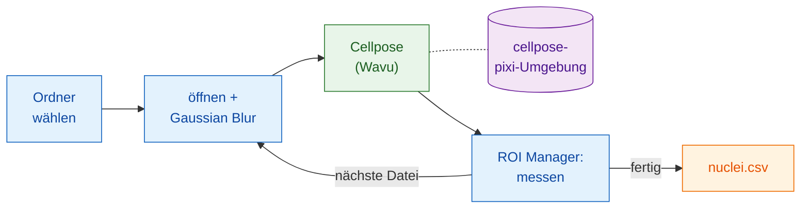

# In Fiji: Groovy und ImageJ-Makro

## Die Idee in einfachen Worten

Hier ist Fiji der Kellner **und** schreibt die Rechnung. Ihr Skript öffnet
jedes Bild, glättet es etwas und misst die Zellkerne, alles mit Fijis eigenen
Befehlen. Nur die Segmentierung geht in die Küche: der Ordner
`cellpose_nuclei`, in seiner eigenen Umgebung. Der Worker startet mit dem
ersten Bild und bleibt für den Rest warm.



## Bevor Sie beginnen

1. **Wavu ist in Fiji installiert**: siehe [wavu-fiji installieren](../fiji/install.md).
2. **Holen Sie den Cellpose-Ordner.** Laden Sie das
   [Wavu-Repository als Zip](https://github.com/Oxford-Zeiss-Centre-of-Excellence/Wavu/archive/refs/heads/main.zip)
   herunter, entpacken Sie es und verwenden Sie `examples/cellpose_nuclei`
   **dort, wo es liegt**: Seine `pixi.toml` findet Wavu zwei Ordner weiter
   oben, verschieben Sie ihn also nicht.
3. **Richten Sie seine Küchengeräte einmal ein.** Öffnen Sie ein
   Zellkernbild und führen Sie **Plugins › Wavu › Run Python Script…** auf
   diesem Ordner aus, wie in [Ihr erster Lauf](../fiji/first-run.md). Der
   erste Start lädt PyTorch und Cellpose herunter (**1–2 GB**, mehrere
   Minuten, nur einmal). Danach startet der Worker in Sekunden.
4. **Ein Ordner mit Bildern**: einkanalige 2D-Zellkern-TIFFs, zum Beispiel
   `A02_s1.tif` aus BBBC039.

## Die Pipeline

Beide Versionen machen dieselben Schritte: die Ordner wählen, über die
`.tif`-Dateien laufen, jede öffnen, eine Kopie weichzeichnen, die Kopie an
Cellpose schicken, jeden Zellkern auf dem **Originalbild** über den ROI
Manager messen, pro Zellkern eine Zeile mit dem Dateinamen anfügen, eine CSV
speichern und aufräumen.

=== "Groovy"

    Öffnen Sie **File › New › Script…**, wählen Sie **Language › Groovy**,
    fügen Sie den Code ein und drücken Sie **Run**. Durch die `#@`-Zeilen
    fragt Fiji zuerst nach den Ordnern.

    ```groovy
    #@ File (label = "Images", style = "directory") imageDir
    #@ File (label = "cellpose_nuclei folder", style = "directory") cellposeDir
    #@ File (label = "Save table as", style = "save", value = "nuclei.csv") outCsv
    import ij.IJ
    import ij.measure.Measurements
    import ij.measure.ResultsTable
    import ij.plugin.frame.RoiManager

    // Wavus Skriptbibliothek laden (wird mit wavu-fiji installiert).
    def wavu = new GroovyShell(this.class.classLoader).evaluate(
            new File(IJ.getDirectory("imagej"), "scripts/Plugins/Wavu/lib/wavu_lib.groovy.txt"))

    def table = new ResultsTable()
    def rm = RoiManager.getRoiManager()
    def files = imageDir.listFiles().findAll { it.name.toLowerCase().endsWith(".tif") }.sort()

    try {
        files.eachWithIndex { File f, int i ->
            IJ.showStatus("Nuclei: " + f.name + " (" + (i + 1) + "/" + files.size() + ")")
            def imp = IJ.openImage(f.path)                       // nativ: öffnen
            def smooth = imp.duplicate()
            IJ.run(smooth, "Gaussian Blur...", "sigma=1")         // nativ: vorverarbeiten

            // Wavu-Schritt: Cellpose in seiner eigenen Umgebung (0 = Durchmesser schätzen)
            Map r = wavu.run(cellposeDir, "script", [diameter: 30, use_gpu: false], [image: smooth])
            int count = r.values.count as int
            IJ.log(f.name + ": " + count + " nuclei")

            rm.reset()
            if (r.rois.rois) rm.open(r.rois.rois)                 // Umrisse -> ROI Manager
            rm.getRoisAsArray().each { roi ->                     // nativ: jeden Zellkern messen
                imp.setRoi(roi)
                def s = imp.getStatistics(Measurements.AREA | Measurements.MEAN)
                table.incrementCounter()
                table.addValue("File", f.name)
                table.addValue("Nucleus", roi.getName())
                table.addValue("Area", s.area)
                table.addValue("Mean", s.mean)
            }
            imp.close(); smooth.close()
            r.images.each { name, out -> out.close() }           // das Labelbild
        }
        table.saveAs(outCsv.path)                                  // nativ: speichern
        table.show("Nuclei")
    } finally {
        rm.reset()
        wavu.stopAll()                                             // den Worker stoppen
    }
    ```

    `wavu.run` gibt eine Map zurück: `images` (Name → ImagePlus), `tables`
    (Name → ResultsTable), `rois` (Name → Pfad eines RoiSet-Zips), `files`
    (Name → Pfad) und `values` (Name → Wert). Parameter können Zahlen,
    Wahrheitswerte oder Text sein; Wavu wandelt sie in die Typen aus
    `PARAMS` um, und alles, was Sie weglassen, behält seinen Standardwert.
    Geben Sie `true` als fünftes Argument an, um die Ergebnisse auch zu
    öffnen, wie es das Menü tut.

=== "ImageJ-Makro"

    Öffnen Sie **File › New › Script…**, wählen Sie **Language › IJ1 Macro**,
    fügen Sie den Code ein und drücken Sie **Run**.

    ```javascript
    imageDir = getDirectory("Choose the folder of images");
    cellposeDir = getDirectory("Choose the cellpose_nuclei folder");
    out = imageDir + "nuclei.csv";

    setBatchMode(true);
    run("Set Measurements...", "area mean redirect=None decimal=3");
    run("Clear Results");
    list = getFileList(imageDir);
    for (i = 0; i < list.length; i++) {
        name = list[i];
        if (!endsWith(toLowerCase(name), ".tif")) continue;
        showStatus("Nuclei: " + name);
        open(imageDir + name);                              // nativ: öffnen
        original = getImageID();
        run("Duplicate...", "title=smooth");
        run("Gaussian Blur...", "sigma=1");                 // nativ: vorverarbeiten

        // Wavu-Schritt: Cellpose auf dem aktuellen Bild ("smooth")
        roiManager("reset");
        run("Run Script (Macro)", "folder=[" + cellposeDir + "] script=script params=[diameter=30 use_gpu=false]");

        selectImage(original);                              // nativ: das Original messen
        first = nResults;
        if (roiManager("count") > 0) roiManager("Measure");
        for (row = first; row < nResults; row++)
            setResult("File", row, name);
        updateResults();
        close("*");
    }
    saveAs("Results", out);                                 // nativ: speichern
    roiManager("reset");
    run("Stop Worker");                                     // den Worker stoppen
    setBatchMode(false);
    print("Saved " + out);
    ```

    **Plugins › Wavu › Run Script (Macro)** hat keinen Dialog. Jeder
    `image`-Parameter des Skripts bekommt das **aktuelle Bild**: ein
    sichtbares Fenster oder, unter `setBatchMode(true)`, das Bild des
    Makros. Die Ergebnisse öffnen sich (hier als Batch-Bilder) unter dem
    Namen `<Bildtitel>-<Ausgabe>`, dieses Makro bekommt also
    `smooth-labels`; eine RoiSet-Ausgabe landet im ROI Manager; eine Zahl
    wird ins Log geschrieben, etwa `count = 42`. Schreiben Sie `params` als
    durch Leerzeichen getrennte `name=value`-Paare, ohne Leerzeichen
    innerhalb eines Werts.

## Tipps

- **Lassen Sie den Recorder schreiben.** Starten Sie
  **Plugins › Macros › Record…** und führen Sie dann
  **Plugins › Wavu › Run Script (Macro)** einmal von Hand aus: Der Recorder
  schreibt die genaue `run("Run Script (Macro)", …)`-Zeile, samt Ordner.
- **Batch-Modus** (`setBatchMode(true)`) hält Fenster verborgen und ist viel
  schneller; schalten Sie ihn aus, solange Sie jeden Schritt noch prüfen.
- **Esc bricht ab.** Esc stoppt den laufenden Wavu-Schritt und mit ihm das
  Skript oder Makro.
- **Nur das erste Bild ist langsam.** Der Worker startet beim ersten Aufruf
  (Sekunden, oder Minuten, wenn seine Umgebung noch nicht installiert ist)
  und wird für jedes weitere Bild wiederverwendet.
  **Plugins › Wavu › Stop Worker** (oder `wavu.stopAll()`) beendet ihn;
  das Schließen von Fiji ebenfalls.
- **Fehler stoppen die Pipeline.** Schlägt das Python-Skript fehl, wirft
  `wavu.run` eine Ausnahme und das Makro bricht ab; der Traceback steht im
  Log-Fenster. Beheben Sie die Ursache und starten Sie erneut: Der Worker ist
  noch warm.
- **Nutzen Sie die GPU**, indem Sie `use_gpu: true` (Groovy) oder
  `use_gpu=true` (Makro) setzen, auf einem Rechner, auf dem Cellpose eine
  verwenden kann; für NVIDIA siehe die `pixi.toml` des Ordners.

Lieber Python? Dieselbe Pipeline in einem Notebook:
[In Python und napari](python.md).

## In einem Satz

Öffnen, weichzeichnen, messen und speichern Sie mit Fijis eigenen Befehlen,
und reichen Sie jedes Bild mit einer Zeile `wavu.run(...)` oder
`run("Run Script (Macro)", ...)` an Cellpose weiter; der Worker startet
einmal und bedient den ganzen Ordner.

[Weiter: in Python und napari :material-arrow-right:](python.md){ .md-button }
