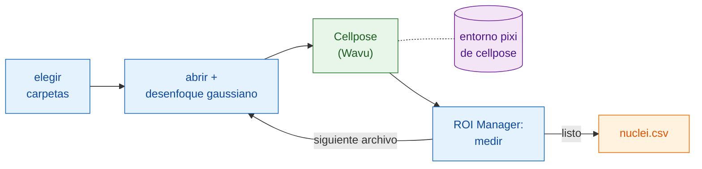

# En Fiji: Groovy y macro de ImageJ

## La idea en palabras sencillas

Aquí Fiji es el camarero **y además** escribe la cuenta. Tu script abre cada
imagen, la suaviza un poco y mide los núcleos, todo con los comandos propios
de Fiji. Solo la segmentación va a la cocina: la carpeta `cellpose_nuclei`,
en su propio entorno. El worker arranca con la primera imagen y se mantiene
caliente para el resto.



## Antes de empezar

1. **Wavu está instalado en Fiji**: mira [Instalar wavu-fiji](../fiji/install.md).
2. **Consigue la carpeta de Cellpose.** Descarga el
   [repositorio de Wavu como zip](https://github.com/Oxford-Zeiss-Centre-of-Excellence/Wavu/archive/refs/heads/main.zip),
   descomprímelo y usa `examples/cellpose_nuclei` **donde está**: su
   `pixi.toml` encuentra Wavu dos carpetas más arriba, así que no la saques
   de ahí.
3. **Prepara sus utensilios de cocina una vez.** Abre una imagen de núcleos
   y ejecuta **Plugins › Wavu › Run Python Script…** sobre esa carpeta, como
   en [Tu primera ejecución](../fiji/first-run.md). El primer arranque
   descarga PyTorch y Cellpose (**1–2 GB**, varios minutos, una sola vez).
   Después, el worker arranca en segundos.
4. **Una carpeta de imágenes**: TIFF 2-D de núcleos de un solo canal, por
   ejemplo `A02_s1.tif` de BBBC039.

## El pipeline

Las dos versiones hacen los mismos pasos: elegir las carpetas, recorrer los
archivos `.tif`, abrir cada uno, desenfocar una copia, enviar la copia a
Cellpose, medir cada núcleo en la imagen **original** a través del ROI
Manager, añadir una fila por núcleo con el nombre del archivo, guardar un
CSV y recoger.

=== "Groovy"

    Abre **File › New › Script…**, elige **Language › Groovy**, pega el
    código y pulsa **Run**. Las líneas `#@` hacen que Fiji pida primero las
    carpetas.

    ```groovy
    #@ File (label = "Images", style = "directory") imageDir
    #@ File (label = "cellpose_nuclei folder", style = "directory") cellposeDir
    #@ File (label = "Save table as", style = "save", value = "nuclei.csv") outCsv
    import ij.IJ
    import ij.measure.Measurements
    import ij.measure.ResultsTable
    import ij.plugin.frame.RoiManager

    // Carga la biblioteca de scripts de Wavu (se instala con wavu-fiji).
    def wavu = new GroovyShell(this.class.classLoader).evaluate(
            new File(IJ.getDirectory("imagej"), "scripts/Plugins/Wavu/lib/wavu_lib.groovy.txt"))

    def table = new ResultsTable()
    def rm = RoiManager.getRoiManager()
    def files = imageDir.listFiles().findAll { it.name.toLowerCase().endsWith(".tif") }.sort()

    try {
        files.eachWithIndex { File f, int i ->
            IJ.showStatus("Nuclei: " + f.name + " (" + (i + 1) + "/" + files.size() + ")")
            def imp = IJ.openImage(f.path)                       // nativo: abrir
            def smooth = imp.duplicate()
            IJ.run(smooth, "Gaussian Blur...", "sigma=1")         // nativo: preprocesar

            // Paso de Wavu: Cellpose en su propio entorno (0 = estimar el diámetro)
            Map r = wavu.run(cellposeDir, "script", [diameter: 30, use_gpu: false], [image: smooth])
            int count = r.values.count as int
            IJ.log(f.name + ": " + count + " nuclei")

            rm.reset()
            if (r.rois.rois) rm.open(r.rois.rois)                 // contornos -> ROI Manager
            rm.getRoisAsArray().each { roi ->                     // nativo: medir cada núcleo
                imp.setRoi(roi)
                def s = imp.getStatistics(Measurements.AREA | Measurements.MEAN)
                table.incrementCounter()
                table.addValue("File", f.name)
                table.addValue("Nucleus", roi.getName())
                table.addValue("Area", s.area)
                table.addValue("Mean", s.mean)
            }
            imp.close(); smooth.close()
            r.images.each { name, out -> out.close() }           // la imagen de etiquetas
        }
        table.saveAs(outCsv.path)                                  // nativo: guardar
        table.show("Nuclei")
    } finally {
        rm.reset()
        wavu.stopAll()                                             // detener el worker
    }
    ```

    `wavu.run` devuelve un mapa: `images` (nombre → ImagePlus), `tables`
    (nombre → ResultsTable), `rois` (nombre → ruta de un zip RoiSet),
    `files` (nombre → ruta) y `values` (nombre → valor). Los parámetros
    pueden ser números, booleanos o texto; Wavu los convierte a los tipos de
    `PARAMS`, y lo que no indiques conserva su valor por defecto. Añade
    `true` como quinto argumento para abrir también los resultados, como
    hace el menú.

=== "Macro de ImageJ"

    Abre **File › New › Script…**, elige **Language › IJ1 Macro**, pega el
    código y pulsa **Run**.

    ```javascript
    imageDir = getDirectory("Choose the folder of images");
    cellposeDir = getDirectory("Choose the cellpose_nuclei folder");
    out = imageDir + "nuclei.csv";

    setBatchMode(true);
    run("Set Measurements...", "area mean redirect=None decimal=3");
    run("Clear Results");
    list = getFileList(imageDir);
    for (i = 0; i < list.length; i++) {
        name = list[i];
        if (!endsWith(toLowerCase(name), ".tif")) continue;
        showStatus("Nuclei: " + name);
        open(imageDir + name);                              // nativo: abrir
        original = getImageID();
        run("Duplicate...", "title=smooth");
        run("Gaussian Blur...", "sigma=1");                 // nativo: preprocesar

        // Paso de Wavu: Cellpose sobre la imagen actual ("smooth")
        roiManager("reset");
        run("Run Script (Macro)", "folder=[" + cellposeDir + "] script=script params=[diameter=30 use_gpu=false]");

        selectImage(original);                              // nativo: medir la original
        first = nResults;
        if (roiManager("count") > 0) roiManager("Measure");
        for (row = first; row < nResults; row++)
            setResult("File", row, name);
        updateResults();
        close("*");
    }
    saveAs("Results", out);                                 // nativo: guardar
    roiManager("reset");
    run("Stop Worker");                                     // detener el worker
    setBatchMode(false);
    print("Saved " + out);
    ```

    **Plugins › Wavu › Run Script (Macro)** no tiene diálogo. Cada parámetro
    `image` del script recibe la **imagen actual**: una ventana visible, o
    la imagen de la macro con `setBatchMode(true)`. Los resultados se abren
    (aquí como imágenes en modo batch) con el nombre
    `<image title>-<output>`, así que esta macro obtiene `smooth-labels`;
    una salida RoiSet va al ROI Manager; un número se escribe en el Log,
    como `count = 42`. Escribe `params` como pares `name=value` separados
    por espacios, sin espacios dentro de un valor.

## Consejos

- **Deja que la grabadora lo escriba por ti.** Inicia
  **Plugins › Macros › Record…** y ejecuta
  **Plugins › Wavu › Run Script (Macro)** una vez a mano: la grabadora
  escribe la línea `run("Run Script (Macro)", …)` exacta, con la carpeta
  incluida.
- **El modo batch** (`setBatchMode(true)`) mantiene las ventanas ocultas y
  es mucho más rápido; desactívalo mientras sigas comprobando cada paso.
- **Esc cancela.** Pulsar Esc detiene el paso de Wavu en curso y, con él, el
  script o la macro.
- **Solo la primera imagen es lenta.** El worker arranca en la primera
  llamada (segundos, o minutos si su entorno aún no está instalado) y se
  reutiliza para todas las imágenes siguientes.
  **Plugins › Wavu › Stop Worker** (o `wavu.stopAll()`) lo detiene; cerrar
  Fiji también.
- **Los errores detienen el pipeline.** Si el script de Python falla,
  `wavu.run` lanza una excepción y la macro se interrumpe; la traza está en
  la ventana Log. Corrige la causa y vuelve a ejecutar: el worker sigue
  caliente.
- **Usa la GPU** poniendo `use_gpu: true` (Groovy) o `use_gpu=true` (macro)
  en una máquina donde Cellpose pueda usar una; mira el `pixi.toml` de la
  carpeta para NVIDIA.

¿Prefieres Python? El mismo pipeline en un notebook:
[En Python y napari](python.md).

## En una frase

Abre, desenfoca, mide y guarda con los comandos propios de Fiji, y pasa cada
imagen a Cellpose con una sola línea `wavu.run(...)` o
`run("Run Script (Macro)", ...)`; el worker arranca una vez y sirve toda la
carpeta.

[Siguiente: en Python y napari :material-arrow-right:](python.md){ .md-button }
