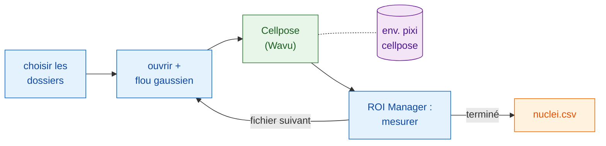

# Dans Fiji : Groovy et macro ImageJ

## L'idée en mots simples

Ici, Fiji est le serveur **et** prépare l'addition. Votre script ouvre
chaque image, la lisse un peu et mesure les noyaux, tout cela avec les
propres commandes de Fiji. Seule la segmentation part en cuisine : le
dossier `cellpose_nuclei`, dans son propre environnement. Le worker démarre
avec la première image et reste chaud pour les suivantes.



## Avant de commencer

1. **Wavu est installé dans Fiji** : voir [Installer wavu-fiji](../fiji/install.md).
2. **Récupérez le dossier Cellpose.** Téléchargez le
   [dépôt Wavu en zip](https://github.com/Oxford-Zeiss-Centre-of-Excellence/Wavu/archive/refs/heads/main.zip),
   décompressez-le, et utilisez `examples/cellpose_nuclei` **là où il est** :
   son `pixi.toml` trouve Wavu deux dossiers plus haut, donc ne le déplacez
   pas.
3. **Installez sa batterie de cuisine une fois.** Ouvrez une image de noyaux
   et lancez **Plugins › Wavu › Run Python Script…** sur ce dossier, comme
   dans [Votre premier lancement](../fiji/first-run.md). Le premier
   démarrage télécharge PyTorch et Cellpose (**1–2 Go**, plusieurs minutes,
   une seule fois). Ensuite, le worker démarre en quelques secondes.
4. **Un dossier d'images** : des TIFF 2D de noyaux à un seul canal, par
   exemple `A02_s1.tif` de BBBC039.

## Le pipeline

Les deux versions font les mêmes étapes : choisir les dossiers, parcourir
les fichiers `.tif`, ouvrir chacun, flouter une copie, envoyer la copie à
Cellpose, mesurer chaque noyau sur l'image **originale** via le ROI Manager,
ajouter une ligne par noyau avec le nom du fichier, enregistrer un seul CSV,
et faire le ménage.

=== "Groovy"

    Ouvrez **File › New › Script…**, choisissez **Language › Groovy**,
    collez, et appuyez sur **Run**. Les lignes `#@` font d'abord demander
    les dossiers par Fiji.

    ```groovy
    #@ File (label = "Images", style = "directory") imageDir
    #@ File (label = "cellpose_nuclei folder", style = "directory") cellposeDir
    #@ File (label = "Save table as", style = "save", value = "nuclei.csv") outCsv
    import ij.IJ
    import ij.measure.Measurements
    import ij.measure.ResultsTable
    import ij.plugin.frame.RoiManager

    // Charger la bibliothèque de script de Wavu (installée avec wavu-fiji).
    def wavu = new GroovyShell(this.class.classLoader).evaluate(
            new File(IJ.getDirectory("imagej"), "scripts/Plugins/Wavu/lib/wavu_lib.groovy.txt"))

    def table = new ResultsTable()
    def rm = RoiManager.getRoiManager()
    def files = imageDir.listFiles().findAll { it.name.toLowerCase().endsWith(".tif") }.sort()

    try {
        files.eachWithIndex { File f, int i ->
            IJ.showStatus("Nuclei: " + f.name + " (" + (i + 1) + "/" + files.size() + ")")
            def imp = IJ.openImage(f.path)                       // natif : ouvrir
            def smooth = imp.duplicate()
            IJ.run(smooth, "Gaussian Blur...", "sigma=1")         // natif : prétraiter

            // Étape Wavu : Cellpose dans son propre environnement (0 = estimer le diamètre)
            Map r = wavu.run(cellposeDir, "script", [diameter: 30, use_gpu: false], [image: smooth])
            int count = r.values.count as int
            IJ.log(f.name + ": " + count + " nuclei")

            rm.reset()
            if (r.rois.rois) rm.open(r.rois.rois)                 // contours -> ROI Manager
            rm.getRoisAsArray().each { roi ->                     // natif : mesurer chaque noyau
                imp.setRoi(roi)
                def s = imp.getStatistics(Measurements.AREA | Measurements.MEAN)
                table.incrementCounter()
                table.addValue("File", f.name)
                table.addValue("Nucleus", roi.getName())
                table.addValue("Area", s.area)
                table.addValue("Mean", s.mean)
            }
            imp.close(); smooth.close()
            r.images.each { name, out -> out.close() }           // l'image d'étiquettes
        }
        table.saveAs(outCsv.path)                                  // natif : enregistrer
        table.show("Nuclei")
    } finally {
        rm.reset()
        wavu.stopAll()                                             // arrêter le worker
    }
    ```

    `wavu.run` renvoie une map : `images` (nom → ImagePlus), `tables`
    (nom → ResultsTable), `rois` (nom → chemin d'un zip RoiSet), `files`
    (nom → chemin) et `values` (nom → valeur). Les paramètres peuvent être
    des nombres, des booléens ou du texte ; Wavu les convertit dans les
    types de `PARAMS`, et tout ce que vous omettez garde sa valeur par
    défaut. Ajoutez `true` en cinquième argument pour aussi ouvrir les
    résultats, comme le fait le menu.

=== "Macro ImageJ"

    Ouvrez **File › New › Script…**, choisissez **Language › IJ1 Macro**,
    collez, et appuyez sur **Run**.

    ```javascript
    imageDir = getDirectory("Choose the folder of images");
    cellposeDir = getDirectory("Choose the cellpose_nuclei folder");
    out = imageDir + "nuclei.csv";

    setBatchMode(true);
    run("Set Measurements...", "area mean redirect=None decimal=3");
    run("Clear Results");
    list = getFileList(imageDir);
    for (i = 0; i < list.length; i++) {
        name = list[i];
        if (!endsWith(toLowerCase(name), ".tif")) continue;
        showStatus("Nuclei: " + name);
        open(imageDir + name);                              // natif : ouvrir
        original = getImageID();
        run("Duplicate...", "title=smooth");
        run("Gaussian Blur...", "sigma=1");                 // natif : prétraiter

        // Étape Wavu : Cellpose sur l'image courante ("smooth")
        roiManager("reset");
        run("Run Script (Macro)", "folder=[" + cellposeDir + "] script=script params=[diameter=30 use_gpu=false]");

        selectImage(original);                              // natif : mesurer l'originale
        first = nResults;
        if (roiManager("count") > 0) roiManager("Measure");
        for (row = first; row < nResults; row++)
            setResult("File", row, name);
        updateResults();
        close("*");
    }
    saveAs("Results", out);                                 // natif : enregistrer
    roiManager("reset");
    run("Stop Worker");                                     // arrêter le worker
    setBatchMode(false);
    print("Saved " + out);
    ```

    **Plugins › Wavu › Run Script (Macro)** n'a pas de boîte de dialogue.
    Chaque paramètre `image` du script reçoit l'**image courante** : une
    fenêtre visible, ou l'image de la macro sous `setBatchMode(true)`. Les
    résultats s'ouvrent (ici comme images en mode batch) sous le nom
    `<titre de l'image>-<sortie>`, donc cette macro obtient `smooth-labels` ;
    une sortie RoiSet va dans le ROI Manager ; un nombre est écrit dans le
    Log, par exemple `count = 42`. Écrivez `params` sous forme de paires
    `name=value` séparées par des espaces, sans espace à l'intérieur d'une
    valeur.

## Astuces

- **Laissez l'enregistreur l'écrire pour vous.** Lancez
  **Plugins › Macros › Record…**, puis exécutez une fois à la main
  **Plugins › Wavu › Run Script (Macro)** : l'enregistreur écrit la ligne
  `run("Run Script (Macro)", …)` exacte, dossier compris.
- **Le mode batch** (`setBatchMode(true)`) garde les fenêtres cachées et est
  bien plus rapide ; désactivez-le tant que vous vérifiez encore chaque
  étape.
- **Échap annule.** Appuyer sur Échap arrête l'étape Wavu en cours, et le
  script ou la macro avec elle.
- **Seule la première image est lente.** Le worker démarre au premier appel
  (quelques secondes, ou quelques minutes si son environnement n'est pas
  encore installé) et est réutilisé pour toutes les images suivantes.
  **Plugins › Wavu › Stop Worker** (ou `wavu.stopAll()`) l'arrête ; fermer
  Fiji aussi.
- **Les erreurs arrêtent le pipeline.** Si le script Python échoue,
  `wavu.run` lève une exception et la macro s'interrompt ; la trace
  d'erreur (traceback) est dans la fenêtre Log. Corrigez la cause, puis
  relancez : le worker est encore chaud.
- **Utilisez le GPU** en mettant `use_gpu: true` (Groovy) ou `use_gpu=true`
  (macro) sur une machine où Cellpose peut s'en servir ; voir le
  `pixi.toml` du dossier pour NVIDIA.

Vous préférez Python ? Le même pipeline dans un notebook :
[En Python et napari](python.md).

## En une phrase

Ouvrez, floutez, mesurez et enregistrez avec les propres commandes de Fiji,
et confiez chaque image à Cellpose avec une seule ligne `wavu.run(...)` ou
`run("Run Script (Macro)", ...)` ; le worker démarre une fois et sert tout
le dossier.

[Suite : en Python et napari :material-arrow-right:](python.md){ .md-button }
