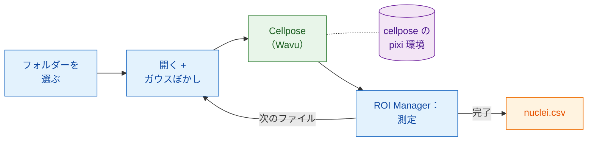

# Fiji で：Groovy と ImageJ マクロ

## やさしく言うと

ここでは Fiji がウェイターで、**しかも** 伝票も書きます。スクリプトは
それぞれの画像を開き、少しなめらかにし、核を測定します。どれも Fiji 自身の
コマンドです。厨房に行くのはセグメンテーションだけで、その厨房は専用の環境を
持つ `cellpose_nuclei` フォルダーです。ワーカーは最初の画像で起動し、残りの
画像のために温まったままでいます。



## 始める前に

1. **Fiji に Wavu がインストールされていること**：
   [Fiji に Wavu をインストールする](../fiji/install.md) を見てください。
2. **Cellpose のフォルダーを手に入れます。**
   [Wavu リポジトリを zip で](https://github.com/Oxford-Zeiss-Centre-of-Excellence/Wavu/archive/refs/heads/main.zip)
   ダウンロードして解凍し、`examples/cellpose_nuclei` を **その場所のまま**
   使います。その `pixi.toml` は 2 つ上のフォルダーにある Wavu を見つけるので、
   外に移動しないでください。
3. **調理器具を一度そろえます。** 核の画像を 1 枚開き、
   [最初の実行](../fiji/first-run.md) と同じように、そのフォルダーで
   **Plugins › Wavu › Run Python Script…** を実行します。最初の起動では
   PyTorch と Cellpose をダウンロードします（**1～2 GB**、数分、一度だけ）。
   その後はワーカーが数秒で起動します。
4. **画像のフォルダー**：単一チャンネルの 2 次元の核の TIFF。たとえば
   BBBC039 の `A02_s1.tif`。

## パイプライン

どちらのバージョンも同じ手順を行います。フォルダーを選び、`.tif` ファイルを
順に処理し、1 つずつ開き、コピーをぼかし、そのコピーを Cellpose に送り、
ROI Manager を通して **元の** 画像ですべての核を測定し、核ごとに 1 行を
ファイル名付きで追加し、1 つの CSV を保存して、後片付けをします。

=== "Groovy"

    **File › New › Script…** を開き、**Language › Groovy** を選んで
    貼り付け、**Run** を押します。`#@` の行があるので、Fiji は最初に
    フォルダーをたずねます。

    ```groovy
    #@ File (label = "Images", style = "directory") imageDir
    #@ File (label = "cellpose_nuclei folder", style = "directory") cellposeDir
    #@ File (label = "Save table as", style = "save", value = "nuclei.csv") outCsv
    import ij.IJ
    import ij.measure.Measurements
    import ij.measure.ResultsTable
    import ij.plugin.frame.RoiManager

    // Wavu のスクリプト用ライブラリを読み込む（wavu-fiji と一緒にインストール済み）。
    def wavu = new GroovyShell(this.class.classLoader).evaluate(
            new File(IJ.getDirectory("imagej"), "scripts/Plugins/Wavu/lib/wavu_lib.groovy.txt"))

    def table = new ResultsTable()
    def rm = RoiManager.getRoiManager()
    def files = imageDir.listFiles().findAll { it.name.toLowerCase().endsWith(".tif") }.sort()

    try {
        files.eachWithIndex { File f, int i ->
            IJ.showStatus("Nuclei: " + f.name + " (" + (i + 1) + "/" + files.size() + ")")
            def imp = IJ.openImage(f.path)                       // ネイティブ：開く
            def smooth = imp.duplicate()
            IJ.run(smooth, "Gaussian Blur...", "sigma=1")         // ネイティブ：前処理

            // Wavu の手順：専用の環境で Cellpose（0 = 直径を推定）
            Map r = wavu.run(cellposeDir, "script", [diameter: 30, use_gpu: false], [image: smooth])
            int count = r.values.count as int
            IJ.log(f.name + ": " + count + " nuclei")

            rm.reset()
            if (r.rois.rois) rm.open(r.rois.rois)                 // 輪郭 -> ROI Manager
            rm.getRoisAsArray().each { roi ->                     // ネイティブ：核ごとに測定
                imp.setRoi(roi)
                def s = imp.getStatistics(Measurements.AREA | Measurements.MEAN)
                table.incrementCounter()
                table.addValue("File", f.name)
                table.addValue("Nucleus", roi.getName())
                table.addValue("Area", s.area)
                table.addValue("Mean", s.mean)
            }
            imp.close(); smooth.close()
            r.images.each { name, out -> out.close() }           // ラベル画像
        }
        table.saveAs(outCsv.path)                                  // ネイティブ：保存
        table.show("Nuclei")
    } finally {
        rm.reset()
        wavu.stopAll()                                             // ワーカーを停止
    }
    ```

    `wavu.run` はマップを返します。`images`（名前 → ImagePlus）、`tables`
    （名前 → ResultsTable）、`rois`（名前 → RoiSet zip のパス）、`files`
    （名前 → パス）、`values`（名前 → 値）です。パラメーターには数値、
    真偽値、文字を渡せます。Wavu が `PARAMS` の型に変換し、省略したものは
    既定値のままです。メニューと同じように結果も開きたいときは、5 番目の
    引数に `true` を加えます。

=== "ImageJ マクロ"

    **File › New › Script…** を開き、**Language › IJ1 Macro** を選んで
    貼り付け、**Run** を押します。

    ```javascript
    imageDir = getDirectory("Choose the folder of images");
    cellposeDir = getDirectory("Choose the cellpose_nuclei folder");
    out = imageDir + "nuclei.csv";

    setBatchMode(true);
    run("Set Measurements...", "area mean redirect=None decimal=3");
    run("Clear Results");
    list = getFileList(imageDir);
    for (i = 0; i < list.length; i++) {
        name = list[i];
        if (!endsWith(toLowerCase(name), ".tif")) continue;
        showStatus("Nuclei: " + name);
        open(imageDir + name);                              // ネイティブ：開く
        original = getImageID();
        run("Duplicate...", "title=smooth");
        run("Gaussian Blur...", "sigma=1");                 // ネイティブ：前処理

        // Wavu の手順：現在の画像（"smooth"）で Cellpose
        roiManager("reset");
        run("Run Script (Macro)", "folder=[" + cellposeDir + "] script=script params=[diameter=30 use_gpu=false]");

        selectImage(original);                              // ネイティブ：元の画像で測定
        first = nResults;
        if (roiManager("count") > 0) roiManager("Measure");
        for (row = first; row < nResults; row++)
            setResult("File", row, name);
        updateResults();
        close("*");
    }
    saveAs("Results", out);                                 // ネイティブ：保存
    roiManager("reset");
    run("Stop Worker");                                     // ワーカーを停止
    setBatchMode(false);
    print("Saved " + out);
    ```

    **Plugins › Wavu › Run Script (Macro)** にはダイアログがありません。
    スクリプトの `image` パラメーターにはすべて **現在の画像** が渡されます。
    表示されているウィンドウ、または `setBatchMode(true)` のもとではマクロの
    画像です。結果は `<画像のタイトル>-<出力>` という名前で（ここではバッチ
    画像として）開くので、このマクロでは `smooth-labels` になります。RoiSet
    の出力は ROI Manager に入り、数値は `count = 42` のように Log に表示
    されます。`params` は `name=value` の組をスペースで区切って書きます。
    値の中にはスペースを入れません。

## ヒント

- **レコーダーに書いてもらいましょう。** **Plugins › Macros › Record…** を
  開始し、**Plugins › Wavu › Run Script (Macro)** を一度手で実行します。
  レコーダーが、フォルダーも含めた正確な `run("Run Script (Macro)", …)` の
  行を書いてくれます。
- **バッチモード**（`setBatchMode(true)`）はウィンドウを隠し、ずっと速く
  なります。まだ各手順を確認しているあいだはオフにしておきます。
- **Esc でキャンセル。** Esc を押すと、実行中の Wavu の手順と、それを
  呼んだスクリプトやマクロが止まります。
- **遅いのは最初の画像だけです。** ワーカーは最初の呼び出しで起動し（数秒、
  環境がまだインストールされていなければ数分）、あとの画像すべてで使い
  回されます。**Plugins › Wavu › Stop Worker**（または `wavu.stopAll()`）で
  終了します。Fiji を閉じても終了します。
- **エラーはパイプラインを止めます。** Python スクリプトが失敗すると、
  `wavu.run` が例外を投げ、マクロは中断します。トレースバックは Log
  ウィンドウにあります。原因を直してもう一度実行してください。ワーカーは
  まだ温まっています。
- **GPU を使う** には、Cellpose が GPU を使えるマシンで `use_gpu: true`
  （Groovy）または `use_gpu=true`（マクロ）にします。NVIDIA については
  フォルダーの `pixi.toml` を見てください。

Python のほうが好きですか？ 同じパイプラインをノートブックで：
[Python と napari で](python.md)。

## ひとことで言うと

開く、ぼかす、測定する、保存するは Fiji 自身のコマンドで行い、各画像を
`wavu.run(...)` か `run("Run Script (Macro)", ...)` の 1 行で Cellpose に
渡します。ワーカーは一度だけ起動し、フォルダー全体を担当します。

[次へ：Python と napari で :material-arrow-right:](python.md){ .md-button }
