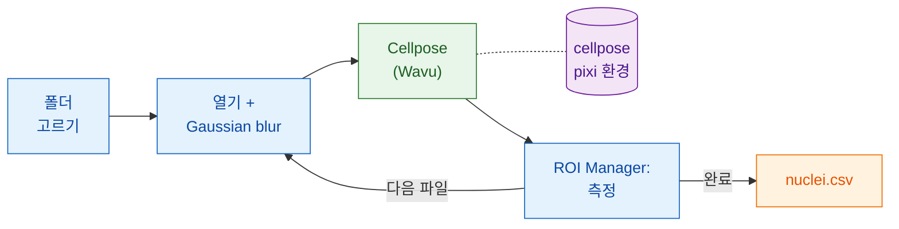

# Fiji에서: Groovy와 ImageJ 매크로

## 쉬운 말로 설명하면

여기서는 Fiji가 웨이터**이면서** 계산서도 써요. 스크립트가 이미지를 하나씩
열고, 조금 부드럽게 하고, 핵을 측정해요. 모두 Fiji 자체 명령으로요. 분할만
주방으로 가요. 자기 환경을 가진 `cellpose_nuclei` 폴더예요. 워커는 첫
이미지에서 시작해서 나머지 이미지 동안 데워진 채로 있어요.



## 시작하기 전에

1. **Fiji에 Wavu가 설치되어 있어야 해요.** [wavu-fiji 설치하기](../fiji/install.md)를
   보세요.
2. **Cellpose 폴더를 받으세요.**
   [Wavu 저장소를 zip으로](https://github.com/Oxford-Zeiss-Centre-of-Excellence/Wavu/archive/refs/heads/main.zip)
   내려받아 압축을 풀고, `examples/cellpose_nuclei`를 **그 자리에서**
   쓰세요. 그 `pixi.toml`은 두 단계 위 폴더에서 Wavu를 찾으니까 밖으로 옮기지
   마세요.
3. **주방 도구를 한 번 갖춰 두세요.** 핵 이미지 하나를 열고 그 폴더에
   **Plugins › Wavu › Run Python Script…**를 실행하세요.
   [첫 실행](../fiji/first-run.md)과 같아요. 첫 시작에서 PyTorch와 Cellpose를
   내려받아요(**1–2 GB**, 몇 분, 한 번만). 그 뒤로는 워커가 몇 초 만에
   시작해요.
4. **이미지 폴더**: 단일 채널 2D 핵 TIFF. 예를 들어 BBBC039의 `A02_s1.tif`.

## 파이프라인

두 버전 모두 같은 단계를 해요. 폴더를 고르고, `.tif` 파일을 돌면서 하나씩
열고, 사본을 흐리게 하고, 그 사본을 Cellpose로 보내고, ROI Manager로
**원본** 이미지에서 핵을 하나하나 측정하고, 핵마다 파일 이름과 함께 한 행을
더하고, CSV 하나를 저장하고, 정리해요.

=== "Groovy"

    **File › New › Script…**를 열고 **Language › Groovy**를 고른 뒤, 붙여
    넣고 **Run**을 누르세요. `#@` 줄 덕분에 Fiji가 먼저 폴더를 물어봐요.

    ```groovy
    #@ File (label = "Images", style = "directory") imageDir
    #@ File (label = "cellpose_nuclei folder", style = "directory") cellposeDir
    #@ File (label = "Save table as", style = "save", value = "nuclei.csv") outCsv
    import ij.IJ
    import ij.measure.Measurements
    import ij.measure.ResultsTable
    import ij.plugin.frame.RoiManager

    // Wavu 스크립팅 라이브러리를 불러와요(wavu-fiji와 함께 설치돼요).
    def wavu = new GroovyShell(this.class.classLoader).evaluate(
            new File(IJ.getDirectory("imagej"), "scripts/Plugins/Wavu/lib/wavu_lib.groovy.txt"))

    def table = new ResultsTable()
    def rm = RoiManager.getRoiManager()
    def files = imageDir.listFiles().findAll { it.name.toLowerCase().endsWith(".tif") }.sort()

    try {
        files.eachWithIndex { File f, int i ->
            IJ.showStatus("Nuclei: " + f.name + " (" + (i + 1) + "/" + files.size() + ")")
            def imp = IJ.openImage(f.path)                       // 기본: 열기
            def smooth = imp.duplicate()
            IJ.run(smooth, "Gaussian Blur...", "sigma=1")         // 기본: 전처리

            // Wavu 단계: 자기 환경의 Cellpose (0 = 지름 추정)
            Map r = wavu.run(cellposeDir, "script", [diameter: 30, use_gpu: false], [image: smooth])
            int count = r.values.count as int
            IJ.log(f.name + ": " + count + " nuclei")

            rm.reset()
            if (r.rois.rois) rm.open(r.rois.rois)                 // 윤곽선 -> ROI Manager
            rm.getRoisAsArray().each { roi ->                     // 기본: 핵마다 측정
                imp.setRoi(roi)
                def s = imp.getStatistics(Measurements.AREA | Measurements.MEAN)
                table.incrementCounter()
                table.addValue("File", f.name)
                table.addValue("Nucleus", roi.getName())
                table.addValue("Area", s.area)
                table.addValue("Mean", s.mean)
            }
            imp.close(); smooth.close()
            r.images.each { name, out -> out.close() }           // labels 이미지
        }
        table.saveAs(outCsv.path)                                  // 기본: 저장
        table.show("Nuclei")
    } finally {
        rm.reset()
        wavu.stopAll()                                             // 워커 멈추기
    }
    ```

    `wavu.run`은 맵을 돌려줘요. `images`(이름 → ImagePlus), `tables`
    (이름 → ResultsTable), `rois`(이름 → RoiSet zip 경로), `files`
    (이름 → 경로), `values`(이름 → 값)예요. 매개변수는 숫자, 불리언, 글이
    될 수 있어요. Wavu가 `PARAMS`의 타입으로 바꿔 주고, 빠뜨린 것은 기본값을
    그대로 써요. 다섯 번째 인수로 `true`를 주면 메뉴처럼 결과도 열어 줘요.

=== "ImageJ 매크로"

    **File › New › Script…**를 열고 **Language › IJ1 Macro**를 고른 뒤, 붙여
    넣고 **Run**을 누르세요.

    ```javascript
    imageDir = getDirectory("Choose the folder of images");
    cellposeDir = getDirectory("Choose the cellpose_nuclei folder");
    out = imageDir + "nuclei.csv";

    setBatchMode(true);
    run("Set Measurements...", "area mean redirect=None decimal=3");
    run("Clear Results");
    list = getFileList(imageDir);
    for (i = 0; i < list.length; i++) {
        name = list[i];
        if (!endsWith(toLowerCase(name), ".tif")) continue;
        showStatus("Nuclei: " + name);
        open(imageDir + name);                              // 기본: 열기
        original = getImageID();
        run("Duplicate...", "title=smooth");
        run("Gaussian Blur...", "sigma=1");                 // 기본: 전처리

        // Wavu 단계: 현재 이미지("smooth")에 Cellpose
        roiManager("reset");
        run("Run Script (Macro)", "folder=[" + cellposeDir + "] script=script params=[diameter=30 use_gpu=false]");

        selectImage(original);                              // 기본: 원본 측정
        first = nResults;
        if (roiManager("count") > 0) roiManager("Measure");
        for (row = first; row < nResults; row++)
            setResult("File", row, name);
        updateResults();
        close("*");
    }
    saveAs("Results", out);                                 // 기본: 저장
    roiManager("reset");
    run("Stop Worker");                                     // 워커 멈추기
    setBatchMode(false);
    print("Saved " + out);
    ```

    **Plugins › Wavu › Run Script (Macro)**에는 대화상자가 없어요.
    스크립트의 `image` 매개변수는 모두 **현재 이미지**를 받아요. 보이는 창이거나,
    `setBatchMode(true)`에서는 매크로의 이미지예요. 결과는
    `<image title>-<output>`이라는 이름으로 열려요(여기서는 배치 이미지로).
    그래서 이 매크로에서는 `smooth-labels`가 돼요. RoiSet 출력은 ROI Manager로
    가고, 숫자는 `count = 42`처럼 Log에 찍혀요. `params`는 공백으로 구분한
    `name=value` 쌍으로 쓰고, 값 안에는 공백을 넣지 마세요.

## 팁

- **기록기가 대신 쓰게 하세요.** **Plugins › Macros › Record…**를 시작하고
  **Plugins › Wavu › Run Script (Macro)**를 손으로 한 번 실행하세요. 기록기가
  폴더까지 포함한 정확한 `run("Run Script (Macro)", …)` 줄을 써 줘요.
- **배치 모드**(`setBatchMode(true)`)는 창을 숨기고 훨씬 빨라요. 단계마다
  확인하는 동안에는 꺼 두세요.
- **Esc로 취소해요.** Esc를 누르면 실행 중인 Wavu 단계와 함께 스크립트나
  매크로도 멈춰요.
- **느린 건 첫 이미지뿐이에요.** 워커는 첫 호출에서 시작하고(몇 초, 환경이
  아직 설치되지 않았다면 몇 분) 그 뒤 이미지마다 다시 쓰여요.
  **Plugins › Wavu › Stop Worker**(또는 `wavu.stopAll()`)로 끝낼 수 있고,
  Fiji를 닫아도 끝나요.
- **오류가 나면 파이프라인이 멈춰요.** Python 스크립트가 실패하면
  `wavu.run`이 예외를 던지고 매크로는 중단돼요. traceback은 Log 창에 있어요.
  원인을 고친 뒤 다시 실행하세요. 워커는 아직 데워져 있어요.
- **GPU를 쓰려면** Cellpose가 GPU를 쓸 수 있는 컴퓨터에서 `use_gpu: true`
  (Groovy) 또는 `use_gpu=true`(매크로)로 정하세요. NVIDIA는 폴더의
  `pixi.toml`을 보세요.

Python이 더 좋나요? 같은 파이프라인을 노트북으로:
[Python과 napari에서](python.md).

## 한 문장으로

열기, 흐리게 하기, 측정, 저장은 Fiji 자체 명령으로 하고, 이미지마다
`wavu.run(...)`이나 `run("Run Script (Macro)", ...)` 한 줄로 Cellpose에
넘기세요. 워커는 한 번 시작해서 폴더 전체를 처리해요.

[다음: Python과 napari에서 :material-arrow-right:](python.md){ .md-button }
