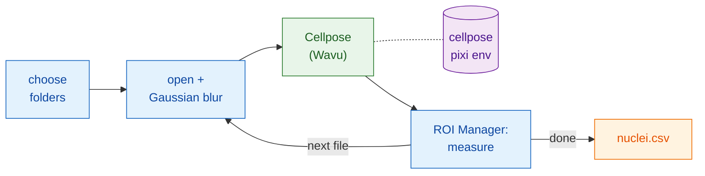

# In Fiji: Groovy and ImageJ macro

## The idea in plain words

Here Fiji is the waiter **and** writes the bill. Your script opens each
image, smooths it a little and measures the nuclei, all with Fiji's own
commands. Only the segmentation goes to the kitchen: the
`cellpose_nuclei` folder, in its own environment. The worker starts with
the first image and stays warm for the rest.



## Before you start

1. **Wavu is installed in Fiji**: see [Install wavu-fiji](../fiji/install.md).
2. **Get the Cellpose folder.** Download the
   [Wavu repository as a zip](https://github.com/Oxford-Zeiss-Centre-of-Excellence/Wavu/archive/refs/heads/main.zip),
   unzip it, and use `examples/cellpose_nuclei` **where it is**: its
   `pixi.toml` finds Wavu two folders up, so do not move it out.
3. **Set up its kitchenware once.** Open one nuclei image and run
   **Plugins › Wavu › Run Python Script…** on that folder, as in
   [Your first run](../fiji/first-run.md). The first start downloads
   PyTorch and Cellpose (**1–2 GB**, several minutes, once). Afterwards
   the worker starts in seconds.
4. **A folder of images**: single-channel 2-D nuclei TIFFs, for example
   BBBC039's `A02_s1.tif`.

## The pipeline

Both versions do the same steps: choose the folders, loop over the `.tif`
files, open each one, blur a copy, send the copy to Cellpose, measure every
nucleus on the **original** image through the ROI Manager, add one row per
nucleus with the file name, save one CSV, and clean up.

=== "Groovy"

    Open **File › New › Script…**, choose **Language › Groovy**, paste, and
    press **Run**. The `#@` lines make Fiji ask for the folders first.

    ```groovy
    #@ File (label = "Images", style = "directory") imageDir
    #@ File (label = "cellpose_nuclei folder", style = "directory") cellposeDir
    #@ File (label = "Save table as", style = "save", value = "nuclei.csv") outCsv
    import ij.IJ
    import ij.measure.Measurements
    import ij.measure.ResultsTable
    import ij.plugin.frame.RoiManager

    // Load Wavu's scripting library (installed with wavu-fiji).
    def wavu = new GroovyShell(this.class.classLoader).evaluate(
            new File(IJ.getDirectory("imagej"), "scripts/Plugins/Wavu/lib/wavu_lib.groovy.txt"))

    def table = new ResultsTable()
    def rm = RoiManager.getRoiManager()
    def files = imageDir.listFiles().findAll { it.name.toLowerCase().endsWith(".tif") }.sort()

    try {
        files.eachWithIndex { File f, int i ->
            IJ.showStatus("Nuclei: " + f.name + " (" + (i + 1) + "/" + files.size() + ")")
            def imp = IJ.openImage(f.path)                       // native: open
            def smooth = imp.duplicate()
            IJ.run(smooth, "Gaussian Blur...", "sigma=1")         // native: preprocess

            // Wavu step: Cellpose in its own environment (0 = estimate the diameter)
            Map r = wavu.run(cellposeDir, "script", [diameter: 30, use_gpu: false], [image: smooth])
            int count = r.values.count as int
            IJ.log(f.name + ": " + count + " nuclei")

            rm.reset()
            if (r.rois.rois) rm.open(r.rois.rois)                 // outlines -> ROI Manager
            rm.getRoisAsArray().each { roi ->                     // native: measure each nucleus
                imp.setRoi(roi)
                def s = imp.getStatistics(Measurements.AREA | Measurements.MEAN)
                table.incrementCounter()
                table.addValue("File", f.name)
                table.addValue("Nucleus", roi.getName())
                table.addValue("Area", s.area)
                table.addValue("Mean", s.mean)
            }
            imp.close(); smooth.close()
            r.images.each { name, out -> out.close() }           // the labels image
        }
        table.saveAs(outCsv.path)                                  // native: save
        table.show("Nuclei")
    } finally {
        rm.reset()
        wavu.stopAll()                                             // stop the worker
    }
    ```

    `wavu.run` returns a map: `images` (name → ImagePlus), `tables`
    (name → ResultsTable), `rois` (name → path of a RoiSet zip), `files`
    (name → path) and `values` (name → value). Parameters can be numbers,
    booleans or text; Wavu converts them to the types in `PARAMS`, and
    anything you leave out keeps its default. Add `true` as a fifth argument
    to also open the results, as the menu does.

=== "ImageJ macro"

    Open **File › New › Script…**, choose **Language › IJ1 Macro**, paste,
    and press **Run**.

    ```javascript
    imageDir = getDirectory("Choose the folder of images");
    cellposeDir = getDirectory("Choose the cellpose_nuclei folder");
    out = imageDir + "nuclei.csv";

    setBatchMode(true);
    run("Set Measurements...", "area mean redirect=None decimal=3");
    run("Clear Results");
    list = getFileList(imageDir);
    for (i = 0; i < list.length; i++) {
        name = list[i];
        if (!endsWith(toLowerCase(name), ".tif")) continue;
        showStatus("Nuclei: " + name);
        open(imageDir + name);                              // native: open
        original = getImageID();
        run("Duplicate...", "title=smooth");
        run("Gaussian Blur...", "sigma=1");                 // native: preprocess

        // Wavu step: Cellpose on the current image ("smooth")
        roiManager("reset");
        run("Run Script (Macro)", "folder=[" + cellposeDir + "] script=script params=[diameter=30 use_gpu=false]");

        selectImage(original);                              // native: measure the original
        first = nResults;
        if (roiManager("count") > 0) roiManager("Measure");
        for (row = first; row < nResults; row++)
            setResult("File", row, name);
        updateResults();
        close("*");
    }
    saveAs("Results", out);                                 // native: save
    roiManager("reset");
    run("Stop Worker");                                     // stop the worker
    setBatchMode(false);
    print("Saved " + out);
    ```

    **Plugins › Wavu › Run Script (Macro)** has no dialog. Every `image`
    parameter of the script gets the **current image**: a visible window,
    or the macro's image under `setBatchMode(true)`. The results open (as
    batch images here) named `<image title>-<output>`, so this macro gets
    `smooth-labels`; a RoiSet output goes into the ROI Manager; a number is
    printed to the Log, such as `count = 42`. Write `params` as
    `name=value` pairs separated by spaces, with no spaces inside a value.

## Tips

- **Let the recorder write it for you.** Start
  **Plugins › Macros › Record…**, then run
  **Plugins › Wavu › Run Script (Macro)** once by hand: the recorder writes
  the exact `run("Run Script (Macro)", …)` line, folder included.
- **Batch mode** (`setBatchMode(true)`) keeps windows hidden and is much
  faster; turn it off while you are still checking each step.
- **Esc cancels.** Pressing Esc stops the running Wavu step and the script
  or macro with it.
- **Only the first image is slow.** The worker starts on the first call
  (seconds, or minutes if its environment is not installed yet) and is
  reused for every later image. **Plugins › Wavu › Stop Worker** (or
  `wavu.stopAll()`) ends it; closing Fiji does too.
- **Errors stop the pipeline.** If the Python script fails, `wavu.run`
  throws and the macro aborts; the traceback is in the Log window. Fix the
  cause, then run again: the worker is still warm.
- **Use the GPU** by setting `use_gpu: true` (Groovy) or `use_gpu=true`
  (macro) on a machine where Cellpose can use one; see the folder's
  `pixi.toml` for NVIDIA.

Prefer Python? The same pipeline in a notebook:
[In Python and napari](python.md).

## In one sentence

Open, blur, measure and save with Fiji's own commands, and hand each image
to Cellpose with one `wavu.run(...)` or `run("Run Script (Macro)", ...)`
line; the worker starts once and serves the whole folder.

[Next: in Python and napari :material-arrow-right:](python.md){ .md-button }
