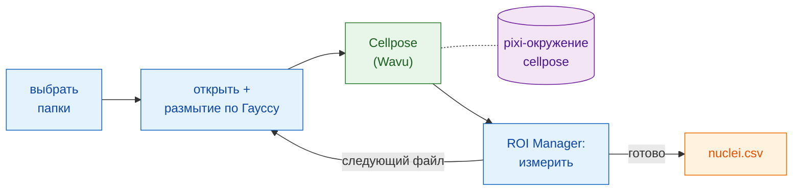

# В Fiji: Groovy и макрос ImageJ

## Идея простыми словами

Здесь Fiji — официант, который **ещё и** выписывает счёт. Ваш скрипт
открывает каждое изображение, слегка его сглаживает и измеряет ядра — всё
собственными командами Fiji. На кухню уходит только сегментация: папка
`cellpose_nuclei` в своём собственном окружении. Воркер запускается с первым
изображением и остаётся разогретым для остальных.



## Перед началом

1. **Wavu установлен в Fiji**: см. [Установка wavu-fiji](../fiji/install.md).
2. **Возьмите папку Cellpose.** Скачайте
   [репозиторий Wavu в виде zip](https://github.com/Oxford-Zeiss-Centre-of-Excellence/Wavu/archive/refs/heads/main.zip),
   распакуйте его и используйте `examples/cellpose_nuclei` **там, где она
   лежит**: её `pixi.toml` находит Wavu двумя папками выше, поэтому не
   переносите её.
3. **Один раз подготовьте её кухонную утварь.** Откройте одно изображение
   ядер и запустите **Plugins › Wavu › Run Python Script…** для этой
   папки, как в разделе [Первый запуск](../fiji/first-run.md). Первый
   запуск скачивает PyTorch и Cellpose (**1–2 ГБ**, несколько минут, один
   раз). После этого воркер запускается за секунды.
4. **Папка с изображениями**: одноканальные 2-D TIFF с ядрами, например
   `A02_s1.tif` из BBBC039.

## Конвейер

Обе версии делают одни и те же шаги: выбирают папки, перебирают файлы
`.tif`, открывают каждый, размывают копию, отправляют копию в Cellpose,
измеряют каждое ядро на **исходном** изображении через ROI Manager,
добавляют по строке на ядро с именем файла, сохраняют один CSV и
прибираются.

=== "Groovy"

    Откройте **File › New › Script…**, выберите **Language › Groovy**,
    вставьте код и нажмите **Run**. Строки `#@` заставляют Fiji сначала
    спросить папки.

    ```groovy
    #@ File (label = "Images", style = "directory") imageDir
    #@ File (label = "cellpose_nuclei folder", style = "directory") cellposeDir
    #@ File (label = "Save table as", style = "save", value = "nuclei.csv") outCsv
    import ij.IJ
    import ij.measure.Measurements
    import ij.measure.ResultsTable
    import ij.plugin.frame.RoiManager

    // Загрузить библиотеку скриптов Wavu (устанавливается вместе с wavu-fiji).
    def wavu = new GroovyShell(this.class.classLoader).evaluate(
            new File(IJ.getDirectory("imagej"), "scripts/Plugins/Wavu/lib/wavu_lib.groovy.txt"))

    def table = new ResultsTable()
    def rm = RoiManager.getRoiManager()
    def files = imageDir.listFiles().findAll { it.name.toLowerCase().endsWith(".tif") }.sort()

    try {
        files.eachWithIndex { File f, int i ->
            IJ.showStatus("Nuclei: " + f.name + " (" + (i + 1) + "/" + files.size() + ")")
            def imp = IJ.openImage(f.path)                       // своими силами: открыть
            def smooth = imp.duplicate()
            IJ.run(smooth, "Gaussian Blur...", "sigma=1")         // своими силами: предобработка

            // шаг Wavu: Cellpose в своём окружении (0 = оценить диаметр)
            Map r = wavu.run(cellposeDir, "script", [diameter: 30, use_gpu: false], [image: smooth])
            int count = r.values.count as int
            IJ.log(f.name + ": " + count + " nuclei")

            rm.reset()
            if (r.rois.rois) rm.open(r.rois.rois)                 // контуры -> ROI Manager
            rm.getRoisAsArray().each { roi ->                     // своими силами: измерить каждое ядро
                imp.setRoi(roi)
                def s = imp.getStatistics(Measurements.AREA | Measurements.MEAN)
                table.incrementCounter()
                table.addValue("File", f.name)
                table.addValue("Nucleus", roi.getName())
                table.addValue("Area", s.area)
                table.addValue("Mean", s.mean)
            }
            imp.close(); smooth.close()
            r.images.each { name, out -> out.close() }           // изображение меток
        }
        table.saveAs(outCsv.path)                                  // своими силами: сохранить
        table.show("Nuclei")
    } finally {
        rm.reset()
        wavu.stopAll()                                             // остановить воркер
    }
    ```

    `wavu.run` возвращает словарь (map): `images` (имя → ImagePlus),
    `tables` (имя → ResultsTable), `rois` (имя → путь к zip-файлу RoiSet),
    `files` (имя → путь) и `values` (имя → значение). Параметры могут быть
    числами, булевыми значениями или текстом; Wavu приводит их к типам из
    `PARAMS`, а всё, что вы не указали, сохраняет значение по умолчанию.
    Добавьте `true` пятым аргументом, чтобы ещё и открыть результаты, как
    это делает меню.

=== "Макрос ImageJ"

    Откройте **File › New › Script…**, выберите **Language › IJ1 Macro**,
    вставьте код и нажмите **Run**.

    ```javascript
    imageDir = getDirectory("Choose the folder of images");
    cellposeDir = getDirectory("Choose the cellpose_nuclei folder");
    out = imageDir + "nuclei.csv";

    setBatchMode(true);
    run("Set Measurements...", "area mean redirect=None decimal=3");
    run("Clear Results");
    list = getFileList(imageDir);
    for (i = 0; i < list.length; i++) {
        name = list[i];
        if (!endsWith(toLowerCase(name), ".tif")) continue;
        showStatus("Nuclei: " + name);
        open(imageDir + name);                              // своими силами: открыть
        original = getImageID();
        run("Duplicate...", "title=smooth");
        run("Gaussian Blur...", "sigma=1");                 // своими силами: предобработка

        // шаг Wavu: Cellpose на текущем изображении ("smooth")
        roiManager("reset");
        run("Run Script (Macro)", "folder=[" + cellposeDir + "] script=script params=[diameter=30 use_gpu=false]");

        selectImage(original);                              // своими силами: измерить исходное
        first = nResults;
        if (roiManager("count") > 0) roiManager("Measure");
        for (row = first; row < nResults; row++)
            setResult("File", row, name);
        updateResults();
        close("*");
    }
    saveAs("Results", out);                                 // своими силами: сохранить
    roiManager("reset");
    run("Stop Worker");                                     // остановить воркер
    setBatchMode(false);
    print("Saved " + out);
    ```

    У **Plugins › Wavu › Run Script (Macro)** нет диалога. Каждый параметр
    `image` скрипта получает **текущее изображение**: видимое окно или
    изображение макроса при `setBatchMode(true)`. Результаты открываются
    (здесь — как пакетные изображения) с именами `<image title>-<output>`,
    поэтому этот макрос получает `smooth-labels`; результат RoiSet попадает
    в ROI Manager; число печатается в Log, например `count = 42`.
    Записывайте `params` парами `name=value` через пробел, без пробелов
    внутри значения.

## Советы

- **Пусть рекордер напишет код за вас.** Запустите
  **Plugins › Macros › Record…**, затем один раз вручную выполните
  **Plugins › Wavu › Run Script (Macro)**: рекордер запишет точную строку
  `run("Run Script (Macro)", …)` вместе с папкой.
- **Пакетный режим** (`setBatchMode(true)`) прячет окна и работает намного
  быстрее; выключите его, пока ещё проверяете каждый шаг.
- **Esc отменяет.** Нажатие Esc останавливает текущий шаг Wavu, а вместе с
  ним и скрипт или макрос.
- **Медленно только первое изображение.** Воркер запускается при первом
  вызове (секунды или минуты, если его окружение ещё не установлено) и
  переиспользуется для всех следующих изображений.
  **Plugins › Wavu › Stop Worker** (или `wavu.stopAll()`) завершает его;
  закрытие Fiji — тоже.
- **Ошибки останавливают конвейер.** Если скрипт на Python падает,
  `wavu.run` выбрасывает исключение, а макрос прерывается; трассировка — в
  окне Log. Устраните причину и запустите снова: воркер всё ещё разогрет.
- **Используйте GPU**, задав `use_gpu: true` (Groovy) или `use_gpu=true`
  (макрос) на машине, где Cellpose может его использовать; про NVIDIA см.
  `pixi.toml` папки.

Предпочитаете Python? Тот же конвейер в ноутбуке:
[В Python и napari](python.md).

## Одним предложением

Открывайте, размывайте, измеряйте и сохраняйте собственными командами Fiji,
а каждое изображение передавайте в Cellpose одной строкой `wavu.run(...)`
или `run("Run Script (Macro)", ...)`; воркер запускается один раз и
обслуживает всю папку.

[Далее: в Python и napari :material-arrow-right:](python.md){ .md-button }
