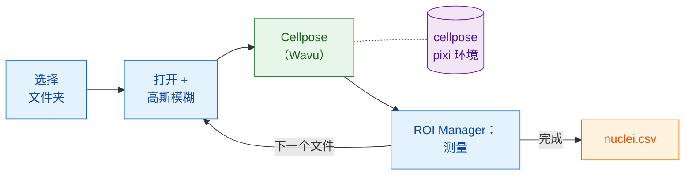

# 在 Fiji 中：Groovy 与 ImageJ 宏

## 用大白话说

这里 Fiji 是服务员，**也**负责结账。你的脚本打开每张图像、稍微做一下平滑、
测量细胞核，全都用 Fiji 自己的命令。只有分割（segmentation）送进厨房：
也就是在自己环境中的 `cellpose_nuclei` 文件夹。worker 在第一张图像时启动，
之后一直保持热机，处理其余的图像。



## 开始之前

1. **Fiji 里已经安装 Wavu**：请看[安装 wavu-fiji](../fiji/install.md)。
2. **获取 Cellpose 文件夹。** 下载
   [Wavu 仓库的 zip 包](https://github.com/Oxford-Zeiss-Centre-of-Excellence/Wavu/archive/refs/heads/main.zip)，
   解压后**原地**使用 `examples/cellpose_nuclei`：它的 `pixi.toml` 会往上
   两级文件夹找到 Wavu，所以不要把它移出去。
3. **先备好它的厨具（只需一次）。** 打开一张细胞核图像，对那个文件夹运行
   **Plugins › Wavu › Run Python Script…**（运行 Python 脚本），做法和
   [第一次运行](../fiji/first-run.md)一样。第一次启动会下载 PyTorch 和
   Cellpose（**1–2 GB**，需要几分钟，只有一次）。之后 worker 几秒内就能启动。
4. **一个图像文件夹**：单通道的 2D 细胞核 TIFF，例如 BBBC039 的
   `A02_s1.tif`。

## 流程

两个版本的步骤相同：选择文件夹、逐个处理 `.tif` 文件、打开每一个、模糊
一份副本、把副本交给 Cellpose、通过 ROI Manager 在**原始**图像上测量每个
细胞核、每个细胞核添加一行并附上文件名、保存为一个 CSV，最后清理干净。

=== "Groovy"

    打开 **File › New › Script…**，选择 **Language › Groovy**，粘贴后按
    **Run**。`#@` 开头的几行会让 Fiji 先询问文件夹。

    ```groovy
    #@ File (label = "Images", style = "directory") imageDir
    #@ File (label = "cellpose_nuclei folder", style = "directory") cellposeDir
    #@ File (label = "Save table as", style = "save", value = "nuclei.csv") outCsv
    import ij.IJ
    import ij.measure.Measurements
    import ij.measure.ResultsTable
    import ij.plugin.frame.RoiManager

    // 加载 Wavu 的脚本库（随 wavu-fiji 一起安装）。
    def wavu = new GroovyShell(this.class.classLoader).evaluate(
            new File(IJ.getDirectory("imagej"), "scripts/Plugins/Wavu/lib/wavu_lib.groovy.txt"))

    def table = new ResultsTable()
    def rm = RoiManager.getRoiManager()
    def files = imageDir.listFiles().findAll { it.name.toLowerCase().endsWith(".tif") }.sort()

    try {
        files.eachWithIndex { File f, int i ->
            IJ.showStatus("Nuclei: " + f.name + " (" + (i + 1) + "/" + files.size() + ")")
            def imp = IJ.openImage(f.path)                       // 原生：打开
            def smooth = imp.duplicate()
            IJ.run(smooth, "Gaussian Blur...", "sigma=1")         // 原生：预处理

            // Wavu 步骤：在自己环境中的 Cellpose（0 = 自动估计直径）
            Map r = wavu.run(cellposeDir, "script", [diameter: 30, use_gpu: false], [image: smooth])
            int count = r.values.count as int
            IJ.log(f.name + ": " + count + " nuclei")

            rm.reset()
            if (r.rois.rois) rm.open(r.rois.rois)                 // 轮廓 -> ROI Manager
            rm.getRoisAsArray().each { roi ->                     // 原生：测量每个细胞核
                imp.setRoi(roi)
                def s = imp.getStatistics(Measurements.AREA | Measurements.MEAN)
                table.incrementCounter()
                table.addValue("File", f.name)
                table.addValue("Nucleus", roi.getName())
                table.addValue("Area", s.area)
                table.addValue("Mean", s.mean)
            }
            imp.close(); smooth.close()
            r.images.each { name, out -> out.close() }           // 标签图像
        }
        table.saveAs(outCsv.path)                                  // 原生：保存
        table.show("Nuclei")
    } finally {
        rm.reset()
        wavu.stopAll()                                             // 停止 worker
    }
    ```

    `wavu.run` 返回一个 map：`images`（名称 → ImagePlus）、`tables`
    （名称 → ResultsTable）、`rois`（名称 → RoiSet zip 的路径）、`files`
    （名称 → 路径）和 `values`（名称 → 数值）。参数可以是数字、布尔值或文本；
    Wavu 会把它们转换成 `PARAMS` 里的类型，没给的参数则保留默认值。加上
    `true` 作为第五个参数，就会像菜单一样同时打开结果。

=== "ImageJ macro"

    打开 **File › New › Script…**，选择 **Language › IJ1 Macro**，粘贴后按
    **Run**。

    ```javascript
    imageDir = getDirectory("Choose the folder of images");
    cellposeDir = getDirectory("Choose the cellpose_nuclei folder");
    out = imageDir + "nuclei.csv";

    setBatchMode(true);
    run("Set Measurements...", "area mean redirect=None decimal=3");
    run("Clear Results");
    list = getFileList(imageDir);
    for (i = 0; i < list.length; i++) {
        name = list[i];
        if (!endsWith(toLowerCase(name), ".tif")) continue;
        showStatus("Nuclei: " + name);
        open(imageDir + name);                              // 原生：打开
        original = getImageID();
        run("Duplicate...", "title=smooth");
        run("Gaussian Blur...", "sigma=1");                 // 原生：预处理

        // Wavu 步骤：对当前图像（"smooth"）运行 Cellpose
        roiManager("reset");
        run("Run Script (Macro)", "folder=[" + cellposeDir + "] script=script params=[diameter=30 use_gpu=false]");

        selectImage(original);                              // 原生：测量原始图像
        first = nResults;
        if (roiManager("count") > 0) roiManager("Measure");
        for (row = first; row < nResults; row++)
            setResult("File", row, name);
        updateResults();
        close("*");
    }
    saveAs("Results", out);                                 // 原生：保存
    roiManager("reset");
    run("Stop Worker");                                     // 停止 worker
    setBatchMode(false);
    print("Saved " + out);
    ```

    **Plugins › Wavu › Run Script (Macro)** 没有对话框。脚本的每个 `image`
    参数都会拿到**当前图像**：一个可见的窗口，或在 `setBatchMode(true)` 下
    宏的图像。结果会以 `<图像标题>-<输出名>` 命名打开（这里是批处理图像），
    所以这个宏会得到 `smooth-labels`；RoiSet 输出会放进 ROI Manager；数字则
    打印到 Log 中，例如 `count = 42`。`params` 写成以空格分隔的
    `name=value`，值里面不能有空格。

## 小技巧

- **让录制器替你写。** 启动 **Plugins › Macros › Record…**，然后手动运行
  一次 **Plugins › Wavu › Run Script (Macro)**：录制器会写出完整的
  `run("Run Script (Macro)", …)` 那一行，连文件夹都包含在内。
- **批处理模式**（`setBatchMode(true)`）会隐藏窗口，速度快得多；还在逐步检查时
  先把它关掉。
- **Esc 可以取消。** 按 Esc 会停止正在运行的 Wavu 步骤，脚本或宏也会跟着
  停止。
- **只有第一张图像比较慢。** worker 在第一次调用时启动（几秒钟；如果环境还没
  安装，则要几分钟），之后的每张图像都会复用它。
  **Plugins › Wavu › Stop Worker**（停止 worker，或 `wavu.stopAll()`）会结束它；
  关闭 Fiji 也会。
- **出错会让流程停下。** 如果 Python 脚本失败，`wavu.run` 会抛出异常，宏
  也会中止；traceback（错误回溯）在 Log 窗口里。修正原因后再运行一次：
  worker 依然是热的。
- **使用 GPU**：在 Cellpose 能用 GPU 的电脑上，设置 `use_gpu: true`（Groovy）
  或 `use_gpu=true`（宏）；NVIDIA 的设置请看该文件夹的 `pixi.toml`。

更喜欢 Python？同一个流程的笔记本版本：
[在 Python 和 napari 中](python.md)。

## 一句话总结

用 Fiji 自己的命令打开、模糊、测量和保存，再用一行 `wavu.run(...)` 或
`run("Run Script (Macro)", ...)` 把每张图像交给 Cellpose；worker 只启动一次，
服务整个文件夹。

[下一步：在 Python 和 napari 中 :material-arrow-right:](python.md){ .md-button }
