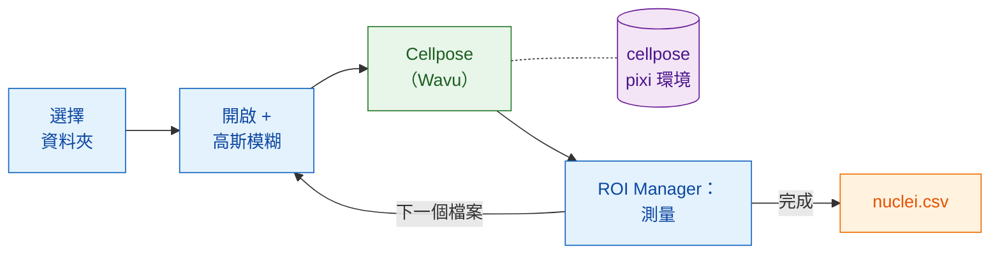

# 在 Fiji 中：Groovy 與 ImageJ 巨集

## 用白話說

這裡 Fiji 是服務生，**也**負責結帳。你的腳本開啟每張影像、稍微做平滑處理、
測量細胞核，全都使用 Fiji 自己的指令。只有分割（segmentation）送進廚房：
也就是在自己環境中的 `cellpose_nuclei` 資料夾。worker 在第一張影像時啟動，
之後一直保持溫熱，處理其餘的影像。



## 開始之前

1. **Fiji 裡已經安裝 Wavu**：請看[安裝 wavu-fiji](../fiji/install.md)。
2. **取得 Cellpose 資料夾。** 下載
   [Wavu 儲存庫的 zip 檔](https://github.com/Oxford-Zeiss-Centre-of-Excellence/Wavu/archive/refs/heads/main.zip)，
   解壓縮後**就地**使用 `examples/cellpose_nuclei`：它的 `pixi.toml` 會往上
   兩層資料夾找到 Wavu，所以不要把它搬出去。
3. **先備好它的廚具（只需一次）。** 開啟一張細胞核影像，對那個資料夾執行
   **Plugins › Wavu › Run Python Script…**（執行 Python 腳本），做法和
   [第一次執行](../fiji/first-run.md)一樣。第一次啟動會下載 PyTorch 和
   Cellpose（**1–2 GB**，需要幾分鐘，只有一次）。之後 worker 幾秒內就能啟動。
4. **一個影像資料夾**：單一通道的 2D 細胞核 TIFF，例如 BBBC039 的
   `A02_s1.tif`。

## 流程

兩個版本做的步驟相同：選擇資料夾、逐一處理 `.tif` 檔案、開啟每一個、模糊
一份複本、把複本送給 Cellpose、透過 ROI Manager 在**原始**影像上測量每個
細胞核、每個細胞核加一列並附上檔名、存成一個 CSV，最後清理乾淨。

=== "Groovy"

    開啟 **File › New › Script…**，選擇 **Language › Groovy**，貼上後按
    **Run**。`#@` 開頭的幾行會讓 Fiji 先詢問資料夾。

    ```groovy
    #@ File (label = "Images", style = "directory") imageDir
    #@ File (label = "cellpose_nuclei folder", style = "directory") cellposeDir
    #@ File (label = "Save table as", style = "save", value = "nuclei.csv") outCsv
    import ij.IJ
    import ij.measure.Measurements
    import ij.measure.ResultsTable
    import ij.plugin.frame.RoiManager

    // 載入 Wavu 的腳本函式庫（隨 wavu-fiji 一起安裝）。
    def wavu = new GroovyShell(this.class.classLoader).evaluate(
            new File(IJ.getDirectory("imagej"), "scripts/Plugins/Wavu/lib/wavu_lib.groovy.txt"))

    def table = new ResultsTable()
    def rm = RoiManager.getRoiManager()
    def files = imageDir.listFiles().findAll { it.name.toLowerCase().endsWith(".tif") }.sort()

    try {
        files.eachWithIndex { File f, int i ->
            IJ.showStatus("Nuclei: " + f.name + " (" + (i + 1) + "/" + files.size() + ")")
            def imp = IJ.openImage(f.path)                       // 原生：開啟
            def smooth = imp.duplicate()
            IJ.run(smooth, "Gaussian Blur...", "sigma=1")         // 原生：前處理

            // Wavu 步驟：在自己環境中的 Cellpose（0 = 自動估計直徑）
            Map r = wavu.run(cellposeDir, "script", [diameter: 30, use_gpu: false], [image: smooth])
            int count = r.values.count as int
            IJ.log(f.name + ": " + count + " nuclei")

            rm.reset()
            if (r.rois.rois) rm.open(r.rois.rois)                 // 輪廓 -> ROI Manager
            rm.getRoisAsArray().each { roi ->                     // 原生：測量每個細胞核
                imp.setRoi(roi)
                def s = imp.getStatistics(Measurements.AREA | Measurements.MEAN)
                table.incrementCounter()
                table.addValue("File", f.name)
                table.addValue("Nucleus", roi.getName())
                table.addValue("Area", s.area)
                table.addValue("Mean", s.mean)
            }
            imp.close(); smooth.close()
            r.images.each { name, out -> out.close() }           // 標籤影像
        }
        table.saveAs(outCsv.path)                                  // 原生：存檔
        table.show("Nuclei")
    } finally {
        rm.reset()
        wavu.stopAll()                                             // 停止 worker
    }
    ```

    `wavu.run` 會回傳一個 map：`images`（名稱 → ImagePlus）、`tables`
    （名稱 → ResultsTable）、`rois`（名稱 → RoiSet zip 的路徑）、`files`
    （名稱 → 路徑）和 `values`（名稱 → 數值）。參數可以是數字、布林值或文字；
    Wavu 會把它們轉成 `PARAMS` 裡的型別，你沒給的參數則保留預設值。加上
    `true` 當作第五個引數，就會像選單一樣同時開啟結果。

=== "ImageJ macro"

    開啟 **File › New › Script…**，選擇 **Language › IJ1 Macro**，貼上後按
    **Run**。

    ```javascript
    imageDir = getDirectory("Choose the folder of images");
    cellposeDir = getDirectory("Choose the cellpose_nuclei folder");
    out = imageDir + "nuclei.csv";

    setBatchMode(true);
    run("Set Measurements...", "area mean redirect=None decimal=3");
    run("Clear Results");
    list = getFileList(imageDir);
    for (i = 0; i < list.length; i++) {
        name = list[i];
        if (!endsWith(toLowerCase(name), ".tif")) continue;
        showStatus("Nuclei: " + name);
        open(imageDir + name);                              // 原生：開啟
        original = getImageID();
        run("Duplicate...", "title=smooth");
        run("Gaussian Blur...", "sigma=1");                 // 原生：前處理

        // Wavu 步驟：對目前影像（"smooth"）執行 Cellpose
        roiManager("reset");
        run("Run Script (Macro)", "folder=[" + cellposeDir + "] script=script params=[diameter=30 use_gpu=false]");

        selectImage(original);                              // 原生：測量原始影像
        first = nResults;
        if (roiManager("count") > 0) roiManager("Measure");
        for (row = first; row < nResults; row++)
            setResult("File", row, name);
        updateResults();
        close("*");
    }
    saveAs("Results", out);                                 // 原生：存檔
    roiManager("reset");
    run("Stop Worker");                                     // 停止 worker
    setBatchMode(false);
    print("Saved " + out);
    ```

    **Plugins › Wavu › Run Script (Macro)** 沒有對話框。腳本的每個 `image`
    參數都會拿到**目前影像**：一個可見的視窗，或在 `setBatchMode(true)` 下
    巨集的影像。結果會以 `<影像標題>-<輸出名稱>` 命名開啟（這裡是批次影像），
    所以這個巨集會得到 `smooth-labels`；RoiSet 輸出會放進 ROI Manager；數字則
    印在 Log 中，例如 `count = 42`。`params` 寫成以空格分隔的 `name=value`，
    值裡面不能有空格。

## 小技巧

- **讓錄製器幫你寫。** 啟動 **Plugins › Macros › Record…**，然後手動執行
  一次 **Plugins › Wavu › Run Script (Macro)**：錄製器會寫出完整的
  `run("Run Script (Macro)", …)` 那一行，連資料夾都包含在內。
- **批次模式**（`setBatchMode(true)`）會隱藏視窗，速度快很多；還在逐步檢查時
  請先關掉它。
- **Esc 可以取消。** 按 Esc 會停止正在執行的 Wavu 步驟，腳本或巨集也會跟著
  停止。
- **只有第一張影像比較慢。** worker 在第一次呼叫時啟動（幾秒鐘；如果環境還沒
  安裝，則要幾分鐘），之後的每張影像都會重複使用它。
  **Plugins › Wavu › Stop Worker**（停止 worker，或 `wavu.stopAll()`）會結束它；
  關閉 Fiji 也會。
- **出錯會讓流程停下。** 如果 Python 腳本失敗，`wavu.run` 會拋出例外，巨集
  也會中止；traceback（錯誤追蹤）在 Log 視窗裡。修正原因後再執行一次：
  worker 依然是暖的。
- **使用 GPU**：在 Cellpose 能用 GPU 的電腦上，設定 `use_gpu: true`（Groovy）
  或 `use_gpu=true`（巨集）；NVIDIA 的設定請看該資料夾的 `pixi.toml`。

比較喜歡 Python？同一個流程的筆記本版本：
[在 Python 和 napari 中](python.md)。

## 一句話總結

用 Fiji 自己的指令開啟、模糊、測量和存檔，再用一行 `wavu.run(...)` 或
`run("Run Script (Macro)", ...)` 把每張影像交給 Cellpose；worker 只啟動一次，
服務整個資料夾。

[下一步：在 Python 和 napari 中 :material-arrow-right:](python.md){ .md-button }
