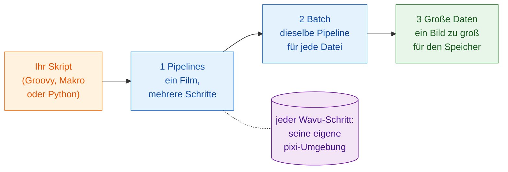

# Workflows

!!! question "Vor jeder Analyse: Was genau messen Sie?"
    Das ist die erste Frage, die Fachleute für Bildanalyse Forschenden
    stellen, und sie gehört vor den ersten Schritt. Nicht „Bitte analysieren
    Sie meine Bilder", sondern:

    - **Was messen Sie in den Bildern?** Das ist die **abhängige Variable**,
      die y-Achse Ihres finalen Plots: eine Anzahl, eine Fläche, eine
      Intensität, eine Geschwindigkeit.
    - **Was verändern oder vergleichen Sie?** Das ist die **unabhängige
      Variable**, die x-Achse: Zeit, Behandlung, Genotyp, Dosis.

    Schreiben Sie es als einen Satz: „*y* gegen *x*". In den Beispielen
    dieses Abschnitts heißt er „**Anzahl der Zellen gegen die Zeit**", und
    dieser Satz bestimmt jeden Schritt: segmentieren, um die Kerne zu zählen,
    verfolgen, um eine Teilung von einem Neuankömmling zu unterscheiden, und
    dann die Zellen pro Bild über die Zeit plotten.

    Arbeiten Sie wie bei testgetriebener Entwicklung: **Legen Sie zuerst das
    Ergebnis fest**, den finalen Plot und die Tabelle dahinter, und prüfen Sie
    es an Daten, deren Antwort Sie kennen. Die Schritte (der DAG) und die
    Methoden ergeben sich dann daraus: Jeder Schritt ist da, weil das Ergebnis
    ihn braucht.

## Die Idee in einfachen Worten { #the-idea-in-plain-words }

Bisher war Wavu eine Brücke: Fiji oder napari (der Kellner) bringt ein Bild
(die Zutaten) zu einer Küche (dem Worker), wo ein Rezept (Ihr Skript) mit
seinen eigenen Küchengeräten (seiner pixi-Umgebung) gekocht wird.

Aber ein Kellner kann mehr als Teller tragen. Aus Sicht Ihres eigenen
Skripts ist ein Wavu-Schritt einfach ein **Funktionsaufruf**: Werte und ein
Bild gehen hinein, Ergebnisse kommen heraus. Hinter dieser einen Zeile läuft
die Arbeit in einer anderen Umgebung, aber darum muss sich Ihr Skript nicht
kümmern. Sie können Wavu-Schritte also **mit den Werkzeugen, die Sie schon
benutzen, hintereinanderschalten**:

- Fiji-Plugins wie **TrackMate** und gewöhnliche **ImageJ-Befehle**;
- **scikit-image**, **pandas** und **matplotlib** in Python;
- **napari**-Layer, Farben und angedockte Plots.

Ihr Skript hält die ganze Analyse zusammen, vom Öffnen der Datei bis zum
fertigen Bild. Es legt die Reihenfolge fest, reicht Bilder und Tabellen von
Schritt zu Schritt weiter und entscheidet, wie das Ergebnis gezeichnet wird.
Das ist ein **Workflow**.

## Drei Stufen { #three-steps-up }

Die Seiten bauen aufeinander auf. Lesen Sie sie in dieser Reihenfolge:

1. **Pipelines.** Ein Zeitraffer durchläuft mehrere Schritte: öffnen,
   segmentieren, tracken, zählen, plotten. Manche Schritte sind Wavu-Küchen,
   die anderen native Werkzeuge. Die Schritte bilden einen **DAG**
   (gerichteter azyklischer Graph, *directed acyclic graph*: Kästen,
   verbunden durch Pfeile, die nur vorwärts zeigen).
2. **Batch-Verarbeitung.** Dieselbe Pipeline für jede Datei in einem Ordner.
   Die Küchen starten einmal und bedienen jede Datei; Sie bekommen eine
   Tabelle für den ganzen Ordner.
3. **Große Daten.** Ein Bild, so groß, dass es nicht in den Arbeitsspeicher
   passt. Ihr Skript bekommt einen Pfad statt Pixeln und arbeitet sich Stück
   für Stück durch das Bild.

Alle drei benutzen dasselbe Beispiel: **Zellen über die Zeit zählen** in
einem kleinen synthetischen Film, `examples/data/demo_timelapse.tif`, dessen
richtige Antwort wir kennen.

-   :material-microscope:{ .lg .middle } **1 · Pipeline in Fiji**

    ---

    Groovy mit TrackMate und ein ImageJ-Makro, mit ein oder zwei Wavu-Schritten.

    [:octicons-arrow-right-24: Pipeline in Fiji](pipeline-fiji.md)

-   :material-language-python:{ .lg .middle } **1 · Pipeline in Python und napari**

    ---

    Zwei Wavu-Küchen hintereinander; Ihr Skript zeichnet das Ergebnis in napari.

    [:octicons-arrow-right-24: Pipeline in Python](pipeline-python.md)

-   :material-folder-multiple-image:{ .lg .middle } **2 · Batch-Verarbeitung**

    ---

    Dieselbe Pipeline über einen Ordner: eine Zeile pro Datei, eine CSV, ein Plot.

    [:octicons-arrow-right-24: Batch-Verarbeitung](batch.md)

-   :material-database-arrow-right:{ .lg .middle } **3 · Große Daten**

    ---

    Streaming-Analyse von OME-Zarr, Chunk für Chunk, mit dask.

    [:octicons-arrow-right-24: Große Daten](large-data.md)

## Was brauche ich? { #which-one-do-i-need }

- **Ein Bild, ein Wavu-Skript, Ergebnisse im Betrachter?** Dann brauchen
  Sie nichts davon: Das erledigen die Menüs (**Plugins › Wavu** oder das
  napari-Widget).
- **Ein Datensatz, mehrere Schritte, manche davon nicht in Python?**
  Beginnen Sie mit einer **Pipeline**: [in Fiji](pipeline-fiji.md), wenn Sie
  Fijis Werkzeuge und Plugins mögen, [in Python](pipeline-python.md), wenn
  Sie in Notebooks und napari zu Hause sind.
- **Viele Dateien, die jeweils in den Arbeitsspeicher passen** (eine Platte,
  ein Ordner voller Zeitraffer)? Schreiben Sie die Pipeline zuerst für eine
  Datei und packen Sie sie dann in eine [Batch](batch.md)-Schleife.
- **Eine Datei, die größer ist als der Arbeitsspeicher Ihres Computers**
  (etwa ab 1–2 GB)? Lesen Sie [Große Daten](large-data.md). Ab etwa 50 GB
  oder bei vielen Stunden Arbeit lassen Sie es als Batch-Job ohne Betrachter
  laufen, oder auf einem Cluster.

!!! tip "Erst für eine, dann für viele"
    Jeder Workflow beginnt als Pipeline, die mit **einer** Datei
    funktioniert. Prüfen Sie ihr Ergebnis mit eigenen Augen im Betrachter.
    Erst dann lassen Sie sie über einen Ordner laufen.

## In einem Satz { #in-one-sentence }

Ein Wavu-Schritt ist ein Funktionsaufruf in seine eigene Umgebung, also kann
Ihr Skript ihn mit Fiji-, Python- und napari-Werkzeugen zu einer Analyse
verketten: zuerst für einen Film, dann für einen Ordner, dann für Daten, die
zu groß für den Arbeitsspeicher sind.

[Weiter: Pipeline in Fiji :material-arrow-right:](pipeline-fiji.md){ .md-button }
