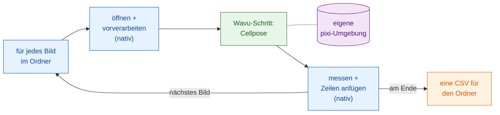

# Skriptgesteuerte Workflows

!!! success "Der stärkste Teil von Wavu"
    Die Menüs sind der einfache Einstieg. Die eigentliche Stärke ist, dass
    **Ihre eigene Pipeline** ein Wavu-Skript wie eine Funktion aufrufen kann,
    für jedes Bild in einem Ordner, und alle anderen Schritte selbst erledigt.

## Die Idee in einfachen Worten

Zurück ins Restaurant, aber jetzt hat ein Tisch mit fünfzig Gästen ein Menü
bestellt. Der Kellner tut, was Kellner gut können: Er setzt die Gäste,
schenkt Wasser ein und schreibt die Rechnung. Nur das eine Gericht, das den
besonderen Ofen braucht, geht in die Küche. Die Küche heizt diesen Ofen
**einmal** an und hält ihn für alle fünfzig Teller heiß.

In einem skriptgesteuerten Workflow gilt:

- **Ihre Pipeline ist der Kellner.** Das ist ein Groovy-Skript in Fiji, ein
  ImageJ-Makro oder ein Python-Notebook bzw. -Skript. Sie erledigt die
  *nativen* Schritte: das Bild öffnen, es etwas aufbereiten, messen,
  speichern.
- **Der Wavu-Schritt ist das Gericht aus der Küche.** Er ist der schwere
  Teil, der eigene Pakete braucht (Cellpose, PyTorch…). Er läuft in der
  eigenen pixi-Umgebung seines Ordners (seinen Küchengeräten), und seine
  Ergebnisse kommen **direkt zurück in Ihre Pipeline**: als Bilder,
  Tabellen, ROIs und Zahlen.
- **Der Worker startet einmal** und bedient jedes Bild. Nur das erste Bild
  wartet, bis der Ofen heiß ist.

## Ein Wavu-Schritt ist ein Funktionsaufruf

Aus Sicht Ihrer Pipeline sieht ein Wavu-Schritt aus wie jede andere
Funktion: Werte und ein Bild gehen hinein, Ergebnisse kommen heraus. In
Groovy ist das `wavu.run(...)`, in einem Makro
`run("Run Script (Macro)", ...)`, in Python `w.run(...)`. Hinter dieser
einen Zeile reist das Bild zu einem Worker, der in einer anderen Umgebung
lebt, und die Ergebnisse reisen zurück.

Genau das macht Wavu zu mehr als einer Brücke. Sie behalten die Werkzeuge,
denen Sie schon vertrauen (Fijis Messungen, den ROI Manager, ein Makro, das
Sie seit Jahren nutzen, pandas), und fügen einen modernen KI-Schritt hinzu,
ohne PyTorch in Fiji oder in Ihr Notebook zu installieren. Zwei Wavu-Schritte
aus zwei Ordnern können sogar in einer Pipeline aufeinander folgen, jeder in
seiner eigenen Umgebung.

## Wann sich das lohnt

- **Viele Bilder.** Ein Ordner mit Bildfeldern, eine Platte, eine Zeitreihe
  als einzelne Dateien. Einmal klicken, eine Tabelle bekommen.
- **Eine wiederholbare Pipeline.** Das Skript *ist* die Methode: dieselben
  Schritte, dieselben Einstellungen, jedes Mal, und Sie können es einer
  Kollegin schicken oder in den Anhang eines Papers legen.
- **Stärken kombinieren.** Fiji zum Öffnen ungewöhnlicher Dateiformate und
  zum Messen, Python für Deep Learning; oder umgekehrt.

!!! info "Weiterhin kleine Daten, ein Bild nach dem anderen"
    Wavus Rahmen ändert sich nicht: Jeder Aufruf verarbeitet **ein Bild, das
    in den Arbeitsspeicher passt** (bis etwa 1–2 GB). Es geht hier um die
    **Schleife**: viele solche Bilder, nacheinander, durch denselben warmen
    Worker. Für einen einzigen riesigen Datensatz nehmen Sie besser einen
    Batch- oder HPC-Workflow.

## Das Beispiel auf den nächsten Seiten

Beide Seiten bauen dieselbe Pipeline: **die Zellkerne in jedem Bild eines
Ordners zählen** und **eine CSV** für den ganzen Ordner schreiben, mit einer
Zeile pro Zellkern und der Datei, aus der er stammt. Der schwere Schritt ist
der Beispielordner
[`cellpose_nuclei`](https://github.com/Oxford-Zeiss-Centre-of-Excellence/Wavu/tree/main/examples/cellpose_nuclei)
aus dem Wavu-Repository. Er nimmt ein `image` und einen `diameter` (`0` lässt
Cellpose ihn schätzen) und gibt `labels` (ein 16-Bit-Labelbild, eine Zahl pro
Zellkern), `count` (die Anzahl der Zellkerne) und `rois` (die Umrisse als
ImageJ-RoiSet) zurück.

Zum Ausprobieren nehmen Sie einen Ordner mit einkanaligen Zellkern-TIFFs,
etwa Bilder aus der BBBC039-Sammlung (das Repository enthält eines in
`tests/data/BBBC039`).

-   :material-microscope:{ .lg .middle } **In Fiji**

    ---

    Die Pipeline als Groovy-Skript und als ImageJ-Makro.

    [:octicons-arrow-right-24: Groovy und ImageJ-Makro](fiji.md)

-   :material-language-python:{ .lg .middle } **In Python und napari**

    ---

    Die Pipeline in einem Notebook mit `wavu.client`, Ergebnisse in napari
    und mehrere Umgebungen hintereinander.

    [:octicons-arrow-right-24: Python und napari](python.md)

## In einem Satz

Lassen Sie Ihr eigenes Skript die gewöhnlichen Schritte erledigen und rufen
Sie Wavu wie eine Funktion nur für den schweren Schritt auf; der Worker
startet einmal, läuft in seiner eigenen Umgebung und gibt die Ergebnisse für
jedes Bild im Ordner direkt zurück.

[Weiter: in Fiji :material-arrow-right:](fiji.md){ .md-button }
