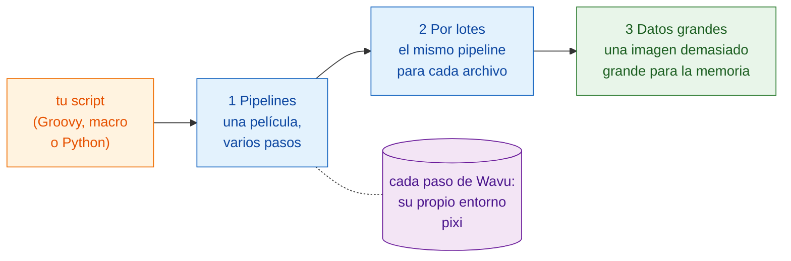

# Flujos de trabajo

!!! question "Antes de cualquier análisis: ¿qué estás midiendo exactamente?"
    Es la primera pregunta que todo analista de bioimagen hace a un
    científico, y la que hay que responder antes de escribir ningún paso. No
    «analízame estas imágenes», sino:

    - **¿Qué mides en las imágenes?** Es la **variable dependiente**, el eje
      y de tu gráfica final: un recuento, un área, una intensidad, una
      velocidad.
    - **¿Qué cambias o comparas?** Es la **variable independiente**, el eje
      x: el tiempo, un tratamiento, un genotipo, una dosis.

    Escríbelo en una frase: «*y* frente a *x*». En los ejemplos de esta
    sección es «**número de células frente al tiempo**», y esa frase elige
    cada paso: segmentar para contar los núcleos, seguir para distinguir una
    división de un recién llegado y, al final, graficar las células por
    fotograma a lo largo del tiempo.

    Trabaja como en el desarrollo guiado por pruebas: **define primero el
    resultado**, la gráfica final y la tabla que hay detrás, y compruébalo con
    datos cuya respuesta conoces. Los pasos (el DAG) y los métodos salen de
    ahí: cada paso existe porque el resultado lo necesita.

## La idea en palabras sencillas

Hasta ahora, Wavu ha sido un puente: Fiji o napari (el camarero) lleva una
imagen (los ingredientes) a una cocina (el worker), donde se cocina una
receta (tu script) con sus propios utensilios de cocina (su entorno pixi).

Pero un camarero puede hacer algo más que llevar platos. Visto desde tu
propio script, un paso de Wavu es solo una **llamada a una función**: entran
valores y una imagen, salen resultados. Detrás de esa línea, el trabajo
ocurre en otro entorno, pero a tu script eso no le importa. Así que puedes
poner pasos de Wavu **en fila con las herramientas que ya usas**:

- plugins de Fiji como **TrackMate**, y **comandos de ImageJ** normales;
- **scikit-image**, **pandas** y **matplotlib** en Python;
- capas, colores y gráficas acopladas de **napari**.

Tu script mantiene unido todo el análisis, desde abrir el archivo hasta la
imagen final. Decide el orden, pasa imágenes y tablas de un paso al
siguiente y decide cómo se dibuja el resultado. Eso es un **flujo de
trabajo** (*workflow*).

## Tres escalones

Las páginas se apoyan unas en otras. Apréndelas en este orden:

1. **Pipelines.** Una serie temporal pasa por varios pasos: abrir,
   segmentar, seguir, contar, graficar. Algunos pasos son cocinas de Wavu;
   los demás son herramientas nativas. Los pasos forman un **DAG** (grafo
   acíclico dirigido, *directed acyclic graph*: cajas unidas por flechas que
   solo van hacia delante).
2. **Procesamiento por lotes.** El mismo pipeline para cada archivo de una
   carpeta. Las cocinas arrancan una vez y sirven todos los archivos;
   obtienes una sola tabla para toda la carpeta.
3. **Datos grandes.** Una imagen tan grande que no cabe en la memoria. Tu
   script recibe una ruta en lugar de píxeles y recorre la imagen pieza a
   pieza.

Las tres usan el mismo ejemplo: **contar células a lo largo del tiempo** en
una pequeña película sintética, `examples/data/demo_timelapse.tif`, cuya
respuesta correcta conocemos.

-   :material-microscope:{ .lg .middle } **1 · Pipeline en Fiji**

    ---

    Groovy con TrackMate, y una macro de ImageJ, con uno o dos pasos de Wavu.

    [:octicons-arrow-right-24: Pipeline en Fiji](pipeline-fiji.md)

-   :material-language-python:{ .lg .middle } **1 · Pipeline en Python y napari**

    ---

    Dos cocinas de Wavu en fila; tu script dibuja el resultado en napari.

    [:octicons-arrow-right-24: Pipeline en Python](pipeline-python.md)

-   :material-folder-multiple-image:{ .lg .middle } **2 · Procesamiento por lotes**

    ---

    El mismo pipeline sobre una carpeta: una fila por archivo, un CSV, una gráfica.

    [:octicons-arrow-right-24: Procesamiento por lotes](batch.md)

-   :material-database-arrow-right:{ .lg .middle } **3 · Datos grandes**

    ---

    Análisis en flujo de OME-Zarr, bloque a bloque, con dask.

    [:octicons-arrow-right-24: Datos grandes](large-data.md)

## ¿Cuál necesito?

- **¿Una imagen, un script de Wavu, resultados en el visor?** No necesitas
  nada de esto: los menús (**Plugins › Wavu**, o el widget de napari) ya lo
  hacen.
- **¿Un conjunto de datos, varios pasos, algunos de ellos fuera de Python?**
  Empieza con un **pipeline**: [en Fiji](pipeline-fiji.md) si te gustan las
  herramientas y plugins de Fiji, [en Python](pipeline-python.md) si vives
  en notebooks y napari.
- **¿Muchos archivos que caben cada uno en la memoria** (una placa, una
  carpeta de series temporales)? Escribe primero el pipeline para un
  archivo y luego envuélvelo en un bucle [por lotes](batch.md).
- **¿Un archivo más grande que la memoria de tu ordenador** (a partir de
  1–2 GB, más o menos)? Lee [Datos grandes](large-data.md). Por encima de
  unos 50 GB, o para muchas horas de trabajo, ejecútalo como un trabajo por
  lotes sin visor, o en un clúster.

!!! tip "Escríbelo para uno, luego para muchos"
    Todo flujo de trabajo empieza como un pipeline que funciona con **un**
    archivo. Comprueba su resultado a ojo en el visor. Solo entonces
    ejecútalo sobre una carpeta.

## En una frase

Un paso de Wavu es una llamada a una función dentro de su propio entorno,
así que tu script puede encadenarlo con herramientas de Fiji, Python y
napari en un solo análisis: primero para una película, luego para una
carpeta y luego para datos demasiado grandes para la memoria.

[Siguiente: Pipeline en Fiji :material-arrow-right:](pipeline-fiji.md){ .md-button }
