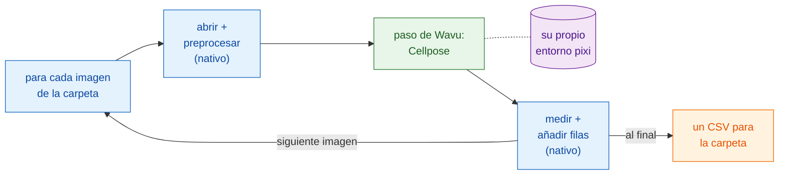

# Flujos de trabajo con scripts

!!! success "La parte más potente de Wavu"
    Los menús son la puerta de entrada fácil. La verdadera fuerza está en que
    **tu propio pipeline** puede llamar a un script de Wavu como a una
    función, para cada imagen de una carpeta, y hacer él mismo todos los
    demás pasos.

## La idea en palabras sencillas

Volvamos al restaurante, pero ahora una mesa de cincuenta comensales ha
reservado un menú cerrado. El camarero hace lo que los camareros hacen bien:
sienta a los comensales, sirve el agua, escribe la cuenta. Solo el único
plato que necesita el horno especial va a la cocina. La cocina enciende ese
horno **una vez** y lo mantiene caliente para los cincuenta platos.

En un flujo de trabajo con scripts:

- **tu pipeline es el camarero.** Es un script de Groovy de Fiji, una macro
  de ImageJ, o un notebook o script de Python. Hace los pasos *nativos*:
  abrir la imagen, limpiarla un poco, medir, guardar.
- **el paso de Wavu es el plato que sale de la cocina.** Es la parte pesada
  que necesita sus propios paquetes (Cellpose, PyTorch…). Se ejecuta en el
  propio entorno pixi de su carpeta (sus utensilios de cocina), y sus
  resultados vuelven **directamente a tu pipeline** como imágenes, tablas,
  ROI y números.
- **el worker arranca una vez** y sirve todas las imágenes. Solo la primera
  imagen espera a que se caliente el horno.

## Un paso de Wavu es una llamada a función

Desde el punto de vista de tu pipeline, un paso de Wavu parece cualquier
otra función: entran valores y una imagen, salen resultados. En Groovy es
`wavu.run(...)`, en una macro `run("Run Script (Macro)", ...)`, en Python
`w.run(...)`. Detrás de esa única línea, la imagen viaja a un worker que
vive en otro entorno, y las salidas viajan de vuelta.

Eso es lo que hace de Wavu algo más que un puente. Conservas las
herramientas en las que ya confías (las mediciones de Fiji, el ROI Manager,
una macro que usas desde hace años, pandas) y añades un paso moderno de IA,
sin instalar PyTorch en Fiji ni en tu notebook. Incluso dos pasos de Wavu de
dos carpetas distintas pueden ir uno tras otro en un mismo pipeline, cada
uno en su propio entorno.

## Cuándo usarlo

- **Muchas imágenes.** Una carpeta de campos de visión, una placa, una serie
  temporal guardada en archivos separados. Un clic, una tabla.
- **Un pipeline que puedes repetir.** El script *es* el método: los mismos
  pasos, los mismos ajustes, cada vez, y puedes enviarlo a un colega o
  ponerlo en el material suplementario de un artículo.
- **Combinar puntos fuertes.** Fiji para abrir formatos de archivo raros y
  medir, Python para el aprendizaje profundo; o al revés.

!!! info "Siguen siendo datos pequeños, una imagen cada vez"
    El alcance de Wavu no cambia: cada llamada procesa **una imagen que cabe
    en memoria** (hasta aproximadamente 1–2 GB). Lo importante aquí es el
    **bucle**: muchas imágenes así, una tras otra, por el mismo worker ya
    caliente. Para un único conjunto de datos enorme, usa un flujo de trabajo
    por lotes o en un clúster (HPC).

## El ejemplo de las páginas siguientes

Las dos páginas construyen el mismo pipeline: **contar los núcleos de cada
imagen de una carpeta** y escribir **un CSV** para toda la carpeta, con una
fila por núcleo y el archivo del que viene. El paso pesado es la carpeta de
ejemplo
[`cellpose_nuclei`](https://github.com/Oxford-Zeiss-Centre-of-Excellence/Wavu/tree/main/examples/cellpose_nuclei)
del repositorio de Wavu. Recibe una `image` y un `diameter` (`0` deja que
Cellpose lo estime), y devuelve `labels` (una imagen de etiquetas de 16 bits,
un número por núcleo), `count` (el número de núcleos) y `rois` (los
contornos como RoiSet de ImageJ).

Para probarlo, usa una carpeta de TIFF de núcleos de un solo canal, como
imágenes de la colección BBBC039 (el repositorio tiene una en
`tests/data/BBBC039`).

-   :material-microscope:{ .lg .middle } **En Fiji**

    ---

    El pipeline como script de Groovy y como macro de ImageJ.

    [:octicons-arrow-right-24: Groovy y macro de ImageJ](fiji.md)

-   :material-language-python:{ .lg .middle } **En Python y napari**

    ---

    El pipeline en un notebook con `wavu.client`, los resultados en napari,
    y varios entornos seguidos.

    [:octicons-arrow-right-24: Python y napari](python.md)

## En una frase

Deja que tu propio script haga los pasos corrientes y llama a Wavu, como a
una función, solo para el pesado; el worker arranca una vez, se ejecuta en
su propio entorno y te devuelve los resultados directamente para cada imagen
de la carpeta.

[Siguiente: en Fiji :material-arrow-right:](fiji.md){ .md-button }
