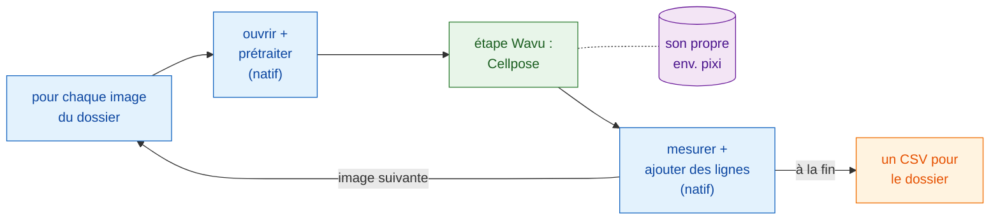

# Workflows en script

!!! success "La partie la plus puissante de Wavu"
    Les menus sont la porte d'entrée facile. La vraie force, c'est que **votre
    propre pipeline** peut appeler un script Wavu comme une fonction, pour
    chaque image d'un dossier, et faire toutes les autres étapes lui-même.

## L'idée en mots simples

Retour au restaurant, mais cette fois une table de cinquante convives a
réservé un menu. Le serveur fait ce que les serveurs savent bien faire : il
installe les convives, sert l'eau, prépare l'addition. Seul le plat qui a
besoin du four spécial part en cuisine. La cuisine allume ce four **une
fois** et le garde chaud pour les cinquante assiettes.

Dans un workflow en script :

- **votre pipeline est le serveur.** C'est un script Groovy de Fiji, une
  macro ImageJ, ou un notebook ou script Python. Il fait les étapes
  *natives* : ouvrir l'image, la nettoyer un peu, mesurer, enregistrer.
- **l'étape Wavu est le plat qui vient de la cuisine.** C'est la partie
  lourde, qui a besoin de ses propres paquets (Cellpose, PyTorch…). Elle
  tourne dans l'environnement pixi propre à son dossier (sa batterie de
  cuisine), et ses résultats reviennent **directement dans votre pipeline**
  sous forme d'images, de tableaux, de ROI et de nombres.
- **le worker démarre une seule fois** et sert chaque image. Seule la
  première image attend que le four chauffe.

## Une étape Wavu est un appel de fonction

Du point de vue de votre pipeline, une étape Wavu ressemble à n'importe
quelle autre fonction : des valeurs et une image entrent, des résultats
sortent. En Groovy, c'est `wavu.run(...)`, dans une macro
`run("Run Script (Macro)", ...)`, en Python `w.run(...)`. Derrière cette
seule ligne, l'image voyage jusqu'à un worker qui vit dans un autre
environnement, et les sorties font le chemin inverse.

C'est ce qui fait de Wavu plus qu'un pont. Vous gardez les outils auxquels
vous faites déjà confiance (les mesures de Fiji, le ROI Manager, une macro
que vous utilisez depuis des années, pandas) et vous ajoutez une étape d'IA
moderne, sans installer PyTorch dans Fiji ni dans votre notebook. Deux
étapes Wavu venant de deux dossiers peuvent même se suivre dans un même
pipeline, chacune dans son propre environnement.

## Quand l'utiliser

- **Beaucoup d'images.** Un dossier de champs de vue, une plaque, une série
  temporelle enregistrée en fichiers séparés. Un clic, un tableau.
- **Un pipeline reproductible.** Le script *est* la méthode : mêmes étapes,
  mêmes réglages, à chaque fois, et vous pouvez l'envoyer à un collègue ou le
  joindre aux annexes d'un article.
- **Combiner les forces.** Fiji pour ouvrir des formats de fichier exotiques
  et mesurer, Python pour l'apprentissage profond ; ou l'inverse.

!!! info "Toujours de petites données, une image à la fois"
    Le périmètre de Wavu ne change pas : chaque appel traite **une image qui
    tient en mémoire** (jusqu'à environ 1–2 Go). L'intérêt ici, c'est la
    **boucle** : beaucoup d'images de ce genre, l'une après l'autre, à travers
    le même worker déjà chaud. Pour un seul jeu de données énorme, utilisez
    plutôt un traitement par lots ou un workflow HPC.

## L'exemple des pages suivantes

Les deux pages construisent le même pipeline : **compter les noyaux dans
chaque image d'un dossier** et écrire **un seul CSV** pour tout le dossier,
avec une ligne par noyau et le fichier dont il provient. L'étape lourde est
le dossier d'exemple
[`cellpose_nuclei`](https://github.com/Oxford-Zeiss-Centre-of-Excellence/Wavu/tree/main/examples/cellpose_nuclei)
du dépôt Wavu. Il prend une `image` et un `diameter` (`0` laisse Cellpose
l'estimer), et renvoie `labels` (une image d'étiquettes 16 bits, un nombre
par noyau), `count` (le nombre de noyaux) et `rois` (les contours sous forme
de RoiSet ImageJ).

Pour l'essayer, utilisez un dossier de TIFF de noyaux à un seul canal, par
exemple des images de la collection BBBC039 (le dépôt en contient une dans
`tests/data/BBBC039`).

-   :material-microscope:{ .lg .middle } **Dans Fiji**

    ---

    Le pipeline en script Groovy et en macro ImageJ.

    [:octicons-arrow-right-24: Groovy et macro ImageJ](fiji.md)

-   :material-language-python:{ .lg .middle } **En Python et napari**

    ---

    Le pipeline dans un notebook avec `wavu.client`, les résultats dans
    napari, et plusieurs environnements à la suite.

    [:octicons-arrow-right-24: Python et napari](python.md)

## En une phrase

Laissez votre propre script faire les étapes ordinaires et appelez Wavu,
comme une fonction, uniquement pour l'étape lourde ; le worker démarre une
fois, tourne dans son propre environnement et renvoie directement les
résultats pour chaque image du dossier.

[Suite : dans Fiji :material-arrow-right:](fiji.md){ .md-button }
