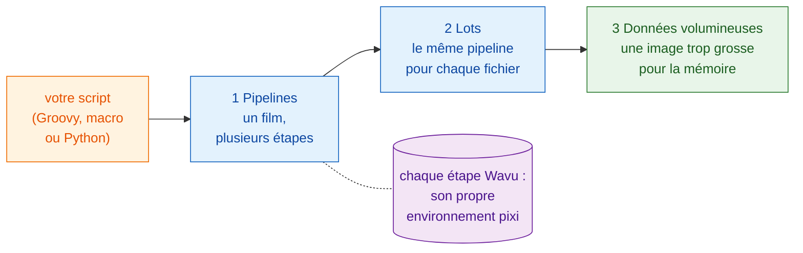

# Workflows

!!! question "Avant toute analyse : que mesurez-vous exactement ?"
    C'est la première question que tout analyste d'images biologiques pose à
    un scientifique, et celle à trancher avant d'écrire la moindre étape. Pas
    « analysez-moi ces images », mais :

    - **Que mesurez-vous dans les images ?** C'est la **variable
      dépendante**, l'axe y de votre graphique final : un nombre, une aire,
      une intensité, une vitesse.
    - **Que faites-vous varier ou que comparez-vous ?** C'est la **variable
      indépendante**, l'axe x : le temps, un traitement, un génotype, une dose.

    Écrivez-le en une phrase, « *y* en fonction de *x* ». Dans les exemples de
    cette section, c'est « **nombre de cellules en fonction du temps** », et
    cette phrase choisit chaque étape : segmenter pour compter les noyaux,
    suivre pour distinguer une division d'un nouvel arrivant, puis tracer les
    cellules par image au cours du temps.

    Travaillez comme en développement piloté par les tests : **définissez
    d'abord le résultat**, le graphique final et le tableau derrière lui, et
    vérifiez-le sur des données dont vous connaissez la réponse. Les étapes
    (le DAG) et les méthodes en découlent : chaque étape existe parce que le
    résultat en a besoin.

## L'idée en mots simples { #the-idea-in-plain-words }

Jusqu'ici, Wavu a été un pont : Fiji ou napari (le serveur) apporte une image
(les ingrédients) à une cuisine (le worker), où une recette (votre script)
est cuisinée avec sa propre batterie de cuisine (son environnement pixi).

Mais un serveur peut faire plus que porter des assiettes. Vue depuis votre
propre script, une étape Wavu n'est qu'un **appel de fonction** : des valeurs
et une image entrent, des résultats sortent. Derrière cette seule ligne, le
travail se fait dans un autre environnement, mais votre script n'a pas à
s'en soucier. Vous pouvez donc enchaîner des étapes Wavu **avec les outils
que vous utilisez déjà** :

- des plugins Fiji comme **TrackMate**, et les **commandes ImageJ**
  ordinaires ;
- **scikit-image**, **pandas** et **matplotlib** en Python ;
- les calques, les couleurs et les graphiques ancrés de **napari**.

Votre script tient toute l'analyse ensemble, de l'ouverture du fichier à
l'image finale. Il décide de l'ordre, passe images et tableaux d'une étape à
l'autre, et décide comment le résultat est dessiné. C'est cela, un
**workflow**.

## Trois marches { #three-steps-up }

Les pages s'appuient les unes sur les autres. Suivez-les dans cet ordre :

1. **Pipelines.** Un time-lapse passe par plusieurs étapes : ouvrir,
   segmenter, suivre, compter, tracer. Certaines étapes sont des cuisines
   Wavu, les autres des outils natifs. Les étapes forment un **DAG** (graphe
   orienté acyclique, *directed acyclic graph* : des boîtes reliées par des
   flèches qui ne vont que vers l'avant).
2. **Traitement par lots.** Le même pipeline pour chaque fichier d'un
   dossier. Les cuisines démarrent une fois et servent tous les fichiers ;
   vous obtenez un seul tableau pour tout le dossier.
3. **Données volumineuses.** Une image si grosse qu'elle ne tient pas en
   mémoire. Votre script reçoit un chemin au lieu de pixels et parcourt
   l'image morceau par morceau.

Les trois utilisent le même exemple : **compter des cellules au cours du
temps** dans un petit film synthétique, `examples/data/demo_timelapse.tif`,
dont nous connaissons la bonne réponse.

-   :material-microscope:{ .lg .middle } **1 · Pipeline dans Fiji**

    ---

    Groovy avec TrackMate, et une macro ImageJ, avec une ou deux étapes Wavu.

    [:octicons-arrow-right-24: Pipeline dans Fiji](pipeline-fiji.md)

-   :material-language-python:{ .lg .middle } **1 · Pipeline en Python et napari**

    ---

    Deux cuisines Wavu à la suite ; votre script dessine le résultat dans napari.

    [:octicons-arrow-right-24: Pipeline en Python](pipeline-python.md)

-   :material-folder-multiple-image:{ .lg .middle } **2 · Traitement par lots**

    ---

    Le même pipeline sur un dossier : une ligne par fichier, un CSV, un graphique.

    [:octicons-arrow-right-24: Traitement par lots](batch.md)

-   :material-database-arrow-right:{ .lg .middle } **3 · Données volumineuses**

    ---

    Analyse en flux d'OME-Zarr, bloc par bloc, avec dask.

    [:octicons-arrow-right-24: Données volumineuses](large-data.md)

## Lequel me faut-il ? { #which-one-do-i-need }

- **Une image, un script Wavu, les résultats dans le visualiseur ?** Vous
  n'avez besoin de rien de tout cela : les menus (**Plugins › Wavu**, ou le
  widget napari) s'en chargent.
- **Un jeu de données, plusieurs étapes, dont certaines pas en Python ?**
  Commencez par un **pipeline** : [dans Fiji](pipeline-fiji.md) si vous aimez
  les outils et plugins de Fiji, [en Python](pipeline-python.md) si vous
  vivez dans les notebooks et napari.
- **Beaucoup de fichiers qui tiennent chacun en mémoire** (une plaque, un
  dossier de time-lapses) ? Écrivez d'abord le pipeline pour un fichier,
  puis enveloppez-le dans une boucle de [traitement par lots](batch.md).
- **Un fichier plus gros que la mémoire de votre ordinateur** (au-delà
  d'environ 1–2 Go) ? Lisez [Données volumineuses](large-data.md). Au-delà
  d'environ 50 Go, ou pour de nombreuses heures de travail, lancez-le comme
  tâche par lots sans visualiseur, ou sur un cluster.

!!! tip "Écrivez-le pour un, puis pour beaucoup"
    Tout workflow commence comme un pipeline qui marche sur **un seul**
    fichier. Vérifiez son résultat à l'œil dans le visualiseur. Ensuite
    seulement, lancez-le sur un dossier.

## En une phrase { #in-one-sentence }

Une étape Wavu est un appel de fonction vers son propre environnement : votre
script peut donc l'enchaîner avec des outils Fiji, Python et napari en une
seule analyse, d'abord pour un film, puis pour un dossier, puis pour des
données trop grosses pour la mémoire.

[Suivant : Pipeline dans Fiji :material-arrow-right:](pipeline-fiji.md){ .md-button }
