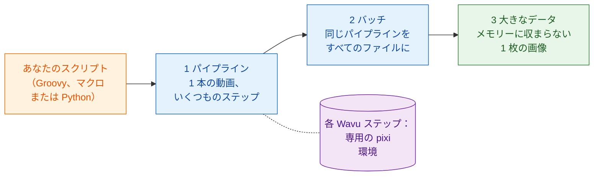

# ワークフロー

!!! question "解析の前に：いったい何を測りますか？"
    これは、バイオイメージ解析の専門家が研究者に必ず最初に尋ねる質問で、
    どのステップを書くよりも先に答えるべき質問です。「この画像を解析して」
    ではなく、次のように考えます。

    - **画像から何を測りますか** ？ それが **従属変数** 、最終的なグラフの
      y 軸です。数、面積、強度、速さなど。
    - **何を変えたり比べたりしますか** ？ それが **独立変数** 、x 軸です。
      時間、処理、遺伝子型、濃度など。

    これを「*x* に対する *y*」という 1 文にします。このセクションの例では
    「 **時間に対する細胞数** 」です。この 1 文がすべてのステップを決めます。
    核を数えるためにセグメンテーションし、分裂と新しく入ってきた細胞を
    見分けるために追跡し、最後にフレームごとの細胞数を時間に対してプロット
    します。

    テスト駆動開発のように進めましょう。 **まず出力を決めます** 。最終的な
    グラフとその元になる表を決め、答えがわかっているデータで確かめます。
    ステップ（DAG）と手法はその副産物です。どのステップも、出力に必要だから
    そこにあります。

## やさしく言うと

ここまでの Wavu は橋でした。Fiji や napari（ウェイター）が画像（食材）を
厨房（ワーカー）へ運び、そこでレシピ（あなたのスクリプト）が専用の調理器具
（そのスクリプトの pixi 環境）で調理されます。

でも、ウェイターにできるのはお皿を運ぶことだけではありません。あなた自身の
スクリプトから見ると、Wavu のステップはただの **関数呼び出し** です。値と
画像を渡すと、結果が返ってきます。その 1 行の裏では別の環境で作業が進みますが、
スクリプトはそれを気にしなくてかまいません。だから Wavu のステップを、
**いつも使っている道具と一列に** 並べられます。

- **TrackMate** などの Fiji プラグインや、ふつうの **ImageJ コマンド**
- Python の **scikit-image**、**pandas**、**matplotlib**
- **napari** のレイヤー、色、ドッキングしたグラフ

ファイルを開くところから最後の図まで、解析全体をまとめるのはあなたの
スクリプトです。順番を決め、画像や表をステップからステップへ渡し、結果を
どう描くかを決めます。これが **ワークフロー** です。

## 3 つの段階

各ページは前のページの上に積み上がります。この順番で学んでください。

1. **パイプライン。** 1 本のタイムラプスがいくつものステップを通ります。
   開く、セグメンテーション、追跡、数える、プロット。Wavu の厨房のステップも
   あれば、ネイティブな道具のステップもあります。ステップは **DAG**
   （*directed acyclic graph*、有向非巡回グラフ：前にしか進まない矢印で
   箱をつないだもの）になります。
2. **バッチ処理。** フォルダーのすべてのファイルに同じパイプラインを
   かけます。厨房は一度だけ起動してすべてのファイルを調理し、フォルダー全体で
   1 つの表が得られます。
3. **大きなデータ。** メモリーに収まらないほど大きな 1 枚の画像です。
   スクリプトはピクセルではなくパスを受け取り、画像を少しずつ処理します。

3 つとも同じ例を使います。小さな合成の動画
`examples/data/demo_timelapse.tif` で **時間とともに細胞を数える** 例で、
正解が分かっています。

-   :material-microscope:{ .lg .middle } **1 · Fiji でパイプライン**

    ---

    TrackMate を使う Groovy と ImageJ マクロに、Wavu のステップを 1 つか 2 つ。

    [:octicons-arrow-right-24: Fiji でパイプライン](pipeline-fiji.md)

-   :material-language-python:{ .lg .middle } **1 · Python と napari でパイプライン**

    ---

    2 つの Wavu の厨房を続けて使い、スクリプトが napari に結果を描きます。

    [:octicons-arrow-right-24: Python でパイプライン](pipeline-python.md)

-   :material-folder-multiple-image:{ .lg .middle } **2 · バッチ処理**

    ---

    同じパイプラインをフォルダーに：ファイルごとに 1 行、CSV 1 つ、グラフ 1 つ。

    [:octicons-arrow-right-24: バッチ処理](batch.md)

-   :material-database-arrow-right:{ .lg .middle } **3 · 大きなデータ**

    ---

    dask で OME-Zarr をチャンクごとにストリーム解析します。

    [:octicons-arrow-right-24: 大きなデータ](large-data.md)

## どれが必要？

- **画像 1 枚、Wavu スクリプト 1 つで、結果はビューアーに？** このどれも
  必要ありません。メニュー（**Plugins › Wavu** または napari のウィジェット）
  でできます。
- **データセット 1 つ、ステップがいくつか、その一部は Python ではない？**
  **パイプライン** から始めてください。Fiji の道具やプラグインが好きなら
  [Fiji で](pipeline-fiji.md)、ノートブックと napari が中心なら
  [Python で](pipeline-python.md)。
- **それぞれはメモリーに収まるファイルがたくさん**（プレート 1 枚分、
  タイムラプスのフォルダー）？ まず 1 つのファイル用にパイプラインを書き、
  それを [バッチ](batch.md) のループで包みます。
- **コンピューターのメモリーより大きなファイルが 1 つ**（だいたい 1〜2 GB 超）？
  [大きなデータ](large-data.md) を読んでください。約 50 GB を超える場合や
  何時間もかかる作業なら、ビューアーなしのバッチジョブとして、または
  クラスターで動かしてください。

!!! tip "まず 1 つ、それからたくさん"
    どのワークフローも、**1 つ** のファイルで動くパイプラインから始まります。
    その結果をビューアーで目で確かめてください。フォルダーに実行するのは
    それからです。

## ひとことで言うと

Wavu のステップは専用の環境への関数呼び出しなので、あなたのスクリプトは
それを Fiji、Python、napari の道具とつないで 1 つの解析にできます。まず
1 本の動画で、次にフォルダーで、そしてメモリーに収まらないデータで。

[次へ：Fiji でパイプライン :material-arrow-right:](pipeline-fiji.md){ .md-button }
