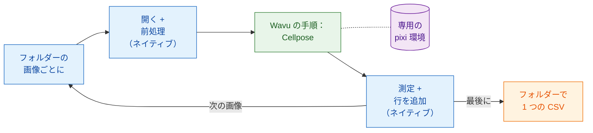

# スクリプトによるワークフロー

!!! success "Wavu でいちばん強力な部分"
    メニューは手軽な入り口です。本当の強みは、**あなた自身のパイプライン**
    が Wavu スクリプトを関数のように呼び出せることです。フォルダーの中の
    すべての画像について呼び出し、ほかの手順はすべてパイプライン自身が
    行います。

## やさしく言うと

もう一度レストランに戻りましょう。今度は 50 人のお客さんのテーブルが
コース料理を予約しています。ウェイターは得意なことをします。お客さんを席に
案内し、水を注ぎ、伝票を書きます。特別なオーブンが必要な 1 品だけが厨房へ
行きます。厨房はそのオーブンに **一度** 火を入れ、50 皿すべてのために
熱いままにしておきます。

スクリプトによるワークフローでは、

- **あなたのパイプラインがウェイターです。** Fiji の Groovy スクリプト、
  ImageJ マクロ、または Python のノートブックやスクリプトです。*ネイティブ*
  な手順を行います。画像を開き、少しきれいにし、測定し、保存します。
- **Wavu の手順は厨房から出てくる料理です。** 専用のパッケージ（Cellpose、
  PyTorch など）が必要な重い部分です。フォルダー専用の pixi 環境（その
  調理器具）で動き、結果は画像、表、ROI、数値として **あなたのパイプラインに
  直接戻ってきます**。
- **ワーカーは一度だけ起動し**、すべての画像を担当します。オーブンが温まる
  のを待つのは最初の画像だけです。

## Wavu の手順は関数呼び出し

パイプラインから見ると、Wavu の手順はほかの関数と同じです。値と画像が入り、
結果が出てきます。Groovy では `wavu.run(...)`、マクロでは
`run("Run Script (Macro)", ...)`、Python では `w.run(...)` です。この 1 行の
裏で、画像は別の環境にいるワーカーまで運ばれ、出力が戻ってきます。

これが、Wavu が単なる橋以上のものである理由です。すでに信頼している道具
（Fiji の測定、ROI Manager、何年も使ってきたマクロ、pandas）はそのままに、
最新の AI の手順を 1 つ足せます。PyTorch を Fiji にもノートブックにも
インストールする必要はありません。2 つのフォルダーの 2 つの Wavu の手順を、
1 つのパイプラインの中で続けて使うこともでき、それぞれが専用の環境で
動きます。

## どんなときに使う？

- **画像がたくさんあるとき。** 視野ごとのフォルダー、プレート、別々の
  ファイルに保存したタイムコース。1 回クリックすれば、表が 1 つできます。
- **繰り返せるパイプラインがほしいとき。** スクリプト *そのもの* が手法です。
  毎回同じ手順、同じ設定で、同僚に送ったり論文の補足資料に入れたりできます。
- **強みを組み合わせたいとき。** 変わったファイル形式を開いたり測定したり
  するのは Fiji、ディープラーニングは Python。その逆でも構いません。

!!! info "それでも小さなデータを、1 枚ずつ"
    Wavu の範囲は変わりません。1 回の呼び出しで扱うのは **メモリーに収まる
    画像 1 枚**（およそ 1～2 GB まで）です。ここでのポイントは **ループ**
    です。そうした画像をたくさん、1 枚ずつ、同じ温まったワーカーで処理します。
    1 つの巨大なデータセットには、バッチや HPC のワークフローを使ってください。

## 次のページの例

どちらのページも同じパイプラインを作ります。**フォルダーのすべての画像で
核を数え**、フォルダー全体で **1 つの CSV** を書きます。核ごとに 1 行で、
どのファイルから来たかも記録します。重い手順は、Wavu リポジトリの
[`cellpose_nuclei`](https://github.com/Oxford-Zeiss-Centre-of-Excellence/Wavu/tree/main/examples/cellpose_nuclei)
という例のフォルダーです。`image` と `diameter`（`0` なら Cellpose が推定
します）を受け取り、`labels`（16-bit のラベル画像。核ごとに 1 つの番号）、
`count`（核の数）、`rois`（ImageJ の RoiSet としての輪郭）を返します。

試すには、単一チャンネルの核の TIFF が入ったフォルダーを使います。たとえば
BBBC039 コレクションの画像です（リポジトリの `tests/data/BBBC039` に 1 枚
あります）。

-   :material-microscope:{ .lg .middle } **Fiji で**

    ---

    Groovy スクリプトと ImageJ マクロでのパイプライン。

    [:octicons-arrow-right-24: Groovy と ImageJ マクロ](fiji.md)

-   :material-language-python:{ .lg .middle } **Python と napari で**

    ---

    `wavu.client` を使ったノートブックでのパイプライン、napari での結果、
    そして複数の環境を続けて使う方法。

    [:octicons-arrow-right-24: Python と napari](python.md)

## ひとことで言うと

ふつうの手順は自分のスクリプトに任せ、重い手順のためだけに Wavu を関数の
ように呼び出します。ワーカーは一度だけ起動し、専用の環境で動き、フォルダーの
すべての画像について結果をそのまま返してくれます。

[次へ：Fiji で :material-arrow-right:](fiji.md){ .md-button }
