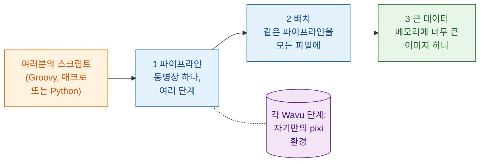

# 워크플로

!!! question "분석 전에: 정확히 무엇을 재나요?"
    이것은 모든 바이오이미지 분석가가 과학자에게 가장 먼저 묻는 질문이고,
    어떤 단계를 쓰기 전에 답해야 하는 질문이에요. "이 이미지 좀 분석해
    주세요"가 아니라 이렇게 물어요.

    - **이미지에서 무엇을 재나요?** 그것이 **종속 변수**, 최종 그래프의
      y축이에요. 개수, 면적, 세기, 속도 같은 것이요.
    - **무엇을 바꾸거나 비교하나요?** 그것이 **독립 변수**, x축이에요.
      시간, 처리, 유전형, 농도 같은 것이요.

    이것을 "*x*에 따른 *y*"라는 한 문장으로 쓰세요. 이 섹션의 예에서는
    "**시간에 따른 세포 수**"이고, 이 한 문장이 모든 단계를 정해요. 핵을
    세려고 분할하고, 분열과 새로 들어온 세포를 구별하려고 추적하고,
    마지막으로 프레임별 세포 수를 시간에 따라 그려요.

    테스트 주도 개발처럼 하세요. **출력을 먼저 정하세요**. 최종 그래프와
    그 뒤의 표를 정하고, 답을 아는 데이터로 확인해요. 단계(DAG)와 방법은
    그 부산물이에요. 모든 단계는 출력이 필요로 하기 때문에 있어요.

## 쉬운 말로 설명하면

지금까지 Wavu는 다리였어요. Fiji나 napari(웨이터)가 이미지(재료)를
주방(워커)으로 가져가면, 그곳에서 레시피(여러분의 스크립트)가 자기만의 주방
도구(그 스크립트의 pixi 환경)로 요리돼요.

하지만 웨이터는 접시만 나르는 게 아니에요. 여러분 스크립트 입장에서 보면
Wavu 단계는 그냥 **함수 호출**이에요. 값과 이미지를 넣으면 결과가 나와요.
그 한 줄 뒤에서는 다른 환경에서 일이 벌어지지만, 스크립트는 신경 쓸 필요가
없어요. 그래서 Wavu 단계를 **이미 쓰는 도구들과 한 줄로** 늘어놓을 수 있어요.

- **TrackMate** 같은 Fiji 플러그인과 평범한 **ImageJ 명령**
- Python의 **scikit-image**, **pandas**, **matplotlib**
- **napari** 레이어, 색, 도킹된 그래프

파일을 여는 것부터 마지막 그림까지, 분석 전체를 묶는 건 여러분의
스크립트예요. 순서를 정하고, 이미지와 표를 단계에서 단계로 넘기고, 결과를
어떻게 그릴지 정해요. 이것이 **워크플로**예요.

## 세 단계로 올라가기

페이지들은 앞 페이지 위에 쌓여요. 이 순서로 배우세요.

1. **파이프라인.** 타임랩스 하나가 여러 단계를 거쳐요. 열기, 분할, 추적,
   세기, 그래프. 어떤 단계는 Wavu 주방이고, 나머지는 네이티브 도구예요.
   단계들은 **DAG**(*directed acyclic graph*, 방향성 비순환 그래프: 앞으로만
   가는 화살표로 상자들을 이은 것)를 이뤄요.
2. **배치 처리.** 폴더의 모든 파일에 같은 파이프라인을 돌려요. 주방은 한
   번만 시작해서 모든 파일을 요리하고, 폴더 전체에 대해 표 하나를 얻어요.
3. **큰 데이터.** 메모리에 들어가지 않을 만큼 큰 이미지 하나예요.
   스크립트는 픽셀 대신 경로를 받고, 이미지를 조각조각 처리해요.

셋 다 같은 예제를 써요. 작은 합성 동영상
`examples/data/demo_timelapse.tif`에서 **시간에 따라 세포 세기**이고, 정답을
알고 있어요.

-   :material-microscope:{ .lg .middle } **1 · Fiji에서 파이프라인**

    ---

    TrackMate를 쓰는 Groovy와 ImageJ 매크로에, Wavu 단계 한두 개.

    [:octicons-arrow-right-24: Fiji에서 파이프라인](pipeline-fiji.md)

-   :material-language-python:{ .lg .middle } **1 · Python과 napari에서 파이프라인**

    ---

    Wavu 주방 두 곳을 연달아 쓰고, 스크립트가 napari에 결과를 그려요.

    [:octicons-arrow-right-24: Python에서 파이프라인](pipeline-python.md)

-   :material-folder-multiple-image:{ .lg .middle } **2 · 배치 처리**

    ---

    같은 파이프라인을 폴더 전체에: 파일마다 한 행, CSV 하나, 그래프 하나.

    [:octicons-arrow-right-24: 배치 처리](batch.md)

-   :material-database-arrow-right:{ .lg .middle } **3 · 큰 데이터**

    ---

    dask로 OME-Zarr를 청크 단위로 스트림 분석해요.

    [:octicons-arrow-right-24: 큰 데이터](large-data.md)

## 나한테 필요한 건 어느 것일까요?

- **이미지 하나, Wavu 스크립트 하나, 결과는 뷰어에?** 이 중 아무것도 필요
  없어요. 메뉴(**Plugins › Wavu** 또는 napari 위젯)로 돼요.
- **데이터셋 하나, 단계 여러 개, 그중 일부는 Python이 아닌가요?**
  **파이프라인**부터 시작하세요. Fiji의 도구와 플러그인을 좋아하면
  [Fiji에서](pipeline-fiji.md), 노트북과 napari에서 주로 일하면
  [Python에서](pipeline-python.md).
- **각각은 메모리에 들어가는 파일이 많나요**(플레이트 하나, 타임랩스
  폴더)? 먼저 파일 하나에 대한 파이프라인을 쓰고, 그걸 [배치](batch.md)
  루프로 감싸세요.
- **컴퓨터 메모리보다 큰 파일 하나**(대략 1–2 GB 이상)? [큰 데이터](large-data.md)를
  읽으세요. 약 50 GB를 넘거나 몇 시간씩 걸리는 일이라면, 뷰어 없이 배치
  작업으로 돌리거나 클러스터에서 돌리세요.

!!! tip "하나로 먼저, 그다음에 여럿으로"
    모든 워크플로는 **파일 하나**에서 작동하는 파이프라인으로 시작해요. 그
    결과를 뷰어에서 눈으로 확인하세요. 폴더에 돌리는 건 그다음이에요.

## 한 문장으로

Wavu 단계는 자기 환경으로 들어가는 함수 호출이라서, 여러분의 스크립트는 그것을
Fiji, Python, napari 도구와 이어 하나의 분석으로 만들 수 있어요. 먼저 동영상
하나로, 그다음 폴더로, 그다음 메모리보다 큰 데이터로요.

[다음: Fiji에서 파이프라인 :material-arrow-right:](pipeline-fiji.md){ .md-button }
