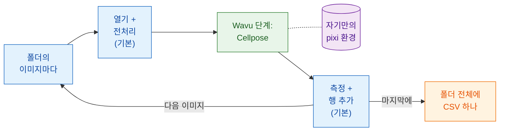

# 스크립트 워크플로

!!! success "Wavu에서 가장 강력한 부분"
    메뉴는 쉽게 시작하는 길이에요. 진짜 힘은 **내 파이프라인**이 Wavu
    스크립트를 함수처럼, 폴더 안의 이미지마다 부르고, 나머지 단계는 모두
    스스로 한다는 데 있어요.

## 쉬운 말로 설명하면

다시 레스토랑이에요. 이번에는 손님 쉰 명이 코스 요리를 예약했어요.
웨이터는 웨이터가 잘하는 일을 해요. 손님을 자리에 앉히고, 물을 따르고,
계산서를 써요. 특별한 오븐이 필요한 요리 하나만 주방으로 가요. 주방은 그
오븐을 **한 번** 켜고, 쉰 접시 내내 뜨겁게 유지해요.

스크립트 워크플로에서는:

- **내 파이프라인이 웨이터예요.** Fiji Groovy 스크립트, ImageJ 매크로, 또는
  Python 노트북이나 스크립트예요. *기본* 단계를 해요. 이미지를 열고, 조금
  다듬고, 측정하고, 저장해요.
- **Wavu 단계는 주방에서 나오는 요리예요.** 자기만의 패키지(Cellpose,
  PyTorch…)가 필요한 무거운 부분이에요. 그 폴더만의 pixi 환경(주방 도구)에서
  실행되고, 결과는 이미지, 표, ROI, 숫자로 **곧바로 내 파이프라인에**
  돌아와요.
- **워커는 한 번만 시작**하고 모든 이미지를 처리해요. 오븐이 데워지기를
  기다리는 건 첫 이미지뿐이에요.

## Wavu 단계는 함수 호출이에요

내 파이프라인 입장에서 Wavu 단계는 다른 함수와 똑같아 보여요. 값과
이미지가 들어가고 결과가 나와요. Groovy에서는 `wavu.run(...)`, 매크로에서는
`run("Run Script (Macro)", ...)`, Python에서는 `w.run(...)`이에요. 그 한 줄
뒤에서 이미지는 다른 환경에 사는 워커로 갔다가, 출력이 돌아와요.

그래서 Wavu는 다리 이상이에요. 이미 믿고 쓰는 도구(Fiji의 측정, ROI
Manager, 몇 년째 쓰는 매크로, pandas)는 그대로 두고, Fiji나 노트북에
PyTorch를 설치하지 않고도 최신 AI 단계 하나를 더할 수 있어요. 두 폴더의
Wavu 단계 두 개를 한 파이프라인에서 이어서 쓸 수도 있고, 각자 자기 환경에서
돌아요.

## 언제 쓰나요

- **이미지가 많을 때.** 시야(field of view) 폴더, 플레이트, 따로 저장한 타임
  코스. 한 번 클릭하면 표 하나가 나와요.
- **반복할 수 있는 파이프라인.** 스크립트가 곧 *방법*이에요. 매번 같은 단계,
  같은 설정이고, 동료에게 보내거나 논문의 보충 자료에 넣을 수 있어요.
- **장점 섞기.** 특이한 파일 형식을 열고 측정하는 건 Fiji, 딥러닝은 Python.
  또는 그 반대도요.

!!! info "여전히 작은 데이터, 한 번에 이미지 한 장"
    Wavu의 범위는 바뀌지 않아요. 호출 하나는 **메모리에 들어가는 이미지 한
    장**(대략 1–2 GB까지)을 처리해요. 여기서 핵심은 **반복**이에요. 그런
    이미지 여러 장을 차례로, 데워진 같은 워커로 처리해요. 아주 큰 데이터셋
    하나라면 배치나 HPC 워크플로를 쓰세요.

## 다음 페이지의 예

두 페이지 모두 같은 파이프라인을 만들어요. **폴더의 모든 이미지에서 핵을
세고**, 폴더 전체에 대해 **CSV 하나**를 써요. 핵 하나당 한 행이고, 어느
파일에서 왔는지도 적어요. 무거운 단계는 Wavu 저장소의
[`cellpose_nuclei`](https://github.com/Oxford-Zeiss-Centre-of-Excellence/Wavu/tree/main/examples/cellpose_nuclei)
예제 폴더예요. `image`와 `diameter`(`0`이면 Cellpose가 추정해요)를 받고,
`labels`(16-bit 라벨 이미지, 핵마다 번호 하나), `count`(핵의 수), `rois`(ImageJ
RoiSet으로 된 윤곽선)를 돌려줘요.

해 보려면 단일 채널 핵 TIFF 폴더를 쓰세요. 예를 들어 BBBC039 모음의
이미지가 좋아요(저장소의 `tests/data/BBBC039`에 하나 있어요).

-   :material-microscope:{ .lg .middle } **Fiji에서**

    ---

    Groovy 스크립트와 ImageJ 매크로로 만든 파이프라인이에요.

    [:octicons-arrow-right-24: Groovy와 ImageJ 매크로](fiji.md)

-   :material-language-python:{ .lg .middle } **Python과 napari에서**

    ---

    `wavu.client`를 쓰는 노트북 속 파이프라인, napari에서 보는 결과, 여러
    환경을 잇따라 쓰기예요.

    [:octicons-arrow-right-24: Python과 napari](python.md)

## 한 문장으로

평범한 단계는 내 스크립트가 하게 두고, 무거운 단계에만 Wavu를 함수처럼
부르세요. 워커는 한 번 시작해서 자기 환경에서 돌고, 폴더의 모든 이미지에
대해 결과를 곧바로 돌려줘요.

[다음: Fiji에서 :material-arrow-right:](fiji.md){ .md-button }
