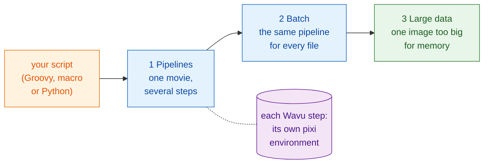

# Workflows

!!! question "Before any analysis: what exactly are you measuring?"
    This is the first question every bioimage analyst asks a scientist, and
    the one to answer before writing any step. Not "please analyse my
    images", but:

    - **What do you measure in the images?** That is the **dependent
      variable**, the y axis of your final plot: a count, an area, an
      intensity, a speed.
    - **What do you change or compare?** That is the **independent
      variable**, the x axis: time, treatment, genotype, dose.

    Write it as one sentence, "*y* against *x*". In the examples of this
    section it is "**number of cells against time**", and that sentence picks
    every step: segment to count the nuclei, track to tell a division from a
    newcomer, then plot cells per frame over time.

    Work like test-driven development: **define the output first**, the final
    plot and the table behind it, and check it on data where you know the answer.
    The steps (the DAG) and the methods are then by-products: each step is
    there because the output needs it.

## The idea in plain words

So far, Wavu has been a bridge: Fiji or napari (the waiter) carries an image
(the ingredients) to a kitchen (the worker), where a recipe (your script)
is cooked with its own kitchenware (its pixi environment).

But a waiter can do more than carry plates. Seen from your own script, a
Wavu step is just a **function call**: values and an image go in, results
come out. Behind that one line, the work happens in another environment, but
your script does not have to care. So you can put Wavu steps **in a row with
the tools you already use**:

- Fiji plugins such as **TrackMate**, and ordinary **ImageJ commands**;
- **scikit-image**, **pandas** and **matplotlib** in Python;
- **napari** layers, colours and docked plots.

Your script holds the whole analysis together, from opening the file to
the final picture. It decides the order, passes images and tables from step
to step, and decides how the result is drawn. That is a **workflow**.

## Three steps up

The pages build on each other. Learn them in this order:

1. **Pipelines.** One time-lapse goes through several steps: open, segment,
   track, count, plot. Some steps are Wavu kitchens, the others are native
   tools. The steps form a **DAG** (a *directed acyclic graph*: boxes joined
   by arrows that only go forward).
2. **Batch processing.** The same pipeline for every file in a folder. The
   kitchens start once and serve every file; you get one table for the
   whole folder.
3. **Large data.** One image so big that it does not fit in memory. Your
   script gets a path instead of pixels and works through the image piece by
   piece.

All three use the same example: **counting cells over time** in a small
synthetic movie, `examples/data/demo_timelapse.tif`, whose right answer we
know.

-   :material-microscope:{ .lg .middle } **1 · Pipeline in Fiji**

    ---

    Groovy with TrackMate, and an ImageJ macro, with one or two Wavu steps.

    [:octicons-arrow-right-24: Pipeline in Fiji](pipeline-fiji.md)

-   :material-language-python:{ .lg .middle } **1 · Pipeline in Python and napari**

    ---

    Two Wavu kitchens in a row; your script draws the result in napari.

    [:octicons-arrow-right-24: Pipeline in Python](pipeline-python.md)

-   :material-folder-multiple-image:{ .lg .middle } **2 · Batch processing**

    ---

    The same pipeline over a folder: one row per file, one CSV, one plot.

    [:octicons-arrow-right-24: Batch processing](batch.md)

-   :material-database-arrow-right:{ .lg .middle } **3 · Large data**

    ---

    Stream analysis of OME-Zarr, chunk by chunk, with dask.

    [:octicons-arrow-right-24: Large data](large-data.md)

## Which one do I need?

- **One image, one Wavu script, results in the viewer?** You need none of
  this: the menus (**Plugins › Wavu**, or the napari widget) do it.
- **One dataset, several steps, some of them not in Python?** Start with a
  **pipeline**: [in Fiji](pipeline-fiji.md) if you like Fiji's tools and
  plugins, [in Python](pipeline-python.md) if you live in notebooks and
  napari.
- **Many files that each fit in memory** (a plate, a folder of
  time-lapses)? Write the pipeline for one file first, then wrap it in a
  [batch](batch.md) loop.
- **One file larger than your computer's memory** (roughly beyond 1–2 GB)?
  Read [Large data](large-data.md). Beyond about 50 GB, or for many hours of
  work, run it as a batch job without a viewer, or on a cluster.

!!! tip "Write it for one, then for many"
    Every workflow starts as a pipeline that works on **one** file. Check
    its result by eye in the viewer. Only then run it on a folder.

## In one sentence

A Wavu step is a function call into its own environment, so your script can
chain it with Fiji, Python and napari tools into one analysis, first for one
movie, then for a folder, then for data too big for memory.

[Next: Pipeline in Fiji :material-arrow-right:](pipeline-fiji.md){ .md-button }
