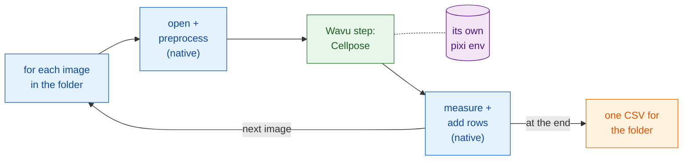

# Scripted workflows

!!! success "The most powerful part of Wavu"
    The menus are the easy way in. The real strength is that **your own
    pipeline** can call a Wavu script like a function, for every image in a
    folder, and do all the other steps itself.

## The idea in plain words

Back to the restaurant, but now a table of fifty guests has booked a set
menu. The waiter does what waiters do well: seats the guests, pours the
water, writes the bill. Only the one dish that needs the special oven goes
to the kitchen. The kitchen lights that oven **once** and keeps it hot for
all fifty plates.

In a scripted workflow:

- **your pipeline is the waiter.** It is a Fiji Groovy script, an ImageJ
  macro, or a Python notebook or script. It does the *native* steps: open
  the image, clean it up a little, measure, save.
- **the Wavu step is the dish from the kitchen.** It is the heavy part that
  needs its own packages (Cellpose, PyTorch…). It runs in its folder's own
  pixi environment (its kitchenware), and its results come **straight back into
  your pipeline** as images, tables, ROIs and numbers.
- **the worker starts once** and serves every image. Only the first image
  waits for the oven to heat up.

## A Wavu step is a function call

From your pipeline's point of view, a Wavu step looks like any other
function: values and an image go in, results come out. In Groovy it is
`wavu.run(...)`, in a macro `run("Run Script (Macro)", ...)`, in Python
`w.run(...)`. Behind that one line, the image travels to a worker that lives
in a different environment, and the outputs travel back.

That is what makes Wavu more than a bridge. You keep the tools you already
trust (Fiji's measurements, the ROI Manager, a macro you have used for
years, pandas) and add one modern AI step, without installing PyTorch into
Fiji or into your notebook. Two Wavu steps from two folders can even follow
each other in one pipeline, each in its own environment.

## When to use it

- **Many images.** A folder of fields of view, a plate, a time course saved
  as separate files. Click once, get one table.
- **A pipeline you can repeat.** The script *is* the method: same steps,
  same settings, every time, and you can send it to a colleague or put it in
  a paper's supplement.
- **Mixing strengths.** Fiji for opening odd file formats and measuring,
  Python for deep learning; or the other way round.

!!! info "Still small data, one image at a time"
    Wavu's scope does not change: each call handles **one image that fits in
    memory** (up to roughly 1–2 GB). The point here is the **loop**: many
    such images, one after another, through the same warm worker. For one
    huge dataset, use a batch or HPC workflow instead.

## The example on the next pages

Both pages build the same pipeline: **count the nuclei in every image of a
folder** and write **one CSV** for the whole folder, with one row per
nucleus and the file it came from. The heavy step is the
[`cellpose_nuclei`](https://github.com/Oxford-Zeiss-Centre-of-Excellence/Wavu/tree/main/examples/cellpose_nuclei)
example folder from the Wavu repository. It takes an `image` and a
`diameter` (`0` lets Cellpose estimate it), and returns `labels` (a 16-bit
label image, one number per nucleus), `count` (the number of nuclei) and
`rois` (the outlines as an ImageJ RoiSet).

To try it, use a folder of single-channel nuclei TIFFs, such as images from
the BBBC039 collection (the repository has one in `tests/data/BBBC039`).

-   :material-microscope:{ .lg .middle } **In Fiji**

    ---

    The pipeline as a Groovy script and as an ImageJ macro.

    [:octicons-arrow-right-24: Groovy and ImageJ macro](fiji.md)

-   :material-language-python:{ .lg .middle } **In Python and napari**

    ---

    The pipeline in a notebook with `wavu.client`, results in napari, and
    several environments in a row.

    [:octicons-arrow-right-24: Python and napari](python.md)

## In one sentence

Let your own script do the ordinary steps and call Wavu, like a function,
only for the heavy one; the worker starts once, runs in its own environment,
and hands the results straight back for every image in the folder.

[Next: in Fiji :material-arrow-right:](fiji.md){ .md-button }
