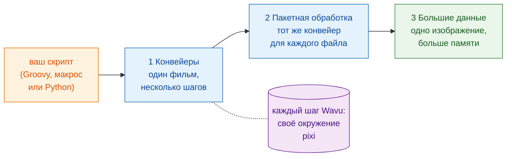

# Рабочие процессы

!!! question "Перед любым анализом: что именно вы измеряете?"
    Это первый вопрос, который любой специалист по анализу биоизображений
    задаёт учёному, и на него нужно ответить до того, как писать первый шаг.
    Не «проанализируйте мне эти изображения», а:

    - **Что вы измеряете на изображениях?** Это **зависимая переменная**,
      ось y вашего итогового графика: число, площадь, интенсивность,
      скорость.
    - **Что вы меняете или сравниваете?** Это **независимая переменная**,
      ось x: время, обработка, генотип, доза.

    Запишите это одним предложением: «*y* в зависимости от *x*». В примерах
    этого раздела это «**число клеток в зависимости от времени**», и это
    предложение определяет каждый шаг: сегментировать, чтобы посчитать ядра,
    отслеживать, чтобы отличить деление от новой клетки, а затем построить
    график числа клеток по кадрам во времени.

    Работайте как при разработке через тестирование: **сначала определите
    результат** — итоговый график и таблицу за ним — и проверьте его на
    данных, для которых ответ известен. Шаги (DAG) и методы получаются из
    этого сами: каждый шаг нужен потому, что его требует результат.

## Идея простыми словами

До сих пор Wavu был мостом: Fiji или napari (официант) несёт изображение
(ингредиенты) на кухню (воркер), где по рецепту (ваш скрипт) готовят своей
собственной кухонной утварью (своим окружением pixi).

Но официант умеет больше, чем носить тарелки. С точки зрения вашего
скрипта шаг Wavu — это просто **вызов функции**: на вход идут значения и
изображение, на выходе — результаты. За этой одной строкой работа идёт в
другом окружении, но вашему скрипту об этом думать не нужно. Поэтому шаги
Wavu можно ставить **в ряд с инструментами, которыми вы уже пользуетесь**:

- плагины Fiji, например **TrackMate**, и обычные **команды ImageJ**;
- **scikit-image**, **pandas** и **matplotlib** в Python;
- слои, цвета и встроенные графики **napari**.

Ваш скрипт держит весь анализ вместе, от открытия файла до итоговой
картинки. Он решает порядок, передаёт изображения и таблицы от шага к шагу
и решает, как нарисовать результат. Это и есть **рабочий процесс**
(*workflow*).

## Три ступени

Страницы опираются друг на друга. Изучайте их в таком порядке:

1. **Конвейеры.** Один временной ряд проходит через несколько шагов:
   открыть, сегментировать, отследить, посчитать, построить график. Часть
   шагов — кухни Wavu, остальные — нативные инструменты. Шаги образуют
   **DAG** (*directed acyclic graph*, ориентированный ациклический граф:
   блоки, соединённые стрелками, которые идут только вперёд).
2. **Пакетная обработка.** Тот же конвейер для каждого файла в папке.
   Кухни запускаются один раз и обслуживают все файлы; вы получаете одну
   таблицу на всю папку.
3. **Большие данные.** Одно изображение настолько большое, что не
   помещается в память. Ваш скрипт получает путь вместо пикселей и
   проходит изображение по кусочкам.

Все три используют один и тот же пример: **подсчёт клеток во времени** в
маленьком синтетическом фильме `examples/data/demo_timelapse.tif`, для
которого мы знаем правильный ответ.

-   :material-microscope:{ .lg .middle } **1 · Конвейер в Fiji**

    ---

    Groovy с TrackMate и макрос ImageJ, с одним или двумя шагами Wavu.

    [:octicons-arrow-right-24: Конвейер в Fiji](pipeline-fiji.md)

-   :material-language-python:{ .lg .middle } **1 · Конвейер на Python и napari**

    ---

    Две кухни Wavu подряд; ваш скрипт рисует результат в napari.

    [:octicons-arrow-right-24: Конвейер на Python](pipeline-python.md)

-   :material-folder-multiple-image:{ .lg .middle } **2 · Пакетная обработка**

    ---

    Тот же конвейер для целой папки: одна строка на файл, один CSV, один график.

    [:octicons-arrow-right-24: Пакетная обработка](batch.md)

-   :material-database-arrow-right:{ .lg .middle } **3 · Большие данные**

    ---

    Потоковый анализ OME-Zarr, блок за блоком, с dask.

    [:octicons-arrow-right-24: Большие данные](large-data.md)

## Что мне нужно?

- **Одно изображение, один скрипт Wavu, результаты в просмотрщике?** Ничего
  из этого не нужно: всё делают меню (**Plugins › Wavu** или виджет
  napari).
- **Один набор данных, несколько шагов, и некоторые из них не на Python?**
  Начните с **конвейера**: [в Fiji](pipeline-fiji.md), если вам нравятся
  инструменты и плагины Fiji, [на Python](pipeline-python.md), если вы
  живёте в ноутбуках и napari.
- **Много файлов, каждый из которых помещается в память** (планшет, папка
  временных рядов)? Сначала напишите конвейер для одного файла, затем
  оберните его в цикл [пакетной обработки](batch.md).
- **Один файл больше памяти вашего компьютера** (примерно свыше 1–2 ГБ)?
  Читайте [Большие данные](large-data.md). Свыше ~50 ГБ или для многих
  часов работы запускайте это как пакетное задание без просмотрщика или на
  кластере.

!!! tip "Сначала для одного, потом для многих"
    Любой рабочий процесс начинается с конвейера, который работает на
    **одном** файле. Проверьте его результат на глаз в просмотрщике. Только
    после этого запускайте его на папке.

## Одним предложением

Шаг Wavu — это вызов функции в его собственном окружении, поэтому ваш
скрипт может связать его с инструментами Fiji, Python и napari в один
анализ: сначала для одного фильма, затем для папки, затем для данных,
которые не помещаются в память.

[Далее: Конвейер в Fiji :material-arrow-right:](pipeline-fiji.md){ .md-button }
