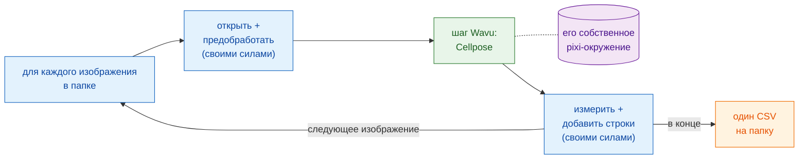

# Рабочие процессы в скриптах

!!! success "Самая мощная часть Wavu"
    Меню — это простой способ начать. Настоящая сила в том, что **ваш
    собственный конвейер** может вызывать скрипт Wavu как функцию для
    каждого изображения в папке, а все остальные шаги делать сам.

## Идея простыми словами

Вернёмся в ресторан, но теперь стол на пятьдесят гостей заказал
комплексное меню. Официант делает то, что официанты умеют хорошо: рассаживает
гостей, наливает воду, выписывает счёт. На кухню уходит только одно блюдо,
для которого нужна особая печь. Кухня разжигает эту печь **один раз** и
держит её горячей для всех пятидесяти тарелок.

В рабочем процессе на скриптах:

- **ваш конвейер — это официант.** Это скрипт Groovy в Fiji, макрос
  ImageJ или ноутбук (notebook) либо скрипт на Python. Он делает
  *собственные* шаги: открывает изображение, слегка его очищает, измеряет,
  сохраняет.
- **шаг Wavu — это блюдо с кухни.** Это тяжёлая часть, которой нужны свои
  пакеты (Cellpose, PyTorch…). Она работает в собственном
  pixi-окружении своей папки (её кухонной утвари), а результаты
  возвращаются **прямо в ваш конвейер** как изображения, таблицы, ROI и
  числа.
- **воркер запускается один раз** и обслуживает каждое изображение. Ждать,
  пока разогреется печь, приходится только первому изображению.

## Шаг Wavu — это вызов функции

С точки зрения вашего конвейера шаг Wavu выглядит как любая другая
функция: на вход значения и изображение, на выходе результаты. В Groovy это
`wavu.run(...)`, в макросе `run("Run Script (Macro)", ...)`, в Python
`w.run(...)`. За этой одной строкой изображение отправляется к воркеру,
который живёт в другом окружении, а результаты возвращаются обратно.

Именно это делает Wavu больше, чем мостом. Вы сохраняете инструменты,
которым уже доверяете (измерения Fiji, ROI Manager, макрос, которым
пользуетесь годами, pandas), и добавляете один современный шаг с ИИ, не
устанавливая PyTorch ни в Fiji, ни в свой ноутбук. Два шага Wavu из двух
папок могут даже идти друг за другом в одном конвейере, каждый в своём
окружении.

## Когда это нужно

- **Много изображений.** Папка полей зрения, планшет, временной ряд,
  сохранённый отдельными файлами. Один щелчок — одна таблица.
- **Повторяемый конвейер.** Скрипт *и есть* метод: те же шаги, те же
  настройки каждый раз, и его можно отправить коллеге или приложить к
  статье в дополнительных материалах.
- **Сочетание сильных сторон.** Fiji — чтобы открывать необычные форматы
  файлов и измерять, Python — для глубокого обучения; или наоборот.

!!! info "По-прежнему небольшие данные, по одному изображению"
    Область применения Wavu не меняется: каждый вызов обрабатывает **одно
    изображение, которое помещается в память** (примерно до 1–2 ГБ). Смысл
    здесь в **цикле**: много таких изображений одно за другим через один и
    тот же разогретый воркер. Для одного огромного набора данных используйте
    пакетную обработку или рабочий процесс на HPC.

## Пример на следующих страницах

Обе страницы строят один и тот же конвейер: **подсчитать ядра на каждом
изображении папки** и записать **один CSV** на всю папку — по строке на
ядро, с именем файла, из которого оно взято. Тяжёлый шаг — папка примера
[`cellpose_nuclei`](https://github.com/Oxford-Zeiss-Centre-of-Excellence/Wavu/tree/main/examples/cellpose_nuclei)
из репозитория Wavu. Она принимает `image` и `diameter` (`0` позволяет
Cellpose оценить его самому) и возвращает `labels` (16-битное изображение
меток, по числу на ядро), `count` (число ядер) и `rois` (контуры в виде
ImageJ RoiSet).

Чтобы попробовать, возьмите папку одноканальных TIFF с ядрами, например
изображения из коллекции BBBC039 (одно есть в репозитории, в
`tests/data/BBBC039`).

-   :material-microscope:{ .lg .middle } **В Fiji**

    ---

    Конвейер как скрипт Groovy и как макрос ImageJ.

    [:octicons-arrow-right-24: Groovy и макрос ImageJ](fiji.md)

-   :material-language-python:{ .lg .middle } **В Python и napari**

    ---

    Конвейер в ноутбуке с `wavu.client`, результаты в napari и несколько
    окружений подряд.

    [:octicons-arrow-right-24: Python и napari](python.md)

## Одним предложением

Пусть ваш собственный скрипт делает обычные шаги и вызывает Wavu, как
функцию, только для тяжёлого; воркер запускается один раз, работает в своём
окружении и возвращает результаты прямо в скрипт для каждого изображения в
папке.

[Далее: в Fiji :material-arrow-right:](fiji.md){ .md-button }
