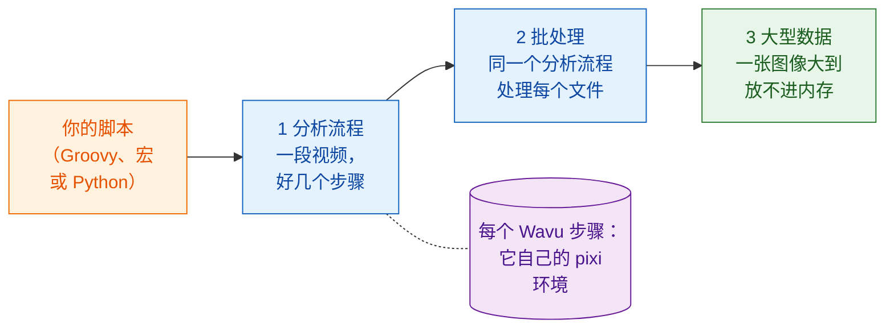

# 工作流程

!!! question "分析之前：你到底要测量什么？"
    这是每位生物图像分析师都会先问科学家的问题，也是写下任何步骤之前就要
    回答的问题。不是“帮我分析一下这些图像”，而是：

    - **你要从图像里测量什么**？这就是**因变量**（dependent variable），
      也就是最后那张图的 y 轴：数量、面积、强度、速度。
    - **你改变或比较的是什么**？这就是**自变量**（independent variable），
      也就是 x 轴：时间、处理、基因型、剂量。

    把它写成一句话：“*y* 对 *x*”。在本节的示例里，这句话是
    “**细胞数对时间**”，而这句话决定了每一个步骤：为了计数细胞核而分割，
    为了分辨分裂和新进来的细胞而追踪，最后把每一帧的细胞数对时间画出来。

    像测试驱动开发（TDD）一样工作：**先定义输出**，也就是最后那张图和它背后的
    表格，并用已知答案的数据检查它。步骤（DAG）和方法都是副产品：每一个步骤
    之所以存在，是因为输出需要它。

## 用白话说

到目前为止，Wavu 一直是一座桥：Fiji 或 napari（服务员）把一张图像
（食材）端到厨房，在那里用食谱（你的脚本）和它自己的厨具（它的 pixi 环境）
把菜做出来。

但服务员能做的不只是端盘子。从你自己的脚本来看，一个 Wavu 步骤就只是
一次**函数调用**：数值和图像送进去，结果送出来。在这一行背后，工作是在
另一个环境里完成的，但你的脚本不必关心。所以你可以把 Wavu 步骤**和你已经
在用的工具排成一列**：

- Fiji 的插件，例如 **TrackMate**，以及普通的 **ImageJ 命令**；
- Python 里的 **scikit-image**、**pandas** 和 **matplotlib**；
- **napari** 的图层、颜色和停靠的图表。

你的脚本把整个分析串在一起，从打开文件到最后的图。它决定顺序，在步骤之间
传递图像和表格，并决定结果要怎么画出来。这就是一个**工作流程**。

## 往上三步

这几页是一层一层叠上去的。请按这个顺序学：

1. **分析流程**。一段延时视频经过好几个步骤：打开、分割、追踪、计数、
   绘图。有些步骤是 Wavu 厨房，其他的是原生工具。这些步骤组成一个
   **DAG**（*directed acyclic graph*，有向无环图：用箭头连起来的方框，
   箭头只往前走）。
2. **批处理**。对文件夹里的每个文件运行同一个分析流程。厨房只启动一次，
   就能服务每个文件；整个文件夹你会得到一张表格。
3. **大型数据**。一张图像大到放不进内存。你的脚本拿到的是一个路径而
   不是像素，然后一块一块地处理这张图像。

三页都用同一个例子：在一段小小的合成视频
`examples/data/demo_timelapse.tif` 里**统计细胞数随时间的变化**，我们知道
它的正确答案。

-   :material-microscope:{ .lg .middle } **1 · Fiji 中的分析流程**

    ---

    用 Groovy 搭配 TrackMate，以及一个 ImageJ 宏，加上一两个 Wavu 步骤。

    [:octicons-arrow-right-24: Fiji 中的分析流程](pipeline-fiji.md)

-   :material-language-python:{ .lg .middle } **1 · Python 与 napari 中的分析流程**

    ---

    两个 Wavu 厨房接连上菜；你的脚本在 napari 里把结果画出来。

    [:octicons-arrow-right-24: Python 中的分析流程](pipeline-python.md)

-   :material-folder-multiple-image:{ .lg .middle } **2 · 批处理**

    ---

    对一个文件夹运行同一个分析流程：每个文件一行，一个 CSV，一张图。

    [:octicons-arrow-right-24: 批处理](batch.md)

-   :material-database-arrow-right:{ .lg .middle } **3 · 大型数据**

    ---

    用 dask 对 OME-Zarr 做流式分析，一个分块接一个分块。

    [:octicons-arrow-right-24: 大型数据](large-data.md)

## 我需要哪一个？

- **一张图像、一个 Wavu 脚本、结果显示在 Fiji/napari 里**？这些你都用
  不到：菜单（**Plugins › Wavu**，或 napari 的小部件）就能做到。
- **一份数据、好几个步骤，其中有些不是 Python**？从**分析流程**开始：
  喜欢 Fiji 的工具和插件，就看 [Fiji 版](pipeline-fiji.md)；平时都待在
  notebook 和 napari 里，就看 [Python 版](pipeline-python.md)。
- **很多文件，每个都放得进内存**（一块孔板、一文件夹的延时视频）？
  先为一个文件写好分析流程，再把它包进[批处理](batch.md)的循环里。
- **一个文件比你电脑的内存还大**（大约超过 1–2 GB）？请看
  [大型数据](large-data.md)。超过约 50 GB，或工作要跑好几个小时，就以
  不开 Fiji/napari 的批处理作业运行，或在集群上运行。

!!! tip "先为一个写，再为很多个"
    每个工作流程一开始都是一个在**一个**文件上能跑通的分析流程。在 Fiji/napari
    里用眼睛检查它的结果。确认之后，才在整个文件夹上运行。

## 一句话总结

Wavu 步骤就是一次函数调用，只是在它自己的环境里运行，所以你的脚本可以把它
和 Fiji、Python、napari 的工具串成一个分析：先处理一段视频，再处理一个
文件夹，然后处理大到放不进内存的数据。

[下一页：Fiji 中的分析流程 :material-arrow-right:](pipeline-fiji.md){ .md-button }
