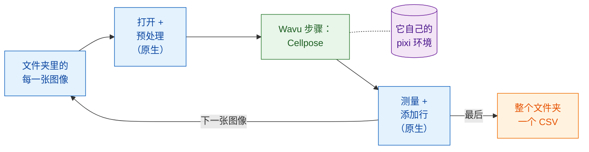

# 脚本化工作流

!!! success "Wavu 最强大的部分"
    菜单是最容易上手的方式。真正的强项在于：**你自己的流程**可以像调用函数
    一样调用 Wavu 脚本，对文件夹里的每一张图像都这样做，其他步骤则由流程自己
    完成。

## 用大白话说

再回到餐厅，不过这次有一桌五十位客人预订了套餐。服务员做自己最擅长的事：
领座、倒水、结账。只有那道需要特殊烤箱的菜才送进厨房。厨房只把烤箱
**点火一次**，然后让它一直保持高温，供应全部五十盘。

在脚本化工作流里：

- **你的流程就是服务员。** 它可以是 Fiji 的 Groovy 脚本、ImageJ 宏，
  或者 Python 笔记本、Python 脚本。它负责*原生*步骤：打开图像、稍微清理一下、
  测量、保存。
- **Wavu 步骤就是从厨房端出来的那道菜。** 它是最繁重的部分，需要自己的包
  （Cellpose、PyTorch……）。它在所属文件夹自己的 pixi 环境（它的厨具）中运行，
  结果会以图像、表格、ROI 和数值的形式**直接回到你的流程里**。
- **worker 只启动一次**，服务每一张图像。只有第一张图像需要等烤箱预热。

## Wavu 步骤就是一次函数调用

从你的流程来看，Wavu 步骤和别的函数没什么两样：传入数值和一张图像，拿回
结果。在 Groovy 里是 `wavu.run(...)`，在宏里是
`run("Run Script (Macro)", ...)`，在 Python 里是 `w.run(...)`。在这一行背后，
图像被送到另一个环境里的 worker，输出再传回来。

这正是 Wavu 不只是一座桥的原因。你继续使用已经信得过的工具（Fiji 的测量、
ROI Manager、用了好几年的宏、pandas），再加上一个现代的 AI 步骤，却不必把
PyTorch 装进 Fiji 或你的笔记本。来自两个文件夹的两个 Wavu 步骤，甚至可以在
同一个流程里前后衔接，各自在自己的环境中运行。

## 什么时候用

- **图像很多。** 一个文件夹的视野、一整块板、存成单独文件的时间序列。
  点一次，得到一张表。
- **可重复的流程。** 脚本*本身*就是方法：每次都是同样的步骤、同样的设置，
  而且你可以把它发给同事，或者放进论文的补充材料。
- **取长补短。** 用 Fiji 打开少见的文件格式和做测量，用 Python 做深度学习；
  反过来也行。

!!! info "仍然是小数据，一次一张图像"
    Wavu 的适用范围没有变：每次调用处理**一张能放进内存的图像**（大约
    1–2 GB 以内）。这里的重点是**循环**：许多这样的图像，一张接一张，送进
    同一个已经热好的 worker。如果是单个超大数据集，请改用批处理或 HPC
    流程。

## 接下来几页的示例

两页都搭建同一个流程：**统计文件夹里每张图像的细胞核数量**，并为整个文件夹
写出**一个 CSV**，每个细胞核一行，并记下它来自哪个文件。繁重的步骤是 Wavu
仓库里的
[`cellpose_nuclei`](https://github.com/Oxford-Zeiss-Centre-of-Excellence/Wavu/tree/main/examples/cellpose_nuclei)
示例文件夹。它接收 `image` 和 `diameter`（`0` 表示让 Cellpose 自己估计），
返回 `labels`（16 位的标签图像，每个细胞核一个编号）、`count`（细胞核数量）
和 `rois`（以 ImageJ RoiSet 形式保存的轮廓）。

想试一试的话，准备一个单通道细胞核 TIFF 的文件夹，比如 BBBC039 数据集里的
图像（仓库在 `tests/data/BBBC039` 里附带了一张）。

-   :material-microscope:{ .lg .middle } **在 Fiji 中**

    ---

    用 Groovy 脚本和 ImageJ 宏写成的流程。

    [:octicons-arrow-right-24: Groovy 与 ImageJ 宏](fiji.md)

-   :material-language-python:{ .lg .middle } **在 Python 和 napari 中**

    ---

    用 `wavu.client` 写在笔记本里的流程、在 napari 中显示结果，以及串联多个
    环境。

    [:octicons-arrow-right-24: Python 与 napari](python.md)

## 一句话总结

让你自己的脚本处理普通步骤，只有繁重的那一步才像调用函数一样调用 Wavu；
worker 只启动一次，在自己的环境中运行，并为文件夹里的每张图像把结果直接
交回来。

[下一步：在 Fiji 中 :material-arrow-right:](fiji.md){ .md-button }
