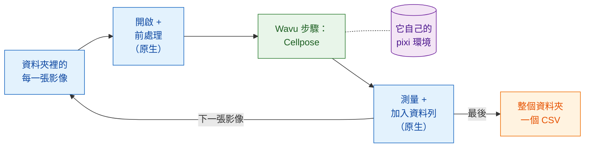

# 腳本化工作流程

!!! success "Wavu 最強大的部分"
    選單是最容易上手的方式。真正的強項在於：**你自己的流程**可以像呼叫函式
    一樣呼叫 Wavu 腳本，對資料夾裡的每一張影像都這樣做，其他步驟則由流程自己
    完成。

## 用白話說

再回到餐廳，不過這次有一桌五十位客人預訂了套餐。服務生做他最擅長的事：
帶位、倒水、結帳。只有那道需要特殊烤箱的菜才送進廚房。廚房只把烤箱
**點火一次**，然後讓它一直保持高溫，供應全部五十盤。

在腳本化工作流程裡：

- **你的流程就是服務生。** 它可以是 Fiji 的 Groovy 腳本、ImageJ 巨集，
  或 Python 筆記本、Python 腳本。它負責*原生*步驟：開啟影像、稍微清理一下、
  測量、存檔。
- **Wavu 步驟就是從廚房端出來的那道菜。** 它是最吃重的部分，需要自己的套件
  （Cellpose、PyTorch……）。它在所屬資料夾自己的 pixi 環境（它的廚具）中執行，
  結果會以影像、表格、ROI 和數值的形式**直接回到你的流程裡**。
- **worker 只啟動一次**，服務每一張影像。只有第一張影像需要等烤箱預熱。

## Wavu 步驟就是一次函式呼叫

從你的流程來看，Wavu 步驟和其他函式沒什麼兩樣：送進數值和一張影像，拿回
結果。在 Groovy 裡是 `wavu.run(...)`，在巨集裡是
`run("Run Script (Macro)", ...)`，在 Python 裡是 `w.run(...)`。在這一行背後，
影像被送到住在另一個環境裡的 worker，輸出再送回來。

這正是 Wavu 不只是一座橋的原因。你繼續使用已經信任的工具（Fiji 的測量、
ROI Manager、用了好幾年的巨集、pandas），再加上一個現代的 AI 步驟，卻不必把
PyTorch 安裝進 Fiji 或你的筆記本。來自兩個資料夾的兩個 Wavu 步驟，甚至可以在
同一個流程裡前後相接，各自在自己的環境中執行。

## 什麼時候用

- **影像很多。** 一個資料夾的視野、一整盤樣本、存成個別檔案的時間序列。
  按一次，得到一張表格。
- **可以重複的流程。** 腳本*本身*就是方法：每次都是同樣的步驟、同樣的設定，
  而且你可以把它寄給同事，或放進論文的補充資料。
- **結合各自的長處。** 用 Fiji 開啟少見的檔案格式和做測量，用 Python 做深度
  學習；反過來也行。

!!! info "仍然是小型資料，一次一張影像"
    Wavu 的適用範圍沒有改變：每次呼叫處理**一張放得進記憶體的影像**（大約
    1–2 GB 以內）。這裡的重點是**迴圈**：許多這樣的影像，一張接一張，送進
    同一個已經暖好的 worker。如果是單一的超大資料集，請改用批次處理或 HPC
    流程。

## 接下來幾頁的範例

兩頁都建立同一個流程：**計算資料夾裡每張影像的細胞核數量**，並為整個資料夾
寫出**一個 CSV**，每個細胞核一列，並記下它來自哪個檔案。吃重的步驟是 Wavu
儲存庫裡的
[`cellpose_nuclei`](https://github.com/Oxford-Zeiss-Centre-of-Excellence/Wavu/tree/main/examples/cellpose_nuclei)
範例資料夾。它接收 `image` 和 `diameter`（`0` 代表讓 Cellpose 自己估計），
並回傳 `labels`（16 位元的標籤影像，每個細胞核一個編號）、`count`（細胞核
數量）和 `rois`（以 ImageJ RoiSet 表示的輪廓）。

想試試看的話，準備一個單一通道的細胞核 TIFF 資料夾，例如 BBBC039 資料集裡的
影像（儲存庫在 `tests/data/BBBC039` 裡附了一張）。

-   :material-microscope:{ .lg .middle } **在 Fiji 中**

    ---

    以 Groovy 腳本和 ImageJ 巨集寫成的流程。

    [:octicons-arrow-right-24: Groovy 與 ImageJ 巨集](fiji.md)

-   :material-language-python:{ .lg .middle } **在 Python 和 napari 中**

    ---

    用 `wavu.client` 寫在筆記本裡的流程、在 napari 中顯示結果，以及串接多個
    環境。

    [:octicons-arrow-right-24: Python 與 napari](python.md)

## 一句話總結

讓你自己的腳本處理一般步驟，只有吃重的那一步才像呼叫函式一樣呼叫 Wavu；
worker 只啟動一次，在自己的環境中執行，並為資料夾裡的每張影像把結果直接
交回來。

[下一步：在 Fiji 中 :material-arrow-right:](fiji.md){ .md-button }
