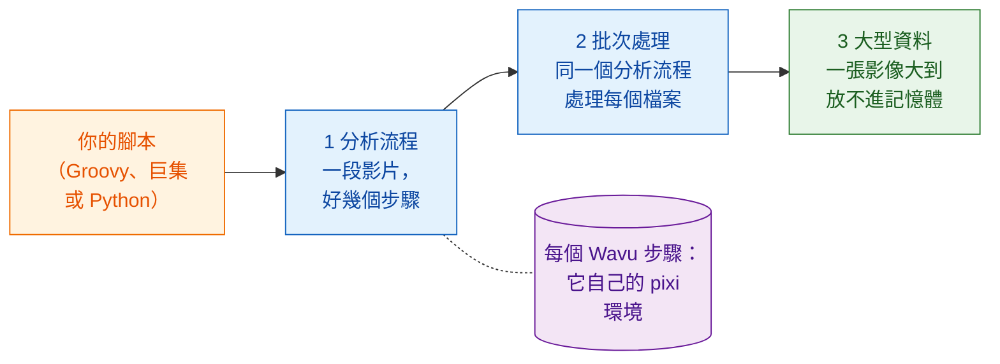

# 工作流程

!!! question "分析之前：你到底要量什麼？"
    這是每位生物影像分析師都會先問科學家的問題，也是寫下任何步驟之前就要
    回答的問題。不是「幫我分析一下這些影像」，而是：

    - **你要從影像裡量什麼**？這就是**應變數**（dependent variable），
      也就是最後那張圖的 y 軸：數量、面積、強度、速度。
    - **你改變或比較的是什麼**？這就是**自變數**（independent variable），
      也就是 x 軸：時間、處理、基因型、劑量。

    把它寫成一句話：「*y* 對 *x*」。在本節的範例裡，這句話是
    「**細胞數對時間**」，而這句話決定了每一個步驟：為了計數細胞核而分割，
    為了分辨分裂和新進來的細胞而追蹤，最後把每個影格的細胞數對時間畫出來。

    像測試驅動開發（TDD）一樣工作：**先定義輸出**，也就是最後那張圖和它背後的
    表格，並用已知答案的資料檢查它。步驟（DAG）和方法都是副產品：每一個步驟
    之所以存在，是因為輸出需要它。

## 用白話說

到目前為止，Wavu 一直是一座橋：Fiji 或 napari（服務生）把一張影像
（食材）端到廚房，在那裡用食譜（你的腳本）和它自己的廚具（它的 pixi 環境）
把菜煮出來。

但服務生能做的不只是端盤子。從你自己的腳本來看，一個 Wavu 步驟就只是
一次**函式呼叫**：數值和影像送進去，結果送出來。在這一行背後，工作是在
另一個環境裡完成的，但你的腳本不必在意。所以你可以把 Wavu 步驟**和你已經
在用的工具排成一列**：

- Fiji 的外掛，例如 **TrackMate**，以及一般的 **ImageJ 指令**；
- Python 裡的 **scikit-image**、**pandas** 和 **matplotlib**；
- **napari** 的圖層、顏色和停靠的圖表。

你的腳本把整個分析串在一起，從開啟檔案到最後的圖。它決定順序，在步驟之間
傳遞影像和表格，並決定結果要怎麼畫出來。這就是一個**工作流程**。

## 往上三步

這幾頁是一層一層疊上去的。請照這個順序學：

1. **分析流程**。一段縮時影片經過好幾個步驟：開啟、分割、追蹤、計數、
   繪圖。有些步驟是 Wavu 廚房，其他的是原生工具。這些步驟組成一個
   **DAG**（*directed acyclic graph*，有向無環圖：用箭頭連起來的方框，
   箭頭只往前走）。
2. **批次處理**。對資料夾裡的每個檔案執行同一個分析流程。廚房只啟動一次，
   就能服務每個檔案；整個資料夾你會拿到一張表格。
3. **大型資料**。一張影像大到放不進記憶體。你的腳本拿到的是一個路徑而
   不是像素，然後一塊一塊地處理這張影像。

三頁都用同一個例子：在一段小小的合成影片
`examples/data/demo_timelapse.tif` 裡**計算細胞數隨時間的變化**，我們知道
它的正確答案。

-   :material-microscope:{ .lg .middle } **1 · Fiji 中的分析流程**

    ---

    用 Groovy 搭配 TrackMate，以及一個 ImageJ 巨集，加上一兩個 Wavu 步驟。

    [:octicons-arrow-right-24: Fiji 中的分析流程](pipeline-fiji.md)

-   :material-language-python:{ .lg .middle } **1 · Python 與 napari 中的分析流程**

    ---

    兩個 Wavu 廚房接連上菜；你的腳本在 napari 裡把結果畫出來。

    [:octicons-arrow-right-24: Python 中的分析流程](pipeline-python.md)

-   :material-folder-multiple-image:{ .lg .middle } **2 · 批次處理**

    ---

    對一個資料夾執行同一個分析流程：每個檔案一列，一個 CSV，一張圖。

    [:octicons-arrow-right-24: 批次處理](batch.md)

-   :material-database-arrow-right:{ .lg .middle } **3 · 大型資料**

    ---

    用 dask 對 OME-Zarr 做流式分析，一個分塊接一個分塊。

    [:octicons-arrow-right-24: 大型資料](large-data.md)

## 我需要哪一個？

- **一張影像、一個 Wavu 腳本、結果顯示在 Fiji/napari 裡**？這些你都用
  不到：選單（**Plugins › Wavu**，或 napari 的小工具）就能做到。
- **一份資料、好幾個步驟，其中有些不是 Python**？從**分析流程**開始：
  喜歡 Fiji 的工具和外掛，就看 [Fiji 版](pipeline-fiji.md)；平常都待在
  notebook 和 napari 裡，就看 [Python 版](pipeline-python.md)。
- **很多檔案，每個都放得進記憶體**（一片多孔盤、一資料夾的縮時影片）？
  先為一個檔案寫好分析流程，再把它包進[批次處理](batch.md)的迴圈裡。
- **一個檔案比你電腦的記憶體還大**（大約超過 1–2 GB）？請看
  [大型資料](large-data.md)。超過約 50 GB，或工作要跑好幾個小時，就以
  不開 Fiji/napari 的批次工作執行，或在叢集上執行。

!!! tip "先為一個寫，再為很多個"
    每個工作流程一開始都是一個在**一個**檔案上能跑的分析流程。在 Fiji/napari
    裡用眼睛檢查它的結果。確認之後，才在整個資料夾上執行。

## 一句話總結

Wavu 步驟就是一次函式呼叫，只是在它自己的環境裡執行，所以你的腳本可以把它和 Fiji、
Python、napari 的工具串成一個分析：先處理一段影片，再處理一個資料夾，然後
處理大到放不進記憶體的資料。

[下一頁：Fiji 中的分析流程 :material-arrow-right:](pipeline-fiji.md){ .md-button }
