# 大きなデータ：ストリーム解析

!!! warning "動きますが、Fiji や napari は操作する場所ではありません"
    **メモリーに収まる画像（およそ 1〜2 GB）** なら、これまでどおりの対話的な
    方法を使ってください。画像を選び、**OK** を押し、結果を受け取ります。
    そのためにこのページの内容は何も必要ありません。

    チャンク単位のストリーム処理（OME-Zarr）を使えば、Wavu スクリプトは
    **ローカルのコンピューターで約 50 GB まで** のデータを処理できます。ただし
    Fiji と napari は、メモリー上のデータを前提にしたキャンバス型のビューアー
    です。ストリーム中に見えるのは **小さなプレビューか最終結果** だけで、
    実行中は動作が遅いままで、**ストリームを操作する場所としてはおすすめ
    しません**。約 50 GB を超える場合は、代わりにバッチ処理や HPC のパイプライン
    を使ってください（[このページの最後](#when-not-to-do-this-in-fiji-or-napari)
    を参照）。

!!! info "組み込みの機能ではなく、設計のパターンです"
    以下はすべて、**あなた** が **自分のスクリプト** をどう書くかの話です。
    Wavu 自身は、パスとパラメーターを `run` に渡し、スクリプトが返したパスを
    返すだけです。チャンク分け、dask、OME-Zarr はスクリプトの仕事で、その
    パッケージはスクリプト専用の `pixi.toml` に書きます。

## やさしく言うと

{ width="800" }

*大きな画像を切れ（OME-Zarr のチャンク）に切り分け、いくつもの小さな厨房
（並列のワーカー）がそれぞれ一度に 1 切れずつ調理するので、メモリーに載るのは
一度に数切れだけです。調理した切れは 1 枚のお皿の上で 1 つの料理、つまり
結果に組み立てられます。*

レストランに戻りましょう。結婚式で、500 人分のディナーの注文が入りました。
その食材をすべて置ける調理台はないので、厨房は **何回かに分けて** 作業します。
食材を **一箱ずつ** 取ってきて、いくつかの箱を別々のコンロで同時に調理し、
できたお皿から順に出していきます。ウェイターがあなたのテーブルに運ぶのは
**味見用の小皿** だけで、料理がちゃんとできているかを見せるためです。

画像の場合、箱にあたるのが **チャンク** です。大きな画像を、小さなブロックの
格子に切ったものです。チャンクはそれぞれ **専用の小さなファイル** として
保存されるので、プログラムはほかに触れずに 1 つのチャンクだけを読めます。

{ width="800" }

*大きな画像は、チャンクごとに 1 つの小さなファイルが入ったフォルダーになり
ます。読み手は必要なファイルだけを 1 つずつ取ってきて、各チャンクで測った
ものが結果の表の 1 行とグラフの 1 本の棒になります。*

## なぜ OME-Zarr なのか

**OME-Zarr**（OME-NGFF、Next-Generation File Format とも呼ばれます）は、
まさにこのためのオープンなフォーマットです。

- **チャンク分け。** チャンクがそれぞれ 1 つのファイルなので、1 つの領域を
  読むのにかかるのは 1 領域分だけで、画像全体ではありません。
- **マルチスケール。** 画像は低い解像度でも保存されます（*ピラミッド*）。
  ビューアーはまず小さなレベルを表示し、ズームした場所だけ細部を取ってきます。
- **クラウド向き。** 同じ構造が、フォルダーでも、ネットワーク共有でも、
  オブジェクトストレージ（S3）でも使えます。
- **オープン。** OME によるコミュニティ標準で、napari、Fiji、Python で
  読めます。

**1 つの大きな TIFF** と比べてみましょう。ほとんどのプログラムは TIFF を
1 つのファイルとして最初から最後まで読みます。従来の TIFF は 4 GB が上限で
（BigTIFF ならその制限はありません）、**1 つの書き手** が順番に書きます。
数 GB なら問題ありませんが、50 GB ではつらくなります。

## バックエンドでのストリーム処理

こつは、ウェイターが食材を一切運ばないことです。あなたのスクリプトは
ピクセルを受け取らず、**パス** を受け取ります。

{ width="800" }

*1 つのストアに 2 つのグループ。左が `/image` グループ、右が `/label` グループ
です。一度に 1 つのチャンクが `/image` から小さなメモリーの箱に入り、処理
され、`/label` の自分の場所に書き込まれ、メモリーから出ていきます。各チャンク
は小さな結果の表も残し、最後にそれらが 1 つの組み立てられた表にまとまります。*

`run` の中で、1 ステップずつ：

1. **パスを受け取ります。** ここではテキストのパラメーターです。（*入力* と
   して送られた、TIFF・CSV・ZIP 以外のパスも、開かれないまま `pathlib.Path`
   として届きます。[通信で運ばれるデータ](../model/architecture.md#data-on-the-wire)
   を参照してください。）
2. **遅延して開きます。** `dask.array.from_zarr` は形、型、チャンクの格子を
   知っていますが、まだ **ピクセルを 1 つも** 読んでいません。
3. **チャンクごとに処理します。** 配列全体に対する処理を書くと、dask が
   それをチャンクごとの小さなタスクに分けます。
4. **結果は入力の隣に書きます。** `ctx.tmpdir` には書きません。そこは
   ワーカーが止まると削除されるからです。
5. **`Path` と小さなプレビュー配列を返します。** パスは Log に表示され、
   プレビュー（4 MiB のインライン上限よりずっと小さいもの）はふつうの画像
   として開きます。

## dask で並列処理

[dask](https://docs.dask.org/en/stable/array.html) は厨房の料理長です。
箱をコンロに割り振ります。

{ width="800" }

*4 つのワーカーが 4 つのチャンクを同時に処理します。各チャンクは隣から借りた
細い縁（ハロー）を持っていて、あとで切り落とされます。各結果は 2 か所へ
行きます。処理したチャンクは出力の格子の元の場所へ（チャンクの組み立て）、
その数は結果の表の新しい行へ（結果の組み立て）。*

- **`map_blocks`** は、各チャンクに対して単独で関数を実行します。しきい値の
  ように、一度に 1 ピクセルだけを見る処理に向いています。
- **`map_overlap`** は、まず隣のチャンクから借りた `depth` ピクセルの
  **ハロー** を加えてから関数を実行し、そのあとハローを切り落とします。
  近傍を見るフィルター（ガウスぼかし、メディアン、モルフォロジー）には
  これが必要で、ないとチャンクの境目ごとに継ぎ目ができます。
  `boundary="reflect"` は、画像の外側の端で何を借りるかを指定します。
  ガウスなら、`depth` は約 `4 × sigma` ピクセルで足ります。

```python
import dask.array as da

image = da.from_zarr("D:/data/big.zarr", component="0")   # 遅延、まだ何も読んでいない
mask = image.map_blocks(lambda block: block > 500, dtype=bool)   # 近傍は不要
```

**チャンクの大きさ。** **1 チャンクあたり数十 MB** を目安にします（たとえば
64 × 512 × 512 の `uint16` = 32 MB）。ずっと小さいと dask は管理作業に時間を
取られ、ずっと大きいと各コンロに広い調理台が必要になります。ディスク上の
チャンクが目安から大きく外れている場合は `image.rechunk(...)` を使います。

**ワーカーの数。** 配列に対する dask の既定のスケジューラーは、1 つの
プロセスの中の **スレッド** を使います。スレッドはメモリーを共有するので、
チャンクの受け渡しにコストはかかりません。数は
`dask.config.set(num_workers=4)` で選びます。関数が純粋な Python で、
スレッドを増やしても速くならない場合は `scheduler="processes"` を試して
ください。

**メモリーの目安。** ピークのメモリー ≈ **ワーカー数 × チャンクの大きさ ×
3〜4**（入力、ハロー、浮動小数点のコピー、出力）。32 MB のチャンクで
ワーカー 4 つなら、画像全体の大きさにかかわらず約 0.5 GB です。

## コードの設計

ストリーム処理用のスクリプトフォルダーは、ふつうの Wavu スクリプトフォルダー
です。その `pixi.toml` にパッケージを追加します（すべて conda-forge に
あります）。

```toml
[dependencies]
dask = ">=2024.1"
zarr = ">=2.16"
ome-zarr = ">=0.9"     # conda-forge の `ome-zarr`、import 名は ome_zarr
scipy = ">=1.10"
tifffile = ">=2023.1"
```

`script.py` の骨組み：

```python
"""Smooth a large OME-Zarr image chunk by chunk (Gaussian blur)."""
from pathlib import Path

import dask
import dask.array as da
import numpy as np
from dask.callbacks import Callback
from scipy import ndimage

PARAMS = {
    "store": {"type": "str", "default": "", "label": "Input OME-Zarr folder"},
    "sigma": {"type": "float", "default": 2.0, "label": "Sigma (pixels)"},
    "output_format": {"type": "choice", "choices": ["ome-zarr", "tiff"], "default": "ome-zarr"},
}


class WavuProgress(Callback):
    """Report dask's finished tasks as ctx.progress, and stop when the user cancels."""

    def __init__(self, ctx):
        super().__init__()
        self.ctx = ctx

    def _start_state(self, dsk, state):
        self.total = sum(len(state[k]) for k in ("ready", "waiting", "running", "finished"))

    def _posttask(self, key, result, dsk, state, worker_id):
        self.ctx.progress(len(state["finished"]) / max(self.total, 1))
        self.ctx.check_cancelled()          # wavu.Cancelled を送出し、dask を止める


def run(ctx, inputs, params):
    store = Path(params["store"])
    sigma = params["sigma"]
    image = da.from_zarr(str(store), component="0")    # フル解像度、遅延
    ctx.log(f"{image.shape} {image.dtype}, chunks {image.chunksize}")

    depth = int(4 * sigma) + 1                         # ガウスに必要なハロー
    smoothed = image.astype(np.float32).map_overlap(
        ndimage.gaussian_filter, depth=depth, boundary="reflect", sigma=sigma)

    with dask.config.set(scheduler="threads", num_workers=4):
        if params["output_format"] == "ome-zarr":
            out = store.with_name(store.stem + "-smoothed.zarr")
            write_ome_zarr(smoothed, out, ctx)
        else:
            out = store.with_name(store.stem + "-smoothed.tif")
            write_tiff(smoothed, out, ctx)

        z = smoothed.shape[0] // 2                     # プレビュー：中央の面を縮小
        step = max(1, max(smoothed.shape[1:]) // 512)
        preview = smoothed[z, ::step, ::step].compute()
    return {"result": out, "preview": preview}
```

2 つの書き手です。**OME-Zarr**（既定）はチャンクごとに並列で書き、解像度の
ピラミッドも作ります。

```python
def write_ome_zarr(arr, out, ctx):
    import zarr
    from ome_zarr.io import parse_url
    from ome_zarr.writer import write_image

    root = zarr.group(store=parse_url(str(out), mode="w").store)
    with WavuProgress(ctx):
        write_image(arr, group=root, axes="zyx", storage_options={"chunks": arr.chunksize})
```

**TIFF** は **1 つの書き手** を通して面を 1 枚ずつ書くので、遅く、並列にも
できず、結果はほとんどのビューアーが丸ごと読む 1 つの大きなファイルになります。
ここでは、進捗とキャンセルの確認はループの中にあります。

```python
def write_tiff(arr, out, ctx):
    import tifffile

    cz = arr.chunksize[0]

    def planes():                                      # 一度に面のブロックを 1 つずつ
        for z0 in range(0, arr.shape[0], cz):
            ctx.check_cancelled()
            ctx.progress(z0 / arr.shape[0])
            yield from arr[z0:z0 + cz].compute()

    tifffile.imwrite(out, planes(), shape=arr.shape, dtype=arr.dtype, bigtiff=True)
```

この骨組みは、単一画像の OME-Zarr のように、フル解像度のレベルが `0` である
3-D の `zyx` 画像を想定しています。4-D や 5-D のデータでは、`axes` と
プレビューのスライスをそれに合わせて変えてください。

**呼び出し方。** 出力フォーマットはただのパラメーターなので、呼び出しの一部
で、既定は OME-Zarr です。

=== "Groovy (Fiji)"

    ```groovy
    def r = wavu.run(folder, "script",          // folder：スクリプトフォルダー
            [store: "D:/data/big.zarr", output_format: "ome-zarr"], [:])
    println r.files.result          // 新しい OME-Zarr のパス
    ```

=== "Python"

    ```python
    from wavu.client import Worker

    with Worker.start("path/to/stream-folder", on_log=print) as w:
        res = w.run("script", {"store": "D:/data/big.zarr", "output_format": "ome-zarr"})
        out = res.outputs["result"].value        # pathlib.Path
        preview = res.outputs["preview"].value   # 小さな NumPy 配列
    ```

`store` はただのテキストのパラメーターなので、**ワーカーから** 見えるパスで
なければなりません。Wavu はコンテナ向けに入力のパスを変換しますが、テキストの
パラメーターは変換しません。コンテナの中のワーカーには、コンテナから見た
パスを入力してください。

**結果を見る。** 遅延して開けば、見えている部分だけが読まれます。napari では
[napari-ome-zarr](https://github.com/ome/napari-ome-zarr) リーダー
（`viewer.open(out, plugin="napari-ome-zarr")`）、Fiji では
**File › Import › HDF5/N5/Zarr/OME-NGFF…**（N5 プラグイン）を使います。
冒頭の注意は今も有効です。眺めることはできますが、ビューアーの中で全体を
解析することはできません。

## Fiji や napari でやらないほうがよいとき { #when-not-to-do-this-in-fiji-or-napari }

- **約 50 GB を超える**、ファイルが多い、何時間もかかる：同じチャンク単位の
  コードを、ビューアーなしの **バッチジョブ** としてワークステーションで
  動かすか（ターミナルで `pixi run wavu run script.py --param store=D:/data/big.zarr`）、
  **HPC クラスター** で動かすか（dask の分散スケジューラーがチャンクを
  多数のマシンに配ります）、オブジェクトストレージのデータの近くの
  **クラウド** で動かしてください。
- **結果をメモリーより大きい 1 つの TIFF にする必要があるとき：** 可能ですが
  遅いです。OME-Zarr を使い、必要な部分だけを変換するほうがよいでしょう。

## ひとことで言うと

メモリーに収まらないデータでは、スクリプトにピクセルではなく **パス** を
渡し、dask に OME-Zarr をチャンクごとにいくつものコンロで調理させ、結果は入力の
隣に書き、ビューアーには味見用の小皿だけを送ります。Wavu 自身はパスを渡して
パスを受け取るだけです。
