# 큰 데이터: 스트림 분석

!!! warning "작동은 하지만, Fiji와 napari는 이걸 조종할 곳이 아니에요"
    **메모리에 들어가는 이미지(대략 1–2 GB)**라면 평소의 대화형 방식을 계속
    쓰세요. 이미지를 고르고, **OK**를 누르고, 결과를 받으면 돼요. 그러려면
    이 페이지의 내용은 하나도 필요 없어요.

    청크 단위 스트림 처리(OME-Zarr)를 쓰면 Wavu 스크립트는 **로컬
    컴퓨터에서 약 50 GB까지**의 데이터를 처리할 수 있어요. 하지만 Fiji와
    napari는 메모리 속 데이터를 전제로 만든 캔버스 기반 뷰어예요. 스트림
    동안에는 **작은 미리보기나 최종 결과**만 보이고, 실행되는 동안 계속
    느리며, **스트림을 조종하기에 권장되는 곳이 아니에요**. 약 50 GB를
    넘으면 배치나 HPC 파이프라인을 쓰세요
    ([이 페이지의 끝](#when-not-to-do-this-in-fiji-or-napari)을 보세요).

!!! info "내장 기능이 아니라 설계 패턴이에요"
    아래는 모두 **여러분이** **자기 스크립트**를 어떻게 쓰는지에 관한
    이야기예요. Wavu 자체는 경로와 매개변수를 `run`에 넘기고, 스크립트가
    돌려준 경로를 돌려줄 뿐이에요. 청크 나누기, dask, OME-Zarr는 스크립트의
    일이고, 그 패키지들은 스크립트 자기 `pixi.toml`에 들어가요.

## 쉬운 말로 설명하면

{ width="800" }

*큰 이미지를 조각(OME-Zarr 청크)으로 썰고, 작은 주방 여러 곳(병렬
워커)이 각자 한 번에 한 조각씩 요리하니, 메모리에는 한 번에 몇 조각만
있어요. 요리된 조각들은 접시 하나 위에서 요리 하나, 곧 결과로 조립돼요.*

다시 레스토랑으로 가 볼까요. 결혼식에서 손님 오백 명분의 저녁을 주문했어요.
그 재료를 다 올려놓을 조리대는 없으니, 주방은 **여러 번에 나눠** 일해요.
재료를 **한 상자씩** 가져오고, 여러 상자를 서로 다른 화구에서 동시에
요리하고, 접시가 준비되는 대로 내보내요. 웨이터가 여러분 테이블에 가져오는
건 요리가 제대로 됐는지 보여 주는 **맛보기 접시**뿐이에요.

이미지에서 상자에 해당하는 게 **청크**예요. 큰 이미지를 작은 블록들의 격자로
자른 거예요. 청크마다 **자기만의 작은 파일**로 저장되니, 프로그램은 나머지를
건드리지 않고 청크 하나만 읽을 수 있어요.

{ width="800" }

*큰 이미지는 청크마다 작은 파일이 하나씩 든 폴더가 돼요. 읽는 쪽은 필요한
파일만 하나씩 가져오고, 각 청크에서 잰 것이 결과 표의 한 행과 그래프의 막대
하나가 돼요.*

## 왜 OME-Zarr인가요

**OME-Zarr**(OME-NGFF, Next-Generation File Format라고도 해요)는 바로 이런
일을 위한 열린 포맷이에요.

- **청크 단위.** 청크마다 자기 파일이라서, 한 영역을 읽으면 그 영역만큼만
  들고, 이미지 전체만큼 들지 않아요.
- **다중 해상도.** 이미지를 더 낮은 해상도로도 저장해요(*피라미드*). 뷰어는
  작은 레벨을 먼저 보여 주고, 확대한 곳만 자세히 가져와요.
- **클라우드 친화적.** 같은 구조가 폴더, 네트워크 공유, 오브젝트
  스토리지(S3)에서 다 작동해요.
- **열린 표준.** OME의 커뮤니티 표준이고, napari, Fiji, Python에서 읽혀요.

**큰 TIFF 하나**와 비교해 보세요. 대부분의 프로그램은 TIFF를 파일 하나로
처음부터 끝까지 읽고, 고전적인 TIFF는 4 GB에서 멈추며(BigTIFF는 그 한계가
없어요), **쓰는 쪽 하나**가 순서대로 써요. 몇 GB라면 괜찮지만, 50 GB면
괴로워요.

## 백엔드에서 스트림 처리하기

비결은 웨이터가 재료를 전혀 나르지 않는다는 거예요. 여러분의 스크립트는
픽셀을 받지 않고 **경로**를 받아요.

{ width="800" }

*저장소 하나, 그룹 둘. 왼쪽은 `/image` 그룹, 오른쪽은 `/label` 그룹이에요.
한 번에 청크 하나가 `/image`에서 작은 메모리 상자로 들어가 처리되고,
`/label`의 자기 자리에 쓰인 뒤 메모리에서 나가요. 청크마다 작은 결과 표도
남기고, 마지막에 그것들이 조립된 표 하나로 합쳐져요.*

`run` 안에서 한 단계씩:

1. **경로를 받아요.** 여기서는 텍스트 매개변수예요. (*입력*으로 보낸 경로가
   TIFF, CSV, ZIP이 아니면 그것도 열리지 않은 채 `pathlib.Path`로
   도착해요. [주고받는 데이터](../model/architecture.md#data-on-the-wire)를
   보세요.)
2. **지연 방식으로 열어요.** `dask.array.from_zarr`는 모양, 타입, 청크
   격자를 알지만, 아직 **픽셀은 하나도** 읽지 않았어요.
3. **청크 단위로 처리해요.** 배열 전체에 대한 작업을 적으면, dask가 그것을
   청크마다 작은 작업 하나로 바꿔요.
4. **결과는 입력 옆에 쓰세요.** `ctx.tmpdir`에 쓰지 마세요. 그곳은 워커가
   멈추면 지워져요.
5. **`Path`와 작은 미리보기 배열을 돌려주세요.** 경로는 Log에 출력되고,
   미리보기(4 MiB 인라인 한도보다 한참 작은)는 평범한 이미지로 열려요.

## dask로 병렬 처리하기

[dask](https://docs.dask.org/en/stable/array.html)는 주방의 주방장이에요.
상자를 화구에 나눠 줘요.

{ width="800" }

*워커 네 개가 청크 네 개를 동시에 처리해요. 청크마다 이웃에게서 빌린 얇은
테두리(헤일로)를 달고 있고, 나중에 잘라 내요. 결과는 두 곳으로 가요. 처리된
청크는 출력 격자의 제자리로(청크 조립), 그 숫자들은 결과 표의 새 행으로(결과
조립).*

- **`map_blocks`**는 청크마다 따로 함수를 실행해요. 임계값처럼 한 번에
  픽셀 하나만 보는 작업에 맞아요.
- **`map_overlap`**은 먼저 이웃 청크에서 빌린 `depth` 픽셀의 **헤일로**를
  붙이고, 함수를 실행한 다음, 헤일로를 잘라 내요. 이웃을 보는 필터(가우시안
  블러, 미디언, 모폴로지)에는 이게 필요해요. 없으면 청크 경계마다 이음매가
  생겨요. `boundary="reflect"`는 이미지 바깥 가장자리에서 무엇을 빌릴지
  정해요. 가우시안이라면 `depth`는 약 `4 × sigma` 픽셀이면 충분해요.

```python
import dask.array as da

image = da.from_zarr("D:/data/big.zarr", component="0")   # 지연 방식, 아직 아무것도 안 읽음
mask = image.map_blocks(lambda block: block > 500, dtype=bool)   # 이웃이 필요 없음
```

**청크 크기.** **청크당 수십 MB**를 목표로 하세요(예: 64 × 512 × 512
`uint16` = 32 MB). 훨씬 작으면 dask가 관리 작업에 시간을 쓰고, 훨씬 크면
화구마다 넓은 조리대가 필요해요. 디스크의 청크가 이와 크게 다르면
`image.rechunk(...)`를 쓰세요.

**워커 수.** 배열에 대한 dask의 기본 스케줄러는 프로세스 하나 안의
**스레드**를 써요. 스레드는 메모리를 공유하니 청크를 주고받는 데 비용이 들지
않아요. 개수는 `dask.config.set(num_workers=4)`로 정해요. 함수가 순수
Python이라 스레드를 늘려도 빨라지지 않는다면 `scheduler="processes"`를
써 보세요.

**메모리 어림 규칙.** 최대 메모리 ≈ **워커 수 × 청크 크기 × 3–4**(입력,
헤일로, 부동소수점 사본, 출력). 32 MB 청크에 워커 네 개라면 이미지 전체
크기와 상관없이 약 0.5 GB가 필요해요.

## 코드 설계

스트림 처리용 스크립트 폴더는 평범한 Wavu 스크립트 폴더예요. 그
`pixi.toml`에 패키지를 추가하세요(모두 conda-forge에 있어요).

```toml
[dependencies]
dask = ">=2024.1"
zarr = ">=2.16"
ome-zarr = ">=0.9"     # conda-forge의 `ome-zarr`, import 이름은 ome_zarr
scipy = ">=1.10"
tifffile = ">=2023.1"
```

`script.py`의 뼈대:

```python
"""Smooth a large OME-Zarr image chunk by chunk (Gaussian blur)."""
from pathlib import Path

import dask
import dask.array as da
import numpy as np
from dask.callbacks import Callback
from scipy import ndimage

PARAMS = {
    "store": {"type": "str", "default": "", "label": "Input OME-Zarr folder"},
    "sigma": {"type": "float", "default": 2.0, "label": "Sigma (pixels)"},
    "output_format": {"type": "choice", "choices": ["ome-zarr", "tiff"], "default": "ome-zarr"},
}


class WavuProgress(Callback):
    """Report dask's finished tasks as ctx.progress, and stop when the user cancels."""

    def __init__(self, ctx):
        super().__init__()
        self.ctx = ctx

    def _start_state(self, dsk, state):
        self.total = sum(len(state[k]) for k in ("ready", "waiting", "running", "finished"))

    def _posttask(self, key, result, dsk, state, worker_id):
        self.ctx.progress(len(state["finished"]) / max(self.total, 1))
        self.ctx.check_cancelled()          # wavu.Cancelled를 일으켜 dask를 멈춰요


def run(ctx, inputs, params):
    store = Path(params["store"])
    sigma = params["sigma"]
    image = da.from_zarr(str(store), component="0")    # 전체 해상도, 지연 방식
    ctx.log(f"{image.shape} {image.dtype}, chunks {image.chunksize}")

    depth = int(4 * sigma) + 1                         # 가우시안에 필요한 헤일로
    smoothed = image.astype(np.float32).map_overlap(
        ndimage.gaussian_filter, depth=depth, boundary="reflect", sigma=sigma)

    with dask.config.set(scheduler="threads", num_workers=4):
        if params["output_format"] == "ome-zarr":
            out = store.with_name(store.stem + "-smoothed.zarr")
            write_ome_zarr(smoothed, out, ctx)
        else:
            out = store.with_name(store.stem + "-smoothed.tif")
            write_tiff(smoothed, out, ctx)

        z = smoothed.shape[0] // 2                     # 미리보기: 가운데 면을 축소
        step = max(1, max(smoothed.shape[1:]) // 512)
        preview = smoothed[z, ::step, ::step].compute()
    return {"result": out, "preview": preview}
```

쓰는 쪽 두 가지예요. **OME-Zarr**(기본값)는 청크 단위로 병렬로 쓰고, 해상도
피라미드도 만들어요.

```python
def write_ome_zarr(arr, out, ctx):
    import zarr
    from ome_zarr.io import parse_url
    from ome_zarr.writer import write_image

    root = zarr.group(store=parse_url(str(out), mode="w").store)
    with WavuProgress(ctx):
        write_image(arr, group=root, axes="zyx", storage_options={"chunks": arr.chunksize})
```

**TIFF**는 **쓰는 쪽 하나**를 거쳐 면을 하나씩 쓰니, 더 느리고 병렬로 돌릴 수
없으며, 결과는 대부분의 뷰어가 통째로 읽는 큰 파일 하나예요. 여기서는 진행
상황과 취소 확인이 반복문 안에 있어요.

```python
def write_tiff(arr, out, ctx):
    import tifffile

    cz = arr.chunksize[0]

    def planes():                                      # 한 번에 면 블록 하나씩
        for z0 in range(0, arr.shape[0], cz):
            ctx.check_cancelled()
            ctx.progress(z0 / arr.shape[0])
            yield from arr[z0:z0 + cz].compute()

    tifffile.imwrite(out, planes(), shape=arr.shape, dtype=arr.dtype, bigtiff=True)
```

이 뼈대는 단일 이미지 OME-Zarr처럼 전체 해상도 레벨이 `0`인 3-D `zyx`
이미지를 가정해요. 4-D나 5-D 데이터라면 `axes`와 미리보기 슬라이스를 거기에
맞게 바꾸세요.

**부르는 방법.** 출력 포맷은 그냥 매개변수라서 호출의 일부이고, 기본값은
OME-Zarr예요.

=== "Groovy (Fiji)"

    ```groovy
    def r = wavu.run(folder, "script",          // folder: 스크립트 폴더
            [store: "D:/data/big.zarr", output_format: "ome-zarr"], [:])
    println r.files.result          // 새 OME-Zarr의 경로
    ```

=== "Python"

    ```python
    from wavu.client import Worker

    with Worker.start("path/to/stream-folder", on_log=print) as w:
        res = w.run("script", {"store": "D:/data/big.zarr", "output_format": "ome-zarr"})
        out = res.outputs["result"].value        # pathlib.Path
        preview = res.outputs["preview"].value   # 작은 NumPy 배열
    ```

`store`는 평범한 텍스트 매개변수라서, **워커가** 볼 수 있는 경로여야 해요.
Wavu는 컨테이너를 위해 입력의 경로는 바꿔 주지만, 텍스트 매개변수는 바꾸지
않아요. 컨테이너 안의 워커라면 컨테이너가 보는 대로 경로를 입력하세요.

**결과 보기.** 지연 방식으로 열면 보이는 부분만 읽혀요. napari에서는
[napari-ome-zarr](https://github.com/ome/napari-ome-zarr) 리더
(`viewer.open(out, plugin="napari-ome-zarr")`), Fiji에서는
**File › Import › HDF5/N5/Zarr/OME-NGFF…**(N5 플러그인)를 쓰세요. 맨 위의
주의점은 여전히 유효해요. 둘러보기는 되지만, 뷰어 안에서 전체를 분석하는 건
안 돼요.

## Fiji나 napari에서 하지 말아야 할 때 { #when-not-to-do-this-in-fiji-or-napari }

- **약 50 GB 이상**, 파일이 많거나 몇 시간씩 걸릴 때: 같은 청크 단위 코드를
  뷰어 없이 워크스테이션에서 **배치 작업**으로 돌리거나(터미널에서
  `pixi run wavu run script.py --param store=D:/data/big.zarr`), **HPC
  클러스터**에서 돌리거나(dask의 분산 스케줄러가 청크를 여러 기계에 나눠요),
  오브젝트 스토리지의 데이터 옆 **클라우드**에서 돌리세요.
- **결과가 메모리보다 큰 TIFF 하나여야 할 때:** 가능하지만 느려요.
  OME-Zarr를 쓰고 필요한 부분만 변환하는 게 나아요.

## 한 문장으로

메모리에 다 들어가지 않는 데이터라면 스크립트에 픽셀 대신 **경로**를 주고,
dask가 OME-Zarr를 청크 단위로 여러 화구에서 요리하게 하고, 결과는 입력 옆에
쓰고, 뷰어에는 맛보기 접시만 보내세요. Wavu 자체는 경로를 넘기고 경로를
받을 뿐이에요.
