# 大型数据：流式分析

!!! warning "能用，但不该由 Fiji 和 napari 来驱动"
    对于**放得进内存的图像（大约 1–2 GB）**，请继续用普通的交互方式：
    选一张图像，按 **OK**，拿到结果。这些都用不到本页的任何内容。

    改用分块、流式的处理（OME-Zarr），Wavu 脚本可以处理**本机上约 50 GB
    以内的数据**。但 Fiji 和 napari 是以画布为核心、假设数据都在内存里的
    软件：流式处理进行时，它们只看得到**小小的预览或最后的结果**，运行期间
    一直都很慢，而且**不是推荐用来驱动流式分析的地方**。超过约 50 GB，请改用
    批处理或 HPC 流程（见[本页最后](#when-not-to-do-this-in-fiji-or-napari)）。

!!! info "一种设计模式，不是内置功能"
    下面所有内容都是**你**怎么写**你自己的脚本**。Wavu 本身只把一个路径和
    参数交给 `run`，再把脚本返回的路径送回来。分块、dask 和 OME-Zarr 都是
    你脚本自己的事，它用的软件包也写在它自己的 `pixi.toml` 里。

## 用白话说

{ width="800" }

*大图像被切成一块块（OME-Zarr 的分块），几个分厨房（并行的 worker）各自
一次煮一块，所以内存里同时只有几块。煮好的块在一个盘子上组合成一餐：
也就是结果。*

回到餐厅。一场婚宴订了五百位客人的晚餐。没有哪个操作台放得下所有食材，
所以厨房**分批**作业：**一箱一箱**地取食材，在不同的灶台上同时煮好几箱，
菜一做好就送出去。服务员只端一份**试吃盘**到你桌上，让你看看这道菜做得
对不对。

对图像来说，箱子就是**分块**（chunk）：一张大图像被切成由小方块组成的
网格。每个分块都存成**自己的一个小文件**，所以程序可以只读一个分块，
不必碰其他部分。

{ width="800" }

*一张大图像变成一个装满小文件的文件夹，每个分块一个文件。读取程序只取
它需要的文件，一次一个；它在每个分块上测得的东西，会变成结果表格的一行和
图表上的一根柱子。*

## 为什么用 OME-Zarr

**OME-Zarr**（也叫 OME-NGFF，Next-Generation File Format，下一代文件格式）
是专为这件事设计的开放格式：

- **分块**。每个分块都是自己的文件，所以读一个区域只需付出一个区域的
  代价，而不是整张图像。
- **多尺度**。图像也以较低的分辨率存储（一座*金字塔*）；Fiji/napari 会先
  显示小的层级，只在你放大的地方才去取细节。
- **适合云端**。同样的结构放在文件夹、网络共享盘或对象存储（S3）上都
  能用。
- **开放**。由 OME 制定的社区标准，napari、Fiji 和 Python 都能读取。

拿**一个大 TIFF** 来比较：大多数程序会把它当成一个文件从头读到尾，传统
TIFF 的上限是 4 GB（BigTIFF 解除了这个限制），而且它必须按顺序经由**一个
写入器**写出。几 GB 还好，五十 GB 就很痛苦。

## 在后端流式处理

诀窍在于服务员从来不搬食材。你的脚本收到的不是像素，而是一个**路径**。

{ width="800" }

*一个存储，两个组：左边是 `/image` 组，右边是 `/label` 组。一次一个分块
从 `/image` 进入小小的内存盒子，经过处理，写进它在 `/label` 中的位置，
然后离开内存。每个分块也会留下一张小小的结果表格；最后它们合并成一张
组合好的表格。*

在 `run` 里，一步一步来：

1. **收到一个路径**。这里是一个文本参数。（以*输入*发送、但不是 TIFF、
   CSV 或 ZIP 的路径，也会原封不动地以 `pathlib.Path` 到达；请看
   [传输中的数据](../model/architecture.md#data-on-the-wire)。）
2. **延迟打开**（lazily）。`dask.array.from_zarr` 知道形状、类型和分块
   网格，但还**没读任何像素**。
3. **逐块处理**。你对整个数组描述要做的工作；dask 把它变成每个分块一个
   小任务。
4. **把结果写在输入旁边**，而不是写在 `ctx.tmpdir`，因为它在 worker 停止
   时会被删除。
5. **返回一个 `Path` 和一个小小的预览数组**。路径会打印在 Log 里；预览
   （远小于 4 MiB 的内联上限）会像普通图像一样打开。

## 用 dask 并行处理

[dask](https://docs.dask.org/en/stable/array.html) 是厨房的主厨：它把
一箱箱食材分给各个灶台。

{ width="800" }

*四个 worker 同时处理四个分块。每个分块都带着从邻居借来的一圈薄边
（halo），处理完再修掉。每个结果都分两路走：处理好的分块回到输出网格中
它的位置（分块组合），它的数字则成为结果表格的新一行（结果组合）。*

- **`map_blocks`** 在每个分块上单独运行你的函数：适合一次只看一个像素的
  运算，例如阈值。
- **`map_overlap`** 会先加上一圈从相邻分块借来、宽 `depth` 像素的
  **halo**，运行你的函数，再把 halo 修掉。需要看邻近像素的滤波器（高斯
  模糊、中值、形态学运算）都需要它，否则每条分块边界上都会出现接缝。
  `boundary="reflect"` 指定在图像最外侧的边缘要借什么。高斯滤波的
  `depth` 大约 `4 × sigma` 像素就够了。

```python
import dask.array as da

image = da.from_zarr("D:/data/big.zarr", component="0")   # 延迟加载，还没读任何东西
mask = image.map_blocks(lambda block: block > 500, dtype=bool)   # 不需要邻近像素
```

**分块大小**。目标是**每个分块几十 MB**（例如 64 × 512 × 512 `uint16`
= 32 MB）。小太多，dask 就把时间都花在记账上；大太多，每个灶台都需要
很大的操作台空间。如果磁盘上的分块大小差得太远，就用 `image.rechunk(...)`。

**worker 数量**。dask 处理数组时的默认调度器，在单个进程中使用**线程**；
它们共享内存，所以传递分块不花任何成本。用
`dask.config.set(num_workers=4)` 选择数量。如果你的函数是纯 Python，
线程变多也不会变快，就试试 `scheduler="processes"`。

**内存经验法则**。峰值内存 ≈ **worker 数 × 分块大小 × 3 到 4**
（输入、halo、一份浮点数副本、输出）。四个 worker 处理 32 MB 的分块，
大约需要半 GB，不管整张图像有多大。

## 代码设计

流式处理用的脚本文件夹，就是一个普通的 Wavu 脚本文件夹。把这些软件包加到
它的 `pixi.toml`（全部都在 conda-forge 上）：

```toml
[dependencies]
dask = ">=2024.1"
zarr = ">=2.16"
ome-zarr = ">=0.9"     # conda-forge 的 `ome-zarr`，导入时名称是 ome_zarr
scipy = ">=1.10"
tifffile = ">=2023.1"
```

`script.py` 的骨架：

```python
"""Smooth a large OME-Zarr image chunk by chunk (Gaussian blur)."""
from pathlib import Path

import dask
import dask.array as da
import numpy as np
from dask.callbacks import Callback
from scipy import ndimage

PARAMS = {
    "store": {"type": "str", "default": "", "label": "Input OME-Zarr folder"},
    "sigma": {"type": "float", "default": 2.0, "label": "Sigma (pixels)"},
    "output_format": {"type": "choice", "choices": ["ome-zarr", "tiff"], "default": "ome-zarr"},
}


class WavuProgress(Callback):
    """Report dask's finished tasks as ctx.progress, and stop when the user cancels."""

    def __init__(self, ctx):
        super().__init__()
        self.ctx = ctx

    def _start_state(self, dsk, state):
        self.total = sum(len(state[k]) for k in ("ready", "waiting", "running", "finished"))

    def _posttask(self, key, result, dsk, state, worker_id):
        self.ctx.progress(len(state["finished"]) / max(self.total, 1))
        self.ctx.check_cancelled()          # 会抛出 wavu.Cancelled，让 dask 停下来


def run(ctx, inputs, params):
    store = Path(params["store"])
    sigma = params["sigma"]
    image = da.from_zarr(str(store), component="0")    # 完整分辨率，延迟加载
    ctx.log(f"{image.shape} {image.dtype}, chunks {image.chunksize}")

    depth = int(4 * sigma) + 1                         # 高斯滤波需要的 halo
    smoothed = image.astype(np.float32).map_overlap(
        ndimage.gaussian_filter, depth=depth, boundary="reflect", sigma=sigma)

    with dask.config.set(scheduler="threads", num_workers=4):
        if params["output_format"] == "ome-zarr":
            out = store.with_name(store.stem + "-smoothed.zarr")
            write_ome_zarr(smoothed, out, ctx)
        else:
            out = store.with_name(store.stem + "-smoothed.tif")
            write_tiff(smoothed, out, ctx)

        z = smoothed.shape[0] // 2                     # 预览：中间的平面，降采样
        step = max(1, max(smoothed.shape[1:]) // 512)
        preview = smoothed[z, ::step, ::step].compute()
    return {"result": out, "preview": preview}
```

两个写入器。**OME-Zarr**（默认）逐块、并行地写入，并建立分辨率金字塔：

```python
def write_ome_zarr(arr, out, ctx):
    import zarr
    from ome_zarr.io import parse_url
    from ome_zarr.writer import write_image

    root = zarr.group(store=parse_url(str(out), mode="w").store)
    with WavuProgress(ctx):
        write_image(arr, group=root, axes="zyx", storage_options={"chunks": arr.chunksize})
```

**TIFF** 要经过**一个写入器**，一个平面接一个平面，所以比较慢，不能并行
运行，结果也是一个大文件，大多数软件会整个读进来。这里的进度和取消检查
放在循环里：

```python
def write_tiff(arr, out, ctx):
    import tifffile

    cz = arr.chunksize[0]

    def planes():                                      # 一次一批平面
        for z0 in range(0, arr.shape[0], cz):
            ctx.check_cancelled()
            ctx.progress(z0 / arr.shape[0])
            yield from arr[z0:z0 + cz].compute()

    tifffile.imwrite(out, planes(), shape=arr.shape, dtype=arr.dtype, bigtiff=True)
```

这个骨架假设一张 3-D `zyx` 图像，完整分辨率的层级是 `0`，就像单图像的
OME-Zarr 那样。如果是 4-D 或 5-D 数据，请相应修改 `axes` 和预览的切片。

**调用它**。输出格式只是一个参数，所以它是调用的一部分，默认是 OME-Zarr：

=== "Groovy (Fiji)"

    ```groovy
    def r = wavu.run(folder, "script",          // folder：脚本文件夹
            [store: "D:/data/big.zarr", output_format: "ome-zarr"], [:])
    println r.files.result          // 新 OME-Zarr 的路径
    ```

=== "Python"

    ```python
    from wavu.client import Worker

    with Worker.start("path/to/stream-folder", on_log=print) as w:
        res = w.run("script", {"store": "D:/data/big.zarr", "output_format": "ome-zarr"})
        out = res.outputs["result"].value        # 一个 pathlib.Path
        preview = res.outputs["preview"].value   # 一个小小的 NumPy 数组
    ```

`store` 是普通的文本参数，所以它必须是 **worker** 看得到的路径。Wavu 会为
容器转换输入的路径，但不会转换文本参数：如果 worker 在容器里，请输入容器
看到的路径。

**查看结果**。用延迟的方式打开，这样只会读取看得到的部分：在 napari 里用
[napari-ome-zarr](https://github.com/ome/napari-ome-zarr) 读取器
（`viewer.open(out, plugin="napari-ome-zarr")`），在 Fiji 里用
**File › Import › HDF5/N5/Zarr/OME-NGFF…**（N5 插件）。开头的提醒依然
成立：浏览没问题，但在 Fiji/napari 里分析整份数据就不行。

## 什么时候不该在 Fiji 或 napari 里做 { #when-not-to-do-this-in-fiji-or-napari }

- **超过约 50 GB**、文件很多或要跑好几个小时：把同样的分块代码当成
  **批处理作业**在工作站上运行，完全不开 Fiji 或 napari（在终端里运行
  `pixi run wavu run script.py --param store=D:/data/big.zarr`）；或在
  **HPC 集群**上运行（dask 的分布式调度器会把分块分到许多台机器上）；
  或在**云端**、靠近对象存储里的数据运行。
- **当结果必须是一个 TIFF**，而且比内存还大：做得到，但很慢；最好用
  OME-Zarr，只转换你需要的部分。

## 一句话总结

对于大到放不进内存的数据，给你的脚本一个**路径**而不是像素，让 dask 在
好几个灶台上逐块烹煮 OME-Zarr，把结果写在输入旁边，只送一份试吃盘给
Fiji/napari；Wavu 本身只负责把路径送进去、再把路径送出来。
