# 大型資料：流式分析

!!! warning "行得通，但不該由 Fiji 和 napari 來驅動"
    對於**放得進記憶體的影像（大約 1–2 GB）**，請繼續用一般的互動方式：
    挑一張影像，按 **OK**，拿到結果。這些都用不到本頁的任何內容。

    改用分塊、流式的處理（OME-Zarr），Wavu 腳本可以處理**本機上約 50 GB
    以內的資料**。但 Fiji 和 napari 是以畫布為核心、假設資料都在記憶體裡的
    軟體：流式處理進行時，它們只看得到**小小的預覽或最後的結果**，執行期間
    一直都很慢，而且**不是推薦用來驅動流式分析的地方**。超過約 50 GB，請改用
    批次或 HPC 流程（見[本頁最後](#when-not-to-do-this-in-fiji-or-napari)）。

!!! info "一種設計模式，不是內建功能"
    下面所有內容都是**你**怎麼寫**你自己的腳本**。Wavu 本身只把一個路徑和
    參數交給 `run`，再把腳本回傳的路徑送回來。分塊、dask 和 OME-Zarr 都是
    你腳本自己的事，它用的套件也寫在它自己的 `pixi.toml` 裡。

## 用白話說

{ width="800" }

*大影像被切成一塊塊（OME-Zarr 的分塊），幾個分廚房（平行的 worker）各自
一次煮一塊，所以記憶體裡同時只有幾塊。煮好的塊在一個盤子上組合成一餐：
也就是結果。*

回到餐廳。一場婚宴訂了五百位客人的晚餐。沒有哪個料理台放得下所有食材，
所以廚房**分批**作業：**一箱一箱**地拿食材，在不同的爐子上同時煮好幾箱，
菜一做好就送出去。服務生只端一份**試吃盤**到你桌上，讓你看看這道菜做得
對不對。

對影像來說，箱子就是**分塊**（chunk）：一張大影像被切成由小方塊組成的
網格。每個分塊都存成**自己的一個小檔案**，所以程式可以只讀一個分塊，
不必碰其他部分。

{ width="800" }

*一張大影像變成一個裝滿小檔案的資料夾，每個分塊一個檔案。讀取程式只拿
它需要的檔案，一次一個；它在每個分塊上量到的東西，會變成結果表格的一列和
圖表上的一根長條。*

## 為什麼用 OME-Zarr

**OME-Zarr**（也叫 OME-NGFF，Next-Generation File Format，新一代檔案格式）
是專為這件事設計的開放格式：

- **分塊**。每個分塊都是自己的檔案，所以讀一個區域只要付出一個區域的
  代價，而不是整張影像。
- **多尺度**。影像也以較低的解析度儲存（一座*金字塔*）；Fiji/napari 會先
  顯示小的層級，只在你放大的地方才去拿細節。
- **適合雲端**。同樣的結構放在資料夾、網路共用磁碟或物件儲存（S3）上都
  能用。
- **開放**。由 OME 制定的社群標準，napari、Fiji 和 Python 都讀得了。

拿**一個大 TIFF** 來比較：大多數程式會把它當成一個檔案從頭讀到尾，傳統
TIFF 的上限是 4 GB（BigTIFF 解除了這個限制），而且它必須依序經由**一個
寫入器**寫出。幾 GB 還好，五十 GB 就很痛苦。

## 在後端流式處理

訣竅在於服務生從來不搬食材。你的腳本收到的不是像素，而是一個**路徑**。

{ width="800" }

*一個儲存區，兩個群組：左邊是 `/image` 群組，右邊是 `/label` 群組。一次
一個分塊從 `/image` 進入小小的記憶體盒子，經過處理，寫進它在 `/label` 中
的位置，然後離開記憶體。每個分塊也會留下一張小小的結果表格；最後它們合併
成一張組合好的表格。*

在 `run` 裡，一步一步來：

1. **收到一個路徑**。這裡是一個文字參數。（以*輸入*送來、但不是 TIFF、
   CSV 或 ZIP 的路徑，也會原封不動地以 `pathlib.Path` 抵達；請看
   [傳輸中的資料](../model/architecture.md#data-on-the-wire)。）
2. **延遲開啟**（lazily）。`dask.array.from_zarr` 知道形狀、型別和分塊
   網格，但還**沒讀任何像素**。
3. **逐塊處理**。你對整個陣列描述要做的工作；dask 把它變成每個分塊一個
   小任務。
4. **把結果寫在輸入旁邊**，而不是寫在 `ctx.tmpdir`，因為它在 worker 停止
   時會被刪除。
5. **回傳一個 `Path` 和一個小小的預覽陣列**。路徑會印在 Log 裡；預覽
   （遠小於 4 MiB 的內嵌上限）會像一般影像一樣開啟。

## 用 dask 平行處理

[dask](https://docs.dask.org/en/stable/array.html) 是廚房的主廚：它把
一箱箱食材分給各個爐子。

{ width="800" }

*四個 worker 同時處理四個分塊。每個分塊都帶著從鄰居借來的一圈薄邊
（halo），處理完再修掉。每個結果都分兩路走：處理好的分塊回到輸出網格中
它的位置（分塊組合），它的數字則成為結果表格的新一列（結果組合）。*

- **`map_blocks`** 在每個分塊上單獨執行你的函式：適合一次只看一個像素的
  運算，例如閾值。
- **`map_overlap`** 會先加上一圈從相鄰分塊借來、寬 `depth` 像素的
  **halo**，執行你的函式，再把 halo 修掉。需要看鄰近像素的濾波器（高斯
  模糊、中值、形態學運算）都需要它，否則每條分塊邊界上都會出現接縫。
  `boundary="reflect"` 指定在影像最外側的邊緣要借什麼。高斯濾波的
  `depth` 大約 `4 × sigma` 像素就夠了。

```python
import dask.array as da

image = da.from_zarr("D:/data/big.zarr", component="0")   # 延遲載入，還沒讀任何東西
mask = image.map_blocks(lambda block: block > 500, dtype=bool)   # 不需要鄰近像素
```

**分塊大小**。目標是**每個分塊幾十 MB**（例如 64 × 512 × 512 `uint16`
= 32 MB）。小太多，dask 就把時間都花在記帳上；大太多，每個爐子都需要
很大的料理台空間。如果磁碟上的分塊大小差得太遠，就用 `image.rechunk(...)`。

**worker 數量**。dask 處理陣列時的預設排程器，在單一行程中使用**執行緒**；
它們共用記憶體，所以傳遞分塊不花任何成本。用
`dask.config.set(num_workers=4)` 選擇數量。如果你的函式是純 Python，
執行緒變多也不會變快，就試試 `scheduler="processes"`。

**記憶體經驗法則**。峰值記憶體 ≈ **worker 數 × 分塊大小 × 3 到 4**
（輸入、halo、一份浮點數副本、輸出）。四個 worker 處理 32 MB 的分塊，
大約需要半 GB，不管整張影像有多大。

## 程式碼設計

流式處理用的腳本資料夾，就是一個普通的 Wavu 腳本資料夾。把這些套件加到
它的 `pixi.toml`（全部都在 conda-forge 上）：

```toml
[dependencies]
dask = ">=2024.1"
zarr = ">=2.16"
ome-zarr = ">=0.9"     # conda-forge 的 `ome-zarr`，匯入時名稱是 ome_zarr
scipy = ">=1.10"
tifffile = ">=2023.1"
```

`script.py` 的骨架：

```python
"""Smooth a large OME-Zarr image chunk by chunk (Gaussian blur)."""
from pathlib import Path

import dask
import dask.array as da
import numpy as np
from dask.callbacks import Callback
from scipy import ndimage

PARAMS = {
    "store": {"type": "str", "default": "", "label": "Input OME-Zarr folder"},
    "sigma": {"type": "float", "default": 2.0, "label": "Sigma (pixels)"},
    "output_format": {"type": "choice", "choices": ["ome-zarr", "tiff"], "default": "ome-zarr"},
}


class WavuProgress(Callback):
    """Report dask's finished tasks as ctx.progress, and stop when the user cancels."""

    def __init__(self, ctx):
        super().__init__()
        self.ctx = ctx

    def _start_state(self, dsk, state):
        self.total = sum(len(state[k]) for k in ("ready", "waiting", "running", "finished"))

    def _posttask(self, key, result, dsk, state, worker_id):
        self.ctx.progress(len(state["finished"]) / max(self.total, 1))
        self.ctx.check_cancelled()          # 會引發 wavu.Cancelled，讓 dask 停下來


def run(ctx, inputs, params):
    store = Path(params["store"])
    sigma = params["sigma"]
    image = da.from_zarr(str(store), component="0")    # 完整解析度，延遲載入
    ctx.log(f"{image.shape} {image.dtype}, chunks {image.chunksize}")

    depth = int(4 * sigma) + 1                         # 高斯濾波需要的 halo
    smoothed = image.astype(np.float32).map_overlap(
        ndimage.gaussian_filter, depth=depth, boundary="reflect", sigma=sigma)

    with dask.config.set(scheduler="threads", num_workers=4):
        if params["output_format"] == "ome-zarr":
            out = store.with_name(store.stem + "-smoothed.zarr")
            write_ome_zarr(smoothed, out, ctx)
        else:
            out = store.with_name(store.stem + "-smoothed.tif")
            write_tiff(smoothed, out, ctx)

        z = smoothed.shape[0] // 2                     # 預覽：中間的平面，降採樣
        step = max(1, max(smoothed.shape[1:]) // 512)
        preview = smoothed[z, ::step, ::step].compute()
    return {"result": out, "preview": preview}
```

兩個寫入器。**OME-Zarr**（預設）逐塊、平行地寫入，並建立解析度金字塔：

```python
def write_ome_zarr(arr, out, ctx):
    import zarr
    from ome_zarr.io import parse_url
    from ome_zarr.writer import write_image

    root = zarr.group(store=parse_url(str(out), mode="w").store)
    with WavuProgress(ctx):
        write_image(arr, group=root, axes="zyx", storage_options={"chunks": arr.chunksize})
```

**TIFF** 要經過**一個寫入器**，一個平面接一個平面，所以比較慢，不能平行
執行，結果也是一個大檔案，大多數軟體會整個讀進來。這裡的進度和取消檢查
放在迴圈裡：

```python
def write_tiff(arr, out, ctx):
    import tifffile

    cz = arr.chunksize[0]

    def planes():                                      # 一次一批平面
        for z0 in range(0, arr.shape[0], cz):
            ctx.check_cancelled()
            ctx.progress(z0 / arr.shape[0])
            yield from arr[z0:z0 + cz].compute()

    tifffile.imwrite(out, planes(), shape=arr.shape, dtype=arr.dtype, bigtiff=True)
```

這個骨架假設一張 3-D `zyx` 影像，完整解析度的層級是 `0`，就像單一影像的
OME-Zarr 那樣。如果是 4-D 或 5-D 資料，請相應修改 `axes` 和預覽的切片。

**呼叫它**。輸出格式只是一個參數，所以它是呼叫的一部分，預設是 OME-Zarr：

=== "Groovy (Fiji)"

    ```groovy
    def r = wavu.run(folder, "script",          // folder：腳本資料夾
            [store: "D:/data/big.zarr", output_format: "ome-zarr"], [:])
    println r.files.result          // 新 OME-Zarr 的路徑
    ```

=== "Python"

    ```python
    from wavu.client import Worker

    with Worker.start("path/to/stream-folder", on_log=print) as w:
        res = w.run("script", {"store": "D:/data/big.zarr", "output_format": "ome-zarr"})
        out = res.outputs["result"].value        # 一個 pathlib.Path
        preview = res.outputs["preview"].value   # 一個小小的 NumPy 陣列
    ```

`store` 是一般的文字參數，所以它必須是 **worker** 看得到的路徑。Wavu 會為
容器轉換輸入的路徑，但不會轉換文字參數：如果 worker 在容器裡，請輸入容器
看到的路徑。

**查看結果**。用延遲的方式開啟，這樣只會讀取看得到的部分：在 napari 裡用
[napari-ome-zarr](https://github.com/ome/napari-ome-zarr) 讀取器
（`viewer.open(out, plugin="napari-ome-zarr")`），在 Fiji 裡用
**File › Import › HDF5/N5/Zarr/OME-NGFF…**（N5 外掛）。開頭的提醒依然
成立：瀏覽沒問題，但在 Fiji/napari 裡分析整份資料就不行。

## 什麼時候不該在 Fiji 或 napari 裡做 { #when-not-to-do-this-in-fiji-or-napari }

- **超過約 50 GB**、檔案很多或要跑好幾個小時：把同樣的分塊程式碼當成
  **批次工作**在工作站上執行，完全不開 Fiji 或 napari（在終端機裡執行
  `pixi run wavu run script.py --param store=D:/data/big.zarr`）；或在
  **HPC 叢集**上執行（dask 的分散式排程器會把分塊分到許多台機器上）；
  或在**雲端**、靠近物件儲存裡的資料執行。
- **當結果必須是一個 TIFF**，而且比記憶體還大：做得到，但很慢；最好用
  OME-Zarr，只轉換你需要的部分。

## 一句話總結

對於大到放不進記憶體的資料，給你的腳本一個**路徑**而不是像素，讓 dask 在
好幾個爐子上逐塊烹煮 OME-Zarr，把結果寫在輸入旁邊，只送一份試吃盤給
Fiji/napari；Wavu 本身只負責把路徑送進去、再把路徑送出來。
