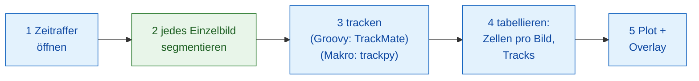

# Pipeline in Fiji

## Die Idee in einfachen Worten { #the-idea-in-plain-words }

Eine Bildanalyse ist ein Abendessen mit mehreren Gängen: Jeder Schritt
(öffnen, segmentieren, verfolgen, zählen, plotten) ist ein Gang, und nicht
jeder Gang kommt aus derselben Küche. Hier serviert Fiji, der Kellner, den größten Teil des
Essens selbst: Es öffnet den Film, verfolgt die Zellen, zählt sie und
zeichnet das Ergebnis. Nur ein Gang, **die Zellkerne in jedem Einzelbild
finden**, wird bei einer Wavu-Küche bestellt (`examples/segment_frames`, in
ihrer eigenen Umgebung). Die Makro-Version bestellt dort auch einen zweiten
Gang, das Tracking (trackpy). TrackMate selbst läuft problemlos aus einem
Skript in Fiji, über seine
[Skript-Schnittstelle](https://imagej.net/plugins/trackmate/scripting/scripting)
in Groovy oder Jython, so wie es die Groovy-Version macht; nur die
ImageJ-Makrosprache kommt an diese Schnittstelle nicht heran.

Die Schritte bilden einen kleinen **DAG** (gerichteter azyklischer Graph,
*directed acyclic graph*): Kästen, die ihr Ergebnis an den nächsten Kasten
weitergeben, ohne Schleifen zurück.



Blaue Kästen sind Fijis eigene Befehle; der grüne Kasten ist ein
Wavu-Skript. In der Makro-Version ist Schritt 3 ebenfalls grün
(`examples/track_trackpy`).

## Bevor Sie anfangen { #before-you-start }

1. **Wavu ist in Fiji installiert**: siehe [wavu-fiji installieren](../fiji/install.md).
   Das Makro braucht das Feld `tables` von
   **Plugins › Wavu › Run Script (Macro)**: Wenn dessen Dialog kein Feld
   **Tables** hat, aktualisieren Sie wavu-fiji.
2. **Holen Sie sich die Beispielordner.** Laden Sie das
   [Wavu-Repository als Zip](https://github.com/Oxford-Zeiss-Centre-of-Excellence/Wavu/archive/refs/heads/main.zip)
   herunter und entpacken Sie es. Benutzen Sie `examples/segment_frames`
   (und für das Makro `examples/track_trackpy`) **dort, wo sie liegen**: Ihre
   `pixi.toml` findet Wavu zwei Ordner weiter oben.
3. **Die Daten**: `examples/data/demo_timelapse.tif`, ein synthetischer Film,
   eigens für diese Seite gemacht: 30 Einzelbilder mit 256 × 256 Pixeln,
   0,65 µm pro Pixel, 5 min pro Bild. Etwa 25 Zellkerne wandern umher, vier
   davon teilen sich, einer verlässt das Bild rechts und einer kommt links
   herein. Die wahren Zahlen sind 25 am Anfang und 29 am Ende:
   `25 25 25 25 25 25 26 26 26 25 25 25 26 26 26 26 26 27 27 28 28 28 28 29 29 29 29 29 29 29`.
4. **TrackMate** für die Groovy-Version. Es ist in Fiji enthalten.

Der erste Durchlauf richtet die Küchengeräte jedes Ordners ein (ein bis
zwei Minuten, einmalig).

## Die Pipeline { #the-pipeline }

=== "Groovy"

    Öffnen Sie **File › New › Script…** (neues Skript), wählen Sie
    **Language › Groovy**, fügen Sie den Code ein und drücken Sie **Run**.
    Fiji fragt nach dem Film, dem Ordner `segment_frames` und einem
    Ausgabeordner.

    ```groovy
    #@ File (label = "Time-lapse (T, Y, X)", style = "file") timelapse
    #@ File (label = "segment_frames folder", style = "directory") segmentDir
    #@ File (label = "Output folder", style = "directory") outDir
    // Minimale dynamische Zellzählung in Fiji:
    // öffnen -> segmentieren (Wavu) -> tracken (TrackMate) -> tabellieren -> Plot + Overlay.
    import fiji.plugin.trackmate.Logger
    import fiji.plugin.trackmate.Model
    import fiji.plugin.trackmate.Settings
    import fiji.plugin.trackmate.TrackMate
    import fiji.plugin.trackmate.detection.LabelImageDetectorFactory
    import fiji.plugin.trackmate.tracking.jaqaman.SparseLAPTrackerFactory
    import ij.IJ
    import ij.ImagePlus
    import ij.gui.Line
    import ij.gui.OvalRoi
    import ij.gui.Overlay
    import ij.gui.Plot
    import ij.measure.ResultsTable
    import java.awt.Color

    // Wavus Skript-Bibliothek (wird mit wavu-fiji installiert).
    def wavu = new GroovyShell(this.class.classLoader).evaluate(
            new File(IJ.getDirectory("imagej"), "scripts/Plugins/Wavu/lib/wavu_lib.groovy.txt"))

    try {
        // 1. Den Zeitraffer öffnen (Fiji selbst).
        def imp = IJ.openImage(timelapse.path)
        def cal = imp.getCalibration()
        double dt = cal.frameInterval > 0 ? cal.frameInterval : 1   // Minuten pro Bild
        int nFrames = imp.getNFrames()

        // 2. Jedes Einzelbild segmentieren (Wavu: examples/segment_frames in seiner eigenen Umgebung).
        Map seg = wavu.run(segmentDir, "script", [sigma: 2, threshold: "otsu", min_area: 30], [image: imp])
        def labels = seg.images.labels                    // uint16-Label-Stapel, ein Bild pro Zeitpunkt
        labels.setCalibration(cal.copy())                 // gleiche Pixelgröße und gleiches Bildintervall

        // 3. Die gelabelten Zellkerne tracken (Fiji selbst: TrackMate).
        def model = new Model()
        model.setLogger(Logger.VOID_LOGGER)
        def settings = new Settings(labels)
        settings.detectorFactory = new LabelImageDetectorFactory()
        settings.detectorSettings = settings.detectorFactory.getDefaultSettings()
        settings.detectorSettings["TARGET_CHANNEL"] = 1
        settings.detectorSettings["SIMPLIFY_CONTOURS"] = false
        settings.trackerFactory = new SparseLAPTrackerFactory()
        settings.trackerSettings = settings.trackerFactory.getDefaultSettings()
        settings.trackerSettings["LINKING_MAX_DISTANCE"] = 10d     // Mikrometer
        settings.trackerSettings["ALLOW_GAP_CLOSING"] = true
        settings.trackerSettings["GAP_CLOSING_MAX_DISTANCE"] = 10d
        settings.trackerSettings["MAX_FRAME_GAP"] = 2              // Bilder
        settings.trackerSettings["ALLOW_TRACK_SPLITTING"] = true   // Teilungen
        settings.trackerSettings["SPLITTING_MAX_DISTANCE"] = 10d
        def trackmate = new TrackMate(model, settings)
        if (!trackmate.checkInput() || !trackmate.process())
            throw new RuntimeException("TrackMate: " + trackmate.getErrorMessage())
        def tm = model.getTrackModel()
        def trackIds = tm.trackIDs(true)

        // 4. Tabellieren: Zellen pro Bild und eine Zeile pro Track.
        def counts = new ResultsTable()
        List<Integer> perFrame = []
        for (int t = 0; t < nFrames; t++) {
            int n = model.getSpots().getNSpots(t, true)
            perFrame << n
            counts.addRow()
            counts.addValue("frame", t)
            counts.addValue("time_min", t * dt)
            counts.addValue("cells", n)
        }
        def tracks = new ResultsTable()
        int divisions = 0
        trackIds.each { id ->
            def spots = tm.trackSpots(id)
            // Eine Teilung: ein Spot, der mit zwei Spots in einem späteren Bild verbunden ist.
            int splits = spots.count { s -> tm.edgesOf(s).count { e -> tm.getEdgeSource(e) == s } > 1 }
            divisions += splits
            def frames = spots.collect { it.getFeature("FRAME") as int }
            tracks.addRow()
            tracks.addValue("track", id)
            tracks.addValue("spots", spots.size())
            tracks.addValue("first_frame", frames.min())
            tracks.addValue("last_frame", frames.max())
            tracks.addValue("divisions", splits)
        }
        counts.show("Cells per frame")
        tracks.show("Tracks")
        counts.save(new File(outDir, imp.getShortTitle() + "-counts.csv").path)
        tracks.save(new File(outDir, imp.getShortTitle() + "-tracks.csv").path)

        // 5a. Zellen pro Bild gegen die Zeit plotten.
        def plot = new Plot("Cells per frame", "time (" + (cal.getTimeUnit() ?: "frame") + ")", "cells")
        plot.setColor(new Color(0x1565c0))
        plot.setLineWidth(2)
        double[] times = (0..<nFrames).collect { it * dt } as double[]
        plot.add("line", times, perFrame as double[])
        plot.add("circle", times, perFrame as double[])
        plot.setLimits(0, (nFrames - 1) * dt, 0, perFrame.max() + 5)
        plot.show()
        IJ.saveAs(plot.getImagePlus(), "PNG", new File(outDir, imp.getShortTitle() + "-counts.png").path)

        // 5b. Den Weg jedes Tracks auf das Original zeichnen, eine Farbe pro Track,
        //     und einen Kreis um jeden Zellkern in dem Bild, in dem er gerade ist.
        double px = cal.pixelWidth
        def overlay = new Overlay()
        trackIds.each { id ->
            def colour = Color.getHSBColor((float) ((id * 0.618034) % 1), 0.9f, 1f)
            tm.trackEdges(id).each { e ->
                def a = tm.getEdgeSource(e), b = tm.getEdgeTarget(e)
                def line = new Line(a.getDoublePosition(0) / px, a.getDoublePosition(1) / px,
                                    b.getDoublePosition(0) / px, b.getDoublePosition(1) / px)
                line.setStrokeColor(colour)
                overlay.add(line)                                   // auf jedem Bild: der ganze Weg
            }
            tm.trackSpots(id).each { s ->
                double r = s.getFeature("RADIUS") / px
                def ring = new OvalRoi(s.getDoublePosition(0) / px - r, s.getDoublePosition(1) / px - r, 2 * r, 2 * r)
                ring.setStrokeColor(colour)
                ring.setPosition(1, 1, (s.getFeature("FRAME") as int) + 1)   // nur in seinem eigenen Bild
                overlay.add(ring)
            }
        }
        imp.setOverlay(overlay)
        IJ.run(imp, "Grays", "")
        // Ein Schnappschuss des letzten Bildes mit allem, was darauf gezeichnet ist.
        imp.setT(nFrames)
        def last = new ImagePlus("last frame", imp.getProcessor().duplicate())
        last.setOverlay(new Overlay())
        overlay.each { roi -> if (roi.getTPosition() in [0, nFrames]) last.getOverlay().add(roi) }
        IJ.saveAs(last.flatten(), "PNG", new File(outDir, imp.getShortTitle() + "-tracks.png").path)
        imp.show()
        labels.close()

        IJ.log("Cells per frame: " + perFrame.join(" "))
        IJ.log(trackIds.size() + " tracks, " + divisions + " divisions")
    } finally {
        wavu.stopAll()                                               // den Worker stoppen
    }
    ```

    Schritt 3 startet TrackMate aus dem Code, wie auf seiner
    [Scripting-Seite](https://imagej.net/plugins/trackmate/scripting/scripting):
    Der *label image detector*
    (Label-Bild-Detektor) macht aus jedem Label einen Spot, und der
    *LAP tracker* verbindet die Spots zu Tracks.

=== "ImageJ macro"

    Öffnen Sie **File › New › Script…** (neues Skript), wählen Sie
    **Language › IJ1 Macro**, fügen Sie den Code ein und drücken Sie **Run**.
    Das Makro fragt nach dem Film, dem Ordner `segment_frames`, dem Ordner
    `track_trackpy` und einem Ausgabeordner.

    ```javascript
    // Minimale dynamische Zellzählung in Fiji, als ImageJ-Makro:
    // öffnen -> segmentieren (Wavu) -> tracken (Wavu: trackpy) -> tabellieren -> Plot + Overlay.
    // Aus dem Skript-Editor starten (es fragt nach den Dateien) oder von der Kommandozeile:
    //   ImageJ-win64.exe --console -batch dag_counting.ijm "<time-lapse>|<segment_frames>|<track_trackpy>|<output folder>"
    arg = getArgument();
    if (arg == "") {
        timelapse = File.openDialog("Choose the time-lapse (T, Y, X)");
        segmentDir = getDirectory("Choose the segment_frames folder");
        trackDir = getDirectory("Choose the track_trackpy folder");
        outDir = getDirectory("Choose the output folder");
    } else {
        a = split(arg, "|");
        timelapse = a[0]; segmentDir = a[1]; trackDir = a[2]; outDir = a[3] + "/";
    }
    setBatchMode(true);

    // 1. Den Zeitraffer öffnen (Fiji selbst).
    open(timelapse);
    movie = getImageID();
    name = File.nameWithoutExtension;
    dt = Stack.getFrameInterval();
    if (dt == 0) dt = 1;
    Stack.getUnits(xu, yu, zu, timeUnit, vu);
    Stack.getDimensions(w, h, channels, slices, frames);

    // 2. Jedes Einzelbild segmentieren (Wavu: segment_frames). Öffnet <name>-labels,
    //    <name>-detections und <name>-count_per_frame.
    run("Run Script (Macro)", "folder=[" + segmentDir + "] script=script params=[sigma=2 threshold=otsu min_area=30]");

    // 3. Tracken (Wavu: track_trackpy), mit der Detektionstabelle. Öffnet "tracks".
    //    search_range ist in Pixeln pro Bild: 15 px = hier etwa 10 Mikrometer.
    run("Run Script (Macro)", "folder=[" + trackDir + "] script=script params=[search_range=15 memory=2] tables=[detections=" + name + "-detections]");

    // 4. Tabellieren: Zellen pro Bild und Anzahl der Tracks, aus der Tabelle tracks.
    n = Table.size("tracks");
    cells = newArray(frames);
    times = newArray(frames);
    nTracks = 0;
    for (i = 0; i < n; i++) {                          // Zeilen sind nach Partikel, dann nach Bild sortiert
        t = Table.get("frame", i, "tracks");
        cells[t] = cells[t] + 1;
        if (i == 0 || Table.get("particle", i, "tracks") != Table.get("particle", i - 1, "tracks"))
            nTracks++;
    }
    Table.create("Cells per frame");
    for (t = 0; t < frames; t++) {
        times[t] = t * dt;
        Table.set("frame", t, t);
        Table.set("time_" + timeUnit, t, times[t]);
        Table.set("cells", t, cells[t]);
    }
    Table.update;
    Table.save(outDir + name + "-counts.csv");

    // 5a. Zellen pro Bild gegen die Zeit plotten.
    Plot.create("Cells per frame", "time (" + timeUnit + ")", "cells");
    Plot.setColor("#1565c0");
    Plot.setLineWidth(2);
    Plot.add("line", times, cells);
    Plot.add("circle", times, cells);
    Array.getStatistics(cells, cmin, cmax);
    Plot.setLimits(0, (frames - 1) * dt, 0, cmax + 5);
    Plot.show();
    saveAs("PNG", outDir + name + "-counts.png");

    // 5b. Den Weg jedes Tracks auf das Original zeichnen, eine Farbe pro Track.
    selectImage(movie);
    run("Grays");
    palette = newArray("#e6194b", "#3cb44b", "#ffe119", "#4363d8", "#f58231", "#911eb4",
                       "#46f0f0", "#f032e6", "#bcf60c", "#fabebe", "#008080", "#e6beff");
    Overlay.remove;
    for (i = 1; i < n; i++) {
        p = Table.get("particle", i, "tracks");
        if (Table.get("particle", i - 1, "tracks") != p) continue;
        setColor(palette[p % palette.length]);
        Overlay.drawLine(Table.get("x", i - 1, "tracks"), Table.get("y", i - 1, "tracks"),
                         Table.get("x", i, "tracks"), Table.get("y", i, "tracks"));
    }
    Overlay.show;
    Stack.setFrame(frames);                            // letztes Bild, mit eingezeichneten Tracks
    run("Flatten");
    saveAs("PNG", outDir + name + "-tracks.png");
    close();
    setBatchMode("exit and display");

    counts = "" + cells[0];
    for (t = 1; t < frames; t++) counts = counts + " " + cells[t];
    print("Cells per frame: " + counts);
    print(nTracks + " tracks");
    run("Stop Worker");                                // beide Worker stoppen
    ```

    Das zweite `run("Run Script (Macro)", …)` hat kein Bild zu senden.
    Stattdessen sendet es eine **Tabelle**:
    `tables=[detections=demo_timelapse-detections]` bedeutet „gib der
    Eingabe `detections` des Skripts die geöffnete Tabelle mit dem Titel
    `demo_timelapse-detections`“, also die Tabelle, die der erste Schritt
    geöffnet hat. Ergebnisse eines Aufrufs ohne Bild werden nur nach der
    Ausgabe benannt, deshalb kommen die Tracks als Tabelle `tracks` an.

Die Kopien im Repository, `tests/fiji/dag_counting.groovy` und
`tests/fiji/dag_counting.ijm`, enthalten denselben Code plus eine letzte
`print`-Zeile, nach der die Tests suchen.

## Was Sie sehen { #what-you-see }

- **Ein Plot-Fenster**, *Cells per frame*: Zellen gegen die Zeit in
  Minuten. Bei der Demo steigt die Kurve in Stufen von 25 auf 29, eine Stufe
  pro Teilung oder Ankunft, und fällt einmal ab, wenn ein Zellkern das Bild
  verlässt.
- **Der Film, mit eingezeichneten Tracks.** Der Weg jedes Tracks ist eine
  Linie in seiner eigenen Farbe, auf jedem Bild; so sehen Sie, wo jeder
  Zellkern gewesen ist und wohin er wandert. Die Groovy-Version zieht
  außerdem einen Kreis um jeden Zellkern in dem Bild, in dem er gerade ist.
- **Tabellen**: *Cells per frame* (Bild, Zeit, Zellen) und in Groovy
  *Tracks* (Spots, erstes und letztes Bild, Teilungen pro Track). Das Makro
  zeigt außerdem die Wavu-Tabellen `demo_timelapse-detections`,
  `demo_timelapse-count_per_frame` und `tracks`.
- **Dateien** im Ausgabeordner: `demo_timelapse-counts.csv`,
  `demo_timelapse-counts.png` (der Plot) und `demo_timelapse-tracks.png`
  (das letzte Bild mit den Tracks), dazu `demo_timelapse-tracks.csv` aus
  Groovy.

Bei der Demo melden beide Versionen:

| | Zellen pro Bild | Tracks |
|---|---|---|
| Groovy (TrackMate) | `25 25 25 25 25 25 26 26 26 26 25 25 26 26 26 26 26 28 28 28 28 28 28 29 29 29 29 29 29 29` | 26, mit 4 Teilungen |
| Makro (trackpy) | dieselben | 30 |

Die Zahlen stimmen mit der Wahrheit überein, außer bei Bild 9 (26, wahr 25)
und den Bildern 17–18 (28, wahr 27). Dort liegt ein Zellkern halb außerhalb
des Bildes: Die Wahrheit zählt ihn erst, wenn sein Mittelpunkt drinnen ist,
der Schwellenwert zählt jeden Teil, den er sieht. Die Anzahl der Tracks
unterscheidet sich, weil die beiden Tracker eine Teilung verschieden
behandeln: TrackMate (mit eingeschaltetem Splitting) lässt einen Track sich
verzweigen, also ergeben 25 Zellkerne plus 1 Neuankömmling 26 Tracks;
trackpy beginnt für eine der beiden Tochterzellen einen neuen Track, also
fügen die 4 Teilungen 4 Tracks hinzu.

## Tipps { #tips }

- **Echte Daten: Wechseln Sie die Küche, nicht die Pipeline.** Ersetzen Sie
  `segment_frames` durch `examples/cellpose_nuclei`, das ebenfalls ein
  Label-Bild zurückgibt. Ändern Sie in Groovy den Ordner und die Parameter
  (`[diameter: 30, use_gpu: false]`) in der Zeile `wavu.run`; TrackMate
  nimmt Labels aus jeder Quelle. Cellpose verarbeitet ein 2-D-Bild pro
  Aufruf: Schreiben Sie also eine Schleife über die Einzelbilder, oder ein
  kleines Skript, das intern eine Schleife macht.
- **Die TrackMate-Einstellungen** sind in Mikrometern. `LINKING_MAX_DISTANCE`
  gibt an, wie weit sich ein Zellkern zwischen zwei Bildern bewegen darf
  (hier 10 µm), `MAX_FRAME_GAP`, wie viele Bilder lang er verschwinden darf
  (2), und `ALLOW_TRACK_SPLITTING` erfasst Teilungen. Schalten Sie
  `ALLOW_TRACK_MERGING` nur ein, wenn Objekte wirklich verschmelzen.
- **Die trackpy-Einstellungen** sind in Pixeln: `search_range=15` ist hier
  etwa 10 µm.
- **Das Feld `tables`** nimmt Paare `input=title`, durch Leerzeichen
  getrennt, für jede geöffnete Tabelle: eine aus **Analyze › Measure**, aus
  `Table.create` oder aus einem früheren Wavu-Schritt. Titel dürfen keine
  Leerzeichen enthalten.

## In einem Satz { #in-one-sentence }

Öffnen, tracken, zählen, plotten und zeichnen Sie mit Fijis eigenen
Werkzeugen, und bestellen Sie bei einer Wavu-Küche nur die Segmentierung
(und, in einem Makro, das Tracking), wobei Bilder und Tabellen von Schritt
zu Schritt weitergereicht werden.
