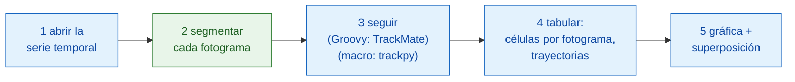

# Pipeline en Fiji

## La idea en palabras sencillas

Un análisis de imágenes es una cena de varios platos: cada paso (abrir,
segmentar, seguir, contar, graficar) es un plato, y no todos salen de la
misma cocina.
Aquí Fiji, el camarero, sirve casi toda la comida él mismo: abre la
película, sigue las células, las cuenta y dibuja el resultado. Solo un plato,
**encontrar los núcleos en cada fotograma**, se pide a una cocina de Wavu
(`examples/segment_frames`, en su propio entorno). La versión en macro pide
allí también un segundo plato, el seguimiento (tracking, con trackpy).
TrackMate en sí funciona muy bien desde un script dentro de Fiji, a través de
su [interfaz de scripting](https://imagej.net/plugins/trackmate/scripting/scripting) en Groovy o Jython, como hace la versión en
Groovy; simplemente el lenguaje de macros de ImageJ no llega a esa interfaz.

Los pasos forman un pequeño **DAG** (grafo acíclico dirigido, *directed
acyclic graph*): cajas que pasan su resultado a la caja siguiente, sin
bucles hacia atrás.



Las cajas azules son comandos propios de Fiji; la caja verde es un script de
Wavu. En la versión en macro, el paso 3 también es verde
(`examples/track_trackpy`).

## Antes de empezar

1. **Wavu está instalado en Fiji**: mira [Instalar wavu-fiji](../fiji/install.md).
   La macro necesita el campo `tables` de
   **Plugins › Wavu › Run Script (Macro)** (ejecutar script desde macro): si
   su diálogo no tiene campo **Tables**, actualiza wavu-fiji.
2. **Consigue las carpetas de ejemplo.** Descarga el
   [repositorio de Wavu como zip](https://github.com/Oxford-Zeiss-Centre-of-Excellence/Wavu/archive/refs/heads/main.zip)
   y descomprímelo. Usa `examples/segment_frames` (y, para la macro,
   `examples/track_trackpy`) **donde están**: su `pixi.toml` encuentra
   Wavu dos carpetas más arriba.
3. **Los datos**: `examples/data/demo_timelapse.tif`, una película sintética
   hecha para esta página: 30 fotogramas de 256 × 256 píxeles, 0,65 µm por
   píxel, 5 min por fotograma. Unos 25 núcleos se desplazan, cuatro de ellos
   se dividen, uno sale por la derecha y otro entra por la izquierda. Los
   recuentos reales son 25 al principio y 29 al final.

   { width="256" }

4. **TrackMate** para la versión en Groovy. Viene con Fiji.

La primera ejecución instala los utensilios de cocina de cada carpeta (un
minuto o dos, una sola vez).

## El pipeline

=== "Groovy"

    Abre **File › New › Script…** (nuevo script), elige
    **Language › Groovy**, pega el código y pulsa **Run**. Fiji te pide la
    película, la carpeta `segment_frames` y una carpeta de salida.

    ```groovy
    #@ File (label = "Time-lapse (T, Y, X)", style = "file") timelapse
    #@ File (label = "segment_frames folder", style = "directory") segmentDir
    #@ File (label = "Output folder", style = "directory") outDir
    // Recuento dinámico mínimo de células en Fiji:
    // abrir -> segmentar (Wavu) -> seguir (TrackMate) -> tabular -> gráfica + superposición.
    import fiji.plugin.trackmate.Logger
    import fiji.plugin.trackmate.Model
    import fiji.plugin.trackmate.Settings
    import fiji.plugin.trackmate.TrackMate
    import fiji.plugin.trackmate.detection.LabelImageDetectorFactory
    import fiji.plugin.trackmate.tracking.jaqaman.SparseLAPTrackerFactory
    import ij.IJ
    import ij.ImagePlus
    import ij.gui.Line
    import ij.gui.OvalRoi
    import ij.gui.Overlay
    import ij.gui.Plot
    import ij.measure.ResultsTable
    import java.awt.Color

    // La biblioteca de scripting de Wavu (se instala con wavu-fiji).
    def wavu = new GroovyShell(this.class.classLoader).evaluate(
            new File(IJ.getDirectory("imagej"), "scripts/Plugins/Wavu/lib/wavu_lib.groovy.txt"))

    try {
        // 1. Abrir la serie temporal (Fiji nativo).
        def imp = IJ.openImage(timelapse.path)
        def cal = imp.getCalibration()
        double dt = cal.frameInterval > 0 ? cal.frameInterval : 1   // minutos por fotograma
        int nFrames = imp.getNFrames()

        // 2. Segmentar cada fotograma (Wavu: examples/segment_frames en su propio entorno).
        Map seg = wavu.run(segmentDir, "script", [sigma: 2, threshold: "otsu", min_area: 30], [image: imp])
        def labels = seg.images.labels                    // pila de etiquetas uint16, un fotograma por instante
        labels.setCalibration(cal.copy())                 // mismo tamaño de píxel e intervalo entre fotogramas

        // 3. Seguir los núcleos etiquetados (Fiji nativo: TrackMate).
        def model = new Model()
        model.setLogger(Logger.VOID_LOGGER)
        def settings = new Settings(labels)
        settings.detectorFactory = new LabelImageDetectorFactory()
        settings.detectorSettings = settings.detectorFactory.getDefaultSettings()
        settings.detectorSettings["TARGET_CHANNEL"] = 1
        settings.detectorSettings["SIMPLIFY_CONTOURS"] = false
        settings.trackerFactory = new SparseLAPTrackerFactory()
        settings.trackerSettings = settings.trackerFactory.getDefaultSettings()
        settings.trackerSettings["LINKING_MAX_DISTANCE"] = 10d     // micras
        settings.trackerSettings["ALLOW_GAP_CLOSING"] = true
        settings.trackerSettings["GAP_CLOSING_MAX_DISTANCE"] = 10d
        settings.trackerSettings["MAX_FRAME_GAP"] = 2              // fotogramas
        settings.trackerSettings["ALLOW_TRACK_SPLITTING"] = true   // divisiones
        settings.trackerSettings["SPLITTING_MAX_DISTANCE"] = 10d
        def trackmate = new TrackMate(model, settings)
        if (!trackmate.checkInput() || !trackmate.process())
            throw new RuntimeException("TrackMate: " + trackmate.getErrorMessage())
        def tm = model.getTrackModel()
        def trackIds = tm.trackIDs(true)

        // 4. Tabular: células por fotograma, y una fila por trayectoria.
        def counts = new ResultsTable()
        List<Integer> perFrame = []
        for (int t = 0; t < nFrames; t++) {
            int n = model.getSpots().getNSpots(t, true)
            perFrame << n
            counts.addRow()
            counts.addValue("frame", t)
            counts.addValue("time_min", t * dt)
            counts.addValue("cells", n)
        }
        def tracks = new ResultsTable()
        int divisions = 0
        trackIds.each { id ->
            def spots = tm.trackSpots(id)
            // Una división: un punto unido a dos puntos de un fotograma posterior.
            int splits = spots.count { s -> tm.edgesOf(s).count { e -> tm.getEdgeSource(e) == s } > 1 }
            divisions += splits
            def frames = spots.collect { it.getFeature("FRAME") as int }
            tracks.addRow()
            tracks.addValue("track", id)
            tracks.addValue("spots", spots.size())
            tracks.addValue("first_frame", frames.min())
            tracks.addValue("last_frame", frames.max())
            tracks.addValue("divisions", splits)
        }
        counts.show("Cells per frame")
        tracks.show("Tracks")
        counts.save(new File(outDir, imp.getShortTitle() + "-counts.csv").path)
        tracks.save(new File(outDir, imp.getShortTitle() + "-tracks.csv").path)

        // 5a. Gráfica de células por fotograma frente al tiempo.
        def plot = new Plot("Cells per frame", "time (" + (cal.getTimeUnit() ?: "frame") + ")", "cells")
        plot.setColor(new Color(0x1565c0))
        plot.setLineWidth(2)
        double[] times = (0..<nFrames).collect { it * dt } as double[]
        plot.add("line", times, perFrame as double[])
        plot.add("circle", times, perFrame as double[])
        plot.setLimits(0, (nFrames - 1) * dt, 0, perFrame.max() + 5)
        plot.show()
        IJ.saveAs(plot.getImagePlus(), "PNG", new File(outDir, imp.getShortTitle() + "-counts.png").path)

        // 5b. Dibujar el camino de cada trayectoria sobre el original, un color por trayectoria,
        //     y un círculo alrededor de cada núcleo en el fotograma donde está.
        double px = cal.pixelWidth
        def overlay = new Overlay()
        trackIds.each { id ->
            def colour = Color.getHSBColor((float) ((id * 0.618034) % 1), 0.9f, 1f)
            tm.trackEdges(id).each { e ->
                def a = tm.getEdgeSource(e), b = tm.getEdgeTarget(e)
                def line = new Line(a.getDoublePosition(0) / px, a.getDoublePosition(1) / px,
                                    b.getDoublePosition(0) / px, b.getDoublePosition(1) / px)
                line.setStrokeColor(colour)
                overlay.add(line)                                   // en cada fotograma: el camino entero
            }
            tm.trackSpots(id).each { s ->
                double r = s.getFeature("RADIUS") / px
                def ring = new OvalRoi(s.getDoublePosition(0) / px - r, s.getDoublePosition(1) / px - r, 2 * r, 2 * r)
                ring.setStrokeColor(colour)
                ring.setPosition(1, 1, (s.getFeature("FRAME") as int) + 1)   // solo en su propio fotograma
                overlay.add(ring)
            }
        }
        imp.setOverlay(overlay)
        IJ.run(imp, "Grays", "")
        // Una captura del último fotograma con lo que tiene dibujado.
        imp.setT(nFrames)
        def last = new ImagePlus("last frame", imp.getProcessor().duplicate())
        last.setOverlay(new Overlay())
        overlay.each { roi -> if (roi.getTPosition() in [0, nFrames]) last.getOverlay().add(roi) }
        IJ.saveAs(last.flatten(), "PNG", new File(outDir, imp.getShortTitle() + "-tracks.png").path)
        imp.show()
        labels.close()

        IJ.log("Cells per frame: " + perFrame.join(" "))
        IJ.log(trackIds.size() + " tracks, " + divisions + " divisions")
    } finally {
        wavu.stopAll()                                               // detener el worker
    }
    ```

    El paso 3 ejecuta TrackMate desde código, como en su
    [página de scripting](https://imagej.net/plugins/trackmate/scripting/scripting): el *label image detector*
    (detector de imagen de etiquetas) convierte cada etiqueta en un punto, y
    el *LAP tracker* une los puntos en trayectorias.

=== "ImageJ macro"

    Abre **File › New › Script…** (nuevo script), elige
    **Language › IJ1 Macro**, pega el código y pulsa **Run**. La macro te
    pide la película, la carpeta `segment_frames`, la carpeta
    `track_trackpy` y una carpeta de salida.

    ```javascript
    // Recuento dinámico mínimo de células en Fiji, como macro de ImageJ:
    // abrir -> segmentar (Wavu) -> seguir (Wavu: trackpy) -> tabular -> gráfica + superposición.
    // Ejecútala desde el editor de scripts (pide los archivos) o desde la línea de comandos:
    //   ImageJ-win64.exe --console -batch dag_counting.ijm "<time-lapse>|<segment_frames>|<track_trackpy>|<output folder>"
    arg = getArgument();
    if (arg == "") {
        timelapse = File.openDialog("Choose the time-lapse (T, Y, X)");
        segmentDir = getDirectory("Choose the segment_frames folder");
        trackDir = getDirectory("Choose the track_trackpy folder");
        outDir = getDirectory("Choose the output folder");
    } else {
        a = split(arg, "|");
        timelapse = a[0]; segmentDir = a[1]; trackDir = a[2]; outDir = a[3] + "/";
    }
    setBatchMode(true);

    // 1. Abrir la serie temporal (Fiji nativo).
    open(timelapse);
    movie = getImageID();
    name = File.nameWithoutExtension;
    dt = Stack.getFrameInterval();
    if (dt == 0) dt = 1;
    Stack.getUnits(xu, yu, zu, timeUnit, vu);
    Stack.getDimensions(w, h, channels, slices, frames);

    // 2. Segmentar cada fotograma (Wavu: segment_frames). Abre <name>-labels,
    //    <name>-detections y <name>-count_per_frame.
    run("Run Script (Macro)", "folder=[" + segmentDir + "] script=script params=[sigma=2 threshold=otsu min_area=30]");

    // 3. Seguir (Wavu: track_trackpy), con la tabla de detecciones. Abre "tracks".
    //    search_range va en píxeles por fotograma: 15 px = unas 10 micras aquí.
    run("Run Script (Macro)", "folder=[" + trackDir + "] script=script params=[search_range=15 memory=2] tables=[detections=" + name + "-detections]");

    // 4. Tabular: células por fotograma y número de trayectorias, a partir de la tabla tracks.
    n = Table.size("tracks");
    cells = newArray(frames);
    times = newArray(frames);
    nTracks = 0;
    for (i = 0; i < n; i++) {                          // filas ordenadas por partícula y luego por fotograma
        t = Table.get("frame", i, "tracks");
        cells[t] = cells[t] + 1;
        if (i == 0 || Table.get("particle", i, "tracks") != Table.get("particle", i - 1, "tracks"))
            nTracks++;
    }
    Table.create("Cells per frame");
    for (t = 0; t < frames; t++) {
        times[t] = t * dt;
        Table.set("frame", t, t);
        Table.set("time_" + timeUnit, t, times[t]);
        Table.set("cells", t, cells[t]);
    }
    Table.update;
    Table.save(outDir + name + "-counts.csv");

    // 5a. Gráfica de células por fotograma frente al tiempo.
    Plot.create("Cells per frame", "time (" + timeUnit + ")", "cells");
    Plot.setColor("#1565c0");
    Plot.setLineWidth(2);
    Plot.add("line", times, cells);
    Plot.add("circle", times, cells);
    Array.getStatistics(cells, cmin, cmax);
    Plot.setLimits(0, (frames - 1) * dt, 0, cmax + 5);
    Plot.show();
    saveAs("PNG", outDir + name + "-counts.png");

    // 5b. Dibujar el camino de cada trayectoria sobre el original, un color por trayectoria.
    selectImage(movie);
    run("Grays");
    palette = newArray("#e6194b", "#3cb44b", "#ffe119", "#4363d8", "#f58231", "#911eb4",
                       "#46f0f0", "#f032e6", "#bcf60c", "#fabebe", "#008080", "#e6beff");
    Overlay.remove;
    for (i = 1; i < n; i++) {
        p = Table.get("particle", i, "tracks");
        if (Table.get("particle", i - 1, "tracks") != p) continue;
        setColor(palette[p % palette.length]);
        Overlay.drawLine(Table.get("x", i - 1, "tracks"), Table.get("y", i - 1, "tracks"),
                         Table.get("x", i, "tracks"), Table.get("y", i, "tracks"));
    }
    Overlay.show;
    Stack.setFrame(frames);                            // último fotograma, con las trayectorias dibujadas
    run("Flatten", "slice");
    saveAs("PNG", outDir + name + "-tracks.png");
    close();
    setBatchMode("exit and display");

    counts = "" + cells[0];
    for (t = 1; t < frames; t++) counts = counts + " " + cells[t];
    print("Cells per frame: " + counts);
    print(nTracks + " tracks");
    run("Stop Worker");                                // detener los dos workers
    ```

    El segundo `run("Run Script (Macro)", …)` no tiene imagen que enviar. En
    su lugar envía una **tabla**: `tables=[detections=demo_timelapse-detections]`
    significa «dale a la entrada `detections` del script la tabla abierta
    titulada `demo_timelapse-detections`», que es la tabla que abrió el
    primer paso. Los resultados de una llamada sin imagen llevan solo el
    nombre de la salida, así que las trayectorias llegan como la tabla
    `tracks`.

Las copias del repositorio, `tests/fiji/dag_counting.groovy` y
`tests/fiji/dag_counting.ijm`, son el mismo código más una última línea
`print` que buscan los tests.

## Lo que ves

- **Una ventana de gráfica**, *Cells per frame* (células por fotograma):
  células frente al tiempo en minutos. En la demo sube de 25 a 29 a
  escalones, un escalón por cada división o llegada, y baja una vez cuando
  un núcleo se va.
- **La película, con las trayectorias dibujadas encima.** El camino de cada
  trayectoria es una línea de su propio color, en todos los fotogramas, así
  que ves dónde ha estado cada núcleo y adónde va. La versión en Groovy
  además rodea cada núcleo con un círculo en el fotograma donde está.
- **Tablas**: *Cells per frame* (fotograma, tiempo, células) y, en Groovy,
  *Tracks* (puntos, primer y último fotograma, divisiones por trayectoria).
  La macro muestra además las tablas de Wavu `demo_timelapse-detections`,
  `demo_timelapse-count_per_frame` y `tracks`.
- **Archivos** en la carpeta de salida: `demo_timelapse-counts.csv`,
  `demo_timelapse-counts.png` (la gráfica) y `demo_timelapse-tracks.png`
  (el último fotograma con las trayectorias), más `demo_timelapse-tracks.csv`
  en Groovy.

En la demo, las dos versiones dan:

| | células por fotograma | trayectorias |
|---|---|---|
| Groovy (TrackMate) | 25 → 29 | 26, con 4 divisiones |
| Macro (trackpy) | lo mismo | 30 |

Los recuentos coinciden con la realidad salvo en el fotograma 9 (26, la
realidad es 25) y en los fotogramas 17–18 (28, la realidad es 27). Ahí hay
un núcleo medio fuera de la imagen: la realidad solo lo cuenta cuando su
centro está dentro; el umbral cuenta la parte que ve. El número de
trayectorias es distinto porque los dos trackers tratan una división de
forma diferente: TrackMate (con la división activada) deja que una
trayectoria se ramifique, así que 25 núcleos más 1 recién llegado dan 26
trayectorias; trackpy empieza una trayectoria nueva para una de las dos
células hijas, así que las 4 divisiones añaden 4 trayectorias.

## Consejos

- **Datos reales: cambia la cocina, no el pipeline.** Sustituye
  `segment_frames` por `examples/cellpose_nuclei`, que también devuelve una
  imagen de etiquetas. En Groovy, cambia la carpeta y los parámetros
  (`[diameter: 30, use_gpu: false]`) en la línea `wavu.run`; TrackMate
  acepta etiquetas de cualquier origen. Cellpose procesa una imagen 2-D por
  llamada, así que recorre los fotogramas en un bucle, o escribe un pequeño
  script que haga el bucle por dentro.
- **Los ajustes de TrackMate** van en micras. `LINKING_MAX_DISTANCE` es
  cuánto puede moverse un núcleo entre fotogramas (10 µm aquí),
  `MAX_FRAME_GAP` durante cuántos fotogramas puede desaparecer (2), y
  `ALLOW_TRACK_SPLITTING` detecta las divisiones. Activa
  `ALLOW_TRACK_MERGING` solo si los objetos se fusionan de verdad.
- **Los ajustes de trackpy** van en píxeles: `search_range=15` son unas
  10 µm aquí.
- **El campo `tables`** acepta pares `input=title` separados por espacios,
  para cualquier tabla abierta: una de **Analyze › Measure**, de
  `Table.create` o de un paso anterior de Wavu. Los títulos no pueden
  contener espacios.

## En una frase

Abre, sigue, cuenta, haz la gráfica y dibuja con las herramientas propias de
Fiji, y pide a una cocina de Wavu solo la segmentación (y, en una macro, el
seguimiento), pasando imágenes y tablas de un paso al siguiente.
