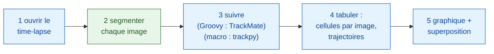
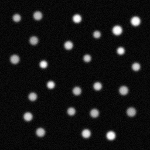
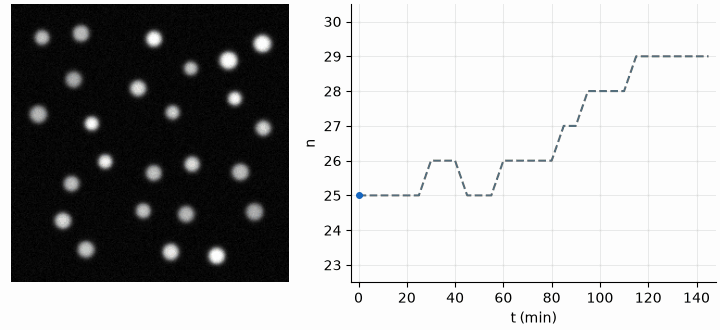
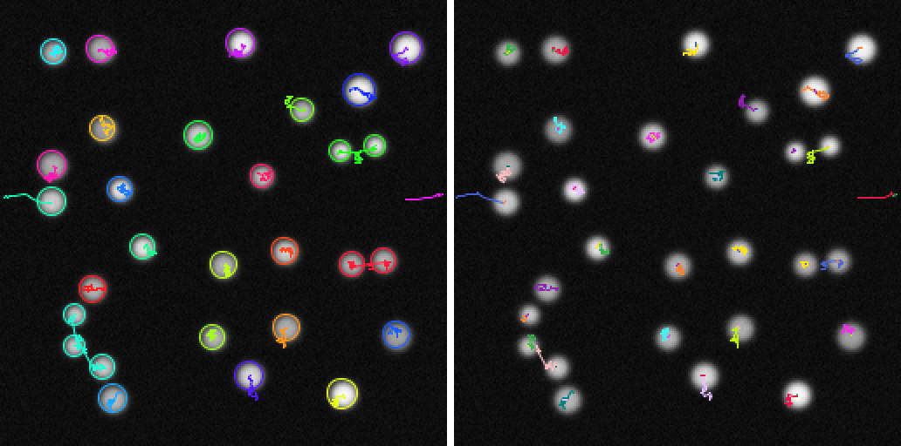

# Pipeline dans Fiji

!!! question "Ce que mesure ce pipeline"
    **Les cellules (y) en fonction du temps (x)** dans un time-lapse de
    noyaux qui se divisent et, en second regard, le nombre de **lignées** :
    une cellule de départ plus toutes ses filles. Chaque étape ci-dessous
    existe parce que ce résultat en a besoin
    (voir [Avant toute analyse](index.md)).

## L'idée en mots simples { #the-idea-in-plain-words }

Une analyse d'images est un dîner en plusieurs plats : chaque étape (ouvrir,
segmenter, suivre, compter, tracer) est un plat, et tous ne viennent pas de
la même cuisine. Ici, Fiji, le serveur, sert lui-même la plus grande partie du
repas : il ouvre le film, suit les cellules, les compte et dessine le
résultat. Un seul plat, **trouver les noyaux dans chaque image du film**,
est commandé à une cuisine Wavu (`examples/segment_frames`, dans son propre
environnement). La version macro y commande aussi un deuxième plat, le
suivi (trackpy). TrackMate lui-même fonctionne très bien depuis un script
dans Fiji, grâce à son
[interface de scripting](https://imagej.net/plugins/trackmate/scripting/scripting)
en Groovy ou en Jython, comme le fait la version Groovy ; le langage macro
d'ImageJ ne peut simplement pas atteindre cette interface.

Les étapes forment un petit **DAG** (graphe orienté acyclique, *directed
acyclic graph*) : des boîtes qui passent leur résultat à la boîte suivante,
sans jamais revenir en arrière en boucle.



Les boîtes bleues sont les commandes propres à Fiji ; la boîte verte est un
script Wavu. Dans la version macro, l'étape 3 est verte elle aussi
(`examples/track_trackpy`).

## Avant de commencer { #before-you-start }

1. **Wavu est installé dans Fiji** : voir [Installer wavu-fiji](../fiji/install.md).
   La macro a besoin du champ `tables` de
   **Plugins › Wavu › Run Script (Macro)** : si son dialogue n'a pas de champ
   **Tables**, mettez wavu-fiji à jour.
2. **Récupérez les dossiers d'exemple** : ouvrez le dépôt Wavu dans
   VS Code, qui le clone pour vous, ou téléchargez-le en zip et
   décompressez-le.

   [Ouvrir le dépôt Wavu dans VS Code](vscode://vscode.git/clone?url=https%3A%2F%2Fgithub.com%2FOxford-Zeiss-Centre-of-Excellence%2FWavu.git){ .md-button .md-button--primary }
   [Télécharger le ZIP](https://github.com/Oxford-Zeiss-Centre-of-Excellence/Wavu/archive/refs/heads/main.zip){ .md-button }

   Utilisez `examples/segment_frames` (et, pour la macro,
   `examples/track_trackpy`) **là où ils sont** : leur `pixi.toml` trouve
   Wavu deux dossiers plus haut.
3. **Les données** : `examples/data/demo_timelapse.tif`, un film synthétique
   fait pour cette page : 30 images de 256 × 256 pixels, 0,65 µm par pixel,
   5 min par image. Environ 25 noyaux se déplacent, quatre d'entre eux se
   divisent, un sort par la droite et un entre par la gauche. Les vrais
   comptes sont 25 au début et 29 à la fin.

   { width="256" }

4. **TrackMate** pour la version Groovy. Il est livré avec Fiji.

La première exécution installe la batterie de cuisine de chaque dossier
(une minute ou deux, une seule fois).

## Le pipeline { #the-pipeline }

=== "Groovy"

    Ouvrez **File › New › Script…** (nouveau script), choisissez
    **Language › Groovy**, collez le code et appuyez sur **Run**. Fiji demande
    le film, le dossier `segment_frames` et un dossier de sortie.

    ```groovy
    #@ File (label = "Time-lapse (T, Y, X)", style = "file") timelapse
    #@ File (label = "segment_frames folder", style = "directory") segmentDir
    #@ File (label = "Output folder", style = "directory") outDir
    // Comptage dynamique de cellules minimal dans Fiji :
    // ouvrir -> segmenter (Wavu) -> suivre (TrackMate) -> tabuler -> graphique + superposition.
    import fiji.plugin.trackmate.Logger
    import fiji.plugin.trackmate.Model
    import fiji.plugin.trackmate.Settings
    import fiji.plugin.trackmate.TrackMate
    import fiji.plugin.trackmate.detection.LabelImageDetectorFactory
    import fiji.plugin.trackmate.tracking.jaqaman.SparseLAPTrackerFactory
    import ij.IJ
    import ij.ImagePlus
    import ij.gui.Line
    import ij.gui.OvalRoi
    import ij.gui.Overlay
    import ij.gui.Plot
    import ij.measure.ResultsTable
    import java.awt.Color

    // La bibliothèque de scripting de Wavu (installée avec wavu-fiji).
    def wavu = new GroovyShell(this.class.classLoader).evaluate(
            new File(IJ.getDirectory("imagej"), "scripts/Plugins/Wavu/lib/wavu_lib.groovy.txt"))

    try {
        // 1. Ouvrir le time-lapse (Fiji natif).
        def imp = IJ.openImage(timelapse.path)
        def cal = imp.getCalibration()
        double dt = cal.frameInterval > 0 ? cal.frameInterval : 1   // minutes par image
        int nFrames = imp.getNFrames()

        // 2. Segmenter chaque image (Wavu : examples/segment_frames dans son propre environnement).
        Map seg = wavu.run(segmentDir, "script", [sigma: 2, threshold: "otsu", min_area: 30], [image: imp])
        def labels = seg.images.labels                    // pile de labels uint16, une image par instant
        labels.setCalibration(cal.copy())                 // même taille de pixel et même intervalle

        // 3. Suivre les noyaux étiquetés (Fiji natif : TrackMate).
        def model = new Model()
        model.setLogger(Logger.VOID_LOGGER)
        def settings = new Settings(labels)
        settings.detectorFactory = new LabelImageDetectorFactory()
        settings.detectorSettings = settings.detectorFactory.getDefaultSettings()
        settings.detectorSettings["TARGET_CHANNEL"] = 1
        settings.detectorSettings["SIMPLIFY_CONTOURS"] = false
        settings.trackerFactory = new SparseLAPTrackerFactory()
        settings.trackerSettings = settings.trackerFactory.getDefaultSettings()
        settings.trackerSettings["LINKING_MAX_DISTANCE"] = 10d     // microns
        settings.trackerSettings["ALLOW_GAP_CLOSING"] = true
        settings.trackerSettings["GAP_CLOSING_MAX_DISTANCE"] = 10d
        settings.trackerSettings["MAX_FRAME_GAP"] = 2              // images
        settings.trackerSettings["ALLOW_TRACK_SPLITTING"] = true   // divisions
        settings.trackerSettings["SPLITTING_MAX_DISTANCE"] = 10d
        def trackmate = new TrackMate(model, settings)
        if (!trackmate.checkInput() || !trackmate.process())
            throw new RuntimeException("TrackMate: " + trackmate.getErrorMessage())
        def tm = model.getTrackModel()
        def trackIds = tm.trackIDs(true)

        // 4. Tabuler : cellules par image, et une ligne par trajectoire.
        def counts = new ResultsTable()
        List<Integer> perFrame = []
        for (int t = 0; t < nFrames; t++) {
            int n = model.getSpots().getNSpots(t, true)
            perFrame << n
            counts.addRow()
            counts.addValue("frame", t)
            counts.addValue("time_min", t * dt)
            counts.addValue("cells", n)
        }
        def tracks = new ResultsTable()
        int divisions = 0
        trackIds.each { id ->
            def spots = tm.trackSpots(id)
            // Une division : un spot relié à deux spots dans une image suivante.
            int splits = spots.count { s -> tm.edgesOf(s).count { e -> tm.getEdgeSource(e) == s } > 1 }
            divisions += splits
            def frames = spots.collect { it.getFeature("FRAME") as int }
            tracks.addRow()
            tracks.addValue("track", id)
            tracks.addValue("spots", spots.size())
            tracks.addValue("first_frame", frames.min())
            tracks.addValue("last_frame", frames.max())
            tracks.addValue("divisions", splits)
        }
        counts.show("Cells per frame")
        tracks.show("Tracks")
        counts.save(new File(outDir, imp.getShortTitle() + "-counts.csv").path)
        tracks.save(new File(outDir, imp.getShortTitle() + "-tracks.csv").path)

        // 5a. Tracer les cellules par image en fonction du temps.
        def plot = new Plot("Cells per frame", "time (" + (cal.getTimeUnit() ?: "frame") + ")", "cells")
        plot.setColor(new Color(0x1565c0))
        plot.setLineWidth(2)
        double[] times = (0..<nFrames).collect { it * dt } as double[]
        plot.add("line", times, perFrame as double[])
        plot.add("circle", times, perFrame as double[])
        plot.setLimits(0, (nFrames - 1) * dt, 0, perFrame.max() + 5)
        plot.show()
        IJ.saveAs(plot.getImagePlus(), "PNG", new File(outDir, imp.getShortTitle() + "-counts.png").path)

        // 5b. Dessiner le chemin de chaque trajectoire sur l'original, une couleur par trajectoire,
        //     et un cercle autour de chaque noyau dans l'image où il se trouve.
        double px = cal.pixelWidth
        def overlay = new Overlay()
        trackIds.each { id ->
            def colour = Color.getHSBColor((float) ((id * 0.618034) % 1), 0.9f, 1f)
            tm.trackEdges(id).each { e ->
                def a = tm.getEdgeSource(e), b = tm.getEdgeTarget(e)
                def line = new Line(a.getDoublePosition(0) / px, a.getDoublePosition(1) / px,
                                    b.getDoublePosition(0) / px, b.getDoublePosition(1) / px)
                line.setStrokeColor(colour)
                overlay.add(line)                                   // sur chaque image : tout le chemin
            }
            tm.trackSpots(id).each { s ->
                double r = s.getFeature("RADIUS") / px
                def ring = new OvalRoi(s.getDoublePosition(0) / px - r, s.getDoublePosition(1) / px - r, 2 * r, 2 * r)
                ring.setStrokeColor(colour)
                ring.setPosition(1, 1, (s.getFeature("FRAME") as int) + 1)   // seulement dans sa propre image
                overlay.add(ring)
            }
        }
        imp.setOverlay(overlay)
        IJ.run(imp, "Grays", "")
        // Un instantané de la dernière image avec ce qui est dessiné dessus.
        imp.setT(nFrames)
        def last = new ImagePlus("last frame", imp.getProcessor().duplicate())
        last.setOverlay(new Overlay())
        overlay.each { roi -> if (roi.getTPosition() in [0, nFrames]) last.getOverlay().add(roi) }
        IJ.saveAs(last.flatten(), "PNG", new File(outDir, imp.getShortTitle() + "-tracks.png").path)
        imp.show()
        labels.close()

        IJ.log("Cells per frame: " + perFrame.join(" "))
        IJ.log(trackIds.size() + " tracks, " + divisions + " divisions")
    } finally {
        wavu.stopAll()                                               // arrêter le worker
    }
    ```

    L'étape 3 lance TrackMate depuis le code, comme sur sa
    [page de scripting](https://imagej.net/plugins/trackmate/scripting/scripting) :
    le *label image detector*
    (détecteur d'image de labels) transforme chaque label en un spot, et le
    *LAP tracker* relie les spots en trajectoires.

=== "ImageJ macro"

    Ouvrez **File › New › Script…** (nouveau script), choisissez
    **Language › IJ1 Macro**, collez le code et appuyez sur **Run**. La macro
    demande le film, le dossier `segment_frames`, le dossier `track_trackpy`
    et un dossier de sortie.

    ```javascript
    // Comptage dynamique de cellules minimal dans Fiji, sous forme de macro ImageJ :
    // ouvrir -> segmenter (Wavu) -> suivre (Wavu : trackpy) -> tabuler -> graphique + superposition.
    // Lancez-la depuis l'éditeur de scripts (elle demande les fichiers), ou en ligne de commande :
    //   ImageJ-win64.exe --console -batch dag_counting.ijm "<time-lapse>|<segment_frames>|<track_trackpy>|<output folder>"
    arg = getArgument();
    if (arg == "") {
        timelapse = File.openDialog("Choose the time-lapse (T, Y, X)");
        segmentDir = getDirectory("Choose the segment_frames folder");
        trackDir = getDirectory("Choose the track_trackpy folder");
        outDir = getDirectory("Choose the output folder");
    } else {
        a = split(arg, "|");
        timelapse = a[0]; segmentDir = a[1]; trackDir = a[2]; outDir = a[3] + "/";
    }
    setBatchMode(true);

    // 1. Ouvrir le time-lapse (Fiji natif).
    open(timelapse);
    movie = getImageID();
    name = File.nameWithoutExtension;
    dt = Stack.getFrameInterval();
    if (dt == 0) dt = 1;
    Stack.getUnits(xu, yu, zu, timeUnit, vu);
    Stack.getDimensions(w, h, channels, slices, frames);

    // 2. Segmenter chaque image (Wavu : segment_frames). Ouvre <name>-labels,
    //    <name>-detections et <name>-count_per_frame.
    run("Run Script (Macro)", "folder=[" + segmentDir + "] script=script params=[sigma=2 threshold=otsu min_area=30]");

    // 3. Suivre (Wavu : track_trackpy), à partir du tableau des détections. Ouvre "tracks".
    //    search_range est en pixels par image : 15 px = environ 10 microns ici.
    run("Run Script (Macro)", "folder=[" + trackDir + "] script=script params=[search_range=15 memory=2] tables=[detections=" + name + "-detections]");

    // 4. Tabuler : cellules par image et nombre de trajectoires, à partir du tableau tracks.
    n = Table.size("tracks");
    cells = newArray(frames);
    times = newArray(frames);
    nTracks = 0;
    for (i = 0; i < n; i++) {                          // lignes triées par particule, puis par image
        t = Table.get("frame", i, "tracks");
        cells[t] = cells[t] + 1;
        if (i == 0 || Table.get("particle", i, "tracks") != Table.get("particle", i - 1, "tracks"))
            nTracks++;
    }
    Table.create("Cells per frame");
    for (t = 0; t < frames; t++) {
        times[t] = t * dt;
        Table.set("frame", t, t);
        Table.set("time_" + timeUnit, t, times[t]);
        Table.set("cells", t, cells[t]);
    }
    Table.update;
    Table.save(outDir + name + "-counts.csv");

    // 5a. Tracer les cellules par image en fonction du temps.
    Plot.create("Cells per frame", "time (" + timeUnit + ")", "cells");
    Plot.setColor("#1565c0");
    Plot.setLineWidth(2);
    Plot.add("line", times, cells);
    Plot.add("circle", times, cells);
    Array.getStatistics(cells, cmin, cmax);
    Plot.setLimits(0, (frames - 1) * dt, 0, cmax + 5);
    Plot.show();
    saveAs("PNG", outDir + name + "-counts.png");

    // 5b. Dessiner le chemin de chaque trajectoire sur l'original, une couleur par trajectoire.
    selectImage(movie);
    run("Grays");
    palette = newArray("#e6194b", "#3cb44b", "#ffe119", "#4363d8", "#f58231", "#911eb4",
                       "#46f0f0", "#f032e6", "#bcf60c", "#fabebe", "#008080", "#e6beff");
    Overlay.remove;
    for (i = 1; i < n; i++) {
        p = Table.get("particle", i, "tracks");
        if (Table.get("particle", i - 1, "tracks") != p) continue;
        setColor(palette[p % palette.length]);
        Overlay.drawLine(Table.get("x", i - 1, "tracks"), Table.get("y", i - 1, "tracks"),
                         Table.get("x", i, "tracks"), Table.get("y", i, "tracks"));
    }
    Overlay.show;
    Stack.setFrame(frames);                            // dernière image, avec les trajectoires dessinées
    run("Flatten", "slice");
    saveAs("PNG", outDir + name + "-tracks.png");
    close();
    setBatchMode("exit and display");

    counts = "" + cells[0];
    for (t = 1; t < frames; t++) counts = counts + " " + cells[t];
    print("Cells per frame: " + counts);
    print(nTracks + " tracks");
    run("Stop Worker");                                // arrêter les deux workers
    ```

    Le second `run("Run Script (Macro)", …)` n'a pas d'image à envoyer. À la
    place, il envoie un **tableau** : `tables=[detections=demo_timelapse-detections]`
    veut dire « donne à l'entrée `detections` du script le tableau ouvert
    intitulé `demo_timelapse-detections` », c'est-à-dire le tableau que la
    première étape a ouvert. Les résultats d'un appel sans image sont nommés
    d'après la sortie seule : les trajectoires arrivent donc dans le tableau
    `tracks`.

Les copies dans le dépôt, `tests/fiji/dag_counting.groovy` et
`tests/fiji/dag_counting.ijm`, contiennent le même code plus une dernière
ligne `print` que les tests recherchent.

## Ce que vous voyez { #what-you-see }

- **Une fenêtre de graphique**, *Cells per frame* : les cellules en fonction
  du temps, en minutes. Sur la démo, la courbe monte de 25 à 29 par marches,
  une marche par division ou arrivée, et redescend une fois quand un noyau
  sort.
- **Le film, avec les trajectoires dessinées dessus.** Le chemin de chaque
  trajectoire est une ligne de sa propre couleur, sur chaque image : vous
  voyez où chaque noyau est passé et où il va. La version Groovy entoure
  aussi chaque noyau d'un cercle dans l'image où il se trouve.
- **Des tableaux** : *Cells per frame* (image, temps, cellules) et, en
  Groovy, *Tracks* (spots, première et dernière image, divisions par
  trajectoire). La macro affiche aussi les tableaux Wavu
  `demo_timelapse-detections`, `demo_timelapse-count_per_frame` et `tracks`.
- **Des fichiers** dans le dossier de sortie : `demo_timelapse-counts.csv`,
  `demo_timelapse-counts.png` (le graphique) et `demo_timelapse-tracks.png`
  (la dernière image avec les trajectoires), plus `demo_timelapse-tracks.csv`
  en Groovy.

Sur la démo, les deux versions indiquent :

| | cellules par image | trajectoires |
|---|---|---|
| Groovy (TrackMate) | 25 → 29 | 26, avec 4 divisions |
| Macro (trackpy) | les mêmes | 30 |

Les comptes correspondent à la vérité, sauf à l'image 9 (26, vérité 25) et
aux images 17–18 (28, vérité 27). Là, un noyau est à moitié hors de
l'image : la vérité ne le compte qu'une fois son centre à l'intérieur, le
seuil compte toute partie qu'il voit. Le nombre de trajectoires diffère car
les deux trackers traitent une division différemment : TrackMate (avec la
division activée) laisse une trajectoire se ramifier, donc 25 noyaux plus
1 nouveau venu donnent 26 trajectoires ; trackpy commence une nouvelle
trajectoire pour l'une des deux filles, donc les 4 divisions ajoutent
4 trajectoires.

{ width="720" }

À gauche, le film avec la queue de chaque trajectoire (trackpy). À droite,
la mesure, **les cellules en fonction du temps**. Tirets gris : le vrai
compte. Points bleus : les cellules mesurées, les mêmes pour toutes les
méthodes, car toutes comptent la même segmentation. Ligne orange : les
**lignées TrackMate** présentes dans chaque image. L'écart entre les points
et la ligne orange, ce sont les cellules nées d'une division : il augmente
d'une unité à chacune des quatre divisions. La ligne des lignées baisse à
50 min, quand un noyau sort, et remonte à 85 min, quand un noyau entre.

{ width="720" }

La dernière image avec chaque trajectoire. À gauche, TrackMate : après une
division, les deux filles gardent la couleur de leur mère, car elles
appartiennent à sa trajectoire (une lignée qui se ramifie). À droite,
trackpy : chaque fille reçoit sa propre trajectoire, il y a donc des
trajectoires mais pas de lignées.

## Astuces { #tips }

- **Données réelles : changez de cuisine, pas de pipeline.** Remplacez
  `segment_frames` par `examples/cellpose_nuclei`, qui renvoie aussi une
  image de labels. En Groovy, changez le dossier et les paramètres
  (`[diameter: 30, use_gpu: false]`) sur la ligne `wavu.run` ; TrackMate
  accepte des labels de n'importe quelle source. Cellpose traite une image
  2-D par appel : bouclez donc sur les images, ou écrivez un petit script
  qui boucle à l'intérieur.
- **Les réglages de TrackMate** sont en microns. `LINKING_MAX_DISTANCE`
  indique jusqu'où un noyau peut se déplacer entre deux images (10 µm ici),
  `MAX_FRAME_GAP` pendant combien d'images il peut disparaître (2), et
  `ALLOW_TRACK_SPLITTING` capte les divisions. N'activez
  `ALLOW_TRACK_MERGING` que si des objets fusionnent vraiment.
- **Les réglages de trackpy** sont en pixels : `search_range=15` vaut
  environ 10 µm ici.
- **Le champ `tables`** prend des paires `input=title` séparées par des
  espaces, pour n'importe quel tableau ouvert : un tableau de
  **Analyze › Measure**, de `Table.create`, ou d'une étape Wavu précédente.
  Les titres ne doivent pas contenir d'espaces.

## En une phrase { #in-one-sentence }

Ouvrez, suivez, comptez, tracez et dessinez avec les outils propres à Fiji,
et ne commandez à une cuisine Wavu que la segmentation (et, dans une macro,
le suivi), en passant images et tableaux d'une étape à l'autre.
